# 03 · 系统架构设计

> 上游事实源：`00-蓝图与术语表.md`。本文中的模块名、表名、包名、版本号、ADR 编号一律照抄 00 号文档，不得自创。
> 读者：写这个项目的你本人 + 面试官。
> 目标：看完本文，你能在白板上画出架构图，并且对每一个方框、每一条箭头都能说出「为什么这么做 / 备选是什么 / 代价是什么」。

---

## 0. 阅读指南

本文按「从大到小、从静态到动态、从正常到异常」的顺序组织：

| 章节 | 回答的问题 | 面试用途 |
|---|---|---|
| 1 架构总览 | 系统长什么样 | 白板画第一层 |
| 2 模块依赖与边界 | 代码怎么组织、怎么防止腐化 | 讲工程能力 |
| 3 请求生命周期 | 一次请求经过哪些组件 | 讲 Spring 原理的抓手 |
| 4 核心链路设计 | 四条链路的每一步 | 单模块深挖 |
| 5 缓存设计 | Redis 怎么用才不出事故 | 讲缓存三兄弟（穿透/击穿/雪崩） |
| 6 一致性方案 | 跨表跨模块数据怎么对齐 | 讲最终一致，替代 Seata |
| 7 幂等设计 | 重复请求怎么不出错 | 讲幂等，面试必问 |
| 8 安全设计 | 认证授权与攻击防护 | 讲 Spring Security + JWT |
| 9 可观测性 | 线上出问题怎么查 | 讲工程素养 |
| 10 演进路径 | 量涨 100 倍怎么改 | **加分重点** |
| 11 架构图汇总 | 白板上画什么 | 收尾 |

**贯穿全文的三条主线**（面试时反复回到这三条，面试官会觉得你有体系）：

1. **流量分层过滤**：越靠近用户越便宜的手段先挡（Nginx 限流 → Redis 预扣 → MQ 削峰 → DB 条件扣减），保证 DB 永远只处理它能处理的量。
2. **最终一致性而非强一致**：单体单库不用分布式事务，用本地消息表 + 重试 + 幂等达成最终一致（ADR-7）。
3. **一切关键写入都可重入**：唯一索引 / Redis token / 状态机前置校验，三道防线保证「重复执行结果一致」。

---

## 1. 架构总览

### 1.1 一句话架构

**一个「单体多模块分层」的 B2C 自营商城**：部署上是**一个 JVM 进程**，代码上是**五个 Maven 模块严格分层**，对外通过 Nginx 统一入口，对内依赖 MySQL / Redis / RocketMQ 三个中间件，并预留多商户维度与微服务拆分路径。

### 1.2 架构图

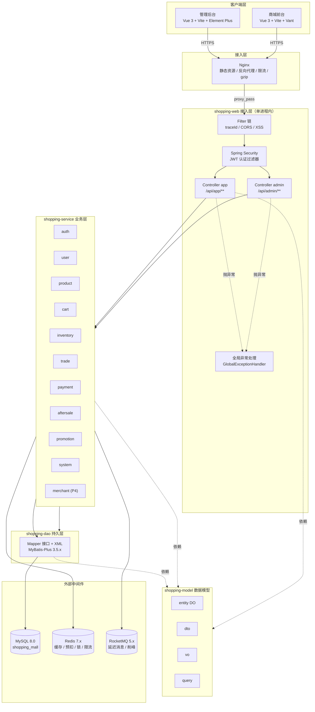

> 图中 `shopping-common` 未画在箭头上，因为它被**所有模块**依赖（详见第 2 章），画进来会让图变糊。

### 1.3 逐层说明

#### 客户端层

- **管理后台**：Vue 3 + Vite + Element Plus，走 `/api/admin/**`。面向运营，做商品管理、订单管理、秒杀活动配置、RBAC 配置。
- **商城前台**：Vue 3 + Vite + Vant，走 `/api/app/**`。面向会员，做浏览、加购、下单、支付、秒杀。
- **为什么两端分开**：接口前缀不同（00 号文档 §6 强制约定），可以让 Spring Security 用两套过滤器链/两套权限模型，管理端要求 `sys_menu` 权限点，C 端只要求登录态。

#### 接入层 Nginx

承担四件事：

1. **静态资源**：Vue 打包产物直接由 Nginx 托管，不打到 Tomcat，省线程。
2. **反向代理**：`/api/**` 转给 `shopping-web`。
3. **限流**：`limit_req_zone` 按 IP 限流，秒杀接口单独一个更严的 zone。
4. **负载均衡**：单机时 `upstream` 只有一个节点，但配置先写好——将来加机器只改 upstream，前端不用动。

**为什么这么做 / 备选 / 代价**：

- 备选：不用 Nginx，Vue 用 devserver 代理、API 直接暴露。
- 代价：多一层转发，约增加 0.1~0.5ms。
- 收益：**秒杀的第一道闸门放在 Nginx**，能在流量打到 JVM 之前就砍掉一部分（ADR-10 三层限流的第一层）；同时演示时「一个域名访问前后台」更专业。

> 注意：Nginx 限流是**单机维度**的，多机部署后每台各自限流，精度会放大。真要在集群维度精确限流必须放到 Redis 层（见第 4.4 节和 8.6 节）。这一点面试时主动说，是加分项。

#### shopping-web（接入层）

- **职责**：只做「协议适配」——参数接收与校验、权限注解、调用 Service、包装 `Result<T>`。**不写业务逻辑，不直接调 Mapper**。
- **内容**：`ShoppingApplication` 启动类、`controller/app`、`controller/admin`、`config`（`SecurityConfig` / `RedisConfig` / `MybatisPlusConfig` / `Knife4jConfig`）、`interceptor`（traceId、限流）、`handler`（全局异常）。
- **启动类放在这一层的原因**：Spring Boot 的组件扫描以启动类所在包 `com.shopping.web` 为起点。把启动类放在 `shopping-web`，再通过 `@SpringBootApplication(scanBasePackages = "com.shopping")` 扫描全项目，是最常见的单体多模块做法。
- **备选**：启动类单独一个 `shopping-boot` 模块。代价是多一个模块、IDE 里跑 main 更绕，收益不明确，**不做**。

#### shopping-service（业务层）

- **职责**：业务规则、事务边界、缓存读写、分布式锁、消息发送。11 个业务模块（含 Phase 4 的 `merchant`）都在这里，每个模块内部再分 `XxxService` 接口 + `impl/XxxServiceImpl`。
- **为什么接口与实现分离**：便于用 Mockito 做单测（06 号文档）、便于 Spring AOP 代理（`@Transactional` / `@DistributedLock` / `@Idempotent` 都靠代理生效）。
- **注意**：`@Transactional` 只在**被代理的外部调用**上生效。同类内部 `this.method()` 调用不走代理，事务失效——这是面试高频追问点，写代码时必须避开（见 3.6）。

#### shopping-dao（持久层）

- **职责**：只有 Mapper 接口 + XML + 分页插件配置。**不写任何 if-else 业务判断**。
- **MyBatis-Plus 3.5.x** 提供单表 CRUD、条件构造器、分页。复杂 SQL（如 `UPDATE wms_stock SET ... WHERE available >= #{num}`）写 XML，因为这类语句要精确控制 SQL 语义。
- **备选**：JPA。ADR-2 已决策：JPA 的脏检查与懒加载在复杂查询里不可控，国内招聘场景 MyBatis-Plus 更常见。

#### shopping-model（数据模型）

- **职责**：`entity`（DO，与表一一对应）、`dto`（入参）、`vo`（出参）、`query`（查询条件）。
- **为什么单独拆一个模块**（00 号文档 §6 已给理由）：如果 DO 放在 `dao`，`service` 就要依赖 `dao` 的类型，`dao` 又需要 `service` 的某些东西时就会循环；把模型提到最底层，`dao` 与 `service` 都只**依赖**它，依赖图变成有向无环（DAG）。
- **约定**：DO 不带业务方法（贫血模型），业务规则放 Service。金额字段一律 `Long` 存**分**（ADR-3）。

#### shopping-common（通用层）

`Result<T>`、`PageResult<T>`、`BizException`、全局异常处理器、枚举、雪花 ID / 金额工具、`@DistributedLock`、`@RateLimit`、`@Idempotent`、traceId（MDC）、消息发送封装 + 本地消息表。

**关键纪律：`common` 里不许有业务代码**（不能 import 任何 `com.shopping.model.entity.PmsSku` 这类具体业务类）。一旦破了这条，`common` 就会变成「什么都往里塞」的垃圾桶，所有模块都依赖它，改一行全项目重编译，模块化就名存实亡。

#### 外部中间件

| 组件 | 用途 | 关键设计 |
|---|---|---|
| MySQL 8.0 | 唯一持久化存储，库名 `shopping_mall` | 所有表含 `id`(雪花)、`create_time`、`update_time`、`deleted` |
| Redis 7.x | 缓存、秒杀预扣（Lua）、分布式锁、限流计数 | key 统一 `shopping:{模块}:{业务}:{标识}` |
| RocketMQ 5.x | 延迟消息（超时关单）、削峰（秒杀异步下单） | Topic 规划见 4.4 与 6 章 |

### 1.4 部署视图

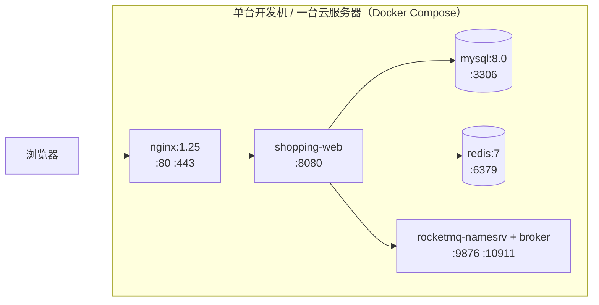

- **为什么用 Docker Compose**：一条 `docker-compose up -d` 拉起 MySQL + Redis + RocketMQ，方便面试现场演示和重置环境。
- **为什么不上 K8s**（00 号文档 §4.1 已排除）：单实例应用没有调度、扩缩容、服务发现的需求，K8s 带来的 YAML 量与排障成本远超收益。
- **本机环境坑**：Docker daemon 默认未启动，跑 RocketMQ 前先起 Docker Desktop；命令行 `java` 是 JDK 8 而 Maven 用 `JAVA_HOME` 的 JDK 17（00 号文档 §9），所有命令统一走 `mvn`。

---

## 2. 模块依赖与边界

### 2.1 依赖图

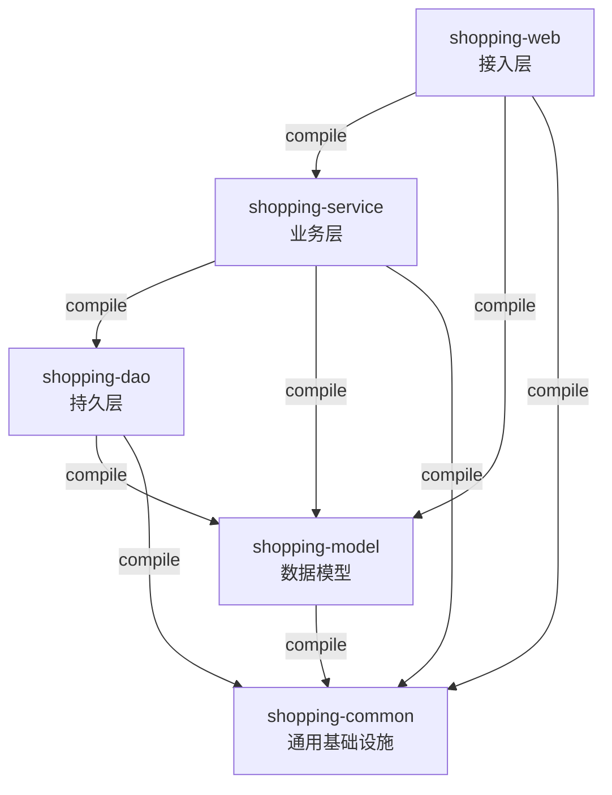

### 2.2 依赖方向规则

**规则 R1（严格单向）**：

```
shopping-web ──> shopping-service ──> shopping-dao ──> shopping-model ──> shopping-common
```

- `web` 可以依赖 `service` / `model` / `common`，**不能**依赖 `dao`（Controller 直接调 Mapper 是分层污染）。
- `service` 可以依赖 `dao` / `model` / `common`，**不能**依赖 `web`。
- `dao` 可以依赖 `model` / `common`，**不能**依赖 `service`。
- `model` 只依赖 `common`，**不能**依赖任何其他业务模块。
- `common` **不依赖任何 `com.shopping` 内部模块**（连 `model` 都不依赖），只依赖第三方库。

**规则 R2（common 全层可见但零业务）**：所有层都可以依赖 `common`，但 `common` 中不允许出现业务实体引用。

**规则 R3（模块间调用只走 Service 接口）**：`trade` 模块要扣库存，只能注入 `com.shopping.service.inventory.StockService` 接口，**不能**注入 `StockMapper`，也不能直接改 `wms_stock`。这样「库存怎么扣」这件事只有 `inventory` 模块知道，将来要加 Redis 预扣、加库存流水，只在 `inventory` 内部改。

**规则 R4（model 只放数据）**：`model` 里的类只有字段 + getter/setter，不写业务方法。业务规则一律在 `service`，避免「DO 里藏着业务逻辑」导致测试和排查困难。

### 2.3 为什么这么分（以及备选与代价）

| 决策 | 备选 | 为什么选它 | 代价 |
|---|---|---|---|
| 拆 5 个 Maven 模块 | 单模块分 package | 编译期就把非法依赖挡住；`mvn -pl shopping-service -am` 可单独构建 | 父 POM 配置量大；IDE 首次导入慢 |
| `model` 独立成模块 | DO 放 `dao` | 消除 `dao` ↔ `service` 循环依赖的唯一可行解 | 多一次模块跳转，找类稍绕 |
| Controller 禁止调 Mapper | 允许灵活调用 | 保证事务、缓存、幂等注解都经过 Service 代理 | 简单查询也要多写一个方法 |

> 反例（面试时可以讲）：如果不拆 `model`，`PmsSku` 这个 DO 会放在 `dao`。`service` 依赖 `dao` 用它是正常的；但某天 `dao` 里想写一个「根据订单状态过滤」的方法，就要 import `oms_order` 的状态枚举 —— 如果那个枚举定义在 `service`，循环依赖立刻出现，Maven 直接编译失败。拆出 `model` 后，枚举和 DO 都在最底层，谁都能用，谁都不会反向依赖。

### 2.4 如何防止循环依赖（落地方案）

光靠自觉不行，要用工具**自动化强制**。项目里同时上两道：

#### 方案一：Maven Enforcer Plugin（构建期，最快失败）

在父 POM 里用 `bannedDependencies` 禁止反向依赖，`extra-enforcer-rules` 的 `banTransitiveDependencies` 可选：

```xml
<plugin>
    <groupId>org.apache.maven.plugins</groupId>
    <artifactId>maven-enforcer-plugin</artifactId>
    <executions>
        <execution>
            <id>enforce-dependency-rules</id>
            <goals><goal>enforce</goal></goals>
            <configuration>
                <rules>
                    <bannedDependencies>
                        <excludes>
                            <!-- shopping-dao 不许依赖 shopping-service -->
                            <exclude>com.shopping:shopping-service</exclude>
                            <exclude>com.shopping:shopping-web</exclude>
                        </excludes>
                        <message>违反分层：dao 不得依赖 service/web</message>
                    </bannedDependencies>
                    <requireJavaVersion>
                        <version>[17,18)</version>
                    </requireJavaVersion>
                    <requireMavenVersion>
                        <version>[3.9,)</version>
                    </requireMavenVersion>
                </rules>
                <fail>true</fail>
            </configuration>
        </execution>
    </executions>
</plugin>
```

每个子模块的 `pom.xml` 里显式声明**自己需要的那几个**依赖（而不是 `shopping-common` 一揽子传递），这样才能被 enforcer 精确校验。**Maven 本身对循环依赖是直接报错的**，所以 enforcer 主要防的是「非法但不成环」的依赖（例如 `dao` 依赖 `web` 不会成环，但违反分层）。

#### 方案二：ArchUnit 单元测试（语义期，表达力更强）

`shopping-web` 或独立 `shopping-test` 下写一个测试类，CI 里跑：

```java
@AnalyzeClasses(packages = "com.shopping", importOptions = ImportOption.DoNotIncludeTests.class)
class LayeredArchitectureTest {

    @ArchTest
    static final ArchRule 分层依赖规则 = layeredArchitecture()
            .consideringOnlyDependenciesInLayers()
            .layer("Web").definedBy("com.shopping.web..")
            .layer("Service").definedBy("com.shopping.service..")
            .layer("Dao").definedBy("com.shopping.dao..")
            .layer("Model").definedBy("com.shopping.model..")
            .layer("Common").definedBy("com.shopping.common..")
            .whereLayer("Web").mayNotBeAccessedByAnyLayer()
            .whereLayer("Service").mayOnlyBeAccessedByLayers("Web")
            .whereLayer("Dao").mayOnlyBeAccessedByLayers("Service")
            .whereLayer("Model").mayOnlyBeAccessedByLayers("Web", "Service", "Dao")
            .whereLayer("Common").mayOnlyBeAccessedByLayers("Web", "Service", "Dao", "Model")
            .because("00 号文档 §6 规定依赖必须严格单向：web -> service -> dao -> model，common 全层可见");

    @ArchTest
    static final ArchRule common不得依赖业务模块 = noClasses()
            .that().resideInAPackage("com.shopping.common..")
            .should().dependOnClassesThat()
            .resideInAnyPackage("com.shopping.service..", "com.shopping.dao..",
                                "com.shopping.web..", "com.shopping.model..")
            .because("common 必须保持零业务，否则会变成垃圾桶模块");

    @ArchTest
    static final ArchRule Controller不得直接依赖Dao = noClasses()
            .that().resideInAPackage("com.shopping.web.controller..")
            .should().dependOnClassesThat().resideInAPackage("com.shopping.dao..")
            .because("Controller 直接调 Mapper 会绕过事务/缓存/幂等代理");
}
```

#### 两个方案的分工

| 维度 | Maven Enforcer | ArchUnit |
|---|---|---|
| 生效时机 | `mvn validate`，构建最早期，最快 | 单元测试阶段，稍晚 |
| 检查粒度 | 模块级（哪个 artifact 依赖哪个） | 包级 / 类级 / 方法级 / 注解级 |
| 能否检查包内结构 | 否 | 能（如「`..impl..` 只能被 `..` 访问」） |
| 结论 | **必做**，是底线 | **推荐做**，是加分项，也是面试谈资 |

> 面试话术：「架构约束如果只写在文档里，三个月后一定腐化。所以我用 Maven Enforcer 在构建期做模块级红线，用 ArchUnit 在测试期做包级红线，违反就构建失败——让约束变成**编译错误**而不是**代码评审意见**。」

---

## 3. 一次请求的完整生命周期

以「**会员下单**」为例：`POST /api/app/trade/orders`，请求体含 `addressId`、`cartItemIds`、可选 `couponRecordId`。

### 3.1 时序图

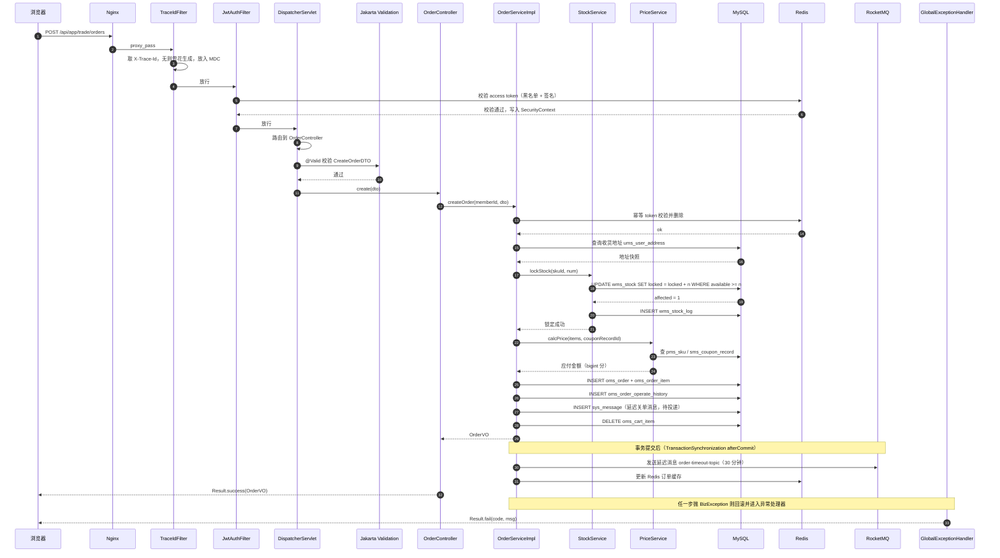

### 3.2 逐跳说明

**第 1 跳：Nginx 分发**。根据 `location /api/` 转发到 `shopping-web:8080`。秒杀接口 `/api/app/seckill/**` 使用单独的 `limit_req_zone`。

**第 2 跳：`TraceIdFilter`（`common.trace`）**。优先级 `Ordered.HIGHEST_PRECEDENCE`。逻辑：

1. 读请求头 `X-Trace-Id`，有就复用（便于前端串日志），没有就生成雪花 ID；
2. `MDC.put("traceId", traceId)`；
3. 塞回响应头 `X-Trace-Id`，方便前端报障时截图；
4. `finally` 中 `MDC.remove("traceId")`——**必须清理**，否则线程池复用会让上一个请求的 traceId 泄漏到下一个请求。

**第 3 跳：`JwtAuthFilter`（Spring Security 过滤器链）**。从 `Authorization: Bearer <accessToken>` 取 token，校验签名与过期，查 Redis 黑名单（登出/踢人），通过后构造 `Authentication` 放入 `SecurityContextHolder`。失败则返回 401，交给 `AuthenticationEntryPoint`。

**第 4 跳：`DispatcherServlet` 路由**。`HandlerMapping` 按路径找到 `OrderController#create`，`HandlerAdapter` 处理参数绑定（`@RequestBody` 用 Jackson 反序列化）。

**第 5 跳：参数校验**。`@Valid @RequestBody CreateOrderDTO` 触发 Jakarta Validation，在 `dto` 上用 `@NotNull` / `@NotEmpty` / `@Min` 声明规则。校验失败抛 `MethodArgumentNotValidException`，由全局异常处理器转成 `Result.fail(400, msg)`。

**第 6 跳：Controller**。只做三件事：取当前登录 `memberId`（从 `SecurityContext` 或自定义 `@CurrentUser` 注解）、调 Service、`Result.success(vo)`。**不写业务判断**。

**第 7 跳：Service 与事务边界**。`createOrder` 标 `@Transactional(rollbackFor = Exception.class)`。事务范围**必须包含**：锁库存、算价、写 `oms_order` / `oms_order_item` / `oms_order_operate_history` / `sys_message`、清购物车。

> **关键取舍**：**发 MQ 不能在事务内**。如果先发消息后提交事务，消息可能先于数据被消费（消费者查不到订单）；如果先提交后发消息、发失败又丢消息。正确做法是**本地消息表**：事务内只往 `sys_message` 落一条待投递记录（与业务数据同一事务，天然原子），事务提交后由投递器发送到 RocketMQ（`TransactionSynchronizationManager.registerSynchronization` 的 `afterCommit` 或定时扫表）。详见第 6 章。

**第 8 跳：DAO**。`OrderMapper.insert(order)`、`StockMapper.lockStock(...)`。条件扣减 SQL 在 XML 里手写，保证「判断 + 扣减」是一条原子语句。

**第 9 跳：返回**。`Result<OrderVO>` 由 Jackson 序列化为 JSON。金额字段是 `Long` 分，前端负责展示转换（或后端在 VO 里额外给一个 `priceYuan` 字符串便于演示）。

**第 10 跳：异常路径**。任何 `BizException` 冒泡到 `GlobalExceptionHandler`，统一转 `Result`，`error` 级别日志带 traceId 与堆栈；`Exception` 兜底脱敏（不把 SQL 异常原文返回前端）。

### 3.3 事务边界图

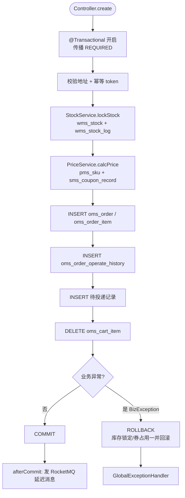

### 3.4 为什么事务范围要这么划

- **备选 A：在整个方法上加 `@Transactional`，MQ 也发在里面**。问题：MQ 发送是外部 IO，长事务持锁（`wms_stock` 行锁）时间变长，秒杀场景直接放大冲突；且发送失败会让 DB 回滚，但消息可能已经投递（不可回滚）。
- **备选 B：完全不用事务，靠补偿**。问题：写订单和锁库存之间失败会留下「订单存在但没锁库存」的脏状态，补偿逻辑复杂得多。
- **本方案**：**DB 内的写操作全在一个事务里**（保证强一致），**跨进程的 MQ 用本地消息表**（保证最终一致）。这是「尽可能缩短事务、把不确定性赶出事务」的典型取舍。

### 3.5 全链路耗时预算（面试可以给数字）

| 环节 | 目标耗时 | 说明 |
|---|---|---|
| Nginx 转发 | < 1 ms | 同机 |
| 过滤器链（traceId + JWT） | < 3 ms | JWT 校验含一次 Redis 黑名单 GET |
| 参数校验 + 序列化 | < 2 ms | |
| 锁库存（一条 UPDATE） | 2~10 ms | 有行锁竞争时上升 |
| 算价（2~3 次索引查询） | 3~8 ms | 走 Redis 缓存后 < 2 ms |
| 订单 3 张表 INSERT | 5~15 ms | 含雪花 ID 生成 |
| 清购物车 | 2~5 ms | |
| **合计（单机、无竞争）** | **目标 TP99 < 150 ms** | 压测在 Phase 3 产出真实数据 |

### 3.6 事务失效的几个坑（务必避开）

1. **同类内部调用**：`OrderServiceImpl` 里 `this.lockStock()` 如果自己标了 `@Transactional`，**不生效**（不走代理）。解决：拆到另一个 Service，或注入自身代理（`AopContext.currentProxy()`）。
2. **异常被吞**：`catch (Exception e) { log.error(e); }` 之后不抛，事务不会回滚。解决：`rollbackFor = Exception.class` 且异常必须抛出。
3. **方法不是 public**：Spring AOP 代理默认只拦 public 方法。
4. **多线程**：`@Transactional` 是基于 ThreadLocal 绑定连接的，事务里 `new Thread()` 写库不在同一事务。解决：拆成两次事务 + 补偿，或干脆不并发。
5. **异常被包装**：抛了 `BizException extends RuntimeException` 没问题；但如果抛的是受检异常且没写 `rollbackFor`，默认不回滚。

---

## 4. 核心链路设计

四条链路：下单主链路、支付回调链路、超时关单与库存回滚、秒杀链路。

### 4.1 下单主链路

**目标**：把「用户想买」变成「一笔待支付的订单 + 已锁定的库存 + 已占用的优惠券」，且任何一步失败都能干净回滚。

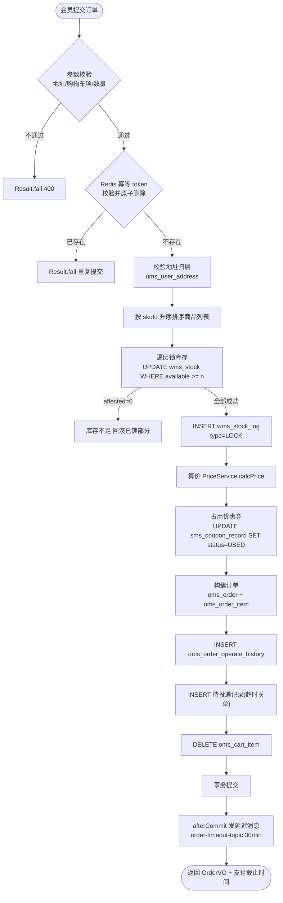

**为什么排序**：所有并发下单请求按 `skuId` 升序锁库存，避免「请求 A 锁 SKU1 等 SKU2、请求 B 锁 SKU2 等 SKU1」的**死锁**。这是经典做法，面试可讲。

**锁库存 SQL（`wms_stock`）**：

```sql
UPDATE wms_stock
   SET locked = locked + #{num},
       update_time = NOW()
 WHERE sku_id = #{skuId}
   AND deleted = 0
   AND available - locked >= #{num}
```

- 一条语句完成「判断 + 扣减」，依赖 InnoDB 行锁保证原子。返回 `affected = 0` 就是库存不足。
- **备选 A：先 `SELECT ... FOR UPDATE` 再 `UPDATE`**（悲观锁）。问题：两次网络往返，且锁持有时间更长。
- **备选 B：乐观锁版本号**（`WHERE version = #{version}`）。问题：秒杀下大量重试，失败率飙升，用户体验差。
- **本方案（ADR-6）**：条件更新 = 隐式乐观锁，没有版本号字段、没有重试循环，失败即库存不足，语义清晰。**代价**：热点 SKU 的行锁会串行化，所以秒杀场景必须先经 Redis 预扣把流量降到 DB 能承受的水平（4.4 节）。

**库存流水 `wms_stock_log`（幂等核心）**：每次库存变更都写一条流水，字段含 `sku_id`、`type`（LOCK / DEDUCT / RELEASE）、`num`、`biz_no`（业务单号，如订单号），并在 `(biz_no, sku_id, type)` 上建**唯一索引**。这样「回滚同一笔订单的库存」重复执行第二次会撞唯一索引，天然幂等。

**清理购物车的边界**：只删**本次下单的 `cartItemIds`**，不能按 `member_id` 全删（用户可能同时在两个设备上购物）。

**发延迟消息的时机**：必须在 `afterCommit`。原因见 3.2 第 7 跳与第 6 章。

### 4.2 支付回调链路

**背景**：Phase 2 **不接任何真实支付渠道**，而是**自建一个模拟支付网关**（接口契约完全对标支付宝，所以设计层面的讲解价值不变，只是不再需要外部账号）。真实第三方支付的行为特征必须模拟到位，否则链路没有意义：**异步回调**、**可能重复回调**、**可能伪造回调**、**必须验签**、**必须返回成功否则渠道重推**。

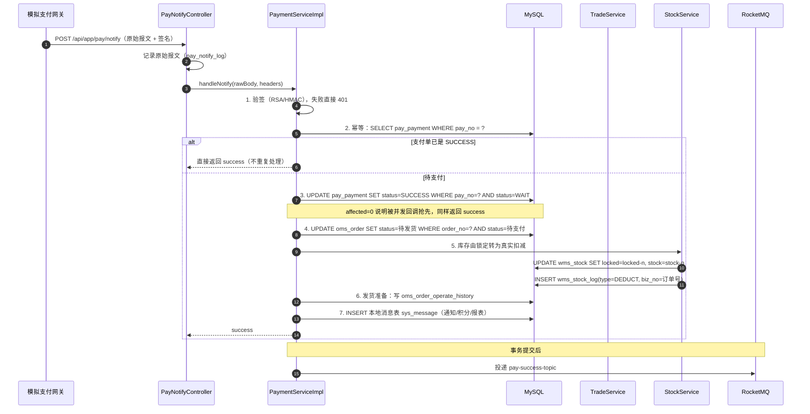

**第 1 步 · 验签**。用模拟支付网关（对标支付宝）约定的公私钥 / HMAC 密钥校验报文签名。**失败立即拒绝并记 `pay_notify_log`**，返回非 success，让渠道重试——**真实平台会按策略重推（最长可重推 24 小时、共 25 次）**，所以「返回非 success」不是随手写的兜底，而是一个明确的可重试信号；反过来，**处理成功就必须返回约定的 success，否则渠道会一直重推同一条报文**。

**第 2 步 · 幂等（本链路的核心）**。第三方支付回调**天然会重复**（超时重推、网络抖动）。手段是**状态机前置校验 + 条件更新**双保险：

- 先 `SELECT` 支付单，若已是 `SUCCESS` 直接返回成功；
- 再用 `UPDATE ... WHERE status = 'WAIT'` 的条件更新，`affected = 0` 也返回成功。

**为什么两者都要**：`SELECT` 挡掉绝大多数重复；但两个回调**并发**到达时都可能读到 `WAIT`，此时条件更新是最后一道原子防线。

**第 3 步 · 更新订单**。同样用条件更新：`WHERE order_no = ? AND status = '待支付'`。这样即使订单已经被超时关单（见 4.3），回调也不会把已关闭订单改成待发货——**这是一致性的关键防线**。此时应触发**退款**流程（`pay_refund`），因为钱收了但单关了。

**第 4 步 · 库存类型转换**。下单时是 `locked` 增加（锁定），支付成功后转成真实扣减：`stock = stock - n, locked = locked - n`。写 `wms_stock_log` 时 `type = DEDUCT`，靠唯一索引保证不重复扣。

**第 5 步 · 本地消息表**。事务内落 `sys_message`，`afterCommit` 投递，用于后续通知类动作（会员积分、消息推送、报表统计）。**这些动作不在支付主链路的强一致范围内**，即使失败也不影响「钱收了、货备了」这个核心结果。

**回调接口为什么不能要求登录鉴权**：它在 `/api/app/pay/notify`，必须从 Spring Security 白名单放行（第三方没有用户 token）。**安全靠验签而不是靠 token**——这一点面试常被追问。

### 4.3 超时关单与库存回滚

**目标**：订单创建后 30 分钟未支付，自动关单并释放库存与优惠券。用 **RocketMQ 延迟消息**（ADR-5），不用 `@Scheduled` 扫表。

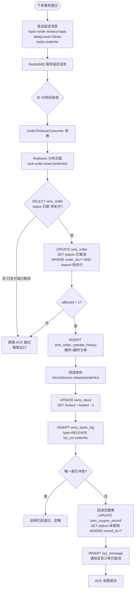

**为什么用延迟消息而不是 `@Scheduled` 扫表**（ADR-5 的面试追问点）：

| 维度 | RocketMQ 延迟消息 | `@Scheduled` 扫表 |
|---|---|---|
| 精度 | 接近 30 分钟准点 | 取决于扫描间隔（如 1 分钟），最差延迟 1 分钟 |
| DB 压力 | 无额外压力 | 每分钟全表扫 `status = 待支付`，订单表越大越慢 |
| 水平扩展 | 天然多消费者 | 多实例会重复处理，要加分布式锁 |
| 复杂度 | 需要 MQ（本来就有） | 简单 |
| 结论 | **本项目选它** | 备选方案，可作为 MQ 不可用时的降级兜底 |

> **降级兜底**：真实项目里两者会**同时存在**——延迟消息为主，`@Scheduled` 每天凌晨扫一次「超过 2 小时仍未关闭的待支付订单」作为补偿。面试时主动说这个，体现「不假设中间件永远可用」的意识。

**幂等三道防线（本链路必讲）**：

1. **状态机前置校验**：订单已经是 `已支付` / `已取消` 就直接 ACK，不做事。这是 ADR-4 状态机的价值——**非法流转在入口就被挡住**。
2. **条件更新**：`WHERE status = '待支付'`，靠 `affected` 判断是不是我抢到的。
3. **库存流水唯一索引**：`wms_stock_log(biz_no, sku_id, type)` 唯一，重复回滚直接冲突忽略。

**为什么还要 Redisson 锁**：RocketMQ 保证「至少一次」投递，同一订单可能被并发消费（重平衡、重试）。锁把同一订单串行化，减少无谓冲突；但**锁不是幂等的依靠**，锁失效时上面三道防线仍能保证正确。**只靠锁做幂等是错的**（锁有超时、有失效），这个观点面试时说出来很加分。

**回滚优惠券的细节**：只回滚**本订单实际占用**的那张（按 `record_id`），不能按 `member_id` 批量改（用户可能有多张券）。如果订单用了券但券已过期，回滚到「未使用」时要注意判断有效期。

### 4.4 秒杀链路（全项目最大亮点）

**场景**：活动开始瞬间 100 万人抢 100 件商品，必须**不超卖、不拖垮 DB、用户能得到明确结果**。

**核心思想：流量分层过滤 + 异步下单**。让尽可能多的请求消失在便宜的层（Nginx / Redis），只有中签的极少数请求能碰到 MySQL。

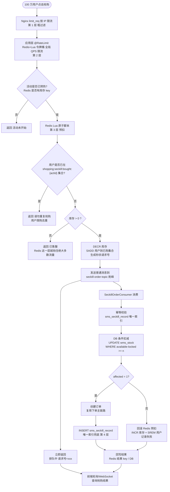

#### 4.4.1 活动预热（T-10 分钟）

前置定时任务（活动开始前 10 分钟）执行：

1. 从 `sms_seckill_activity` + `sms_seckill_sku` 读活动与秒杀库存；
2. `SET shopping:seckill:stock:{activityId}:{skuId} <库存>`（String 类型，`DECR` 用）；
3. `SET shopping:seckill:activity:{activityId} <活动信息JSON>`，TTL 到活动结束 + 1 小时；
4. 清理上一轮的 `shopping:seckill:bought:{activityId}` 集合；
5. **预热幂等**：先 `SETNX shopping:seckill:warm:{activityId}`，避免多实例重复预热。

**为什么必须预热**：活动开始的瞬间如果 Redis 里没有库存，所有请求都会穿透到 MySQL 做校验，Redis 就失去了挡流量的意义。预热是「把读压力提前到低峰期」。

**备选**：不预热，用 Redis 懒加载（第一次请求时从 DB 读并 `SETNX`）。问题：活动开始瞬间大量请求同时 miss，形成「缓存击穿 + 惊群」，正是我们要避免的。

#### 4.4.2 第 1 层：Nginx 限流

```nginx
limit_req_zone $binary_remote_addr zone=seckill_ip:10m rate=5r/s;
location /api/app/seckill/ {
    limit_req zone=seckill_ip burst=10 nodelay;
    limit_req_status 429;
    proxy_pass http://shopping_backend;
}
```

- 单 IP 5 req/s，突发 10。挡掉脚本刷单和误触连点。
- **代价**：多机部署后每台 Nginx 各自限流，且公司出口 IP 的多人会被误伤。所以它只是**第 1 层粗过滤**，不是最终手段。

#### 4.4.3 第 2 层：应用层全局限流 `@RateLimit`

`common.limit` 提供的注解，基于 Redis + Lua 实现令牌桶/滑动窗口，**全局维度**（key 里不含 IP），控制住整个集群打到秒杀 Service 的 QPS：

```java
@RateLimit(key = "shopping:limit:seckill:submit", qps = 2000, strategy = RateLimitStrategy.SLIDING_WINDOW)
@PostMapping("/api/app/seckill/{activityId}/submit")
public Result<SeckillResultVO> submit(@PathVariable Long activityId,
                                      @RequestParam Long skuId,
                                      @RequestParam Long seckillSkuId) { ... }
```

**为什么 Redis + Lua**：`INCR` + `EXPIRE` 是两条命令，非原子，高并发下窗口边界会出现计数丢失；Lua 脚本在 Redis 单线程内执行，天然原子。

#### 4.4.4 第 3 层：Redis Lua 原子预扣（核心）

**一次 Lua 调用完成四件事**，保证原子性：

```lua
-- KEYS[1] = shopping:seckill:stock:{activityId}:{skuId}
-- KEYS[2] = shopping:seckill:bought:{activityId}
-- ARGV[1] = memberId
-- ARGV[2] = 限购数量
-- 返回: 0=成功, 1=库存不足, 2=重复购买, 3=活动不存在

if redis.call('EXISTS', KEYS[1]) == 0 then
    return 3
end

-- 用户限购去重：SISMEMBER 在 Set 里
if redis.call('SISMEMBER', KEYS[2], ARGV[1]) == 1 then
    return 2
end

local stock = tonumber(redis.call('GET', KEYS[1]))
if stock == nil or stock <= 0 then
    return 1
end

redis.call('DECR', KEYS[1])
redis.call('SADD', KEYS[2], ARGV[1])
redis.call('EXPIRE', KEYS[2], 86400)
return 0
```

**为什么用户去重也放 Lua 里**：如果先 `SISMEMBER` 判断、再 `SADD`，两次调用之间有窗口，同一用户并发点两次会都通过判断。放进 Lua 就和扣库存一样原子了。

**为什么用 `DECR` 而不是先 `GET` 再 `SET`**：`GET`+`SET` 是两条命令，中间会被其他请求插入，必然超卖。`DECR` 是原子操作，且返回值 `-1` 就代表卖光，用 `lua` 里的 `GET` 判断加 `DECR` 也行（本脚本这么写是为了区分「售罄」和「不存在」两种返回码）。

**代价与风险（面试必答）**：

| 风险 | 后果 | 应对 |
|---|---|---|
| Redis 宕机 | 预扣全丢 | 上层直接返回「活动繁忙」快速失败，**不能降级直连 DB**（DB 必然被打穿）；秒杀库存以 DB 为准，Redis 只做挡板 |
| Redis 与 DB 不一致 | 可能少卖（Redis 扣了 DB 没扣） | 消费者回滚 Redis 预扣；对账任务兜底 |
| Lua 脚本变大 | 阻塞 Redis 单线程 | 脚本保持极简，只做判断 + 2 条写命令 |
| 活动结束时残留 key | 内存泄漏 | 所有秒杀 key 都带 TTL |

**关键认知**：**Redis 预扣只是「入场券」，不是权威库存**。真正的防超卖底线在 DB（4.4.6）。这样即使 Redis 数据错了，也不会超卖——这个认知是秒杀设计的核心，面试时一定要说出来。

#### 4.4.5 MQ 削峰

预扣成功后立刻发消息到 `seckill-order-topic`，**同步返回前端「排队中」**。

- **为什么用普通消息不用事务消息**：因为 Redis 预扣和发消息之间没有跨库事务需求——发消息失败时，Redis 库存已经扣了，靠**对账任务**补偿（把 Redis 已扣但无成功记录的请求回滚）。用事务消息反而拖长 RT。
- **Topic / Tag 规划**：`seckill-order-topic` + tag = `activityId % 队列数`，保证**同一活动的消息进同一队列**（顺序消费），避免同一活动内库存乱序。
- **消费者参数**：`consumeThreadMax` 按 DB 承载能力调（例如 32），`consumeMessageBatchMaxSize = 1`。
- **前端怎么拿结果**：方案 A 轮询 `GET /api/app/seckill/result/{requestNo}`（简单，首选）；方案 B WebSocket / SSE 推送（体验好，实现重）。本项目选 A，并限制轮询频率（1 秒 1 次）+ 结果 key 设 5 分钟 TTL。

#### 4.4.6 第 4 层：DB 条件扣减 + 唯一索引兜底

消费者里做三件事：

```sql
-- 1) 幂等入口：sms_seckill_record 唯一索引 (activity_id, member_id, seckill_sku_id)
--    先 INSERT，冲突则说明已处理过，直接 ACK
INSERT INTO sms_seckill_record (id, activity_id, member_id, seckill_sku_id, order_no, status, ...)
VALUES (?, ?, ?, ?, ?, 'PROCESSING', ...);

-- 2) DB 侧条件扣减（真正的防超卖底线）
UPDATE wms_stock
   SET locked = locked + #{num}
 WHERE sku_id = #{skuId}
   AND deleted = 0
   AND available - locked >= #{num};

-- 3) 扣减成功则复用下单主链路创建订单，回写 record.status = SUCCESS
```

**为什么唯一索引是「兜底」而不是「主手段」**：唯一索引只能保证**不重复下单**，不能保证**不超卖**。防超卖靠 `UPDATE ... WHERE available - locked >= num` 的条件扣减。两者职责不同，必须都有：

| 防线 | 防的是 | 手段 |
|---|---|---|
| Redis 预扣 | 超卖（99%）+ 拖垮 DB | Lua 原子 DECR + SISMEMBER |
| MQ 削峰 | 瞬时流量 | 异步化，DB 按自己的节奏消费 |
| DB 条件扣减 | 超卖（最后 1%） | `WHERE available - locked >= num` |
| `sms_seckill_record` 唯一索引 | 重复下单 | `UNIQUE(activity_id, member_id, seckill_sku_id)` |

**逻辑删除与唯一索引的冲突**（ADR-8 的追问点）：项目里表都有 `deleted` 字段。如果用户在秒杀里取消过、又重抢，`deleted` 字段会破坏唯一性判断。做法：**`sms_seckill_record` 这类「防重表」不参与逻辑删除**，它的语义是「这个人这次活动抢过」，抢过就该被记住；`deleted` 字段保留但不使用（或者这张特殊表不加 `deleted`，需要在 02 号 DDL 文档里明确标注）。这是「通用规范要有例外」的典型例子，面试讲出来很显功底。

#### 4.4.7 秒杀结果的四种终态

| 状态 | 触发条件 | 前端展示 |
|---|---|---|
| `QUEUING` | 已进 MQ，等待消费 | 「排队中，请稍候」 |
| `SUCCESS` | 扣减成功、订单已创建 | 跳转支付页 |
| `SOLD_OUT` | Redis 预扣失败 / DB 扣减失败 | 「已售罄」 |
| `FAILED` | 参数错误、活动已结束、重复购买 | 具体原因 |

**回滚 Redis 预扣的时机**：DB 扣减失败时 `INCR` 库存 + `SREM` 用户。这一步可能失败（Redis 短暂不可用），所以设计一个**对账定时任务**：每 5 分钟扫 `sms_seckill_record` 中 `status = PROCESSING` 且超过 2 分钟的记录，与 Redis 库存比对并修正。**对账是最终一致的最后一道保险**，面试必讲。

#### 4.4.8 秒杀压测目标（Phase 3 产出真实数据）

| 指标 | 目标 | 说明 |
|---|---|---|
| 单机 QPS（抢购接口） | ≥ 5000 | 绝大多数请求在 Redis 层返回 |
| TP99 响应时间 | < 100 ms | 同步返回「排队中」很快 |
| 超卖数量 | **0** | 硬性红线 |
| MySQL 峰值 QPS | < 2000 | 削峰效果的直接证据 |
| 订单创建成功率 | 100%（对中签者） | 有对账兜底 |

> 面试时给数字比给架构图更有说服力：**「压测前 MySQL 峰值 1.2 万 QPS、超卖 3 件；加了 Redis Lua 预扣 + MQ 削峰后，MySQL 峰值降到 1800 QPS，超卖 0 件，抢购接口 TP99 从 1.8s 降到 68ms。」** 这样的句子要多准备几句。

---

## 5. 缓存设计

### 5.1 Key 命名规范

**统一格式**：`shopping:{模块}:{业务}:{标识}`

- 全部小写，冒号分隔，用模块代码（`auth/user/product/cart/inventory/trade/payment/promotion/aftersale/merchant/system`）；
- 用 `:` 而不是 `_` 或 `-`，因为 Redis Cluster 用 `{}` 做 hash tag，`:` 是社区事实标准；
- **必须有前缀 `shopping:`**：本机 Redis 可能有其他项目的 key，前缀便于 `SCAN shopping:*` 排查与清理；
- **禁止 `KEYS *`**，排查用 `SCAN`（`KEYS` 会阻塞单线程 Redis）。

### 5.2 核心 key 清单

| Key 模板 | 数据结构 | TTL | 用途 | 更新策略 |
|---|---|---|---|---|
| `shopping:product:detail:{spuId}` | String(JSON) | 30min + 随机 0~5min | 商品详情（SPU+SKU+属性） | 主动删除 + 懒加载 |
| `shopping:product:sku:{skuId}` | String(JSON) | 30min + 随机 | SKU 基础信息与价格 | 上下架/改价时删除 |
| `shopping:product:category:tree` | String(JSON) | 2h + 随机 | 类目树（低频变更） | 定时刷新 |
| `shopping:product:stock:{skuId}` | String(number) | 10min | 商品页展示库存 | 变更时删除 |
| `shopping:cart:{memberId}` | Hash(skuId → JSON) | 7 天 | 购物车（可考虑直接落库，见 5.6） | 写时同步 |
| `shopping:inventory:lock:{orderNo}` | String | 30min | 下单锁库存标记 | 关单/支付时删除 |
| `shopping:trade:order:{orderNo}` | Hash | 2h | 订单详情缓存 | 状态变更时删除 |
| `shopping:trade:timeout:{orderNo}` | String | 35min | 超时关单兜底标记 | 过期自动 |
| `shopping:seckill:activity:{activityId}` | String(JSON) | 活动结束 + 1h | 秒杀活动信息 | 预热写入 |
| `shopping:seckill:stock:{activityId}:{skuId}` | String(number) | 活动结束 + 1h | 秒杀库存（DECR） | 预热写入 + Lua 扣减 |
| `shopping:seckill:bought:{activityId}` | Set(memberId) | 24h | 已抢购用户去重 | Lua SADD |
| `shopping:seckill:result:{requestNo}` | String(JSON) | 5min | 秒杀结果轮询 | 消费者写入 |
| `shopping:seckill:warm:{activityId}` | String | 2h | 预热幂等锁 | SETNX |
| `shopping:coupon:record:{memberId}` | ZSet | 1h | 我的优惠券列表 | 领券/用券时删除 |
| `shopping:auth:token:blacklist:{jti}` | String | 剩余有效期 | 登出/踢人黑名单 | 登出时写入 |
| `shopping:auth:refresh:{memberId}` | String | 7 天 | refreshToken 白名单 | 登录写入，刷新时轮转 |
| `shopping:lock:order:close:{orderNo}` | Redisson 锁 | 30s（看门狗续期） | 关单串行化 | Redisson 自动 |
| `shopping:limit:seckill:submit` | String(计数) | 1s | 秒杀全局限流 | Lua 滑动窗口 |

**TTL 为什么带随机**：见 5.4 缓存雪崩。**为什么商品详情 30 分钟**：商品数据变更频率远低于读取频率，30 分钟能保证 95%+ 命中率，同时最长 30 分钟就能看到运营的修改；改价、上下架这类**敏感操作走主动删除**，不依赖 TTL。

### 5.3 缓存穿透（查不到的数据反复打 DB）

**问题**：恶意请求 `spuId = -1` 或不存在的大 ID，缓存永远不命中，每次都打 MySQL。

**方案一：空值缓存（必做）**

查库为空时，往 Redis 写一个特殊标记（如 `"NULL"` 字符串），TTL 短一些（**2 分钟**）：

```java
String key = "shopping:product:detail:" + spuId;
String json = redis.get(key);
if (json != null) {
    return "NULL".equals(json) ? null : JSON.parseObject(json, ProductDetailVO.class);
}
ProductDetailVO vo = loadFromDb(spuId);
if (vo == null) {
    redis.set(key, "NULL", 2, TimeUnit.MINUTES);   // 空值缓存
    return null;
}
redis.set(key, JSON.toJSONString(vo), 30 + ThreadLocalRandom.current().nextInt(300), TimeUnit.SECONDS);
return vo;
```

- **TTL 为什么短**：如果运营刚好在缓存空值的 2 分钟内上架了商品，用户 2 分钟后就能看到了，感知不明显。
- **代价**：Redis 里会存大量 `"NULL"`，被恶意构造大量随机 ID 时占内存。所以还要配合方案二。
- **怎么区分「真空值」和「缓存故障」**：Redis 不可用时返回 null 会导致「短暂显示商品不存在」。做法是 **Redis 异常时降级直查 DB**，而不是返回 null（`try/catch` 包住缓存读）。

**方案二：布隆过滤器（加分项）**

把所有合法的 `spuId` 预热进 Redis 的布隆过滤器（`BF.ADD`，需要 RedisBloom 模块；没有模块时用 `SETBIT` 手写或用 Guava `BloomFilter` 放本地）：

```java
// 本地 Guava 布隆过滤器（错误率 1%，预计 10 万商品）
BloomFilter<Long> spuBloom = BloomFilter.create(Funnels.longFunnel(), 100_000, 0.01);

// 查询前先过布隆
if (!spuBloom.mightContain(spuId)) {
    return null;      // 一定不存在，直接返回，不查库
}
```

- **特点**：说「不存在」一定准，说「存在」有误判率（1%），误判只是多查一次库，不影响正确性。
- **代价**：布隆过滤器**不支持删除**（删掉 SPU 后过滤器里还在），需要定期重建（每天凌晨全量重建一个，用双缓冲切换）。所以它只作为**第一道筛子**，空值缓存才是主力。
- **运维视角**：本地布隆过滤器在多实例下各存一份，新上架商品需要等重建才生效——这也是它只能做辅助的原因。

### 5.4 缓存击穿（热点 key 过期瞬间）

**问题**：某个爆款商品 key 刚好过期，同时几万个请求都 miss，全部涌向 DB。

**方案一：逻辑过期（本项目主选）**

缓存 value 里带一个 `expireAt` 字段，**Redis key 本身永不过期**：

```json
{ "data": { ...商品详情... }, "expireAt": 1735660800000 }
```

读取逻辑：

```java
ProductDetailVO readWithLogicalExpire(Long spuId) {
    String json = redis.get("shopping:product:detail:" + spuId);
    if (json == null) {
        return null;   // 真正冷启动，走 5.5 的加载流程
    }
    ProductCache cache = JSON.parseObject(json, ProductCache.class);
    if (cache.getExpireAt() > System.currentTimeMillis()) {
        return cache.getData();                       // 未逻辑过期，直接返回
    }
    // 已逻辑过期：尝试抢互斥锁去重建，抢不到的直接返回旧数据
    if (redis.setIfAbsent("shopping:lock:product:rebuild:" + spuId, "1", Duration.ofSeconds(10))) {
        try {
            ProductDetailVO fresh = loadFromDb(spuId);
            redis.set(key, wrap(fresh, 30, TimeUnit.MINUTES));   // 重置逻辑过期时间
            return fresh;
        } finally {
            redis.delete("shopping:lock:product:rebuild:" + spuId);
        }
    }
    return cache.getData();   // 拿不到锁 → 返回旧数据，绝不打 DB
}
```

- **优点**：**用户永不等待**，即使重建失败也返回旧数据；DB 压力被压到「每 30 分钟一次重建」。
- **代价**：一段时间内返回的是**旧数据**（这里是商品详情，可接受；**订单、库存这类强一致场景绝不能这么用**）。
- **适用判断**：读多写极少、能容忍短暂旧数据的场景。这是它的适用边界，面试要主动划清。

**方案二：互斥锁（备选，用于不能返回旧数据的场景）**

```java
String json = redis.get(key);
if (json != null) return parse(json);
// 双检：抢到锁的线程才查库，其他线程自旋等待
if (redis.setIfAbsent(lockKey, "1", Duration.ofSeconds(5))) {
    try {
        String again = redis.get(key);           // 双重检查，可能已被上一个持锁者写入
        if (again != null) return parse(again);
        Object vo = loadFromDb(id);
        redis.set(key, toJson(vo), 30, TimeUnit.MINUTES);
        return vo;
    } finally {
        redis.delete(lockKey);
    }
} else {
    Thread.sleep(50);
    return readWithMutex(id);   // 自旋重试，注意加最大重试次数
}
```

- **代价**：其他线程要**等待**（RT 变长），且自旋要有上限（否则线程池被占满）。
- **为什么这里用 `setIfAbsent` 手写锁而不用 Redisson**：重建耗时短（一次 DB 查询），不需要看门狗续期，`SET NX PX` 足够且更轻。**Redisson 用在业务级分布式锁**（如 `shopping:lock:order:close:{orderNo}`），因为需要自动续期和可重入。

### 5.5 缓存雪崩（大量 key 同时失效 / Redis 挂掉）

**方案一：TTL 加随机（必做）**

```java
int baseTtlSeconds = 30 * 60;
int jitter = ThreadLocalRandom.current().nextInt(0, 300);   // 0~5 分钟随机
redis.set(key, value, baseTtlSeconds + jitter, TimeUnit.SECONDS);
```

这样同一批预热的数据不会在同一秒集体过期，过期时间被摊平在 5 分钟窗口里。

**方案二：多级缓存（本地 + Redis，进阶）**

- 本地用 Caffeine 存**极热点**数据（类目树、秒杀活动信息），TTL 更短（如 30 秒），Redis 挂掉时本地还能顶一小会儿。
- **代价**：多实例本地缓存不一致，需要靠短 TTL 自然收敛。所以只放**变更极少、能容忍 30 秒不一致**的数据。

**方案三：Redis 高可用与降级**

- 部署上至少主从 + Sentinel（本项目演示环境单机，但架构文档里说明生产做法）。
- **应用侧限流保护**：Redis 不可用时，用 `@RateLimit` 的本地降级策略（Guava `RateLimiter`）限制打到 DB 的 QPS，避免「缓存挂了 → DB 被全量流量打穿 → 整个系统崩」的雪崩连锁。
- **熔断**：连续 N 次 Redis 超时后短暂跳过缓存直查 DB（并限流），而不是无限等待。

### 5.6 商品详情缓存的读 / 写流程

**读流程（Cache Aside）**

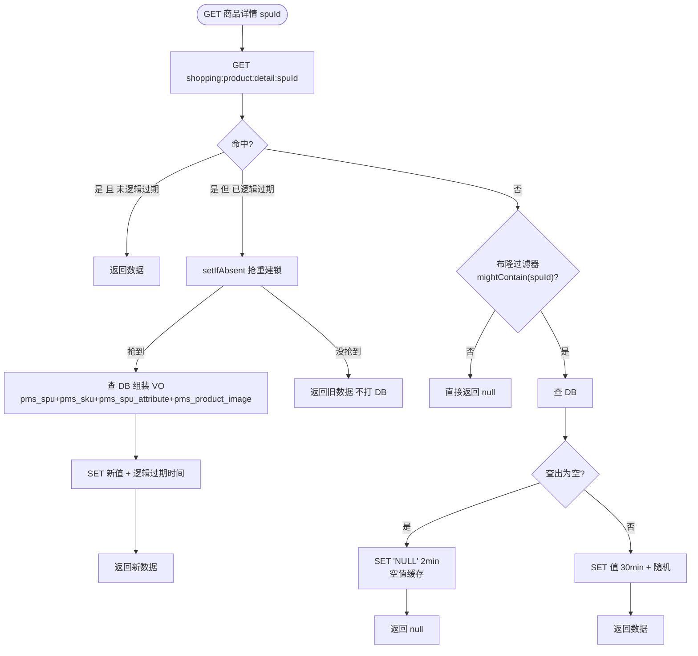

**写流程（运营改价 / 上下架 / 改库存）**：核心是**删除缓存，而不是更新缓存**。

```java
@Transactional(rollbackFor = Exception.class)
public void updateSku(SkuUpdateDTO dto) {
    // 1) 先改 DB
    skuMapper.updateById(toEntity(dto));
    // 2) 事务提交后再删缓存（关键）
    TransactionSynchronizationManager.registerSynchronization(new TransactionSynchronization() {
        @Override
        public void afterCommit() {
            redis.delete("shopping:product:sku:" + dto.getSkuId());
            redis.delete("shopping:product:detail:" + dto.getSpuId());
            redis.delete("shopping:product:stock:" + dto.getSkuId());
        }
    });
}
```

**为什么删缓存而不是更新缓存**：

| 维度 | 删除（Cache Aside） | 更新 |
|---|---|---|
| 并发安全 | 简单，不写脏值 | 两个并发写可能后写的旧值覆盖新值 |
| 缓存利用率 | 懒加载，没被读的 key 不会占内存 | 无论有没有人读都要写，浪费 |
| 代价 | 下次读有一次 miss（可接受） | 看似快，实则容易不一致 |

**为什么必须 `afterCommit` 删**：如果在事务内删，事务还没提交时另一个请求读缓存 miss 又去查 DB（读到**旧值**），然后它把旧值写进缓存，接着你的事务提交——**缓存里留下了永久的旧值**。这是经典的「缓存与数据库不一致」场景。

**为什么是先改 DB 再删缓存，不是先删缓存再改 DB**：先删缓存的话，删完到改库之间有空窗，其他请求会把**改库前的旧值**读进缓存，同样留下脏数据。**先改库后删缓存**的空窗要小得多（只影响删除失败的情况），是工业界主流做法。

**删除失败怎么办**（面试追问）：

1. 重试（`afterCommit` 里失败入本地消息表，由投递器重试，复用第 6 章机制）；
2. 兜底靠 TTL（30 分钟 + 随机），最差 30 分钟后自动一致；
3. 强调：**「延迟双删」是种流传很广但收益有限的技巧**（删缓存 → 改库 → sleep 500ms → 再删），因为 sleep 时间靠猜，且阻塞线程。本项目用 TTL 兜底 + 消息重试，更可控。

### 5.7 购物车到底放 Redis 还是 MySQL（一个真实取舍）

- 00 号文档表清单里有 `oms_cart_item`（MySQL 表），所以**购物车以 MySQL 为准**。
- Redis 只做**读加速**（`shopping:cart:{memberId}` 用 Hash），TTL 7 天。
- **为什么不纯 Redis**：购物车是**用户资产**，Redis 没有持久化保证（即便开 AOF 也有丢失窗口），丢购物车是严重体验事故。而且结算时要按 `cartItemIds` 校验归属，走 DB 更可靠。
- **代价**：写操作要同时写 DB 和 Redis，多一次 IO。取舍是「**正确性优先于性能**」——购物车不像秒杀有极端并发。

---

## 6. 一致性方案

### 6.1 问题定义

「下单成功后要通知会员/加积分/推送」这类动作，发生在**同一个库的其他表**、甚至**其他系统**里。它们和订单创建之间需要「要么都成、要么都不成」的语义。单体单库的情况下——

> **先明确结论：本项目不需要分布式事务框架**（ADR-7）。

原因：

1. 下单、锁库存、写订单明细，**都在同一个 MySQL 库的同一个事务里**，InnoDB 本地事务已经保证 ACID。这是单体架构最大的红利。
2. 唯一「跨进程」的环节是 **MQ 投递**，它不可能和 DB 事务原子。这属于「**本地事务 + 消息**」问题，标准解法就是**本地消息表**（`sys_message`）。
3. Seata AT 模式虽然能解决跨库问题，但需要额外的 TC 服务、全局锁、undo_log 表，**在单库场景下是纯粹的复杂度增加**（00 号文档 §4.1 已排除）。

> 面试话术：「我评估过 Seata，但我的业务只有一个库，本地事务就能覆盖 95% 的一致性需求。剩下 5% 是跨进程的 MQ 投递，用本地消息表 + 重试 + 幂等做成最终一致，实现只有两百行代码而且每一步我都能讲清楚。Seata 会引入一个我无法在生产环境压测的 TC 组件，收益和风险不成比例。」

### 6.2 `sys_message` 表结构要点

| 字段 | 类型 | 说明 |
|---|---|---|
| `id` | bigint | 雪花 ID 主键 |
| `msg_no` | varchar(64) | 消息业务编号，**唯一索引**（防重复插入） |
| `topic` | varchar(128) | RocketMQ Topic |
| `tag` | varchar(64) | Tag |
| `biz_key` | varchar(64) | 业务键（如 `orderNo`），**用于消费幂等与排查** |
| `payload` | text | 消息体 JSON（含 traceId！） |
| `status` | tinyint | `0`=待投递 `1`=已投递 `2`=投递失败 `3`=已消费 `4`=死信 |
| `retry_count` | int | 已重试次数 |
| `next_retry_time` | datetime | 下次重试时间（指数退避） |
| `error_msg` | varchar(512) | 最后失败原因 |
| `create_time` / `update_time` / `deleted` | — | 公共字段 |

索引：`uk_msg_no (msg_no)`、`idx_status_next_retry (status, next_retry_time)`。

**关键设计点**：

- `payload` 里必须带 `traceId`，消费端从消息里取出并放进 MDC，这样「下单请求」和「异步消息处理」的日志能串成一条链路（第 9 章）。
- `status` 用 tinyint 而不是字符串，减少索引体积。
- `reto_count` + `next_retry_time` 支持指数退避，避免失败时疯狂重试打爆 MQ。

### 6.3 完整机制流程图

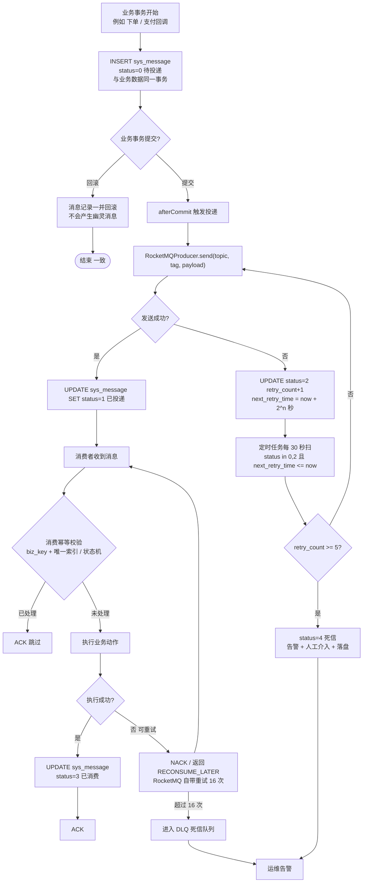

### 6.4 五个环节的细节

**(1) 写入时机**：**与业务数据在同一个事务内**。这是本地消息表的精髓——利用「同一个本地事务的原子性」，把「业务写入」和「消息待发」绑定成一体：要么都成功，要么都回滚，**绝不会出现「订单建了但消息没落库」或「消息落了但订单没建」**。

**(2) 投递**：事务提交后立即尝试（`afterCommit`），失败由定时任务兜底扫描。**双重保障**：

- 正常路径：`afterCommit` 立即发送，RT 低；
- 异常路径：定时任务扫 `status in (0, 2)`，保证「提交成功但进程在发送前挂了」的消息也能补发。

**为什么 `afterCommit` 而不是事务内发送**：见 3.2 第 7 跳。核心是「MQ 发送是外部 IO，不可回滚，不能进事务」。

**(3) 投递重试**：指数退避 `2^n` 秒（1s / 2s / 4s / 8s / 16s），最多 5 次。**为什么要退避**：如果是 MQ 集群抖动，立刻重试只会加剧拥塞；如果是消息本身格式错误（不可重试错误），重试 5 次后进死信，避免无限循环。

**(4) 幂等消费**：消费端**必须**自己保证幂等，因为 RocketMQ 保证「至少一次」（at-least-once），重复投递是正常的。手段：

- `biz_key` + 业务唯一索引（如 `wms_stock_log(biz_no, sku_id, type)`）；
- 状态机前置校验（如 `UPDATE ... WHERE status = '待支付'`）；
- 专门的消费记录表（如果业务上没有天然的唯一键）。

**(5) 死信处理**：`retry_count >= 5`（投递阶段）或 RocketMQ 重试 16 次仍未成功（消费阶段）→ 进死信 → **告警 + 人工介入**。死信必须能查、能重放：

- 提供后台页面 `/api/admin/system/message` 查 `sys_message`（`status = 4`）；
- 支持「手工重投」（把 `status` 改回 `0`、`retry_count` 归零）；
- **绝对不能默默丢掉**：静默失败的消息是线上最难查的 bug。

### 6.5 消息的可靠性矩阵

| 故障点 | 会不会丢消息 | 靠什么保证 |
|---|---|---|
| 业务事务回滚 | 不会（消息一起回滚） | 同事务 |
| 事务提交后进程崩溃 | 不会 | `sys_message` 已落库 + 定时任务补发 |
| MQ 发送失败 | 不会 | `status=2` + 重试 |
| MQ Broker 宕机 | 不会（已持久化） | RocketMQ 同步刷盘 + 主从 |
| 消费者处理失败 | 不会 | NACK 重试 + 死信 |
| 消费者重复处理 | **结果一致** | 幂等手段（第 7 章） |
| 消费者进程崩溃（处理中） | 不会 | 消息未 ACK，重平衡后重投 |

### 6.6 为什么不用 Seata（完整论证）

| 维度 | 本地消息表 | Seata AT |
|---|---|---|
| 组件依赖 | 无（用已有的 MySQL + RocketMQ） | 需部署 TC（Seata Server）+ 每库 undo_log 表 |
| 一致性 | 最终一致（秒级延迟） | 强一致（但性能差） |
| 全局锁 | 无 | 有，热点行会互相阻塞 |
| 代码侵入 | 低（一个 `SysMessageService` 封装） | 低（`@GlobalTransactional`），但问题被隐藏 |
| 可解释性 | **每个环节都能讲清楚**（面试极大加分） | 「框架帮我搞定的」——面试追问就崩 |
| 适用场景 | 单库 + 少量跨进程动作 | 多库/多服务 |

**结论**：本项目是单体单库，**本地消息表以更小的成本覆盖了全部需求**，而且它的每个环节（写入时机、重试、幂等、死信）都是面试官爱问的点，讲了就是加分。Seata 在这个场景是**为了技术而技术**。

**补充一句让面试官眼前一亮的话**：「本地消息表不是分布式事务的替代品，它是**特定约束下的更优解**。如果将来拆了服务、库也拆了，我会切成**事务消息 + 补偿（Saga）**的组合：RocketMQ 事务消息解决『本地事务 + 发消息』的原子性，业务补偿解决跨服务的回滚。」

---

## 7. 幂等设计

### 7.1 需要幂等的场景清单

| # | 场景 | 为什么重复 | 主要手段 |
|---|---|---|---|
| 1 | **支付回调** | 第三方超时重推、网络抖动 | 状态机前置校验 + `UPDATE ... WHERE status = 'WAIT'` |
| 2 | **库存回滚** | MQ 至少一次投递、消费者重试 | `wms_stock_log` 唯一索引 `(biz_no, sku_id, type)` |
| 3 | **秒杀下单** | MQ 重投、用户连点 | `sms_seckill_record` 唯一索引 `(activity_id, member_id, seckill_sku_id)` |
| 4 | **MQ 消费（通用）** | at-least-once 语义 | `biz_key` + 业务唯一索引 + 消费状态表 |
| 5 | **普通下单** | 用户连点、前端重复提交 | Redis token（`@Idempotent`）+ 前端按钮置灰 |
| 6 | **退款申请** | 用户重复点击 | 业务唯一索引 `(order_no, refund_type)` + 状态机 |
| 7 | **超时关单** | 延迟消息重复、多消费者 | 订单状态机 + 条件更新 + 库存流水唯一索引 |
| 8 | **优惠券领取** | 用户连点 | Redis `SETNX` + `sms_coupon_record` 唯一索引 `(coupon_id, member_id)` |
| 9 | **管理端批量导入** | 网络重试 | 幂等 token + 业务自然键唯一索引 |

**共性认知**：**幂等的前提是「能识别出这是同一个请求」**。所以核心问题永远是「**用什么当幂等键**」：

- 支付回调 → `pay_no`（支付单号，第三方给的）
- 库存回滚 → `biz_no + sku_id + type`（业务单号 + 操作类型）
- 秒杀 → `activity_id + member_id + seckill_sku_id`
- 普通下单 → 客户端生成的 `requestId`（Redis token）

### 7.2 四种手段的适用边界

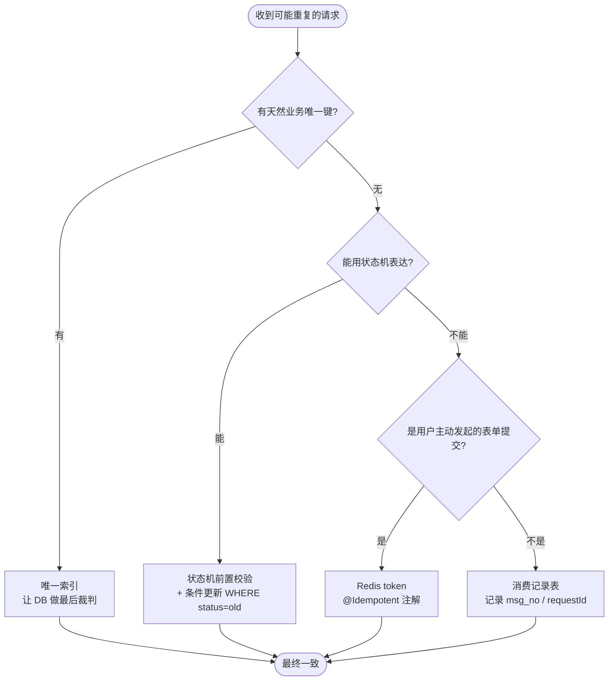

#### 手段一：唯一索引（最可靠，优先用）

**为什么最可靠**：它是**数据库层面**的约束，不依赖应用代码正确、不依赖 Redis 可用、不受并发影响。即使应用有 bug、即使多个实例同时处理，唯一索引都会在 INSERT 时拦住第二个。

```sql
-- 库存流水：同一个业务单号 + SKU + 操作类型只能有一条
ALTER TABLE wms_stock_log ADD UNIQUE KEY uk_biz_sku_type (biz_no, sku_id, type);

-- 秒杀记录：同一活动同一人同一 SKU 只能抢一次
ALTER TABLE sms_seckill_record ADD UNIQUE KEY uk_act_member_sku (activity_id, member_id, seckill_sku_id);

-- 领券记录
ALTER TABLE sms_coupon_record ADD UNIQUE KEY uk_coupon_member (coupon_id, member_id);
```

**代价与注意事项**：

- 唯一索引会**降低写入性能**（要维护索引 B+ 树），但相比它带来的正确性，完全值得；
- 必须**捕获 `DuplicateKeyException` 并当作「成功」处理**（说明已经处理过），而不是当成错误抛给用户；
- **逻辑删除的冲突**（ADR-8）：`deleted` 字段会让「删掉再插入」撞唯一索引。解决方案有三：① 防重表不参与逻辑删除（本项目对 `wms_stock_log` / `sms_seckill_record` 采用）；② 唯一索引里带上 `deleted` 时间戳（`deleted_at` 为 0 或时间戳），但 Mapper 层要复杂化；③ 唯一键里加一个自增的 `delete_seq`。**本项目选 ①，因为流水表和防重表的语义就是「发生过就是发生过」**。

#### 手段二：状态机前置校验 + 条件更新（ADR-4）

```java
// 支付回调中的订单状态流转
int affected = orderMapper.updateStatusByCondition(
        orderNo,
        OrderStatusEnum.WAIT_PAY.getCode(),   // 期望的原状态
        OrderStatusEnum.WAIT_DELIVER.getCode() // 目标状态
);
if (affected == 0) {
    // 要么已支付过，要么已被超时关单 —— 两种都不是错误，走幂等分支
    log.info("订单状态流转未生效，可能已处理过, orderNo={}", orderNo);
    return PayNotifyResult.success();
}
```

**核心思想**：把「**当前状态**」当成乐观锁的版本号。状态机的价值不只是防乱改，它天然就是幂等的基础设施。

**代价**：每次状态流转都要多写一个「带条件」的 Mapper 方法（不能直接用 MyBatis-Plus 的 `updateById`），但换来的是可证明的正确性。

#### 手段三：Redis token（`@Idempotent` 注解）

前端进入下单页时先调 `GET /api/app/trade/order/token` 拿一个 token，提交订单时带上。

```java
@Idempotent(key = "shopping:idem:order:token", ttlSeconds = 300, message = "请勿重复提交")
@PostMapping("/api/app/trade/orders")
public Result<OrderVO> create(@Valid @RequestBody CreateOrderDTO dto) { ... }
```

切面逻辑（`common.idempotent`）：

```java
@Around("@annotation(idempotent)")
public Object around(ProceedingJoinPoint pjp, Idempotent idempotent) throws Throwable {
    String requestId = resolveKey(pjp, idempotent);   // 从 header 或参数取 token
    String key = idempotent.key() + ":" + requestId;
    // setIfAbsent 原子占位
    Boolean ok = redis.opsForValue().setIfAbsent(key, "1", Duration.ofSeconds(idempotent.ttlSeconds()));
    if (Boolean.FALSE.equals(ok)) {
        throw new BizException(idempotent.message());
    }
    try {
        return pjp.proceed();
    } catch (Throwable e) {
        redis.delete(key);       // 业务失败要放行重试，否则用户被永久卡住
        throw e;
    }
}
```

**为什么业务失败要删除 key**：如果业务失败了还占着 token，用户重试会被拒，体验极差。**只有成功时才让 token 自然过期**（因为成功了就不该再提交）。

**备选**：不删 key，让用户重新取 token。代价是前端逻辑更复杂。本项目选「失败即释放」。

**代价与局限**：`@Idempotent` 只在**单次会话窗口**内有效（300 秒 TTL），且依赖 Redis 可用。所以它是**防误触的第一道门**，不是正确性的最后防线——**最后防线永远是唯一索引**。

#### 手段四：消费记录表

当业务上既没有天然唯一键、也无法用状态机表达时（例如「发一条站内信」），用一张消费记录表记录已处理的 `msg_no`：

```sql
CREATE TABLE sys_message_consume (
    id bigint PRIMARY KEY,
    msg_no varchar(64) NOT NULL,
    consumer_group varchar(64) NOT NULL,
    consume_time datetime NOT NULL,
    UNIQUE KEY uk_msg_group (msg_no, consumer_group)
);
```

**为什么带 `consumer_group`**：同一条消息可能被多个不同的消费者组消费（通知组、积分组），它们**都应该各处理一次**，所以幂等键必须包含消费者组。

> **本项目优先复用 `sys_message.status` 字段**（`3` = 已消费）来做消费幂等，只有在需要「一对多消费者」时才引入额外的消费记录表——**能不加表就不加表**。

### 7.3 幂等的通用检查清单（写代码时对照）

1. 这个操作的**幂等键**是什么？在数据库里有没有唯一约束？
2. 重复执行时，代码走的是**「成功 + 日志」还是「报错」**？必须是前者。
3. 有没有**并发**重复的可能（不是先后重复）？有就必须靠 DB 约束，不能靠「先查后写」。
4. 幂等键有没有**过期**风险？过期后重复请求会不会出事？
5. 幂等失败时，**用户看到什么**？（不能是 500）
6. 有没有**日志**记录「本次被判定为重复」？否则线上排查时你不知道是幂等生效了还是业务没跑。

---

## 8. 安全设计

### 8.1 JWT 双 Token 机制

**为什么不用单 Token**：单 Token 如果设短（15 分钟），用户频繁被踢；如果设长（7 天），一旦泄露就有 7 天的风险窗口。**双 Token 是「安全」与「体验」的折中**。

| Token | 有效期 | 存储位置 | 作用 |
|---|---|---|---|
| **accessToken** | 30 分钟 | 前端内存（Vuex/Pinia） | 每次请求带上，`Authorization: Bearer` |
| **refreshToken** | 7 天 | HttpOnly Cookie 或 localStorage | 只用于换新 accessToken |

**刷新流程**：

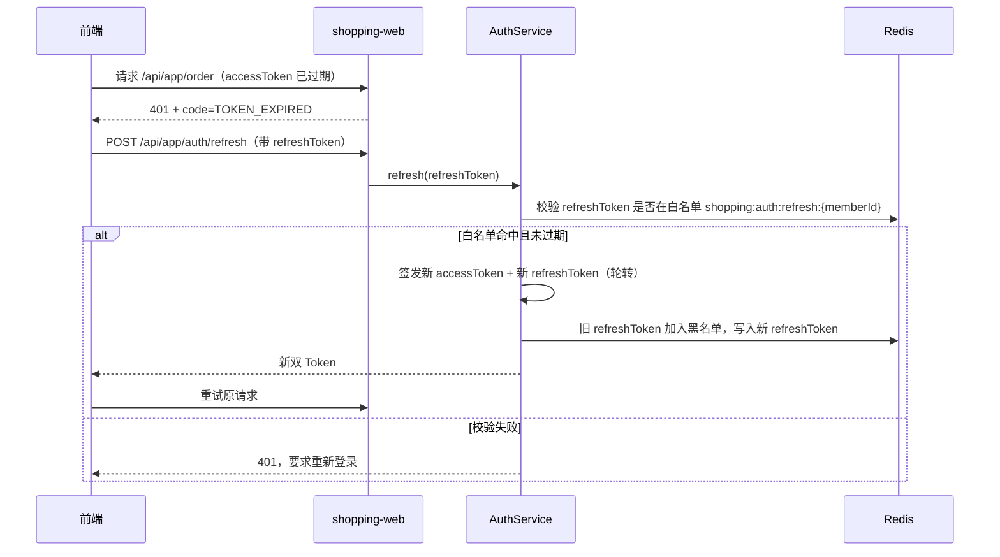

**关键设计点（都是面试追问点）**：

1. **refreshToken 轮转（Rotation）**：每次刷新都换一个新的 refreshToken，旧的立即失效。这样**如果 refreshToken 被盗用，真正的用户下次刷新就会失败**，能发现被盗。
2. **refreshToken 白名单存 Redis**（`shopping:auth:refresh:{memberId}`）：纯 JWT 是**无状态**的，签发后无法撤销。存一份白名单，就获得了「踢人」能力。**代价**：多一次 Redis 查询、失去纯粹的无状态性——但对需要「强制下线」的业务是必须的。
3. **accessToken 不存 Redis**，只靠签名校验（无状态，性能好）；登出时把该 token 的 `jti` 放进黑名单 `shopping:auth:token:blacklist:{jti}`，TTL = 剩余有效期（过期后自动清理，不会无限增长）。
4. **签名算法用 HS256**（对称）还是 RS256（非对称）？单体应用只有一个签发者，**HS256 足够且更快**；如果将来有多个服务要独立验签，再换 RS256（公钥验签，私钥只有认证服务持有）。
5. **payload 里只放非敏感信息**：`memberId`、`jti`、`exp`、`iat`、`type`（access/refresh）。**绝不放密码、手机号**——JWT 只是 Base64 编码，不是加密，任何人都能解出 payload。

### 8.2 Spring Security 过滤器链位置

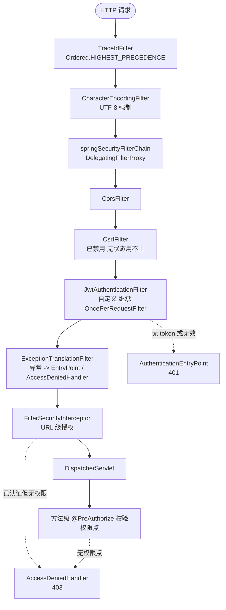

**`JwtAuthenticationFilter` 的位置**：插在 `UsernamePasswordAuthenticationFilter` 之前（用 `addFilterBefore`）。因为登录接口本身不需要 token，而其他所有接口都需要，放在最前面能保证「进入业务逻辑前一定已认证」。

**`@PreAuthorize` 为什么在 `DispatcherServlet` 之后**：方法级安全靠 AOP 代理，而 Controller 的方法调用发生在 DispatcherServlet 内。所以 URL 级授权（Filter 层）先执行，方法级授权（AOP 层）后执行。**两层授权是有意的**：Filter 层挡「未登录」，AOP 层挡「登录了但没这个权限点」。

**`oncePerRequestFilter` 的必要性**：`Filter` 在 forward/include 时可能被重复调用，`OncePerRequestFilter` 用 request attribute 保证一个请求只走一次，避免重复认证。

### 8.3 RBAC 权限校验

**模型**：`sys_user` → `sys_user_role` → `sys_role` → `sys_role_menu` → `sys_menu`（`menu` 表同时承载「菜单」和「权限点」两种语义，用 `menu_type` 区分）。

**权限点编码规范**：`{模块}:{资源}:{动作}`，例如：

- `product:spu:list`、`product:spu:add`、`product:spu:edit`、`product:spu:remove`
- `trade:order:list`、`trade:order:ship`
- `promotion:seckill:add`
- `system:user:resetPwd`

**用法**：

```java
@PreAuthorize("@ss.hasPermi('product:spu:add')")
@PostMapping("/api/admin/product/spu")
public Result<Long> createSpu(@Valid @RequestBody SpuCreateDTO dto) { ... }
```

`@ss` 是一个 Spring Bean（`PermissionService`，bean name 为 `ss`），`hasPermi` 从 `SecurityContext` 取当前用户的权限集合（登录时一次性从 `sys_menu` 查出并放进 accessToken 或 Redis），判断是否包含目标权限点。

**为什么权限集合不放 Token 里**：Token 会变大（几百个权限点），且**改了权限不能立即生效**（要等 token 过期）。所以放 Redis（`shopping:auth:perms:{userId}`），改权限时删除该 key，**立即生效**。

**数据级权限（Phase 4 的伏笔）**：到了多商户阶段，`mms_merchant` 用户只能看自己的数据。做法是在 Mapper 的查询里强制拼 `merchant_id = ?`，或者用 MyBatis-Plus 的 `TenantLineInnerInterceptor` 做自动数据隔离。**Phase 1 就要在相关表上带 `merchant_id` 默认 1**（00 号文档 §5 已强制），这样 Phase 4 加隔离不用改表。

**C 端与管理端的分权**：`/api/app/**` 只要求「已登录」（`authenticated()`），`/api/admin/**` 要求「有对应权限点」。两端的用户表都不同（`ums_user` vs `sys_user`），Token 里的 `type` 声明区分，防止 C 端用户拿着自己的 token 去访问管理端接口。

### 8.4 密码加密（BCrypt）

```java
@Bean
public PasswordEncoder passwordEncoder() {
    return new BCryptPasswordEncoder(10);   // strength = 10，约 50~100ms 一次
}
```

**为什么用 BCrypt 而不是 MD5/SHA**：

| 算法 | 是否可逆 | 抗彩虹表 | 抗暴力破解 | 结论 |
|---|---|---|---|---|
| MD5 | 否（但可查表） | 需自己加盐 | 极弱（GPU 每秒几十亿次） | **禁用** |
| SHA-256 | 否 | 需自己加盐 | 弱（快，利于爆破） | 需加盐 + 多轮，麻烦 |
| **BCrypt** | 否 | **内置随机盐** | **强，本身就是慢哈希** | **本项目选它** |

**BCrypt 的三个优点**：

1. **自带盐**：每次加密生成随机盐并存进结果字符串（`$2a$10$...`），同一密码两次加密结果不同；
2. **可调强度**：`strength` 参数决定迭代次数（2^10 轮），硬件变快时调高即可；
3. **验证不需要额外存盐**：`matches(raw, encoded)` 从 encoded 里解析出盐。

**代价**：单次加密/验证约 50~100ms，比 MD5 慢几个数量级。**这正是它的目的**——登录接口因此天然抗暴力破解。但也意味着**登录接口必须限流**（否则攻击者能用大量登录请求打满 CPU）：用 `@RateLimit` 对 `/api/app/auth/login` 按 IP + 账号双维度限制。

> **必须避免的坑**：不要把 BCrypt 用在**高频**场景（如每次请求验证某个 token），也不要用它加密需要解密的数据（它是**单向**的，密码不需要解密，这是设计意图）。

### 8.5 敏感数据脱敏

**三类敏感数据**：

| 数据 | 场景 | 处理方式 |
|---|---|---|
| 手机号 | 列表展示、日志 | 展示 `138****8888`，存储明文（需脱敏查询）或 AES 加密 |
| 身份证 | 实名场景（本项目不做） | 展示 `110***********1234` |
| 收货地址 | 订单详情 | 展示完整（用户自己的），**日志里不打印完整地址** |
| 密码 | 任何地方 | **永不返回、永不打印** |

**实现**：用 Jackson 的 `@JsonSerialize(using = SensitiveSerializer.class)` 或自定义注解：

```java
public class UmsUserVO {
    private Long id;
    private String nickname;

    @Sensitive(type = SensitiveType.PHONE)
    private String phone;      // 序列化时自动变成 138****8888
}
```

**日志脱敏**：Logback 配置里加一个 `PatternLayout` 转换器，把日志中的 11 位数字自动替换成脱敏格式。**为什么必须做**：日志会被集中收集、被很多人看到，明文手机号是真实的数据泄露风险。面试时提到这一点，体现安全意识。

**为什么不用「存储加密 + 查询解密」的方案**：AES 加密后无法用 `LIKE` 模糊查询、无法建索引。本项目选**存储明文 + 展示/日志脱敏**，在演示场景下更实用；生产环境（尤其有合规要求时）需要用「加密存储 + 手机号哈希列做索引」的方案——**这个取舍要能讲出来**。

### 8.6 SQL 注入与 XSS 防护

**SQL 注入**：

- **根本手段**：所有 SQL 只用 `#{}`（MyBatis 的预编译占位符 → JDBC `PreparedStatement`），**禁止 `${}` 拼接**。
- **例外**：动态排序字段（`ORDER BY ${column}`）无法预编译。做法是**白名单校验**：

```java
private static final Set<String> ALLOWED_SORT = Set.of("create_time", "price", "sale_count");

private String safeOrderBy(String input) {
    if (!ALLOWED_SORT.contains(input)) {
        return "create_time";
    }
    return input;
}
```

- **配合**：数据库账号只给 `shopping_mall` 库的 CRUD 权限，不给 `DROP` / `FILE` 权限，即使有注入点也降低危害（**最小权限原则**）。
- **ArchUnit 可以再加一条规则**：禁止 Mapper XML 里出现 `${` —— 这是自动化强制的典范，值得在面试里提。

**XSS 防护**：

- **输入侧**：用 `HtmlUtils.htmlEscape()` 或 Jsoup 的 `Safelist` 对富文本之外的字段做转义（商品描述这类富文本要用白名单过滤，允许 `<p>` `` 等，禁止 `<script>` `<iframe>`）。
- **输出侧**：Vue 默认对插值做 HTML 转义，**禁止用 `v-html` 渲染用户输入**（除非已过滤）。
- **HTTP 头**：加 `X-Content-Type-Options: nosniff`、`X-Frame-Options: DENY`（防点击劫持）、`Content-Security-Policy`（Nginx 层配置）。
- **`shop:csrf`**：因为是**无状态 JWT + 前端不依赖 Cookie 自动携带**，CSRF 攻击的前提（浏览器自动带 Cookie）不成立，所以 `SecurityConfig` 里 **`csrf().disable()`**。**这个「为什么能禁用」必须能讲**，否则会被追问「你为什么把 CSRF 关了」。

### 8.7 秒杀接口防刷

秒杀是「被薅羊毛」的首要目标，需要**五层防刷**：

| 层 | 手段 | 挡住什么 |
|---|---|---|
| 1 | Nginx 按 IP `limit_req` 5r/s | 单机脚本刷 |
| 2 | 强制登录 + 实名/手机绑定前置校验 | 无限小号 |
| 3 | 秒杀路径加**一次性签名**（活动开始时下发给前端，含时间戳 + 活动ID，服务端校验 HMAC + 5 秒有效期） | 提前构造请求的脚本、重放攻击 |
| 4 | 用户维度限购（Redis `SISMEMBER` + DB 唯一索引） | 同一账号重复抢 |
| 5 | 风控（可选加分项）：同一 IP/设备指纹短时间大量请求 → 加入临时黑名单 `shopping:risk:blacklist:{ip}` | 分布式刷单 |

**第 3 层「秒杀 URL 隐藏 + 签名」是经典设计**（原始秒杀系统的做法）：活动开始前接口地址不暴露，活动开始时才把带签名的真实地址发给前端。这样脚本无法在活动开始**之前**就把请求准备好并开始轰炸。

**为什么用户限购必须做到 DB 层**：Redis 挡的是「99%」，但用户可以通过「清缓存 / 换设备 / 并发请求」绕过 Redis。**唯一索引是物理约束，绕不过**。

> **一个容易被忽略的点**：秒杀接口**不能只靠前端按钮置灰**。前端限制只能防误触，防不住任何有意的攻击。所有防护必须在服务端。

---

## 9. 可观测性

> 应届生项目的常见短板：功能能跑，但「线上出问题了怎么办」答不上来。这一章是你和普通候选人拉开差距的地方——**它证明你写的是「系统」而不是「作业」**。

### 9.1 traceId 全链路

**实现机制**（`common.trace`）：

```java
@Component
@Order(Ordered.HIGHEST_PRECEDENCE)
public class TraceIdFilter extends OncePerRequestFilter {
    public static final String TRACE_ID = "traceId";
    public static final String HEADER = "X-Trace-Id";

    @Override
    protected void doFilterInternal(HttpServletRequest req, HttpServletResponse resp, FilterChain chain)
            throws ServletException, IOException {
        String traceId = req.getHeader(HEADER);
        if (!StringUtils.hasText(traceId)) {
            traceId = String.valueOf(SnowflakeIdWorker.nextId());
        }
        try {
            MDC.put(TRACE_ID, traceId);
            resp.setHeader(HEADER, traceId);
            chain.doFilter(req, resp);
        } finally {
            MDC.remove(TRACE_ID);   // 必须清理，防线程池串号
        }
    }
}
```

**日志格式**（Logback `logback-spring.xml`）：

```xml
<pattern>%d{yyyy-MM-dd HH:mm:ss.SSS} %-5level [%thread] [%X{traceId}] %logger{36} - %msg%n</pattern>
```

输出形如：

```
2025-01-15 10:23:41.882 INFO  [http-nio-8080-exec-7] [1857392018374651136] c.s.s.trade.OrderServiceImpl - 下单成功 orderNo=OMS20250115000001 amount=19900
```

**traceId 怎么跨线程、跨 MQ 传递**（这是真正的难点）：

| 场景 | 问题 | 解法 |
|---|---|---|
| `@Async` / 线程池 | MDC 是 ThreadLocal，子线程拿不到 | 自定义 `TaskDecorator`，提交任务时把 MDC 复制过去 |
| RocketMQ 生产 | 消息体里没有 traceId，消费端日志断链 | 发消息时把 `traceId` 放进消息 **userProperty**（`msg.putUserProperty("traceId", MDC.get("traceId"))`） |
| RocketMQ 消费 | 消费者线程的 MDC 是空的 | 消费入口从 userProperty 取 traceId，`MDC.put` 后再处理，`finally` 清理 |
| 定时任务 | 无 HTTP 请求 | 任务开始时自己生成一个 traceId |

**为什么值得这么做**：一次「下单成功后没扣库存」的排查，如果有 traceId，你能一条命令捞出**同步请求 + MQ 消费 + 定时补偿**的所有日志；没有的话你要在几万行日志里靠时间戳猜。**面试时举这个具体例子，比说「我们用了链路追踪」有说服力十倍。**

### 9.2 统一日志格式与分级

| 级别 | 用途 | 示例 |
|---|---|---|
| `ERROR` | 需要人介入 | 支付验签失败、MQ 死信、DB 连接池耗尽 |
| `WARN` | 可自愈但需关注 | 幂等命中、重试成功、缓存重建 |
| `INFO` | 关键业务节点 | 下单成功、支付成功、关单成功（**带业务单号**） |
| `DEBUG` | 排查用，生产关闭 | SQL 参数、方法入参 |

**Logback 关键配置**：

- **异步 Appender**（`AsyncAppender` + `ArrayBlockingQueue`）：日志写盘是 IO 操作，同步写会拖慢接口 RT；
- **队列满时策略**：设 `discardingThreshold=0` + `neverBlock=false`，宁可丢 DEBUG 日志也不阻塞业务线程；
- **分级输出**：ERROR 单独一个文件（便于告警监控），并按天 + 按大小滚动（`SizeAndTimeBasedRollingPolicy`，单文件 100MB，保留 30 天）；
- **敏感信息过滤**：自定义 `Converter` 脱敏手机号、身份证、密码字段。

**统一日志规范（写代码时必须遵守）**：

1. **禁止 `System.out.println`**（无法被日志框架收集、无级别、无 traceId）；
2. **禁止字符串拼接**，用占位符 `log.info("下单成功 orderNo={} amount={}", orderNo, amount)`（拼接即使日志级别关闭也会执行，浪费 CPU）；
3. **异常必须传异常对象**：`log.error("关单失败 orderNo={}", orderNo, e)`，**不要**只写 `e.getMessage()`（丢堆栈 = 无法排查）；
4. **业务日志必须带业务单号**（`orderNo` / `payNo` / `memberId`），这是排查的索引；
5. **不要在循环里打 INFO 日志**（批量 1000 条就是 1000 行日志）。

### 9.3 慢 SQL 与慢接口监控

**慢 SQL（三层）**：

1. **MySQL 层**：开启慢查询日志，`long_query_time = 0.5`（生产 0.1~1 秒），配 `pt-query-digest` 或 `mysqldumpslow` 分析 Top SQL。
2. **应用层**：MyBatis-Plus 的性能分析插件 `PerformanceInterceptor`，或自写 `Interceptor` 在 `Executor` 层计时，超过 500ms 打 WARN 并带上 traceId。
3. **连接池层**：HikariCP 监控 `activeConnections` / `pendingThreads`。**`pendingThreads > 0` 是危险信号**——说明连接池不够用，请求在排队，接下来就是 RT 飙升。

**慢接口**：

- 一个 `HandlerInterceptor#afterCompletion` 或 AOP 切面统计 Controller 耗时，超过 1000ms 打 WARN（带 traceId + URI + 参数摘要）；
- 秒杀等敏感接口阈值单独设（超 200ms 就报警）。

**及时发现的经典手段——`EXPLAIN` 常态化**：任何一个新写的复杂查询，先 `EXPLAIN` 看 `type` 是不是 `ALL`（全表扫）。**面试常问**：「你项目里遇到过慢 SQL 吗？」答案是准备好的：

> 「订单列表查询一开始没加索引，用户订单多了以后变成全表扫，TP99 从 200ms 涨到 3s。我用 `EXPLAIN` 看到 `type=ALL`，加了 `(member_id, create_time)` 联合索引后降到 `type=range`，TP99 回到 180ms。同时我用 `sys_operation_log` 记录操作日志时意识到：**索引的列顺序要按「等值条件在前、范围条件在后」排**，所以是 `member_id` 在前而不是 `create_time` 在前。」

### 9.4 关键业务指标

技术指标之外，**业务指标才是面试官真正想听的**（因为它证明你在做「业务系统」而不是「技术练习」）。

| 指标 | 定义 | 监控方式 | 异常信号 |
|---|---|---|---|
| **下单量** | 每分钟 `oms_order` INSERT 数 | 定时任务统计 + 打点 | 突然为 0 → 下单链路挂了 |
| **支付成功率** | 支付成功数 / 发起支付数 | `pay_payment` 按状态聚合 | 掉到 70% 以下 → 模拟网关或回调有问题 |
| **秒杀 QPS** | 抢购接口每分钟请求数 | Redis 计数器 + 接口计数 | 远超限流阈值 → 有刷单 |
| **秒杀成功率** | 成功数 / 有效请求数 | `sms_seckill_record` / 请求数 | 中签者未成单 → 对账告警 |
| **超卖数** | `SUM(卖出) - 初始库存` | 定时对账任务 | **任何 > 0 都是 P0 事故** |
| **库存回滚延迟** | 关单时间 → 库存释放时间 | `wms_stock_log` 时间差 | 超 5 分钟 → 消费者积压 |
| **MQ 积压量** | Topic 的 `Diff Total` | RocketMQ 控制台 | 持续增长 → 消费者跟不上 |
| **死信数量** | `sys_message.status = 4` | 定时统计 + 告警 | 任何新增都要看 |
| **缓存命中率** | `keyspace_hits / (hits + misses)` | Redis `INFO stats` | 低于 90% → 缓存设计或 TTL 有问题 |
| **事务回滚率** | 回滚次数 / 提交次数 | 自定义 AOP 计数 | 飙升 → 库存/券竞争激烈 |

**落地方案（不引入额外组件）**：

- 轻量做法：`@Scheduled` 每 5 分钟聚合一次，写日志 + 写 Redis（`shopping:metric:{name}:{时间戳}`），Spring Boot Actuator 暴露 `/actuator/metrics` 给运维查；
- 不引入 Prometheus + Grafana（演示环境成本高）。**但要知道它们是什么、为什么生产要用**：面试时可以说「我项目里用 Actuator + 定时打点看指标，生产环境我会接 Micrometer 到 Prometheus，用 Grafana 做面板」——**体现你知道进阶路径，同时诚实地说明现状**。

### 9.5 排查一个线上问题的完整路径（面试可以直接讲这个故事）

场景：**用户反馈「下单成功但库存没扣」**。

```
第 1 步：拿 traceId
  用户截图里有响应头 X-Trace-Id，或者从 Nginx access log 按时间 + URI 找到。
第 2 步：捞全链路日志
  grep 1857392018374651136 app.log
  → 看到 OrderServiceImpl 打的下单成功日志，拿到 orderNo。
第 3 步：查业务数据
  SELECT * FROM oms_order WHERE order_no = 'OMS2025...';
  SELECT * FROM wms_stock_log WHERE biz_no = 'OMS2025...';
  → 发现 wms_stock_log 里没有对应记录。
第 4 步：定位环节
  → 说明事务里 lockStock 没执行或执行失败。
  → 看 OrderServiceImpl 日志：发现 lockStock 抛了异常但被 catch 吞掉了（事务没回滚）。
第 5 步：修复 + 验证
  → 删掉那个 catch，让异常抛出；补一个断言测试。
第 6 步：数据修复
  → 用脚本补 wms_stock_log 并调整 locked（注意幂等，走唯一索引）。
第 7 步：防复发
  → 加对账任务：每小时比对 oms_order 与 wms_stock_log 的 biz_no，发现不一致就告警。
```

> 这个故事的价值不在技术难度，而在于它展示了**有章法的排查过程**：先定位（traceId）→ 再取证（日志 + 数据）→ 再归因（代码）→ 再修复（代码 + 数据）→ 最后防复发（对账）。面试官听到「防复发」这一步，对你的评价会明显不同。

---

## 10. 演进路径

> 题目：**如果业务量涨 100 倍，你会怎么改？**
> 这是本文最重要的章节。回答的关键不是「堆组件」，而是**给出有依据的顺序**——先拆哪个、为什么是它、拆完会带来什么新问题。

### 10.1 先量化「涨 100 倍」意味着什么

假设当前：日订单 1 万，峰值 QPS 200，商品 10 万，会员 50 万，单库单表数据量 `oms_order` 100 万行。

100 倍后：日订单 100 万，峰值 QPS 2 万，`oms_order` 1 亿行/年，`wms_stock_log` 数亿行。

**先判断哪个先崩**（这个判断过程本身就是面试亮点）：

| 资源 | 当前负载 | 100 倍后 | 先崩的顺序 |
|---|---|---|---|
| 单机 Tomcat 线程池（200 线程） | 200 QPS 轻松 | 2 万 QPS **必崩** | **第 1 个崩** |
| MySQL 单实例（写 QPS 约 3000） | 轻松 | 2 万 QPS **必崩** | 第 2 个崩 |
| `oms_order` 单表行数 | 100 万 | 1 亿，索引 3 层→4 层，DDL 做不动 | 第 3 个 |
| Redis 单实例（约 10 万 QPS） | 轻松 | 秒杀预扣可能到 5~10 万 | 第 4 个 |
| 带宽 | 够 | 商品图是瓶颈（应该上 CDN） | 并行 |

**结论**：**应用层先拆（无状态，最容易），然后是 DB（有状态，最难），最后才是 Redis**。这个顺序不能反——先动 DB 会把自己坑死，因为 DB 的拆分是不可逆的、需要停机或双写迁移。

### 10.2 演进四阶段

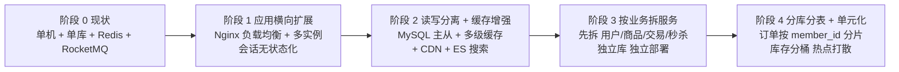

### 10.3 阶段 1：应用横向扩展（1~2 周，收益最直接）

**做什么**：

1. **应用无状态化**：把任何存在 JVM 内存里的会话状态挪走。本项目已经没有 `HttpSession`（用 JWT），本地布隆过滤器改成 Redis 布隆（否则每个实例的过滤器不一致），本地 Caffeine 只保留可容忍不一致的数据。
2. **Nginx upstream 加多台**：`upstream shopping_backend { server 10.0.0.1:8080; server 10.0.0.2:8080; }`。
3. **定时任务单点化**：现在 `@Scheduled` 在每个实例都会跑 → 重复执行。解决：用 Redisson 分布式锁包住任务（`shopping:lock:job:daily-report`），**抢到锁的实例才执行**。
4. **文件上传改对象存储**：现在文件落本地磁盘（`sys_file` 只记录路径），多实例后 A 机上传的文件 B 机读不到。改 S3/OSS/MinIO。
5. **Nginx 限流语义修正**：多台 Nginx 各自按 IP 限流，等于限额被放大 N 倍。**真正的全局限流必须移到应用层 Redis（`@RateLimit`）**，这一条在 8.6/4.4.3 已经埋好了。

**为什么先做这个**：**改动最小、收益线性、可回滚**（加机器而已）。而且它暴露的「无状态化」问题（定时任务、本地缓存、文件）本来就是架构债，早还早好。

**代价**：日志现在分散在多台机器上，`grep` 不好使了 → **必须上集中式日志**（ELK 或 Loki）。这是阶段 1 的隐性必做项，很多人会漏。

### 10.4 阶段 2：数据库读写分离 + 缓存增强

**做什么**：

1. **MySQL 一主两从**（半同步复制），写走主库、读走从库。
   - **怎么落地**：Spring 的 `AbstractRoutingDataSource` + 自定义 `@DataSource("slave")` 注解 + AOP 切换。
   - **⚠️ 主从延迟是核心问题**：刚下单马上查订单，从库可能还没同步 → 用户看到「订单不存在」。
   - **解法**：**写后读强制走主库**（下单成功后 1 秒内的查询走主库），或关键路径（支付、订单详情）直接走主库。**这个坑面试必问**，答不上来说明你只是「知道读写分离」而没想过延迟。
2. **缓存分层**：Caffeine（本地，秒级 TTL，极热点）+ Redis（分布式，分钟级 TTL）→ 本地缓存挡掉 90% 的 Redis 请求。
3. **CDN**：商品图片是最大的带宽消耗。把 `pms_product_image` 的 URL 换成 CDN 域名。
4. **引入 Elasticsearch 做商品搜索**：MySQL `LIKE '%关键词%'` 无法用索引，数据量大了必然慢。用 Canal 订阅 binlog 同步 `pms_spu` / `pms_sku` 到 ES。
   - **注意**：00 号文档 §4.1 把 ES 列为「当前不引入」，理由是「校招非必须，Phase 4 再考虑」。**这里说的是「量涨 100 倍之后的演进方案」，不是现在要做**——面试时要明确区分「现在的选择」和「演进的方向」。
5. **Redis 高可用**：单机 → 主从 + Sentinel（或 Cluster，但 Cluster 对 Lua 脚本有跨 slot 限制，见 10.6）。

**为什么第二阶段做数据库**：应用层拆完，DB 还是单点，它会成为第一瓶颈。但**先做读写分离而不是分库分表**——因为读写分离是「不改业务代码」的前提下能拿到最大收益的方案（大部分系统读多写少，比如商品查询占 90%）。

### 10.5 阶段 3：按业务拆服务（先拆谁？）

**拆分顺序的依据：哪个模块「变更频率」和「资源需求」与其他模块差异最大，就先拆它。**

我的顺序和理由：

| 顺序 | 服务 | 为什么排这个位置 | 独立库 |
|---|---|---|---|
| **1** | **秒杀服务**（`promotion` 的秒杀部分） | ① 资源需求最特殊：瞬时 10 万 QPS，而其他模块平时只有几百；② 故障隔离价值最大：**秒杀打挂不能影响日常下单**；③ 依赖最少：只依赖库存和订单，边界清晰。**这是最该先拆的** | `seckill_db`（+ Redis Cluster） |
| **2** | **商品服务**（`product`） | 读多写少、缓存密集、有独立的搜索需求（ES 只服务它）；被几乎所有模块读，但几乎没有反向调用 | `product_db` |
| **3** | **用户 + 认证服务**（`user` + `auth`） | 是全系统的地基（谁都要认人），但调用量大且接口稳定（`getMemberById`）。它先独立能让「用户 token 校验」不再穿透到订单库 | `user_db` |
| **4** | **交易服务**（`trade` + `inventory` + `payment`） | **最难拆，放最后**。因为下单天然跨「库存 + 订单 + 支付 + 优惠券」，拆开立刻产生分布式事务问题（见 10.7） | `trade_db`、`inventory_db` |
| **5** | 运营后台 / 报表 | 统计查询会拖慢生产库，独立成服务 + 读从库/数仓 | `report_db` |

**为什么秒杀排第一而不是交易**：**「拆分的收益 = 故障隔离 + 独立扩缩容」**。秒杀是唯一一个「流量是别人 100 倍、且可以异步化」的模块，拆出去后它可以单独扩容 50 台机器，其他模块还是 5 台。而交易拆出去只是「换了部署单元」，扩缩容需求和其他模块一致，收益小得多而一致性成本巨大。

**拆之前必须先做的两件事**：

1. **接口化**：现在模块间是 Java 方法调用，拆之前要把 `StockService` 这类接口定义抽出来（本地接口 → 未来换成 HTTP/Dubbo 客户端）。**本项目在 Phase 1 就用接口 + impl 分离，就是为了这一刻**。
2. **数据所有权梳理**：明确「哪张表归谁」。例如 `wms_stock` 归库存服务，`trade` 不能再直连它——**这个约束在阶段 3 之前就要在代码里强制**（ArchUnit 规则：`trade` 包不许 import `inventory` 的 Mapper）。

### 10.6 阶段 4：分库分表与热点打散

**触发条件（不能提前做）**：`oms_order` 单表 > 2000 万行、单库磁盘 > 1TB、或写入 QPS 超过单实例上限。**这是 ADR 层面的判断，也是 00 号文档 §4.1 排除 ShardingSphere 的原因——现在没有数据量支撑。**

**怎么做**：

1. **分片键选择**：
   - `oms_order` / `oms_order_item`：按 `member_id` 哈希分片（用户查自己的订单是最高频的，按 `member_id` 分能让查询落在单分片）。**代价**：运营按 `order_no` 查订单要扫全部分片 → 建立「订单号 → 分片」的映射表，或订单号里直接编码分片位（雪花 ID 里预留 4 位分片号）。
   - `wms_stock`：按 `sku_id` 分片。
   - `wms_stock_log`：按时间分片（按月），老数据归档。
2. **热点问题（这是分库分表后最痛的新问题）**：
   - **秒杀热点 SKU**：所有请求打同一个 `sku_id`，分片后还是打同一个分片。解法：**库存分桶**——把 100 件库存拆成 10 桶每桶 10 件（`wms_stock` 加 `bucket_no` 字段，或建 `wms_stock_bucket` 表），请求随机选桶扣减，扣完再换下一桶。**代价**：总库存要聚合计算，且可能「总库存还有但某些桶空了」导致少卖。所以分桶只用在秒杀 SKU 上，普通 SKU 不分桶。
   - **订单自增热点**：已用雪花 ID，天然无热点（**这正是 ADR-9 选雪花的收益之一，可以在面试时回扣**）。
3. **分布式 ID**：雪花 ID 在 1024 个节点内够用；时钟回拨处理方案（ADR-9 的追问点）：检测到回拨 < 5ms 就等待，> 5ms 就报警 + 换 workerId，或直接用「雪花 + 号段模式」双保险。
4. **跨分片查询**：分页、聚合、`JOIN` 都会变难。
   - 订单列表要「按用户查」→ 单分片，没问题；
   - 要「按时间查全平台订单」→ 走**异构索引**（把订单同步到 ES 或数仓）；
   - **经验**：**分库分表后不要试图在 DB 层做跨片 JOIN，一律上异构索引或宽表**。

### 10.7 拆完之后的新问题（面试加分重头戏）

**拆完你就从「单体」变成了「分布式系统」，新问题清单**：

| 新问题 | 具体表现 | 解法 |
|---|---|---|
| **分布式事务** | 下单要跨库存库 + 订单库 + 优惠券库 | RocketMQ **事务消息** + 补偿（Saga）；或 TCC（库存是典型 TCC 场景：Try 锁、Confirm 扣、Cancel 释放）。**本项目现有的本地消息表机制是它的雏形** |
| **跨服务查询** | 订单详情要展示商品名、会员昵称 | ① 数据冗余（订单明细里存商品名快照，**本项目已经这么做了**：`oms_order_item` 存 `sku_name` / `sku_price` 快照）；② API 组合（BFF）；③ 宽表（Canal 同步到 ES） |
| **链路变长、排查变难** | 一次下单经过 5 个服务 | traceId + OpenTelemetry，日志集中化。**本项目现在就该把 traceId 跨 MQ 传递做好，为这一步铺路** |
| **服务治理** | 超时、重试、熔断、降级 | Sentinel / Resilience4j。**注意**：熔断降级的前提是「有降级方案」——例如商品服务挂了，订单详情页应该展示降级的占位而不是整页报错 |
| **数据一致性对账** | 库存库和订单库可能对不上 | 定时对账任务 + 差异修复（**本项目秒杀的 Redis/DB 对账就是这套思路的缩小版**） |
| **发布与灰度** | 5 个服务要同时发布 | 接口版本化（`/api/v1`、`/api/v2`），先上线兼容新旧两版，数据迁移完成后再下线旧版 |
| **配置管理** | 5 个服务 × 3 环境的配置 | 配置中心（Nacos / Apollo）——**这是唯一一个我会在微服务阶段才引入的组件**，因为那时它才有收益 |
| **本地事务消失** | 原来的「库存 + 订单同库同事务」变成了跨库 | 这是**最本质的损失**：原本 1 个事务能保证的事，现在要靠最终一致。**所以拆分要有非常强的理由**（故障隔离 / 独立扩缩容 / 团队边界），不能为了「架构先进」而拆 |

### 10.8 一句话总结（面试收尾用）

> **「涨 100 倍，我会按『无状态 → 有状态』的顺序改：先横向扩应用实例（几天、可回滚），再做读写分离和缓存分层（几周、不改业务代码），然后按『资源特征差异』拆服务——第一个拆秒杀，因为它流量是别人的 100 倍且可以异步化，收益最大；交易放最后，因为拆它会产生分布式事务，成本最高。最后才是分库分表，而且它有个硬前提：单表两千万行、单库写入到顶。整个过程我会一直反问自己：这个改动带来的收益，能不能覆盖它引入的一致性和运维成本。」**

**关键态度**：**不要一上来就说「上微服务、上 K8s」**。面试官想听的是**判断力**，不是组件名词。能说出「我暂时不做，因为 X」比说出「我上了 X」更值钱。

---

## 11. 架构图汇总

### 11.1 白板简化图（面试直接画这张）

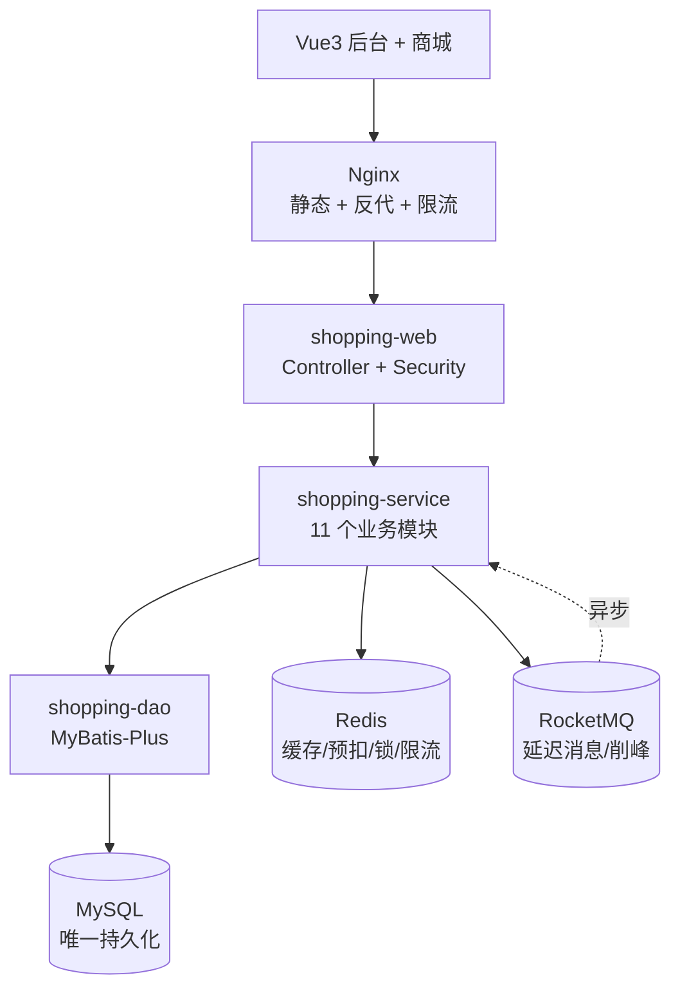

**画的时候标注三个数字/关键词**（这是让图「活起来」的关键）：

1. 在 Redis 旁写 **「Lua 预扣 · 挡 99% 秒杀流量」**；
2. 在 MQ 旁写 **「延迟消息 → 超时关单 · 削峰 → 异步下单」**；
3. 在 MySQL 旁写 **「条件扣减防超卖 · 唯一索引保幂等」**。

### 11.2 更完整的白板图（有时间时展开）

在简化图基础上，把三条链路画成分支：

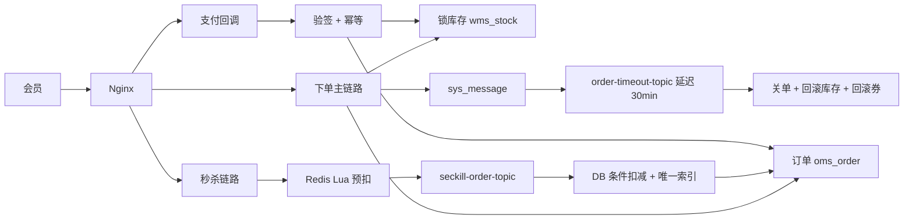

### 11.3 画图顺序（照着念，讲的时候手跟着画）

**固定顺序：从右到左画数据，从左到右画流量。** 具体：

1. **先画 MySQL**（最右下角）——「这是我的唯一持久化，所有表都在这儿」；
2. **画 Redis 和 RocketMQ**（MySQL 左边）——「Redis 干四件事：缓存、秒杀预扣、分布式锁、限流；MQ 干两件事：延迟消息关单、秒杀削峰」；
3. **画五层**（从上到下：web / service / dao / model，common 圈住）——「代码上是五个 Maven 模块，依赖严格单向」；
4. **画 HTTP 入口**（Nginx → web）——「Nginx 是第一道限流」；
5. **最后画客户端**（最上面）——「两端：Vue3 后台和 Vant 商城」；
6. **用不同颜色的箭头画三条链路**：下单（黑）、支付（蓝）、秒杀（红）。

**为什么要这个顺序**：先画「不变的东西」（存储），再画「变的东西」（链路）。这样你讲链路时手不用来回跑，面试官的视线也稳定。

### 11.4 讲解节奏

#### 30 秒版本（自我介绍时带过）

> 「这是一个单体多模块的 B2C 商城，五个 Maven 模块严格分层：web、service、dao、model，加一个公共模块。存储层是 MySQL 唯一持久化，Redis 负责缓存、秒杀预扣、分布式锁和限流，RocketMQ 负责超时关单的延迟消息和秒杀的流量削峰。我选单体是因为校招场景下微服务的调试成本和一致性成本远大于收益，但我在架构上预留了拆分路径。整个项目最大的亮点是秒杀：**Nginx 限流 → Redis Lua 原子预扣 → MQ 削峰 → DB 条件扣减 → 唯一索引兜底**，四层防超卖，压测结果是零超卖、MySQL 峰值 QPS 从 1.2 万降到 1800。」

#### 2 分钟版本（被要求「讲讲你的项目架构」时）

按这个结构讲，每部分一句话，**主动留钩子**：

1. **定位与选型（20 秒）**：「B2C 自营商城 + 秒杀，单体多模块。为什么不是微服务——校招阶段组件复杂度和一致性成本大于收益，而且面试官更想听清一个设计而不是看堆技术栈。」
2. **分层与约束（20 秒）**：「五层严格单向依赖，用 Maven Enforcer 在构建期、ArchUnit 在测试期强制。`model` 单独拆是为了打破 `dao` 和 `service` 的循环依赖；`common` 零业务。」
3. **一次请求的生命周期（20 秒）**：「以会员下单为例：traceId 过滤器 → JWT 认证 → 参数校验 → Controller → Service 开事务 → 锁库存、算价、写订单、落本地消息表、清购物车 → 提交后发延迟消息。**MQ 发送必须在事务外，靠本地消息表保证不丢**。」
4. **秒杀（40 秒，重点）**：「四层过滤：Nginx 按 IP 限流挡脚本；应用层 Redis+Lua 全局限流；Lua 脚本原子完成『库存判断 + 扣减 + 用户去重』，一次调用挡掉 99% 流量；中签的进 MQ 削峰，消费者再做 DB 条件扣减和唯一索引兜底。**Redis 只是挡板不是权威，防超卖的底线在 DB 的条件更新**。还有对账任务兜 Redis 和 DB 的差异。」
5. **一致性（20 秒）**：「不用 Seata——单库本地事务覆盖 95%，剩下跨进程的用本地消息表做最终一致，投递重试 + 幂等消费 + 死信告警。每个环节我都能讲清楚，这比『框架帮我搞定的』更有价值。」
6. **演进（20 秒）**：「如果量涨 100 倍，我按无状态到有状态的顺序改：先扩应用实例，再读写分离加缓存分层，然后拆服务——**第一个拆秒杀**，因为它资源特征最特殊且能异步化；交易放最后，因为拆它会产生分布式事务。最后才分库分表。」

### 11.5 可能被追问的问题清单（提前准备答案）

| 追问 | 一句核心答案 |
|---|---|
| 为什么不拆微服务？ | 校招场景组件成本 > 收益；单库本地事务能覆盖大部分一致性需求；我预留了拆分路径（见第 10 章） |
| 怎么防超卖？ | 四层：Redis Lua 预扣、MQ 削峰、DB `WHERE available - locked >= n` 条件扣减、唯一索引防重 |
| Redis 挂了秒杀怎么办？ | 快速失败返回「活动繁忙」，**绝不降级直连 DB**（会打穿）；DB 仍是权威库存 |
| 消息丢了怎么办？ | 本地消息表同事务落库 + `afterCommit` 投递 + 定时扫表补发 + 死信告警人工重放 |
| 幂等怎么做的？ | 唯一索引（最可靠）+ 状态机条件更新 + Redis token；按「能否识别出同一请求」选幂等键 |
| 缓存和 DB 不一致怎么办？ | 先改库后删缓存 + `afterCommit` 删 + 失败进消息表重试 + TTL 兜底 |
| 为什么不用 Seata？ | 单库不需要；本地消息表成本更低且每步可解释；拆服务后会改用事务消息 + 补偿 |
| 事务里能做 MQ 发送吗？ | 不能，外部 IO 不可回滚。用本地消息表或 `afterCommit` |
| 主从延迟怎么办？ | 写后读强制走主库（下单成功后短时间内的查询） |
| 你怎么知道系统出问题了？ | traceId 全链路（含跨 MQ 传递）+ 慢 SQL/慢接口告警 + 业务指标（支付成功率、超卖数、MQ 积压） |

---

## 附录 A · 本文与 00 号文档的对应关系

| 本文提到的 | 00 号文档出处 | 一致性 |
|---|---|---|
| 五个 Maven 模块与依赖方向 | §6 | 一致 |
| 11 个业务模块名 | §3 | 一致 |
| 全部表名（`sys_message` / `wms_stock_log` / `sms_seckill_record` 等） | §5 | 一致 |
| Phase 0-4 | §2 | 一致 |
| ADR-1 ~ ADR-10 | §7 | 一致 |
| 技术版本（JDK 17 / Boot 3.2.x / MP 3.5.x / Redis 7.x / RocketMQ 5.x / jjwt 0.12.x） | §4 | 一致 |
| 不引入 Nacos / Gateway / Seata / ShardingSphere / K8s | §4.1 | 一致（仅出现在「为什么不引入」的论证中） |
| 金额 `bigint` 存分 | §5 / ADR-3 | 一致 |
| 接口前缀 `/api/app/**` 与 `/api/admin/**` | §6 | 一致 |
| 多商户 `merchant_id` 预留 | §2 / §5 | 一致 |

## 附录 B · 后续文档衔接

| 文档 | 本文为它提供了什么 |
|---|---|
| `01-需求规格说明.md` | 秒杀的性能指标与防刷需求 |
| `02-数据库设计.md` | `sys_message` 表结构要点、四类唯一索引、`merchant_id` 预留与「防重表不参与逻辑删除」的例外 |
| `04-接口设计规范.md` | `Result<T>` 约定、traceId 响应头、秒杀结果轮询接口 |
| `05-开发规范.md` | 分层纪律、日志规范、事务使用禁忌（3.6）、幂等检查清单（7.3） |
| `06-测试与部署.md` | 秒杀压测目标（4.4.8）、Testcontainers 验证缓存与幂等、对账任务测试 |
