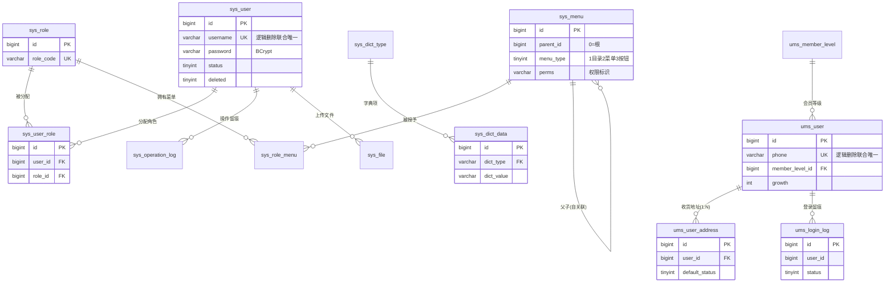
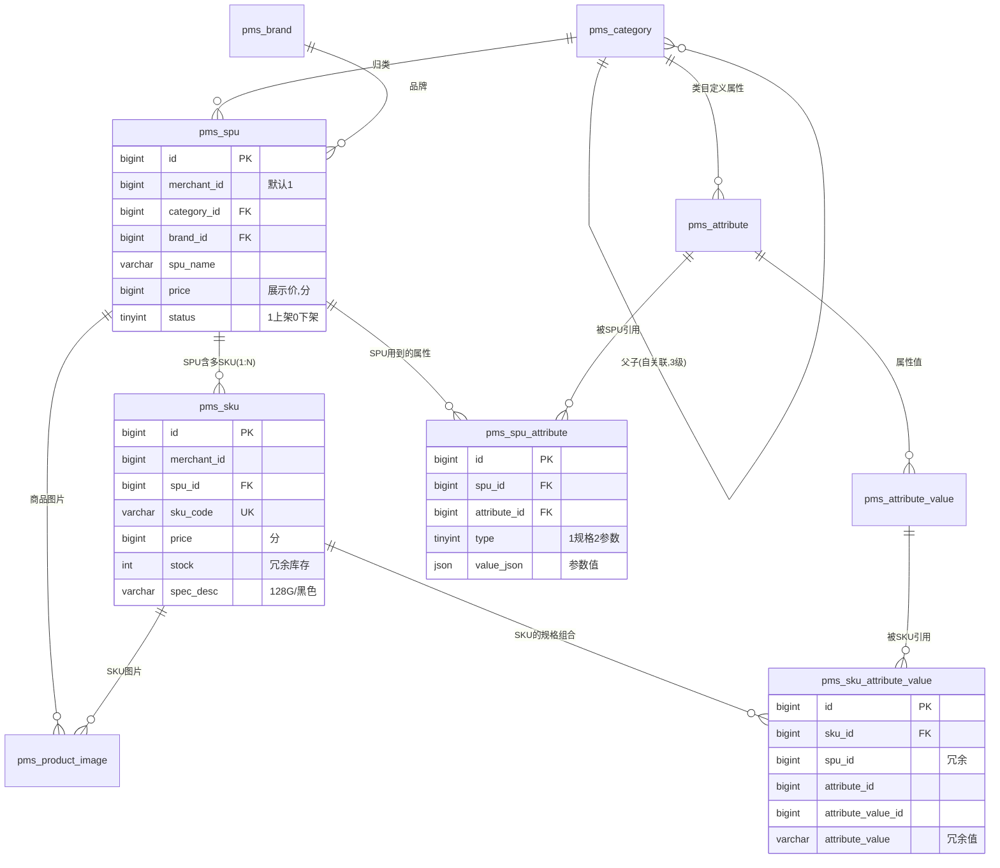
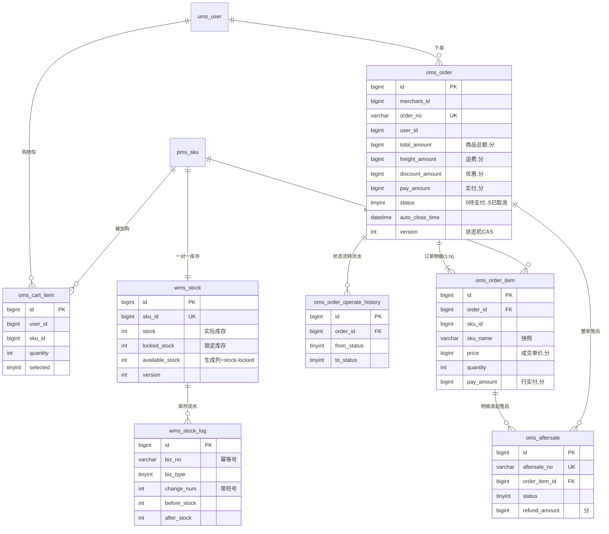
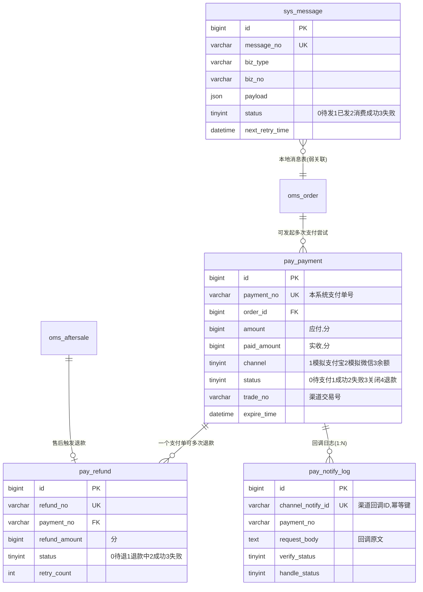
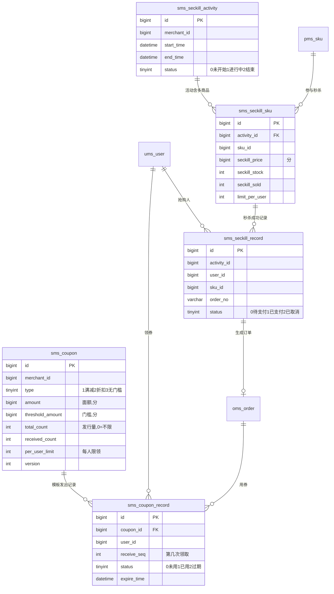
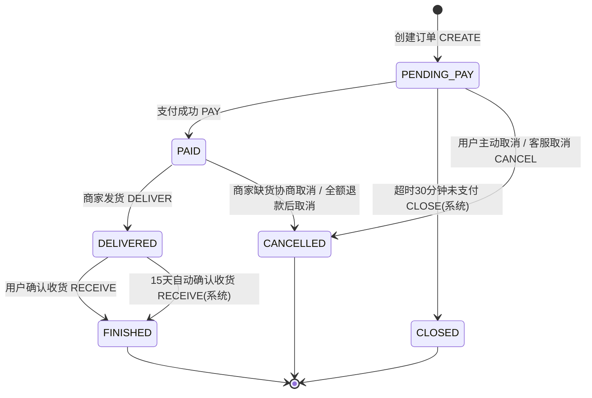

# 04 · 数据库设计

> 上游依赖：`00-蓝图与术语表.md`（唯一事实源）。本文的表名、模块名、阶段口径全部照抄 00 号文档 §5，**一张不多、一张不少**（Phase 1 共 22 张、Phase 2 共 11 张、Phase 3 共 5 张、Phase 4 共 3 张，合计 **41 张**）。
> 目标读者：写这个项目的你本人 + 面试官。照着本文可以**直接建库**，同时准备好回答索引、事务、锁、幂等、防超卖的追问。
>
> 约定环境：MySQL 8.0，`InnoDB`，`utf8mb4` / `utf8mb4_0900_ai_ci`。

---

## 1. 设计约定

这一节是全库的「宪法」。41 张表里任何一张如果违反了这里的约定，就是设计缺陷，不是风格问题。

### 1.1 每张表必含的 4 个公共字段

```sql
`id`          bigint   NOT NULL                COMMENT '主键，雪花ID',
`create_time` datetime NOT NULL DEFAULT CURRENT_TIMESTAMP COMMENT '创建时间',
`update_time` datetime NOT NULL DEFAULT CURRENT_TIMESTAMP ON UPDATE CURRENT_TIMESTAMP COMMENT '更新时间',
`deleted`     tinyint  NOT NULL DEFAULT 0      COMMENT '逻辑删除：0未删除 1已删除'
```

三个决策要说清楚：

**（1）为什么主键是雪花 ID 而不是 `AUTO_INCREMENT`**

| 维度 | 自增 ID | 雪花 ID（本项目） |
|---|---|---|
| 暴露业务量 | 竞对下单两次就知道你一天多少单 | 19 位无规律，不泄露 |
| 分库分表 / 多实例 | 需要改造（步长、号段） | 天生全局唯一，**预留演进路径** |
| 写入性能 | 顺序写，页分裂最少 | 趋势递增（同毫秒内递增），页分裂可控 |
| 前端安全 | `/order/1001` 可以遍历 | 无法遍历 |
| 成本 | 0 | 依赖机器时钟；**需处理时钟回拨** |

- 实现落在 `common.util.SnowflakeIdWorker`，`workerId` 从配置读取（单机固定 `1`，Phase 4 多实例时改成从 Redis 注册分配）。
- **时钟回拨怎么答**：检测到 `now < lastTimestamp` 时，(a) 回拨幅度小于 5ms 就自旋等待；(b) 大于 5ms 直接抛异常让请求失败（宁可失败也不生成可能重复的 ID）；(c) 更完善的做法是备用 workerId 兜底。本项目采用 (a)+(b)。
- **前端精度坑（必踩）**：雪花 ID 是 19 位 `long`，超过 JS `Number.MAX_SAFE_INTEGER`（2^53-1 ≈ 9007 万亿）。必须在 Jackson 里把 `Long` **全局序列化为 String**，否则前端拿到的是 `1234567890123456800` 这种被抹掉低位的错值，回传后端就查不到数据。

```java
// MybatisPlusConfig / JacksonConfig 中统一配置
@Bean
public Jackson2ObjectMapperBuilderCustomizer longToString() {
    return builder -> {
        builder.serializerByType(Long.class, ToStringSerializer.instance);
        builder.serializerByType(Long.TYPE, ToStringSerializer.instance);
    };
}
```

**（2）为什么用 `datetime` 而不是 `timestamp`**

`timestamp` 只到 2038 年，且受 `time_zone` 影响——同一行数据在不同会话读出来是不一样的，排查问题时非常痛苦。`datetime` 占 5 字节（MySQL 8 带精度）但语义清晰。**全库统一 `datetime`，连接串固定 `serverTimezone=Asia/Shanghai`。**

**（3）`deleted` 只用 0/1**

不用「删除时间戳」「删除人 ID」这类花活。0/1 让 MyBatis-Plus 的 `@TableLogic` 开箱即用：

```java
// 全局配置一次，所有 Mapper 的 select/update 自动追加 deleted = 0
mybatis-plus.global-config.db-config.logic-delete-field=deleted
mybatis-plus.global-config.db-config.logic-delete-value=1
mybatis-plus.global-config.db-config.logic-not-delete-value=0
```

> ⚠️ 注意：`@TableLogic` 只对 **MyBatis-Plus 生成的 SQL** 生效。手写的 XML / `@Select` 必须自己带上 `deleted = 0`，忘了就会「删了还能查出来」。这是本项目最常见的低级 bug。

### 1.2 字符集、排序规则与存储引擎

```sql
-- 建库语句
CREATE DATABASE IF NOT EXISTS `shopping_mall`
  DEFAULT CHARACTER SET utf8mb4
  DEFAULT COLLATE utf8mb4_0900_ai_ci;
```

- **`utf8mb4` 而不是 `utf8`**：MySQL 的 `utf8` 是阉割版（最多 3 字节），存不了 emoji 和部分生僻字。用户昵称、商品评价里一定有 emoji，用 `utf8` 会直接报 `Incorrect string value`。
- **`utf8mb4_0900_ai_ci` 而不是 `utf8mb4_general_ci`**：`0900_ai_ci` 基于 Unicode 9.0，排序更准；`ai` = accent insensitive，`ci` = case insensitive。**全库统一，避免 JOIN 时因排序规则不一致导致索引失效**（`Illegal mix of collations` 或隐式转换）。
- **`InnoDB`**：唯一支持事务和行级锁的引擎。MyISAM 是表锁，秒杀场景直接雪崩。没有第二个选项。

### 1.3 金额一律用 `bigint` 存「分」

**这是本项目 ADR-3，也是面试高频题，必须能讲透。**

| 方案 | 问题 |
|---|---|
| `double` / `float` | **二进制浮点无法精确表示 0.1**。`0.1 + 0.2 = 0.30000000000000004`。累加 1000 笔订单后差额能到几毛钱，对账永远对不平。**绝对不用。** |
| `decimal(10,2)` | 精确，能用。但 Java 侧要映射 `BigDecimal`，每次运算都要 `setScale` + 舍入模式，忘一次就出 `0.30000000000000004` 式的脏数据；且 `decimal` 在 MySQL 里是**变长存储 + 十进制运算**，比整数慢。 |
| **`bigint` 存分（本项目）** | 整数运算，天然精确、天然快、天然支持 `SUM()`。Java 侧就是 `Long`，无精度陷阱。 |

**落地规则：**

1. 库表里所有金额字段命名统一带 `_amount` 或 `price` 后缀，单位是**分**，字段注释必须写「单位：分」。
2. Java 侧统一 `Long`（`common.util.MoneyUtil` 提供工具方法）。
3. **只在最终展示时转换，中间全程用分**。

```java
public final class MoneyUtil {
    private MoneyUtil() {}

    /** 分 -> 元字符串，用于展示；永不返回 double */
    public static String fen2Yuan(Long fen) {
        if (fen == null) return "0.00";
        return BigDecimal.valueOf(fen, 2).toPlainString();  // 1234 -> "12.34"
    }

    /** 元 -> 分，用于接收前端输入；用 BigDecimal 避免 double 精度 */
    public static Long yuan2Fen(String yuan) {
        return new BigDecimal(yuan).movePointRight(2)
                .setScale(0, RoundingMode.HALF_UP).longValueExact();
    }

    /** 折扣计算：单价 * 数量 * 折扣百分比 / 100，四舍五入到分 */
    public static Long multiply(Long fen, int quantity, int discountPercent) {
        return BigDecimal.valueOf(fen)
                .multiply(BigDecimal.valueOf(quantity))
                .multiply(BigDecimal.valueOf(discountPercent))
                .divide(BigDecimal.valueOf(100), 0, RoundingMode.HALF_UP)
                .longValueExact();
    }
}
```

**前端怎么转（Vue 3）：**

```js
// 后端 Long 全局序列化成了字符串（因为雪花ID），所以金额也是字符串，先转 Number
export function toYuan(fen) {
  if (fen === null || fen === undefined || fen === '') return '0.00'
  return (Number(fen) / 100).toFixed(2)   // 1234 -> "12.34"
}

export function toFen(yuan) {
  return Math.round(Number(yuan) * 100)   // "12.34" -> 1234
}
```

> **面试追问「为什么后端 Long 全转 String 了金额也能算？」**
> 答：金额最大到「亿」级也只有 10^11 分，远小于 2^53，`Number()` 转换安全；真正危险的是 19 位雪花 ID，所以 ID 必须走字符串，金额走 `Number()` 后两位小数展示。**如果金额超过 9 万亿分（90 亿元）也不用担心**，因为单笔订单不可能到这个量级，而统计类金额（GMV）我们用 `SUM(bigint)` 在 DB 里算，返回给前端前已经 `BigDecimal` 处理过。

**容量核算（面试可以主动说）**：`bigint` 8 字节，`decimal(10,2)` 是 5 字节，看起来 decimal 更省。但 41 张表里金额字段总计不到 100 个，每行多 3 字节，100 万订单也就多 3MB。**用 3MB 换掉一整类精度 bug，非常划算。**

### 1.4 所有字段必须有 `COMMENT`

理由不是「规范好看」，而是三条实际收益：

1. **新人（也就是三个月后的你）不用翻代码猜字段含义。** `status` 是 `1` 还是 `0` 表示成功？只有注释能救你。
2. **可以从库里直接逆向出文档**：`SHOW FULL COLUMNS FROM oms_order;` 就是一份字段说明书。
3. **枚举值必须写在注释里**，格式统一为 `含义：值1=xx 值2=yy`，例如：

```sql
`status` tinyint NOT NULL DEFAULT 0 COMMENT '订单状态：0待支付 1待发货 2待收货 3已完成 4已关闭 5已取消',
```

### 1.5 索引命名规范

| 类型 | 命名 | 示例 |
|---|---|---|
| 主键 | `PRIMARY` | `PRIMARY KEY (id)` |
| 唯一索引 | `uk_字段` / `uk_字段1_字段2` | `uk_order_no`、`uk_user_id_sku_id` |
| 普通索引 | `idx_字段` / `idx_字段1_字段2` | `idx_user_id_status` |
| 组合索引 | 按**区分度从高到低**排列字段 | `idx_user_id_status_create_time` |

- 索引名一律**小写下划线**，长度不超过 64 字符（MySQL 限制）。
- 组合索引的字段顺序遵循**最左前缀**原则，并且优先把**等值条件**放前面、**范围/排序条件**放后面。反例：`idx_create_time_user_id` 在 `WHERE user_id = ? ORDER BY create_time` 下只能用到 `create_time`，因为 `user_id` 不在最左。
- **不建冗余索引**：有了 `idx_user_id_status(user_id, status)` 就不要再建 `idx_user_id(user_id)`——最左前缀已经覆盖，多一个索引就多一份写入开销和 buffer pool 占用。这条在代码 review 时要真的检查。

### 1.6 不建物理外键（FOREIGN KEY）

**DDL 里一个 `FOREIGN KEY` 都不写。** 这是主动决策，不是偷懒。面试被问到要能给出四条理由：

1. **性能**：外键约束会在**父表的被引用列**上加锁。典型的坑是「删一个 SPU」要去检查 `pms_sku`，`pms_sku` 的 `spu_id` 上加共享锁——高并发下极易出现**跨表锁等待甚至死锁**。秒杀场景下这是灾难。
2. **扩展性**：一旦要**分库分表**（Phase 4 之后的演进），跨库外键根本不存在。现在不建，将来不用拆。
3. **逻辑删除天然冲突**：本项目所有删除都是 `UPDATE ... SET deleted = 1`，物理外键的 `ON DELETE CASCADE` 永远不会触发，等于花钱买了个没用的约束；而 `deleted=1` 的「已删父行」在数据库看来依然是合法存在的行，外键也拦不住业务上的脏数据。
4. **运维**：`mysqldump` 的导入顺序、数据迁移、批量刷数据都要先关 `FOREIGN_KEY_CHECKS=0`，等于平时不用、出事才想起。

**那靠什么保证参照完整性？** 三层：

- **应用层**：Service 在写子表前先校验父行存在（用 MyBatis-Plus 的 `getById`，走主键索引，成本极低）。
- **数据层**：所有 JOIN 都走索引列，且业务上「先有父后有子」，靠**写入顺序**保证。
- **对账层**：定时任务（Phase 3）跑一致性校验 SQL，例如找出孤儿明细：

```sql
-- 每天凌晨跑一次，找出没有主单的订单明细（正常应返回 0 行）
SELECT i.id, i.order_id
FROM oms_order_item i
LEFT JOIN oms_order o ON o.id = i.order_id
WHERE o.id IS NULL
LIMIT 100;
```

### 1.7 逻辑删除与唯一索引的冲突（高频面试题，单独讲）

**问题**：`sys_user` 上要保证「用户名唯一」，于是建 `UNIQUE KEY uk_username (username)`。现在用户 `tom` 被逻辑删除了（`deleted = 1`），他想重新注册 `tom`——**插入直接报 `Duplicate entry 'tom' for key 'uk_username'`**。因为物理行还在，唯一索引照样管它。

**四种解法，本项目按场景选用：**

**方案 A（本项目主用）：唯一索引带上 `deleted` 列**

```sql
UNIQUE KEY `uk_username` (`username`, `deleted`)
```

- 效果：`(tom, 0)` 只允许一行 → **保证「未删除的用户名唯一」这个真正需要的语义**；同时允许存在 `(tom, 1)`。
- 局限：`deleted` 只有 0/1 两个值，所以**同一个用户名最多只能有一条已删记录**。第二次删除同名用户会撞车。
- 适用：绝大多数业务表。因为「同一个名字反复删了又建」在真实业务里很少见，而且撞上时还有方案 C 兜底。
- **这就是本项目 41 张表里 `uk_*` 的标准写法**（少数不吃逻辑删除的表除外，见下）。

**方案 B：`deleted` 存「删除时的主键 ID」，未删除为 0**

```sql
`deleted` bigint NOT NULL DEFAULT 0   -- 0=未删；删除时写入本行 id
UNIQUE KEY `uk_username` (`username`, `deleted`)
```

- 效果：**完美**。因为每行的 `id` 唯一，删除后 `(tom, 1001)`、`(tom, 1002)` 都不会冲突，可以无限次重建同名。
- 代价：`deleted` 从 `tinyint` 变成 `bigint`，**违反了本文 §1.1 的约定**，且 MyBatis-Plus 的 `logic-delete-value` 得改成动态值（要写自定义 SQL 或拦截器）。
- 结论：**本项目不用**，但面试时一定要讲——这是能体现你「知道更好的方案，并且权衡后没选」的加分点。

**方案 C（兜底）：删除时改写唯一列**

```sql
-- 删除用户时，顺手把唯一列改名，彻底释放原名
UPDATE `sys_user`
SET `deleted` = 1,
    `username` = CONCAT(`username`, '_del_', `id`)
WHERE `id` = ? AND `deleted` = 0;
```

- 优点：不依赖索引技巧，**任何列都能用**（包括 `phone` 这种「删除后号码要能重新注册」的场景）。
- 缺点：数据「被改脏」了，想看历史原值只能靠日志；且 `username` 字段长度要留出后缀余量。
- 适用：手机号、邮箱这类**强唯一且需释放**的字段。

**方案 D（MySQL 8 优雅解）：生成列 + 唯一索引（部分索引的替代）**

MySQL 不支持 `WHERE deleted = 0` 的部分索引，但可以用**虚拟生成列**模拟——已删除行的生成列为 `NULL`，而**唯一索引允许多个 NULL**：

```sql
`username` varchar(64) NOT NULL COMMENT '登录账号',
`deleted`  tinyint     NOT NULL DEFAULT 0 COMMENT '逻辑删除：0未删 1已删',
`uk_username` varchar(64) GENERATED ALWAYS AS (IF(`deleted` = 0, `username`, NULL)) VIRTUAL
    COMMENT '活跃行唯一键：已删除时为NULL，绕开唯一约束',
UNIQUE KEY `uk_username` (`uk_username`)
```

- 效果：**和方案 B 一样完美**，且 `deleted` 仍是 `tinyint`。
- 代价：多一个虚拟列（不占存储，只在索引里）；MyBatis-Plus 实体里该字段必须标 `@TableField(exist = false)` 或 `insertStrategy = NEVER`，**否则 INSERT 会因为「给生成列赋值」报错 3105**。
- 本项目选择：**不默认使用**，因为 41 张表都这么写会显著增加理解和维护成本；只在**真的需要「反复删除重建同名」**的表上启用。

**决策总结表：**

| 场景 | 采用方案 |
|---|---|
| 一般业务表的唯一约束（`uk_order_no`、`uk_payment_no` 等业务单号） | **方案 A**，且单号类字段**不带 `deleted`**（见下） |
| 账号、昵称等「删了要能重建」的字段 | 方案 A + 方案 C 兜底 |
| 手机号、邮箱 | 方案 A + 方案 C 兜底 |
| 需要严格无限重建 | 方案 D（按需局部启用） |

**一个重要例外**：`oms_order.order_no`、`pay_payment.payment_no` 这类**业务单号**的唯一索引**不带 `deleted`**：

```sql
UNIQUE KEY `uk_order_no` (`order_no`)
```

理由：单号是**全局唯一凭证**，即使订单被逻辑删除，这个单号也**永远不允许被再次使用**（否则对账时一个单号对应两笔业务，事故）。所以这里的唯一性必须是**物理层面**的。同理适用于：`wms_stock_log` 的幂等唯一索引、`sms_seckill_record` 的防重唯一索引——**这些是「安全约束」，不是「业务展示约束」，必须严格**。

### 1.8 多商户预留：`merchant_id`

按 00 号文档 §5 的规定，以下 6 张表**从 Phase 1 起就带 `merchant_id bigint NOT NULL DEFAULT 1`**：

`pms_spu`、`pms_sku`、`oms_order`、`oms_order_item`、`wms_stock`、`sms_seckill_activity`

本文在此基础上，把 `merchant_id` 继续下沉到**所有交易与库存流水类表**（不新增表，只加字段，不违反唯一事实源）：

| 追加了 `merchant_id` 的表 | 理由 |
|---|---|
| `oms_order_operate_history` | 商家后台查「我的订单操作记录」需按商户过滤 |
| `oms_aftersale` | 售后单要落到具体商家，否则退款无法分账 |
| `pay_payment` / `pay_refund` | Phase 4 分账结算必须知道钱属于谁 |
| `wms_stock_log` | 库存流水按商家查询与对账 |
| `oms_cart_item` | 购物车结算时要按商户拆单（Phase 4 核心逻辑） |
| `sms_seckill_sku` / `sms_seckill_record` | 秒杀订单同样要归属商家 |
| `sms_coupon` | 优惠券是商家出资的，必须归属 |

**明确不加 `merchant_id` 的表，以及为什么：**

- `pms_category` / `pms_brand` / `pms_attribute` / `pms_attribute_value`：这是**平台级基础数据**（类比淘宝的一级类目、品牌库），由平台统一维护，商家只能选择不能新增。给它们加 `merchant_id` 会导致「每个商家都有一套自己的类目树」，前端筛选和聚合彻底失控。
- `sys_*` / `ums_*` / `mms_*`：系统与用户域，与商户隔离无关。
- `sys_message` / `pay_notify_log` / `wms_stock_log` 之外的日志表：日志按业务单号回溯，不参与商户维度的数据隔离。

**Phase 1-3 怎么用**：所有写入都写死 `1`（`DEFAULT 1` 保证就算代码漏了也有兜底）；所有查询**不加** `merchant_id` 条件，所以**没有性能损失**。到 Phase 4 只需在 Service 层加一个 `MerchantContext.getMerchantId()` 拼条件，或上一个 MyBatis-Plus 的 `TenantLineInnerInterceptor`，**核心表一行不用改**。

> **面试话术**：「我在 Phase 1 就在商品、订单、库存、秒杀表上预留了 `merchant_id` 并默认写 1，P1-P3 是纯自营没有额外复杂度；到 Phase 4 只需补 `mms_*` 三张表和租户拦截器，就能演进成多商户，不用重构核心表。这是架构预判，不是提前优化——因为**加字段的成本是 0，改表的成本是停机。**

### 1.9 其它约定

| 项 | 约定 |
|---|---|
| 表名 / 字段名 | 全小写 + 下划线，**不用复数**（`oms_order` 不是 `oms_orders`） |
| 布尔语义字段 | `tinyint`，`1` 表示真/是/启用（`status`、`is_show`、`selected`、`default_status`） |
| 状态字段 | 一律 `tinyint`，语义写在 `COMMENT` 里；**不用 `varchar` 存 'PAID'**（占空间、比较慢、拼错不报错） |
| 枚举 | Java 侧 `common.enums` 用枚举类承载，与库里的 `tinyint` 一一对应，**绝不裸写魔法数字** |
| JSON 字段 | 用 `json` 类型（MySQL 8 原生），只在「整块读写、不参与条件查询」的场景用，例如 `spec_json`、`scope_ids` |
| 大文本 | 商品详情用 `longtext`，日志报文用 `text`；**不放进主表高频查询的覆盖范围** |
| 表注释 | 每张表必须有 `COMMENT='中文表名'` |
| 时间精度 | 不显式写精度，默认秒级。秒杀流水若需毫秒，单独用 `datetime(3)`（本项目 `wms_stock_log` 保持秒级，靠 `id` 递增排序即可） |

---

## 2. ER 关系总览

**为什么拆成 5 张图**：41 张表画一张图必然是「毛线球」，面试时掏出来对方也看不清。按**领域**拆开，每张图讲一个故事，反而更能体现你的建模能力：**每个领域的聚合边界在哪里、谁引用谁、哪些是强弱关系。**

### 2.1 用户与权限域（system + user + auth，共 13 张）



**读图要点（面试可讲）**：

- `sys_user_role`、`sys_role_menu` 是**纯关联表**，没有业务字段，主键依然是雪花 ID 而非联合主键——因为 MyBatis-Plus 的 `BaseMapper` 需要单主键，且联合主键在分库分表时会变成灾难。
- `sys_menu` **自关联**成树，`parent_id = 0` 表示根节点。菜单树全量加载到 Redis 后递归组装，**不做递归 SQL**（MySQL 8 的 `WITH RECURSIVE` 能写，但每次请求都跑一遍就没必要）。
- `ums_user` 与 `sys_user` **是两套独立的账号体系**：前者是 C 端会员（手机号 + 验证码登录），后者是后台管理员（账号密码登录）。**不合并**——合并会让权限模型和会员模型互相污染。
- `ums_user_address` 与 `ums_user` 是 1:N，`default_status = 1` 的地址**每用户至多一条**，靠应用层在事务里「先全部置 0、再置 1」保证，**不靠数据库唯一索引**（因为 `(user_id, default_status)` 上建唯一索引会导致「只能有一条非默认地址」，直接锁死了）。

### 2.2 商品模型域（product，共 9 张）



**读图要点（这是全文最重要的一张图）**：

- **`SPU : SKU = 1 : N`**。`pms_spu` 描述「iPhone 15 是什么」，`pms_sku` 描述「iPhone 15 128G 黑色卖多少钱、还剩几件」。
- **`pms_sku_attribute_value` 是「SKU ↔ 属性值」的多对多桥表**，它记录了「这个 SKU 在『颜色』这个属性上取的是『黑色』」。**一个 SKU 在每个属性上只能有一个值**，这条业务规则直接落成唯一索引 `uk_sku_id_attribute_id`。
- 该表为什么**冗余 `spu_id` / `attribute_name` / `attribute_value`**：商品详情页要「按 SPU 一次性查出所有 SKU 的规格组合」来做规格选择器，有 `spu_id` 就能一条 SQL 搞定，省掉一次 JOIN `pms_sku`。这是**用少量存储换查询次数**的典型取舍，细节见 §4.1。
- `pms_product_image` 同时挂 SPU 和 SKU，用 `sku_id = 0` 表示「这是 SPU 级图片」。**为什么不用两个字段可空**：`sku_id` 可空会让索引出现 NULL，查询要写 `sku_id IS NULL OR sku_id = ?`，无法走索引；用 `0` 作哨兵值，索引友好得多。

### 2.3 交易与库存域（cart + inventory + trade + aftersale，共 7 张）



**读图要点**：

- **`oms_order : oms_order_item` 用 `||--|{`（一对一到一对多）**：订单主表一条记录至少对应一条明细，明细是「下单那一刻的商品快照」。
- **「快照」是交易域的核心思想**：`oms_order_item` 里的 `sku_name`、`sku_image`、`price` 都不是外键，而是**下单时刻的副本**。因为商品随时会改名、改价、下架甚至删除，**订单必须能独立还原历史真相**。这是电商建模和普通 CRUD 最大的区别。
- **`wms_stock : wms_stock_log`**：前者是**状态表**（当前库存是多少），后者是**流水表**（怎么变成这个数的）。状态表用来做条件更新防超卖，流水表用来做幂等与审计。**两者缺一不可**。
- **`oms_aftersale` 挂在 `oms_order_item` 上而不是只挂订单**：因为退款的粒度是「某一个 SKU 退几件」，必须落到明细行。

### 2.4 支付域（payment，共 3 张 + 本地消息表）



**读图要点**：

- **`oms_order` 与 `pay_payment` 是 1:N**：一个订单允许**多次支付尝试**（第一次用户关了收银台、超时关闭支付单，用户可以重新发起）。所以「订单：支付单」不是一对一。
- **`pay_payment : pay_refund` = 1:N**：一个支付单可以部分退款多次。
- **`pay_notify_log.channel_notify_id` 是支付幂等的第一道闸门**，唯一索引直接拦掉渠道的重复推送，详见 §4.4。
- **`sys_message` 用 `}o--||` 是因为它不持有物理外键**，只是通过 `biz_type + biz_no` 弱关联到 `oms_order`，这正是「本地消息表」的设计意图：**消息表只关心「有没有发出去、有没有被消费」，不关心业务表长什么样。**

### 2.5 营销与秒杀域（promotion，共 5 张）



**读图要点**：

- **`sms_coupon_record` 的 `receive_seq` 是解决「限领 N 张」的唯一索引技巧**：`UNIQUE KEY (coupon_id, user_id, receive_seq)`。想领第 2 张就必须写 `receive_seq = 2`，写重复了数据库直接拒绝。这比「先 SELECT COUNT 再 INSERT」的检查-执行竞态**安全一个量级**，详见 §6 的 SQL-7。
- **`sms_seckill_record` 上的 `UNIQUE KEY (activity_id, user_id)` 是防重复下单的最后一道防线**，也是面试官最爱问的「唯一索引兜底」的落点，详见 §4.5 与 §7。

---

## 3. 逐表 DDL

### 3.0 关于本章的阅读方式

- 表顺序**严格按 00 号文档 §5 的 Phase 1 → 2 → 3 → 4**，模块内按「先主表后从表」排列。
- 每张表给出**可直接执行的完整 `CREATE TABLE`**（MySQL 8.0，含反引号、注释、索引）。
- 每张表后有 **字段说明表**（只解释关键/易误解字段）与 **索引设计说明**（**每个索引服务哪条具体查询**）。
- CRUD 表不做过长展开；深度分析集中在 §4 指定的 5 组表。
- 所有 DDL 都带了 `DROP TABLE IF EXISTS` 便于**反复执行脚本**（生产环境请把 `DROP` 去掉或换成 `CREATE TABLE IF NOT EXISTS`，见 §9）。

---

### 3.1 Phase 1 · `system` 模块（9 张）

#### 3.1.1 `sys_user` — 后台用户

```sql
DROP TABLE IF EXISTS `sys_user`;
CREATE TABLE `sys_user` (
  `id`              bigint       NOT NULL                COMMENT '主键，雪花ID',
  `username`        varchar(64)  NOT NULL                COMMENT '登录账号',
  `password`        varchar(100) NOT NULL                COMMENT 'BCrypt 加密后的密码（60位，留余量）',
  `nickname`        varchar(64)  NOT NULL DEFAULT ''     COMMENT '昵称/显示名',
  `real_name`       varchar(64)           DEFAULT NULL   COMMENT '真实姓名',
  `avatar`          varchar(500)          DEFAULT NULL   COMMENT '头像 URL',
  `phone`           varchar(20)           DEFAULT NULL   COMMENT '手机号',
  `email`           varchar(64)           DEFAULT NULL   COMMENT '邮箱',
  `gender`          tinyint      NOT NULL DEFAULT 0      COMMENT '性别：0未知 1男 2女',
  `dept_name`       varchar(64)           DEFAULT NULL   COMMENT '所属部门（本项目不做部门树，只留名称）',
  `status`          tinyint      NOT NULL DEFAULT 1      COMMENT '状态：1启用 0禁用',
  `last_login_time` datetime              DEFAULT NULL   COMMENT '最后登录时间',
  `last_login_ip`   varchar(64)           DEFAULT NULL   COMMENT '最后登录IP',
  `pwd_update_time` datetime              DEFAULT NULL   COMMENT '密码最后修改时间，用于强制改密策略',
  `remark`          varchar(255)          DEFAULT NULL   COMMENT '备注',
  `create_time`     datetime     NOT NULL DEFAULT CURRENT_TIMESTAMP COMMENT '创建时间',
  `update_time`     datetime     NOT NULL DEFAULT CURRENT_TIMESTAMP ON UPDATE CURRENT_TIMESTAMP COMMENT '更新时间',
  `deleted`         tinyint      NOT NULL DEFAULT 0      COMMENT '逻辑删除：0未删除 1已删除',
  PRIMARY KEY (`id`),
  UNIQUE KEY `uk_username` (`username`, `deleted`),
  KEY `idx_phone` (`phone`),
  KEY `idx_status` (`status`),
  KEY `idx_create_time` (`create_time`)
) ENGINE=InnoDB DEFAULT CHARSET=utf8mb4 COLLATE=utf8mb4_0900_ai_ci COMMENT='后台用户表';
```

**字段说明**

| 字段 | 说明 |
|---|---|
| `password` | 存 **BCrypt 哈希**，绝不用 MD5/SHA1（可彩虹表反查）。BCrypt 自带随机盐，同一个密码每次哈希结果都不同，所以**不能用来做等值查询**——只能 `SELECT ... WHERE username = ?` 后用 `matches()` 校验。长度给 `100` 是因为 BCrypt 定长 60，留余量以便将来换 `$2b$` 或加前缀。 |
| `username` | 唯一索引是 `(username, deleted)` 复合，见 §1.7 方案 A。 |
| `status` | 禁用后 JWT 仍可能有效，所以**登出/禁用时要往 Redis 写黑名单**，不能只靠这个字段。这是面试常问的「你怎么让 JWT 立即失效」。 |

**索引设计说明**

| 索引 | 服务的查询 | 说明 |
|---|---|---|
| `PRIMARY (id)` | `getById`、`@TableId` 更新 | 雪花 ID 主键，所有按 ID 的操作走聚簇索引，最快。 |
| `uk_username (username, deleted)` | 登录 `SELECT ... WHERE username = ? AND deleted = 0` | 等值查询走 `const`，且顺带保证「活跃账号名唯一」。 |
| `idx_phone (phone)` | 后台按手机号搜用户 | 单列即可，管理端不常查，不做复合。 |
| `idx_status (status)` | 管理端按启停状态筛选 | 区分度低（只有 0/1），**数据量小时优化器可能不用它**，这是正常的，不要为此删掉。 |
| `idx_create_time (create_time)` | 列表默认按创建时间倒序 + 时间区间筛选 | 管理端列表 `ORDER BY create_time DESC` 依赖它避免 filesort。 |

#### 3.1.2 `sys_role` — 角色

```sql
DROP TABLE IF EXISTS `sys_role`;
CREATE TABLE `sys_role` (
  `id`          bigint      NOT NULL                COMMENT '主键，雪花ID',
  `role_name`   varchar(64) NOT NULL                COMMENT '角色名称，如「超级管理员」',
  `role_code`   varchar(64) NOT NULL                COMMENT '角色编码，如 SUPER_ADMIN / OPERATOR',
  `data_scope`  tinyint     NOT NULL DEFAULT 1      COMMENT '数据范围：1全部 2本商户 3仅本人',
  `sort`        int         NOT NULL DEFAULT 0      COMMENT '排序，值越小越靠前',
  `status`      tinyint     NOT NULL DEFAULT 1      COMMENT '状态：1启用 0禁用',
  `remark`      varchar(255)         DEFAULT NULL   COMMENT '备注',
  `create_time` datetime    NOT NULL DEFAULT CURRENT_TIMESTAMP COMMENT '创建时间',
  `update_time` datetime    NOT NULL DEFAULT CURRENT_TIMESTAMP ON UPDATE CURRENT_TIMESTAMP COMMENT '更新时间',
  `deleted`     tinyint     NOT NULL DEFAULT 0      COMMENT '逻辑删除：0未删除 1已删除',
  PRIMARY KEY (`id`),
  UNIQUE KEY `uk_role_code` (`role_code`, `deleted`),
  KEY `idx_status_sort` (`status`, `sort`)
) ENGINE=InnoDB DEFAULT CHARSET=utf8mb4 COLLATE=utf8mb4_0900_ai_ci COMMENT='后台角色表';
```

**字段说明**

| 字段 | 说明 |
|---|---|
| `role_code` | **代码里做权限判断用 `role_code`，不用 `id`**。因为 `id` 是雪花 ID，在不同环境（开发/测试/生产）值不同，写死在 `@PreAuthorize("hasRole('SUPER_ADMIN')")` 里就废了。 |
| `data_scope` | Phase 4 多商户的数据隔离维度：平台管理员 = `1`，商家管理员 = `2`。现在加好，Phase 4 直接读。 |

**索引设计说明**

| 索引 | 服务的查询 |
|---|---|
| `uk_role_code (role_code, deleted)` | 登录后按角色编码加载权限：`WHERE role_code IN ('SUPER_ADMIN') AND deleted = 0`；以及保证编码不重复。 |
| `idx_status_sort (status, sort)` | 角色下拉框：`WHERE status = 1 ORDER BY sort`。等值列在前、排序列在后，**排序走索引无需 filesort**。 |

#### 3.1.3 `sys_user_role` — 用户-角色关联

```sql
DROP TABLE IF EXISTS `sys_user_role`;
CREATE TABLE `sys_user_role` (
  `id`          bigint   NOT NULL                COMMENT '主键，雪花ID',
  `user_id`     bigint   NOT NULL                COMMENT '用户ID，逻辑关联 sys_user.id',
  `role_id`     bigint   NOT NULL                COMMENT '角色ID，逻辑关联 sys_role.id',
  `create_time` datetime NOT NULL DEFAULT CURRENT_TIMESTAMP COMMENT '创建时间',
  `update_time` datetime NOT NULL DEFAULT CURRENT_TIMESTAMP ON UPDATE CURRENT_TIMESTAMP COMMENT '更新时间',
  `deleted`     tinyint  NOT NULL DEFAULT 0      COMMENT '逻辑删除：0未删除 1已删除',
  PRIMARY KEY (`id`),
  UNIQUE KEY `uk_user_id_role_id` (`user_id`, `role_id`, `deleted`),
  KEY `idx_role_id` (`role_id`)
) ENGINE=InnoDB DEFAULT CHARSET=utf8mb4 COLLATE=utf8mb4_0900_ai_ci COMMENT='后台用户-角色关联表';
```

**字段说明**：无业务字段，纯关联表。

**索引设计说明**

| 索引 | 服务的查询 |
|---|---|
| `uk_user_id_role_id (user_id, role_id, deleted)` | ① 防止重复授权；② 登录时「查我的角色」`WHERE user_id = ? AND deleted = 0` 走最左前缀 `user_id`，直接命中。 |
| `idx_role_id (role_id)` | **反向查询**：删角色前查「这个角色被哪些用户用了」`WHERE role_id = ?`。没有它就得全表扫。关联表**两个方向都要建索引**，这是标准做法。 |

#### 3.1.4 `sys_menu` — 菜单/权限点

```sql
DROP TABLE IF EXISTS `sys_menu`;
CREATE TABLE `sys_menu` (
  `id`          bigint       NOT NULL                COMMENT '主键，雪花ID',
  `parent_id`   bigint       NOT NULL DEFAULT 0      COMMENT '父菜单ID，0表示根节点',
  `menu_name`   varchar(64)  NOT NULL                COMMENT '菜单名称',
  `menu_type`   tinyint      NOT NULL DEFAULT 1      COMMENT '类型：1目录 2菜单 3按钮',
  `path`        varchar(200)          DEFAULT NULL   COMMENT '前端路由路径，如 /system/user',
  `component`   varchar(200)          DEFAULT NULL   COMMENT '前端组件路径，如 system/user/index',
  `perms`       varchar(128)          DEFAULT NULL   COMMENT '权限标识，如 system:user:add',
  `icon`        varchar(64)           DEFAULT NULL   COMMENT '菜单图标',
  `sort`        int          NOT NULL DEFAULT 0      COMMENT '同级排序，值越小越靠前',
  `visible`     tinyint      NOT NULL DEFAULT 1      COMMENT '是否在菜单中显示：1显示 0隐藏',
  `keep_alive`  tinyint      NOT NULL DEFAULT 1      COMMENT '是否缓存页面：1是 0否',
  `status`      tinyint      NOT NULL DEFAULT 1      COMMENT '状态：1启用 0禁用',
  `create_time` datetime     NOT NULL DEFAULT CURRENT_TIMESTAMP COMMENT '创建时间',
  `update_time` datetime     NOT NULL DEFAULT CURRENT_TIMESTAMP ON UPDATE CURRENT_TIMESTAMP COMMENT '更新时间',
  `deleted`     tinyint      NOT NULL DEFAULT 0      COMMENT '逻辑删除：0未删除 1已删除',
  PRIMARY KEY (`id`),
  UNIQUE KEY `uk_perms` (`perms`, `deleted`),
  KEY `idx_parent_id_sort` (`parent_id`, `sort`),
  KEY `idx_menu_type` (`menu_type`)
) ENGINE=InnoDB DEFAULT CHARSET=utf8mb4 COLLATE=utf8mb4_0900_ai_ci COMMENT='后台菜单与权限点表';
```

**字段说明**

| 字段 | 说明 |
|---|---|
| `menu_type` | **目录/菜单/按钮三级**都用这一张表。`3`（按钮）没有 `path`/`component`，只有 `perms`。这样「页面访问权限」和「接口调用权限」共用一套模型。 |
| `perms` | 权限字符串，格式 `模块:资源:动作`，如 `system:user:add`。Spring Security 侧用 `@PreAuthorize("hasAuthority('system:user:add')")` 校验。**它是可空的**（目录节点不需要），所以唯一索引里允许 NULL——MySQL 唯一索引允许多个 NULL，正好。 |
| `parent_id = 0` | 哨兵值而非 NULL，理由同 §2.2 的 `sku_id = 0`：**索引对 NULL 的处理不一致，用哨兵值查询计划更稳定**。 |

**索引设计说明**

| 索引 | 服务的查询 |
|---|---|
| `uk_perms (perms, deleted)` | 保证权限标识全局唯一（防止两个接口挂同一个权限点导致越权判断混乱）。 |
| `idx_parent_id_sort (parent_id, sort)` | 加载菜单树：`WHERE parent_id = ? ORDER BY sort`（懒加载方式），或全量加载后内存组装。 |
| `idx_menu_type (menu_type)` | 只查按钮权限点：`WHERE menu_type = 3`（角色授权弹窗勾选权限点用）。 |

#### 3.1.5 `sys_role_menu` — 角色-菜单关联

```sql
DROP TABLE IF EXISTS `sys_role_menu`;
CREATE TABLE `sys_role_menu` (
  `id`          bigint   NOT NULL                COMMENT '主键，雪花ID',
  `role_id`     bigint   NOT NULL                COMMENT '角色ID',
  `menu_id`     bigint   NOT NULL                COMMENT '菜单/权限点ID',
  `create_time` datetime NOT NULL DEFAULT CURRENT_TIMESTAMP COMMENT '创建时间',
  `update_time` datetime NOT NULL DEFAULT CURRENT_TIMESTAMP ON UPDATE CURRENT_TIMESTAMP COMMENT '更新时间',
  `deleted`     tinyint  NOT NULL DEFAULT 0      COMMENT '逻辑删除：0未删除 1已删除',
  PRIMARY KEY (`id`),
  UNIQUE KEY `uk_role_id_menu_id` (`role_id`, `menu_id`, `deleted`),
  KEY `idx_menu_id` (`menu_id`)
) ENGINE=InnoDB DEFAULT CHARSET=utf8mb4 COLLATE=utf8mb4_0900_ai_ci COMMENT='角色-菜单权限关联表';
```

**索引设计说明**

| 索引 | 服务的查询 |
|---|---|
| `uk_role_id_menu_id (role_id, menu_id, deleted)` | ① 防止重复授权同一菜单；② 加载某角色的全部权限 `WHERE role_id = ? AND deleted = 0`，命中。 |
| `idx_menu_id (menu_id)` | 反向：删菜单前查引用。 |

> **为什么关联表也要 `deleted`**：用户「取消勾选 → 再勾回来」时，逻辑删除让这条记录留着，重新勾选时是 `UPDATE deleted = 0`（或插入新行）。**代价是同一对 `(role_id, menu_id)` 会累积多行**。所以本项目在 Service 层对关联表采取「**物理删除**」策略（`deleted` 字段保留但不使用），因为这属于**授权关系而非业务数据**，不需要追溯。这是「约定存在，但要知道什么时候不用」的典型例子——面试时主动说出来，比机械遵守规范更得分。

#### 3.1.6 `sys_dict_type` — 字典类型

```sql
DROP TABLE IF EXISTS `sys_dict_type`;
CREATE TABLE `sys_dict_type` (
  `id`          bigint      NOT NULL                COMMENT '主键，雪花ID',
  `dict_name`   varchar(64) NOT NULL                COMMENT '字典名称，如「订单状态」',
  `dict_type`   varchar(64) NOT NULL                COMMENT '字典类型编码，如 order_status',
  `status`      tinyint     NOT NULL DEFAULT 1      COMMENT '状态：1启用 0禁用',
  `remark`      varchar(255)         DEFAULT NULL   COMMENT '备注',
  `create_time` datetime    NOT NULL DEFAULT CURRENT_TIMESTAMP COMMENT '创建时间',
  `update_time` datetime    NOT NULL DEFAULT CURRENT_TIMESTAMP ON UPDATE CURRENT_TIMESTAMP COMMENT '更新时间',
  `deleted`     tinyint     NOT NULL DEFAULT 0      COMMENT '逻辑删除：0未删除 1已删除',
  PRIMARY KEY (`id`),
  UNIQUE KEY `uk_dict_type` (`dict_type`, `deleted`),
  KEY `idx_status` (`status`)
) ENGINE=InnoDB DEFAULT CHARSET=utf8mb4 COLLATE=utf8mb4_0900_ai_ci COMMENT='字典类型表';
```

**索引设计说明**：`uk_dict_type` 服务「按编码取字典」的前置校验与唯一性；`idx_status` 服务后台字典列表筛选。字典数据**总量极小（几十行）**，启动时全量加载进 Redis，**不构成任何性能压力**，索引主要是为了约束而非性能。

#### 3.1.7 `sys_dict_data` — 字典数据

```sql
DROP TABLE IF EXISTS `sys_dict_data`;
CREATE TABLE `sys_dict_data` (
  `id`          bigint       NOT NULL                COMMENT '主键，雪花ID',
  `dict_type`   varchar(64)  NOT NULL                COMMENT '字典类型编码，逻辑关联 sys_dict_type.dict_type',
  `dict_label`  varchar(64)  NOT NULL                COMMENT '字典标签（展示值），如「待支付」',
  `dict_value`  varchar(64)  NOT NULL                COMMENT '字典键值（存储值），如 0',
  `sort`        int          NOT NULL DEFAULT 0      COMMENT '排序，值越小越靠前',
  `css_class`   varchar(64)           DEFAULT NULL   COMMENT '前端标签样式，如 success/warning/danger',
  `is_default`  tinyint      NOT NULL DEFAULT 0      COMMENT '是否默认选中：1是 0否',
  `status`      tinyint      NOT NULL DEFAULT 1      COMMENT '状态：1启用 0禁用',
  `remark`      varchar(255)          DEFAULT NULL   COMMENT '备注',
  `create_time` datetime     NOT NULL DEFAULT CURRENT_TIMESTAMP COMMENT '创建时间',
  `update_time` datetime     NOT NULL DEFAULT CURRENT_TIMESTAMP ON UPDATE CURRENT_TIMESTAMP COMMENT '更新时间',
  `deleted`     tinyint      NOT NULL DEFAULT 0      COMMENT '逻辑删除：0未删除 1已删除',
  PRIMARY KEY (`id`),
  UNIQUE KEY `uk_dict_type_dict_value` (`dict_type`, `dict_value`, `deleted`),
  KEY `idx_dict_type_sort` (`dict_type`, `sort`)
) ENGINE=InnoDB DEFAULT CHARSET=utf8mb4 COLLATE=utf8mb4_0900_ai_ci COMMENT='字典数据表';
```

**字段说明**：`dict_type` 是**字符串外键**（关联 `sys_dict_type.dict_type` 而非 `id`）。这是**故意的反范式**：字典是「编码驱动」的，代码里写 `dictType = "order_status"` 比写一个雪花 ID 可读得多，而且导数据、清库重建时不受 ID 变化影响。

**索引设计说明**

| 索引 | 服务的查询 |
|---|---|
| `uk_dict_type_dict_value (dict_type, dict_value, deleted)` | 防止同一字典下出现重复键值（`order_status` 下不能有两个 `0`）。 |
| `idx_dict_type_sort (dict_type, sort)` | 主查询：`WHERE dict_type = ? AND status = 1 ORDER BY sort`。这里**故意没有把 `status` 放进索引**，因为字典数据量小（每个类型 5~20 行），回表过滤 `status` 的成本可以忽略；而把 `status` 加进来会让索引变宽且阻止 `sort` 的有序性（`status` 在中间会导致排序无法直接用索引）。**这是一个具体的、可讲的取舍。** |

#### 3.1.8 `sys_operation_log` — 操作日志

```sql
DROP TABLE IF EXISTS `sys_operation_log`;
CREATE TABLE `sys_operation_log` (
  `id`             bigint        NOT NULL                COMMENT '主键，雪花ID',
  `user_id`        bigint                 DEFAULT NULL   COMMENT '操作人ID（未登录为NULL）',
  `username`       varchar(64)            DEFAULT NULL   COMMENT '操作人账号（冗余，防用户被删后无法追溯）',
  `module`         varchar(64)   NOT NULL DEFAULT ''     COMMENT '所属模块，如 商品管理',
  `operation`      varchar(128)  NOT NULL DEFAULT ''     COMMENT '操作描述，如 新增商品',
  `business_type`  tinyint       NOT NULL DEFAULT 0      COMMENT '业务类型：0其它 1新增 2修改 3删除 4导出 5导入',
  `method`         varchar(255)           DEFAULT NULL   COMMENT '执行的方法签名，如 com.shopping.service.product.impl.SpuServiceImpl.save',
  `request_method` varchar(16)            DEFAULT NULL   COMMENT 'HTTP方法：GET/POST/PUT/DELETE',
  `request_url`    varchar(500)           DEFAULT NULL   COMMENT '请求URL',
  `request_param`  text                   DEFAULT NULL   COMMENT '请求参数（敏感字段需脱敏）',
  `response_result` text                  DEFAULT NULL   COMMENT '响应结果（截断至2000字符）',
  `status`         tinyint       NOT NULL DEFAULT 1      COMMENT '操作结果：1成功 0失败',
  `error_msg`      varchar(2000)          DEFAULT NULL   COMMENT '错误信息（异常堆栈首行）',
  `ip`             varchar(64)            DEFAULT NULL   COMMENT '操作IP',
  `ip_region`      varchar(128)           DEFAULT NULL   COMMENT 'IP归属地（离线库解析，可为空）',
  `user_agent`     varchar(500)           DEFAULT NULL   COMMENT '浏览器 UA',
  `cost_time`      bigint        NOT NULL DEFAULT 0      COMMENT '耗时（毫秒）',
  `trace_id`       varchar(64)            DEFAULT NULL   COMMENT '链路追踪ID，与日志文件中的traceId对应',
  `create_time`    datetime      NOT NULL DEFAULT CURRENT_TIMESTAMP COMMENT '创建时间（即操作时间）',
  `update_time`    datetime      NOT NULL DEFAULT CURRENT_TIMESTAMP ON UPDATE CURRENT_TIMESTAMP COMMENT '更新时间',
  `deleted`        tinyint       NOT NULL DEFAULT 0      COMMENT '逻辑删除：0未删除 1已删除',
  PRIMARY KEY (`id`),
  KEY `idx_user_id` (`user_id`),
  KEY `idx_create_time` (`create_time`),
  KEY `idx_module_business_type` (`module`, `business_type`),
  KEY `idx_trace_id` (`trace_id`)
) ENGINE=InnoDB DEFAULT CHARSET=utf8mb4 COLLATE=utf8mb4_0900_ai_ci COMMENT='后台操作日志表';
```

**字段说明**

| 字段 | 说明 |
|---|---|
| `trace_id` | **和日志文件里的 `traceId` 是同一个值**（来自 MDC）。用户投诉「我上午点的那个操作失败了」，你能从这一列直接 `grep` 到应用日志的全部上下文。**这是本项目一个能打动面试官的小设计。** |
| `request_param` / `response_result` | 用 `text` 且**必须截断**。用户改个商品详情，`detail_html` 可能几百 KB，直接入库会让这张表爆炸。截断阈值放配置里。 |
| 为什么不用 `deleted` 过滤日志 | 日志表**只追加、只查、永不删**。`deleted` 字段是为符合约定而存在，实际恒为 0，且**所有查询都不带 `deleted = 0`**——带上反而多一次无意义的过滤。 |

**索引设计说明**

| 索引 | 服务的查询 |
|---|---|
| `idx_user_id` | 「某管理员最近干了什么」：`WHERE user_id = ? ORDER BY create_time DESC`。 |
| `idx_create_time` | 日志列表默认按时间倒序分页 + 清理任务 `DELETE WHERE create_time < ?`（日志走物理删除）。 |
| `idx_module_business_type (module, business_type)` | 「商品管理下的所有删除操作」审计查询。 |
| `idx_trace_id` | **排查利器**：`WHERE trace_id = ?` 精确命中，用联表或日志文件还原整条请求链路。 |

#### 3.1.9 `sys_file` — 文件记录

```sql
DROP TABLE IF EXISTS `sys_file`;
CREATE TABLE `sys_file` (
  `id`            bigint       NOT NULL                COMMENT '主键，雪花ID',
  `file_name`     varchar(255) NOT NULL                COMMENT '原始文件名',
  `file_key`      varchar(500) NOT NULL                COMMENT '存储唯一键（本地相对路径或OSS objectKey）',
  `file_url`      varchar(500) NOT NULL                COMMENT '可访问URL',
  `file_type`     varchar(64)           DEFAULT NULL   COMMENT 'MIME类型，如 image/jpeg',
  `file_suffix`   varchar(16)           DEFAULT NULL   COMMENT '扩展名，如 jpg',
  `file_size`     bigint       NOT NULL DEFAULT 0      COMMENT '文件大小（字节）',
  `biz_type`      varchar(64)           DEFAULT NULL   COMMENT '业务类型：product/avatar/aftersale/refund_proof',
  `biz_id`        bigint                DEFAULT NULL   COMMENT '关联业务ID（如SPU ID）',
  `storage_type`  tinyint      NOT NULL DEFAULT 1      COMMENT '存储方式：1本地 2阿里云OSS 3MinIO',
  `uploader_type` tinyint      NOT NULL DEFAULT 1      COMMENT '上传者类型：1后台用户 2C端会员',
  `uploader_id`   bigint                DEFAULT NULL   COMMENT '上传者ID',
  `md5`           varchar(32)           DEFAULT NULL   COMMENT '文件MD5，用于秒传与去重',
  `create_time`   datetime     NOT NULL DEFAULT CURRENT_TIMESTAMP COMMENT '创建时间',
  `update_time`   datetime     NOT NULL DEFAULT CURRENT_TIMESTAMP ON UPDATE CURRENT_TIMESTAMP COMMENT '更新时间',
  `deleted`       tinyint      NOT NULL DEFAULT 0      COMMENT '逻辑删除：0未删除 1已删除',
  PRIMARY KEY (`id`),
  KEY `idx_biz_type_biz_id` (`biz_type`, `biz_id`),
  KEY `idx_uploader_type_uploader_id` (`uploader_type`, `uploader_id`),
  KEY `idx_md5` (`md5`),
  KEY `idx_create_time` (`create_time`)
) ENGINE=InnoDB DEFAULT CHARSET=utf8mb4 COLLATE=utf8mb4_0900_ai_ci COMMENT='文件记录表';
```

**字段说明**

| 字段 | 说明 |
|---|---|
| `file_key` vs `file_url` | `file_key` 是**存储层标识**（换 CDN 域名时不变），`file_url` 是**访问地址**（换域名时会变）。**分两列存**，将来切换 OSS/CDN 只需刷 `file_url`，不用动 `file_key`。如果混成一列，换域名就得全表字符串替换。 |
| `md5` | 支持**秒传**：上传前先算 MD5，命中已有文件直接复用，不再上传。索引 `idx_md5` 服务这个查询。注意 MD5 有碰撞可能，用来去重足够，**不要用它做安全校验**。 |
| `biz_id` | 没有物理外键，`(biz_type, biz_id)` 组合定位「某个商品的图片」。 |

**索引设计说明**：`idx_biz_type_biz_id` 服务「查某商品的所有图片」；`idx_uploader_type_uploader_id` 服务「我的上传记录」；`idx_md5` 服务秒传查重；`idx_create_time` 服务文件列表分页与空间清理任务。

---

### 3.2 Phase 1 · `user` + `auth` 模块（4 张）

#### 3.2.1 `ums_user` — C 端会员

```sql
DROP TABLE IF EXISTS `ums_user`;
CREATE TABLE `ums_user` (
  `id`              bigint       NOT NULL                COMMENT '主键，雪花ID',
  `username`        varchar(64)           DEFAULT NULL   COMMENT '会员昵称（可空，允许后设置）',
  `password`        varchar(100)          DEFAULT NULL   COMMENT 'BCrypt密码，验证码登录用户为NULL',
  `phone`           varchar(20)  NOT NULL                COMMENT '手机号，登录主标识',
  `email`           varchar(64)           DEFAULT NULL   COMMENT '邮箱',
  `nickname`        varchar(64)           DEFAULT NULL   COMMENT '展示昵称',
  `avatar`          varchar(500)          DEFAULT NULL   COMMENT '头像URL',
  `gender`          tinyint      NOT NULL DEFAULT 0      COMMENT '性别：0未知 1男 2女',
  `birthday`        date                  DEFAULT NULL   COMMENT '生日',
  `member_level_id` bigint       NOT NULL DEFAULT 1      COMMENT '会员等级ID，逻辑关联 ums_member_level.id',
  `growth`          int          NOT NULL DEFAULT 0      COMMENT '成长值，升级依据',
  `points`          int          NOT NULL DEFAULT 0      COMMENT '可用积分',
  `total_points`    int          NOT NULL DEFAULT 0      COMMENT '历史累计积分（只增不减，用于等级判定）',
  `status`          tinyint      NOT NULL DEFAULT 1      COMMENT '状态：1正常 0禁用',
  `register_source` tinyint      NOT NULL DEFAULT 1      COMMENT '注册来源：1PC 2H5 3小程序 4App',
  `last_login_time` datetime              DEFAULT NULL   COMMENT '最后登录时间',
  `last_login_ip`   varchar(64)           DEFAULT NULL   COMMENT '最后登录IP',
  `create_time`     datetime     NOT NULL DEFAULT CURRENT_TIMESTAMP COMMENT '创建时间（即注册时间）',
  `update_time`     datetime     NOT NULL DEFAULT CURRENT_TIMESTAMP ON UPDATE CURRENT_TIMESTAMP COMMENT '更新时间',
  `deleted`         tinyint      NOT NULL DEFAULT 0      COMMENT '逻辑删除：0未删除 1已删除',
  PRIMARY KEY (`id`),
  UNIQUE KEY `uk_phone` (`phone`, `deleted`),
  UNIQUE KEY `uk_username` (`username`, `deleted`),
  KEY `idx_member_level_id` (`member_level_id`),
  KEY `idx_create_time` (`create_time`)
) ENGINE=InnoDB DEFAULT CHARSET=utf8mb4 COLLATE=utf8mb4_0900_ai_ci COMMENT='C端会员表';
```

**字段说明**

| 字段 | 说明 |
|---|---|
| `phone` | **登录主标识**，唯一索引带 `deleted`。手机号是「删除后要能重新注册」的典型案例，所以删除时需按 §1.7 方案 C 改写为 `138****0000_del_<id>`。 |
| `username` | 可空 + 唯一索引。**MySQL 唯一索引允许多个 NULL**，所以大量「还没设昵称」的会员不会互相冲突。这正是我们敢在可空列上建唯一索引的原因。 |
| `points` vs `total_points` | `points` 是**可用余额**（消费会减少），`total_points` 是**累计值**（只增）。会员等级判定必须用 `total_points`，否则用户花掉积分就掉级了。**这是新手最容易搞错的地方。** |

**索引设计说明**

| 索引 | 服务的查询 |
|---|---|
| `uk_phone (phone, deleted)` | 登录：`WHERE phone = ? AND deleted = 0` → `const`，同时保证手机号唯一。 |
| `uk_username (username, deleted)` | 保证昵称唯一（若业务允许重名，应删掉这个索引——**本项目保留，因为昵称是登录备选标识**）。 |
| `idx_member_level_id` | 按等级统计会员数、发等级专属券：`WHERE member_level_id = ? AND deleted = 0`。 |
| `idx_create_time` | 会员增长曲线、后台会员列表按注册时间倒序。 |

#### 3.2.2 `ums_user_address` — 收货地址

```sql
DROP TABLE IF EXISTS `ums_user_address`;
CREATE TABLE `ums_user_address` (
  `id`               bigint       NOT NULL                COMMENT '主键，雪花ID',
  `user_id`          bigint       NOT NULL                COMMENT '会员ID，逻辑关联 ums_user.id',
  `receiver_name`    varchar(64)  NOT NULL                COMMENT '收货人姓名',
  `receiver_phone`   varchar(20)  NOT NULL                COMMENT '收货人手机号',
  `province`         varchar(64)  NOT NULL DEFAULT ''     COMMENT '省',
  `city`             varchar(64)  NOT NULL DEFAULT ''     COMMENT '市',
  `district`         varchar(64)  NOT NULL DEFAULT ''     COMMENT '区/县',
  `detail_address`   varchar(255) NOT NULL                COMMENT '详细地址（街道门牌）',
  `postal_code`      varchar(16)           DEFAULT NULL   COMMENT '邮政编码',
  `default_status`   tinyint      NOT NULL DEFAULT 0      COMMENT '是否默认：1是 0否',
  `tag`              varchar(32)           DEFAULT NULL   COMMENT '标签：家/公司/学校',
  `create_time`      datetime     NOT NULL DEFAULT CURRENT_TIMESTAMP COMMENT '创建时间',
  `update_time`      datetime     NOT NULL DEFAULT CURRENT_TIMESTAMP ON UPDATE CURRENT_TIMESTAMP COMMENT '更新时间',
  `deleted`          tinyint      NOT NULL DEFAULT 0      COMMENT '逻辑删除：0未删除 1已删除',
  PRIMARY KEY (`id`),
  KEY `idx_user_id_default_status` (`user_id`, `default_status`, `deleted`),
  KEY `idx_user_id` (`user_id`),
  KEY `idx_receiver_phone` (`receiver_phone`)
) ENGINE=InnoDB DEFAULT CHARSET=utf8mb4 COLLATE=utf8mb4_0900_ai_ci COMMENT='会员收货地址表';
```

**字段说明**

| 字段 | 说明 |
|---|---|
| 地址按省市区**平铺成 3 列**而不是存 JSON | 因为要做「按省份统计订单量」这类分析（Phase 4 结算报表），平铺才能高效 `GROUP BY province`。JSON 列做聚合要么无法走索引，要么得用生成列，得不偿失。**但也没有做成 `province_id/city_id` 关联行政区划表**——本项目不需要那级复杂度，存名字够用。 |
| `default_status` | **不能建 `UNIQUE (user_id, default_status)`**。建了之后「每个用户只能有一条非默认地址」，直接锁死业务。默认地址的唯一性由 Service 在事务里「`UPDATE ... SET default_status = 0 WHERE user_id = ?` 然后 `SET default_status = 1 WHERE id = ?`」保证。 |
| 为什么冗余存 `receiver_name/phone` | 与 `ums_user` 的昵称/手机号**解耦**：很多人给老家父母买东西，收货人是父母而不是自己。 |

**索引设计说明**

| 索引 | 服务的查询 |
|---|---|
| `idx_user_id_default_status (user_id, default_status, deleted)` | ① 地址列表 `WHERE user_id = ? AND deleted = 0 ORDER BY default_status DESC`（默认地址排第一）；② 结算页取默认地址 `WHERE user_id = ? AND default_status = 1 AND deleted = 0` → 三列全等值，直接命中。**注意把 `deleted` 放进索引**，避免回表过滤。 |
| `idx_user_id` | 冗余但保留：因为上面那个复合索引在「只按 `user_id` 查且要 `ORDER BY id`」时不满足排序需求。**这里破例保留冗余索引，理由要能说清**。 |
| `idx_receiver_phone` | 客服场景：按收货手机号查订单/地址。 |

#### 3.2.3 `ums_member_level` — 会员等级

```sql
DROP TABLE IF EXISTS `ums_member_level`;
CREATE TABLE `ums_member_level` (
  `id`               bigint      NOT NULL                COMMENT '主键，雪花ID',
  `level_name`       varchar(64) NOT NULL                COMMENT '等级名称，如「黄金会员」',
  `level_value`      int         NOT NULL                COMMENT '等级值，数字越大等级越高',
  `growth_threshold` int         NOT NULL DEFAULT 0      COMMENT '升级所需成长值门槛（累计值）',
  `discount_percent` int         NOT NULL DEFAULT 100    COMMENT '折扣百分比：100=不打折 95=9.5折 90=9折',
  `icon`             varchar(500)         DEFAULT NULL   COMMENT '等级图标URL',
  `description`      varchar(255)         DEFAULT NULL   COMMENT '等级权益描述',
  `status`           tinyint     NOT NULL DEFAULT 1      COMMENT '状态：1启用 0禁用',
  `create_time`      datetime    NOT NULL DEFAULT CURRENT_TIMESTAMP COMMENT '创建时间',
  `update_time`      datetime    NOT NULL DEFAULT CURRENT_TIMESTAMP ON UPDATE CURRENT_TIMESTAMP COMMENT '更新时间',
  `deleted`          tinyint     NOT NULL DEFAULT 0      COMMENT '逻辑删除：0未删除 1已删除',
  PRIMARY KEY (`id`),
  UNIQUE KEY `uk_level_value` (`level_value`, `deleted`),
  KEY `idx_growth_threshold` (`growth_threshold`)
) ENGINE=InnoDB DEFAULT CHARSET=utf8mb4 COLLATE=utf8mb4_0900_ai_ci COMMENT='会员等级表';
```

**字段说明**

| 字段 | 说明 |
|---|---|
| `discount_percent` | **用整数百分比而不是小数**：`95` 表示 9.5 折。理由同金额——避免浮点。计算时 `price * 95 / 100` 用 `MoneyUtil.multiply`，`BigDecimal` 四舍五入到分。 |
| `growth_threshold` | 判定当前等级时：`SELECT * FROM ums_member_level WHERE growth_threshold <= ? AND status = 1 ORDER BY growth_threshold DESC LIMIT 1`——取「门槛不超过我成长值的最高等级」。**索引 `idx_growth_threshold` 让这个查询走范围扫描 + 排序**，数据量只有几行，实际无所谓，但写法是对的。 |

**索引设计说明**：`uk_level_value` 保证等级值唯一；`idx_growth_threshold` 服务「按成长值定级」的范围查询。等级表**必须全量缓存到 Redis**（变更极少、读取极频繁），DB 只作为持久化。

#### 3.2.4 `ums_login_log` — 登录日志

```sql
DROP TABLE IF EXISTS `ums_login_log`;
CREATE TABLE `ums_login_log` (
  `id`          bigint       NOT NULL                COMMENT '主键，雪花ID',
  `user_id`     bigint                DEFAULT NULL   COMMENT '用户ID（登录失败时为NULL）',
  `username`    varchar(64)           DEFAULT NULL   COMMENT '登录账号/手机号（冗余，失败时也要记）',
  `user_type`   tinyint      NOT NULL DEFAULT 2      COMMENT '用户类型：1后台用户 2C端会员',
  `login_type`  tinyint      NOT NULL DEFAULT 1      COMMENT '登录方式：1密码 2验证码 3刷新Token',
  `ip`          varchar(64)           DEFAULT NULL   COMMENT '登录IP',
  `ip_region`   varchar(128)          DEFAULT NULL   COMMENT 'IP归属地',
  `user_agent`  varchar(500)          DEFAULT NULL   COMMENT '浏览器/客户端UA',
  `status`      tinyint      NOT NULL DEFAULT 1      COMMENT '登录结果：1成功 0失败',
  `msg`         varchar(255)          DEFAULT NULL   COMMENT '结果描述，如「密码错误」「账号已锁定」',
  `create_time` datetime     NOT NULL DEFAULT CURRENT_TIMESTAMP COMMENT '创建时间（即登录时间）',
  `update_time` datetime     NOT NULL DEFAULT CURRENT_TIMESTAMP ON UPDATE CURRENT_TIMESTAMP COMMENT '更新时间',
  `deleted`     tinyint      NOT NULL DEFAULT 0      COMMENT '逻辑删除：0未删除 1已删除',
  PRIMARY KEY (`id`),
  KEY `idx_user_id` (`user_id`),
  KEY `idx_username_status` (`username`, `status`),
  KEY `idx_create_time` (`create_time`),
  KEY `idx_ip` (`ip`)
) ENGINE=InnoDB DEFAULT CHARSET=utf8mb4 COLLATE=utf8mb4_0900_ai_ci COMMENT='登录日志表';
```

**字段说明**：没有单独的 `login_time` 列，**`create_time` 就是登录时间**——避免两列语义重复（这在 review 时是很常见的「设计冗余」）。

**索引设计说明**

| 索引 | 服务的查询 |
|---|---|
| `idx_username_status (username, status)` | **风控查询**：「某账号最近 10 分钟失败了几次」`WHERE username = ? AND status = 0 AND create_time > ?`。命中前两列后用 `create_time` 回表过滤。若要做严格的风控，可把索引扩成 `(username, status, create_time)`——**本项目把这一步留给读者按 §6 的方法自行优化**。 |
| `idx_ip` | 「同一 IP 尝试登录了哪些账号」——撞库检测。 |
| `idx_create_time` | 日志清理任务与时间范围查询。 |

---

### 3.3 Phase 1 · `product` 模块（9 张）

#### 3.3.1 `pms_category` — 商品类目（树）

```sql
DROP TABLE IF EXISTS `pms_category`;
CREATE TABLE `pms_category` (
  `id`          bigint      NOT NULL                COMMENT '主键，雪花ID',
  `parent_id`   bigint      NOT NULL DEFAULT 0      COMMENT '父类目ID，0表示一级类目',
  `name`        varchar(64) NOT NULL                COMMENT '类目名称',
  `level`       tinyint     NOT NULL DEFAULT 1      COMMENT '层级：1一级 2二级 3三级（本项目固定3级）',
  `sort`        int         NOT NULL DEFAULT 0      COMMENT '同级排序，值越小越靠前',
  `icon`        varchar(500)         DEFAULT NULL   COMMENT '类目图标URL',
  `banner`      varchar(500)         DEFAULT NULL   COMMENT '类目Banner图URL',
  `is_show`     tinyint     NOT NULL DEFAULT 1      COMMENT '是否前台展示：1是 0否',
  `status`      tinyint     NOT NULL DEFAULT 1      COMMENT '状态：1启用 0禁用',
  `create_time` datetime    NOT NULL DEFAULT CURRENT_TIMESTAMP COMMENT '创建时间',
  `update_time` datetime    NOT NULL DEFAULT CURRENT_TIMESTAMP ON UPDATE CURRENT_TIMESTAMP COMMENT '更新时间',
  `deleted`     tinyint     NOT NULL DEFAULT 0      COMMENT '逻辑删除：0未删除 1已删除',
  PRIMARY KEY (`id`),
  KEY `idx_parent_id_sort` (`parent_id`, `sort`),
  KEY `idx_level` (`level`),
  KEY `idx_status` (`status`)
) ENGINE=InnoDB DEFAULT CHARSET=utf8mb4 COLLATE=utf8mb4_0900_ai_ci COMMENT='商品类目表（树形）';
```

**字段说明**

| 字段 | 说明 |
|---|---|
| `level` | 冗余层级，**不用递归算**。好处是「只查三级类目」一条 SQL 搞定；代价是**移动类目时要连带更新子树的 `level`**（本项目禁止跨级移动类目，从根上避免这个问题）。 |
| 为什么不做 `path` 物化路径 | 物化路径（`/1/12/103/`）能让「查某类目的所有后代」变成 `WHERE path LIKE '/1/12/%'`，比递归快。但本项目**只有 3 级、类目总量几百个**，全量加载进 Redis 内存组装更简单也更快。**面试可以主动说：「如果类目到 5 级以上或者上千个，我会加 `path` 字段或物化路径表」——这是有条件的取舍，不是没想到。** |

**索引设计说明**：`idx_parent_id_sort (parent_id, sort)` 服务「加载某个父类目下的直接子类目并按序展示」与整棵树的逐层加载；`idx_level` 服务「拿所有一级类目做首页导航」；`idx_status` 服务前台只查启用的类目（数据量小，优化器可能不走，保留是为了语义清晰）。

#### 3.3.2 `pms_brand` — 品牌

```sql
DROP TABLE IF EXISTS `pms_brand`;
CREATE TABLE `pms_brand` (
  `id`            bigint       NOT NULL                COMMENT '主键，雪花ID',
  `name`          varchar(64)  NOT NULL                COMMENT '品牌名称，如「Apple」',
  `name_cn`       varchar(64)           DEFAULT NULL   COMMENT '品牌中文名，如「苹果」',
  `logo`          varchar(500)          DEFAULT NULL   COMMENT '品牌Logo URL',
  `first_letter`  char(1)               DEFAULT NULL   COMMENT '品牌首字母，用于A-Z索引导航',
  `description`   varchar(1000)         DEFAULT NULL   COMMENT '品牌介绍',
  `sort`          int          NOT NULL DEFAULT 0      COMMENT '排序，值越小越靠前',
  `status`        tinyint      NOT NULL DEFAULT 1      COMMENT '状态：1启用 0禁用',
  `create_time`   datetime     NOT NULL DEFAULT CURRENT_TIMESTAMP COMMENT '创建时间',
  `update_time`   datetime     NOT NULL DEFAULT CURRENT_TIMESTAMP ON UPDATE CURRENT_TIMESTAMP COMMENT '更新时间',
  `deleted`       tinyint      NOT NULL DEFAULT 0      COMMENT '逻辑删除：0未删除 1已删除',
  PRIMARY KEY (`id`),
  UNIQUE KEY `uk_name` (`name`, `deleted`),
  KEY `idx_first_letter_sort` (`first_letter`, `sort`),
  KEY `idx_status` (`status`)
) ENGINE=InnoDB DEFAULT CHARSET=utf8mb4 COLLATE=utf8mb4_0900_ai_ci COMMENT='商品品牌表';
```

**字段说明**：`first_letter` 存单字符（`A`~`Z`），服务「品牌墙」的字母导航。用 `char(1)` 而不是 `varchar(1)`：定长且语义明确，索引更紧凑。

**索引设计说明**：`uk_name` 防品牌重名；`idx_first_letter_sort` 服务 `WHERE first_letter = 'A' ORDER BY sort`；`idx_status` 服务前台只展示启用品牌。

#### 3.3.3 `pms_attribute` — 属性（规格/参数）

```sql
DROP TABLE IF EXISTS `pms_attribute`;
CREATE TABLE `pms_attribute` (
  `id`          bigint      NOT NULL                COMMENT '主键，雪花ID',
  `category_id` bigint      NOT NULL                COMMENT '所属类目ID，逻辑关联 pms_category.id',
  `name`        varchar(64) NOT NULL                COMMENT '属性名，如「颜色」「屏幕尺寸」',
  `type`        tinyint     NOT NULL DEFAULT 1      COMMENT '属性类型：1规格属性(决定SKU) 2参数属性(仅展示)',
  `input_type`  tinyint     NOT NULL DEFAULT 1      COMMENT '录入方式：1从属性值列表单选 2多选 3手工输入',
  `unit`        varchar(16)          DEFAULT NULL   COMMENT '单位，如「英寸」「克」',
  `is_required` tinyint     NOT NULL DEFAULT 0      COMMENT '是否必填：1是 0否',
  `searchable`  tinyint     NOT NULL DEFAULT 0      COMMENT '是否作为筛选条件：1是 0否',
  `sort`        int         NOT NULL DEFAULT 0      COMMENT '排序，值越小越靠前',
  `status`      tinyint     NOT NULL DEFAULT 1      COMMENT '状态：1启用 0禁用',
  `create_time` datetime    NOT NULL DEFAULT CURRENT_TIMESTAMP COMMENT '创建时间',
  `update_time` datetime    NOT NULL DEFAULT CURRENT_TIMESTAMP ON UPDATE CURRENT_TIMESTAMP COMMENT '更新时间',
  `deleted`     tinyint     NOT NULL DEFAULT 0      COMMENT '逻辑删除：0未删除 1已删除',
  PRIMARY KEY (`id`),
  UNIQUE KEY `uk_category_id_name` (`category_id`, `name`, `deleted`),
  KEY `idx_category_id_type` (`category_id`, `type`),
  KEY `idx_type_searchable` (`type`, `searchable`)
) ENGINE=InnoDB DEFAULT CHARSET=utf8mb4 COLLATE=utf8mb4_0900_ai_ci COMMENT='商品属性表（规格属性/参数属性）';
```

**字段说明**

| 字段 | 说明 |
|---|---|
| `type` | **这是整个商品模型的分水岭**。`1` = 规格属性（颜色、内存），它决定能拆出多少个 SKU，值来自 `pms_attribute_value`；`2` = 参数属性（上市年份、保修期），它不上 SKU，只在详情页的参数表里展示，值可以是自由文本（存在 `pms_spu_attribute.value_json`）。**建模时把两者分开，是避免「SPU 表被一堆无用规格撑爆」的关键。** |
| `searchable` | 是否出现在前台筛选栏。手机类目下「品牌」「内存」可筛，「保修期」不筛。前台筛选走 Redis 缓存的「类目 → 可筛属性」映射，不打 DB。 |

**索引设计说明**

| 索引 | 服务的查询 |
|---|---|
| `uk_category_id_name (category_id, name, deleted)` | 同一类目下属性名不能重复（否则前端筛选栏出现两个「颜色」）。 |
| `idx_category_id_type (category_id, type)` | **核心查询**：发布商品时「取该类目下的所有规格属性」`WHERE category_id = ? AND type = 1 AND status = 1` → 等值两列全命中。 |
| `idx_type_searchable (type, searchable)` | 后台维护「哪些属性参与筛选」。 |

#### 3.3.4 `pms_attribute_value` — 属性值

```sql
DROP TABLE IF EXISTS `pms_attribute_value`;
CREATE TABLE `pms_attribute_value` (
  `id`           bigint       NOT NULL                COMMENT '主键，雪花ID',
  `attribute_id` bigint       NOT NULL                COMMENT '所属属性ID，逻辑关联 pms_attribute.id',
  `value`        varchar(128) NOT NULL                COMMENT '属性值，如「黑色」「128GB」',
  `sort`         int          NOT NULL DEFAULT 0      COMMENT '排序，值越小越靠前',
  `status`       tinyint      NOT NULL DEFAULT 1      COMMENT '状态：1启用 0禁用',
  `create_time`  datetime     NOT NULL DEFAULT CURRENT_TIMESTAMP COMMENT '创建时间',
  `update_time`  datetime     NOT NULL DEFAULT CURRENT_TIMESTAMP ON UPDATE CURRENT_TIMESTAMP COMMENT '更新时间',
  `deleted`      tinyint      NOT NULL DEFAULT 0      COMMENT '逻辑删除：0未删除 1已删除',
  PRIMARY KEY (`id`),
  UNIQUE KEY `uk_attribute_id_value` (`attribute_id`, `value`, `deleted`),
  KEY `idx_attribute_id_sort` (`attribute_id`, `sort`)
) ENGINE=InnoDB DEFAULT CHARSET=utf8mb4 COLLATE=utf8mb4_0900_ai_ci COMMENT='商品属性值表';
```

**字段说明**：`value` 是 `varchar` 而不是数字，因为属性值既有「128」也有「深空黑色」。**颜色在库里存的是「深空黑」这个字符串，不是 `#000000`**——前台用图片色块靠 `pms_attribute_value.id` 关联一张色卡配置（本项目不建表，放前端常量）。

**索引设计说明**：`uk_attribute_id_value` 防同一属性下重复值；`idx_attribute_id_sort` 服务「颜色」下拉框 `WHERE attribute_id = ? AND status = 1 ORDER BY sort`。**两张属性表都会被全量缓存**，DB 查询只发生在后台维护时。

#### 3.3.5 `pms_spu` — 标准商品单元（★核心表，深度剖析见 §4.1）

```sql
DROP TABLE IF EXISTS `pms_spu`;
CREATE TABLE `pms_spu` (
  `id`              bigint        NOT NULL                COMMENT '主键，雪花ID',
  `merchant_id`     bigint        NOT NULL DEFAULT 1      COMMENT '商家ID，多商户预留：1=自营',
  `category_id`     bigint        NOT NULL                COMMENT '三级类目ID，逻辑关联 pms_category.id',
  `brand_id`        bigint                 DEFAULT NULL   COMMENT '品牌ID，逻辑关联 pms_brand.id',
  `spu_name`        varchar(128)  NOT NULL                COMMENT '商品名称，如「Apple iPhone 15」',
  `sub_title`       varchar(255)           DEFAULT NULL   COMMENT '副标题/营销卖点',
  `keywords`        varchar(255)           DEFAULT NULL   COMMENT '搜索关键词，逗号分隔',
  `unit`            varchar(16)   NOT NULL DEFAULT '件'   COMMENT '计量单位',
  `main_image`      varchar(500)           DEFAULT NULL   COMMENT '主图URL（冗余自 pms_product_image 中 type=1&sku_id=0 的第一张）',
  `album_images`    json                   DEFAULT NULL   COMMENT '轮播图URL数组，如 ["https://a.jpg","https://b.jpg"]',
  `detail_html`     longtext               DEFAULT NULL   COMMENT '图文详情HTML（整块读写，不参与条件查询）',
  `price`           bigint        NOT NULL DEFAULT 0      COMMENT '展示价（单位：分），取该SPU下所有SKU的最低价，冗余字段',
  `original_price`  bigint        NOT NULL DEFAULT 0      COMMENT '划线价（单位：分），0表示不展示',
  `stock`           int           NOT NULL DEFAULT 0      COMMENT 'SPU总可售库存，冗余汇总自各SKU',
  `sale_count`      int           NOT NULL DEFAULT 0      COMMENT '累计销量，用于「按销量排序」',
  `weight`          int           NOT NULL DEFAULT 0      COMMENT '重量（克），用于运费计算',
  `publish_status`  tinyint       NOT NULL DEFAULT 0      COMMENT '发布状态：0草稿 1已提交待审 2审核通过 3审核驳回',
  `status`          tinyint       NOT NULL DEFAULT 0      COMMENT '上下架状态：1上架 0下架',
  `is_new`          tinyint       NOT NULL DEFAULT 0      COMMENT '是否新品：1是 0否',
  `is_recommend`    tinyint       NOT NULL DEFAULT 0      COMMENT '是否推荐：1是 0否',
  `sort`            int           NOT NULL DEFAULT 0      COMMENT '排序权重，值越大越靠前（运营手动置顶用）',
  `create_by`       bigint                 DEFAULT NULL   COMMENT '创建人ID（后台用户）',
  `create_time`     datetime      NOT NULL DEFAULT CURRENT_TIMESTAMP COMMENT '创建时间',
  `update_time`     datetime      NOT NULL DEFAULT CURRENT_TIMESTAMP ON UPDATE CURRENT_TIMESTAMP COMMENT '更新时间',
  `deleted`         tinyint       NOT NULL DEFAULT 0      COMMENT '逻辑删除：0未删除 1已删除',
  PRIMARY KEY (`id`),
  KEY `idx_category_id_status` (`category_id`, `status`, `deleted`),
  KEY `idx_brand_id` (`brand_id`),
  KEY `idx_merchant_id_status` (`merchant_id`, `status`, `deleted`),
  KEY `idx_status_create_time` (`status`, `create_time`),
  KEY `idx_status_sort` (`status`, `sort`),
  KEY `idx_spu_name` (`spu_name`),
  KEY `idx_status_sale_count` (`status`, `sale_count`)
) ENGINE=InnoDB DEFAULT CHARSET=utf8mb4 COLLATE=utf8mb4_0900_ai_ci COMMENT='标准商品单元表（SPU）';
```

**字段说明（关键/易误解字段）**

| 字段 | 说明 |
|---|---|
| `price` | **冗余的展示价**，等于该 SPU 下所有启用 SKU 的最低 `price`。为什么冗余：商品列表页只查 `pms_spu` 一张表就能展示价格，**避免 `JOIN pms_sku` + `GROUP BY` 求 MIN**。代价是 SKU 改价时必须同事务刷新 SPU 价格。 |
| `stock` | 同理，是各 SKU `stock` 的汇总。**只用于列表页展示「有货/无货」，绝不用于下单扣减**——真正的库存权威在 `wms_stock`。**三个「库存」的关系必须在面试时讲清楚**（见 §4.1 的坑）。 |
| `album_images` | 用 MySQL 8 原生 `json` 类型。**只在详情页整块读取**，不参与 `WHERE`。如果将来要「按图片名搜索」，就得拆回 `pms_product_image` 表——所以我们**同时保留**了 `pms_product_image` 表，`album_images` 只是读取加速的冗余。 |
| `detail_html` | `longtext`。**锁死一条规则：任何 `SELECT` 列表查询都不许带这一列**，必须显式列出字段或用 `@TableField(select = false)`。一条商品详情 500KB，列表页 20 条就是 10MB 网络传输，这是能直接把接口拖垮的低级错误。 |
| `status` 与 `publish_status` | **两个状态是两个维度**：`publish_status` 是「审核流程走到哪」（商家提交 → 平台审核），`status` 是「审核通过后有没有上架卖」。不要合并成一个字段，否则「审核驳回后要能下架」这种组合表达不了。 |
| `merchant_id` | 默认 `1`（自营）。Phase 1-3 所有查询**不带**这个条件。 |

**索引设计说明**

| 索引 | 服务的查询 |
|---|---|
| `idx_category_id_status (category_id, status, deleted)` | **C 端类目列表页**：`WHERE category_id = ? AND status = 1 AND deleted = 0 ORDER BY id DESC LIMIT 20`。三列全等值，直接命中后按主键顺序回表，**分页可以走索引顺序**。 |
| `idx_status_create_time (status, create_time)` | **后台商品列表默认排序**：`WHERE status = ? AND deleted = 0 ORDER BY create_time DESC`。`status` 等值 + `create_time` 有序 → **消除 filesort**。 |
| `idx_status_sort (status, sort)` | 运营置顶场景：`WHERE status = 1 ORDER BY sort DESC, id DESC`。 |
| `idx_status_sale_count` | 「按销量排序」的列表页：`WHERE status = 1 ORDER BY sale_count DESC`。 |
| `idx_brand_id` | 品牌馆：`WHERE brand_id = ? AND status = 1`。 |
| `idx_merchant_id_status (merchant_id, status, deleted)` | **Phase 4 商家后台**：`WHERE merchant_id = ? AND status = ? AND deleted = 0`。现在建好，Phase 4 零改动。 |
| `idx_spu_name (spu_name)` | 后台按商品名搜索。**注意 `WHERE spu_name LIKE '%iPhone%'` 用不上它**（左模糊），详见 §6 的 SQL-2。 |

> **索引是不是太多了？** 7 个二级索引在写入时要维护 7 棵 B+ 树。这里的取舍是：商品表**读远大于写**（读:写 ≈ 1000:1），而索引让每个前台列表查询都能走索引、零 filesort。**如果这是一个写多读少的表（比如订单流水），我会砍到 2 个索引。这就是「按读写比决定索引数量」的原则。**

#### 3.3.6 `pms_sku` — 最小库存单元（★核心表，深度剖析见 §4.1）

```sql
DROP TABLE IF EXISTS `pms_sku`;
CREATE TABLE `pms_sku` (
  `id`              bigint        NOT NULL                COMMENT '主键，雪花ID',
  `merchant_id`     bigint        NOT NULL DEFAULT 1      COMMENT '商家ID，多商户预留：1=自营',
  `spu_id`          bigint        NOT NULL                COMMENT '所属SPU ID，逻辑关联 pms_spu.id',
  `sku_code`        varchar(64)   NOT NULL                COMMENT 'SKU编码（商家自定义，全局唯一）',
  `sku_name`        varchar(200)  NOT NULL                COMMENT 'SKU全称，如「Apple iPhone 15 128GB 黑色」',
  `spec_desc`       varchar(255)           DEFAULT NULL   COMMENT '规格摘要，如「128GB / 黑色」，冗余便于列表展示',
  `spec_json`       json                   DEFAULT NULL   COMMENT '规格快照数组：[{"attributeId":1,"attributeName":"颜色","valueId":3,"valueName":"黑色"}]',
  `image`           varchar(500)           DEFAULT NULL   COMMENT 'SKU图片URL',
  `price`           bigint        NOT NULL DEFAULT 0      COMMENT '销售价（单位：分）',
  `original_price`  bigint        NOT NULL DEFAULT 0      COMMENT '划线价（单位：分），0表示不展示',
  `cost_price`      bigint        NOT NULL DEFAULT 0      COMMENT '成本价（单位：分），仅商家后台可见，前台接口必须排除',
  `stock`           int           NOT NULL DEFAULT 0      COMMENT '可售库存（冗余自 wms_stock，仅用于展示）',
  `locked_stock`    int           NOT NULL DEFAULT 0      COMMENT '锁定库存（冗余展示用）',
  `sale_count`      int           NOT NULL DEFAULT 0      COMMENT '累计销量',
  `weight`          int           NOT NULL DEFAULT 0      COMMENT '重量（克），用于运费',
  `status`          tinyint       NOT NULL DEFAULT 1      COMMENT '状态：1启用 0禁用',
  `create_time`     datetime      NOT NULL DEFAULT CURRENT_TIMESTAMP COMMENT '创建时间',
  `update_time`     datetime      NOT NULL DEFAULT CURRENT_TIMESTAMP ON UPDATE CURRENT_TIMESTAMP COMMENT '更新时间',
  `deleted`         tinyint       NOT NULL DEFAULT 0      COMMENT '逻辑删除：0未删除 1已删除',
  PRIMARY KEY (`id`),
  UNIQUE KEY `uk_sku_code` (`sku_code`, `deleted`),
  KEY `idx_spu_id` (`spu_id`, `status`),
  KEY `idx_merchant_id` (`merchant_id`),
  KEY `idx_price` (`price`),
  KEY `idx_status_sale_count` (`status`, `sale_count`)
) ENGINE=InnoDB DEFAULT CHARSET=utf8mb4 COLLATE=utf8mb4_0900_ai_ci COMMENT='最小库存单元表（SKU）';
```

**字段说明**

| 字段 | 说明 |
|---|---|
| `sku_code` | 商家 SKU 编码。唯一索引带 `deleted`（§1.7 方案 A），且要配 §1.7 方案 C 的兜底：删除时改写为 `XXX_del_<id>`，否则删两次同一编码就冲突。 |
| `spec_json` | **规格快照的 JSON 副本**。它和 `pms_sku_attribute_value` 的关系是「快照 vs 规范」：`pms_sku_attribute_value` 是**规范化的关系数据**，用于「按属性筛选商品」；`spec_json` 是**读取用的快照**，用于详情页一次性把「128GB / 黑色」渲染出来，不用 JOIN 三张表。**冗余的代价是改属性名时要同步刷新 JSON**——本项目接受，因为属性名极少改。 |
| `spec_desc` | 纯展示字符串，比 `spec_json` 更省解析成本。列表页用它（如购物车行：「128GB / 黑色」），详情页用 `spec_json`。 |
| `cost_price` | **绝不能在 C 端接口返回**。落库是为了毛利报表。实现上：C 端 VO 单独定义，不直接返回 DO；或用 `@JsonIgnore`。**这是一个真实的信息泄露风险点，面试时主动提很加分。** |
| `stock` / `locked_stock` | **同上：这是冗余展示字段，不是扣减依据**。真正扣减改的是 `wms_stock`，然后通过事务或 MQ 同步回来。 |

**索引设计说明**

| 索引 | 服务的查询 |
|---|---|
| `uk_sku_code (sku_code, deleted)` | 商家按编码查 SKU、导入商品时防重。 |
| `idx_spu_id (spu_id, status)` | **最高频查询**：商品详情页「取这个 SPU 下所有启用的 SKU」`WHERE spu_id = ? AND status = 1`。 |
| `idx_price` | 「按价格区间筛选」`WHERE price BETWEEN ? AND ?`。注意：**这个索引在「`status=1` + 价格区间 + 类目」的复合条件下大概率不会被选中**（因为要回表判断 `status` 和类目，优化器算下来可能不如全扫），真实项目里这种筛选应交给搜索服务。**保留它是为了让 `ORDER BY price LIMIT 20` 这种纯价格排序能走索引。** |
| `idx_status_sale_count` | 热销榜。 |
| `idx_merchant_id` | Phase 4 商家维度统计。 |

#### 3.3.7 `pms_spu_attribute` — SPU 与属性关联

```sql
DROP TABLE IF EXISTS `pms_spu_attribute`;
CREATE TABLE `pms_spu_attribute` (
  `id`            bigint      NOT NULL                COMMENT '主键，雪花ID',
  `spu_id`        bigint      NOT NULL                COMMENT 'SPU ID，逻辑关联 pms_spu.id',
  `attribute_id`  bigint      NOT NULL                COMMENT '属性ID，逻辑关联 pms_attribute.id',
  `attribute_name` varchar(64) NOT NULL               COMMENT '属性名冗余快照，如「颜色」',
  `type`          tinyint     NOT NULL DEFAULT 1      COMMENT '属性类型：1规格属性 2参数属性',
  `value_json`    json                 DEFAULT NULL   COMMENT '参数属性值：["2023年","全国联保"]；规格属性此列为NULL',
  `sort`          int         NOT NULL DEFAULT 0      COMMENT '展示排序',
  `create_time`   datetime    NOT NULL DEFAULT CURRENT_TIMESTAMP COMMENT '创建时间',
  `update_time`   datetime    NOT NULL DEFAULT CURRENT_TIMESTAMP ON UPDATE CURRENT_TIMESTAMP COMMENT '更新时间',
  `deleted`       tinyint     NOT NULL DEFAULT 0      COMMENT '逻辑删除：0未删除 1已删除',
  PRIMARY KEY (`id`),
  UNIQUE KEY `uk_spu_id_attribute_id` (`spu_id`, `attribute_id`, `deleted`),
  KEY `idx_attribute_id` (`attribute_id`)
) ENGINE=InnoDB DEFAULT CHARSET=utf8mb4 COLLATE=utf8mb4_0900_ai_ci COMMENT='SPU-属性关联表';
```

**字段说明**

| 字段 | 说明 |
|---|---|
| 为什么 `type=1`（规格）时 `value_json` 为 NULL | **规格属性的值是「逐 SKU」的，存在 `pms_sku_attribute_value` 里；这张表只记录「这个 SPU 用了哪些属性」**。比如 iPhone 15 用了「颜色」和「内存」两个规格属性，但具体「黑色 + 128G」属于某个 SKU，不属于 SPU。这个区分是 SPU/SKU 建模最容易搞混的地方。 |
| `type=2`（参数）时 | 参数是 SPU 级别的（所有 SKU 共享），所以值直接放在 `value_json`。用 JSON 数组而不是「一个值一行」，因为参数**只读不改、不参与筛选**，拆成多行反而增加 JOIN。 |
| `attribute_name` 冗余 | 前台详情页要展示「颜色：黑色/白色」，有这列就不用 JOIN `pms_attribute`。属性改名频率极低，冗余成本可接受。 |

**索引设计说明**：`uk_spu_id_attribute_id (spu_id, attribute_id, deleted)` 保证「一个 SPU 对同一属性只有一条记录」并服务详情页 `WHERE spu_id = ?`；`idx_attribute_id` 服务反向查询「哪些 SPU 用了这个属性」（删属性前检查引用）。

#### 3.3.8 `pms_sku_attribute_value` — SKU 与属性值组合（★核心表，深度剖析见 §4.1）

```sql
DROP TABLE IF EXISTS `pms_sku_attribute_value`;
CREATE TABLE `pms_sku_attribute_value` (
  `id`                  bigint       NOT NULL                COMMENT '主键，雪花ID',
  `sku_id`              bigint       NOT NULL                COMMENT 'SKU ID，逻辑关联 pms_sku.id',
  `spu_id`              bigint       NOT NULL                COMMENT 'SPU ID（冗余，避免与 pms_sku 做JOIN）',
  `attribute_id`        bigint       NOT NULL                COMMENT '属性ID，逻辑关联 pms_attribute.id',
  `attribute_name`      varchar(64)  NOT NULL                COMMENT '属性名快照，如「颜色」',
  `attribute_value_id`  bigint       NOT NULL                COMMENT '属性值ID，逻辑关联 pms_attribute_value.id',
  `attribute_value`     varchar(128) NOT NULL                COMMENT '属性值快照，如「黑色」',
  `sort`                int          NOT NULL DEFAULT 0      COMMENT '展示排序',
  `create_time`         datetime     NOT NULL DEFAULT CURRENT_TIMESTAMP COMMENT '创建时间',
  `update_time`         datetime     NOT NULL DEFAULT CURRENT_TIMESTAMP ON UPDATE CURRENT_TIMESTAMP COMMENT '更新时间',
  `deleted`             tinyint      NOT NULL DEFAULT 0      COMMENT '逻辑删除：0未删除 1已删除',
  PRIMARY KEY (`id`),
  UNIQUE KEY `uk_sku_id_attribute_id` (`sku_id`, `attribute_id`, `deleted`),
  KEY `idx_spu_id_attribute_id` (`spu_id`, `attribute_id`),
  KEY `idx_attribute_value_id` (`attribute_value_id`),
  KEY `idx_attribute_id_value` (`attribute_id`, `attribute_value_id`)
) ENGINE=InnoDB DEFAULT CHARSET=utf8mb4 COLLATE=utf8mb4_0900_ai_ci COMMENT='SKU-属性值组合表';
```

**字段说明**

| 字段 | 说明 |
|---|---|
| `uk_sku_id_attribute_id` | **这条唯一索引是业务规则「一个 SKU 在同一个属性上只能取一个值」的数据库级表达**。有了它，就算代码写错了「一个 SKU 同时是黑色又是白色」，数据库直接报错。**用约束固化业务规则，比在 Service 里写 if 判断可靠得多。** |
| `spu_id` 冗余 | 商品详情页要「收集所有 SKU 的规格值，去重后生成规格选择器」。有 `spu_id` 就是一条 `SELECT DISTINCT attribute_id, attribute_value_id, attribute_value FROM pms_sku_attribute_value WHERE spu_id = ?`，**不用 JOIN `pms_sku`**。这是典型的「用冗余换掉一次 JOIN」。 |
| `attribute_value` 冗余 | 同上，展示直接读，不 JOIN `pms_attribute_value`。 |
| 一个 SKU 有几行 | SKU 有 N 个规格属性就有 N 行。iPhone 15 128G 黑色 = 2 行（颜色→黑色、内存→128GB）。**这就是「多规格」的落地方式：SKU 是规格值的笛卡尔积组合。** |

**索引设计说明**

| 索引 | 服务的查询 |
|---|---|
| `uk_sku_id_attribute_id (sku_id, attribute_id, deleted)` | ① 下单时取某 SKU 的规格描述 `WHERE sku_id = ?`；② 约束保证一属性一值。 |
| `idx_spu_id_attribute_id (spu_id, attribute_id)` | **详情页主力索引**：`WHERE spu_id = ?` 一次拿全部 SKU 的规格组合。 |
| `idx_attribute_value_id` | **「按颜色筛选商品」**：`WHERE attribute_value_id IN (3,5)` → 先查这张表拿到 `sku_id`，再回 `pms_sku` 拿 `spu_id`。这是属性筛选的入口索引。 |
| `idx_attribute_id_value (attribute_id, attribute_value_id)` | 比上面更精确的筛选路径：`WHERE attribute_id = 1 AND attribute_value_id IN (3,5)`，两列都等值，比单列更窄。 |

#### 3.3.9 `pms_product_image` — 商品图片

```sql
DROP TABLE IF EXISTS `pms_product_image`;
CREATE TABLE `pms_product_image` (
  `id`          bigint       NOT NULL                COMMENT '主键，雪花ID',
  `spu_id`      bigint       NOT NULL                COMMENT 'SPU ID，逻辑关联 pms_spu.id',
  `sku_id`      bigint       NOT NULL DEFAULT 0      COMMENT 'SKU ID，0表示SPU级图片（哨兵值，不用NULL）',
  `url`         varchar(500) NOT NULL                COMMENT '图片URL',
  `type`        tinyint      NOT NULL DEFAULT 1      COMMENT '图片类型：1主图 2轮播图 3详情图',
  `sort`        int          NOT NULL DEFAULT 0      COMMENT '排序，值越小越靠前',
  `create_time` datetime     NOT NULL DEFAULT CURRENT_TIMESTAMP COMMENT '创建时间',
  `update_time` datetime     NOT NULL DEFAULT CURRENT_TIMESTAMP ON UPDATE CURRENT_TIMESTAMP COMMENT '更新时间',
  `deleted`     tinyint      NOT NULL DEFAULT 0      COMMENT '逻辑删除：0未删除 1已删除',
  PRIMARY KEY (`id`),
  KEY `idx_spu_id_sku_id_type_sort` (`spu_id`, `sku_id`, `type`, `sort`),
  KEY `idx_sku_id` (`sku_id`)
) ENGINE=InnoDB DEFAULT CHARSET=utf8mb4 COLLATE=utf8mb4_0900_ai_ci COMMENT='商品图片表';
```

**字段说明**：`sku_id = 0` 表示 SPU 级图片，**不用 NULL**。理由：`WHERE sku_id = 0` 是等值查询，走索引；`WHERE sku_id IS NULL` 在 MySQL 里也能走索引，但**混合写 `sku_id IS NULL OR sku_id = ?` 就无法走索引了**，而且 `NOT IN` / `!=` 遇到 NULL 的行为差异是经典 bug 源。**统一哨兵值，查询计划稳定。**

**索引设计说明**：`idx_spu_id_sku_id_type_sort` 用一条索引覆盖图片查询的全部组合——详情页轮播 `WHERE spu_id = ? AND sku_id = 0 AND type = 2 ORDER BY sort`，以及切换 SKU 时 `WHERE spu_id = ? AND sku_id = ? ORDER BY sort`。**四列复合看似奢侈，但这是详情页每次都要跑的查询，且图片表写入极少（发布商品时写一次），完全值得。**

---

### 3.4 Phase 2 · `cart` + `inventory` 模块（3 张）

#### 3.4.1 `oms_cart_item` — 购物车项

```sql
DROP TABLE IF EXISTS `oms_cart_item`;
CREATE TABLE `oms_cart_item` (
  `id`          bigint       NOT NULL                COMMENT '主键，雪花ID',
  `merchant_id` bigint       NOT NULL DEFAULT 1      COMMENT '商家ID，多商户预留：1=自营',
  `user_id`     bigint       NOT NULL                COMMENT '会员ID，逻辑关联 ums_user.id',
  `spu_id`      bigint       NOT NULL                COMMENT 'SPU ID（冗余，便于按商品分组展示）',
  `sku_id`      bigint       NOT NULL                COMMENT 'SKU ID，逻辑关联 pms_sku.id',
  `quantity`    int          NOT NULL DEFAULT 1      COMMENT '购买数量',
  `selected`    tinyint      NOT NULL DEFAULT 1      COMMENT '是否勾选结算：1勾选 0未勾选',
  `price`       bigint       NOT NULL DEFAULT 0      COMMENT '加入购物车时的单价快照（单位：分）',
  `sku_name`    varchar(200) NOT NULL DEFAULT ''     COMMENT '商品名称快照（防商品改名/删除后购物车展示异常）',
  `sku_image`   varchar(500)          DEFAULT NULL   COMMENT '商品图片快照',
  `spec_desc`   varchar(255)          DEFAULT NULL   COMMENT '规格摘要快照，如「128GB / 黑色」',
  `spu_status`  tinyint      NOT NULL DEFAULT 1      COMMENT '加购时SPU状态快照：1上架 0下架（用于提示「商品已下架」）',
  `create_time` datetime     NOT NULL DEFAULT CURRENT_TIMESTAMP COMMENT '创建时间',
  `update_time` datetime     NOT NULL DEFAULT CURRENT_TIMESTAMP ON UPDATE CURRENT_TIMESTAMP COMMENT '更新时间',
  `deleted`     tinyint      NOT NULL DEFAULT 0      COMMENT '逻辑删除：0未删除 1已删除',
  PRIMARY KEY (`id`),
  UNIQUE KEY `uk_user_id_sku_id` (`user_id`, `sku_id`, `deleted`),
  KEY `idx_user_id_selected` (`user_id`, `selected`),
  KEY `idx_sku_id` (`sku_id`),
  KEY `idx_merchant_id` (`merchant_id`)
) ENGINE=InnoDB DEFAULT CHARSET=utf8mb4 COLLATE=utf8mb4_0900_ai_ci COMMENT='购物车项表';
```

**字段说明**

| 字段 | 说明 |
|---|---|
| `uk_user_id_sku_id (user_id, sku_id, deleted)` | **同一用户对同一 SKU 只能有一行**，再次加购是 `UPDATE quantity = quantity + ?`，不是插新行。有了它，即使用户狂点「加入购物车」并发请求也不会出现两行。 |
| 为什么冗余 `sku_name` / `sku_image` / `spec_desc` / `price` | **购物车必须能展示「失效商品」**。商品下架、改价、改名甚至删除后，用户打开购物车看到的仍应是「他当初加的那个东西」。如果购物车只存 `sku_id`、展示时 JOIN `pms_sku`，商品一删除购物车行就查不出来了（或者显示成空白）。**这是电商和普通 CRUD 的关键差别：交易链路上的展示数据要快照化。** |
| `price` 是快照但**不能直接用于结算** | 结算时必须**重新查实时价格**（可能有秒杀、优惠券）。快照价的作用是「在购物车页展示价格」以及「检测降价提示：`当前价 < 快照价` 时显示『比加入时便宜 X 元』」。**这个区分要能讲清。** |

**索引设计说明**

| 索引 | 服务的查询 |
|---|---|
| `uk_user_id_sku_id (user_id, sku_id, deleted)` | ① 加购时判断「已存在则累加数量」（先 `SELECT` 后 `UPDATE`/`INSERT`）；② 保证不重复。 |
| `idx_user_id_selected (user_id, selected)` | **购物车页主力查询**：`WHERE user_id = ? AND deleted = 0 ORDER BY create_time DESC`（命中 `user_id` 最左）；以及结算时 `WHERE user_id = ? AND selected = 1`（两列命中）。 |
| `idx_sku_id` | 定时任务：「有多少人把这个 SKU 加购了但没买」（转化率分析、降价提醒推送）。 |
| `idx_merchant_id` | Phase 4 按商户拆单。 |

#### 3.4.2 `wms_stock` — 库存（★核心表，深度剖析见 §4.3）

```sql
DROP TABLE IF EXISTS `wms_stock`;
CREATE TABLE `wms_stock` (
  `id`              bigint   NOT NULL                COMMENT '主键，雪花ID',
  `merchant_id`     bigint   NOT NULL DEFAULT 1      COMMENT '商家ID，多商户预留：1=自营',
  `sku_id`          bigint   NOT NULL                COMMENT 'SKU ID，逻辑关联 pms_sku.id',
  `warehouse_id`    bigint   NOT NULL DEFAULT 1      COMMENT '仓库ID，Phase1-3 固定为1（单仓）',
  `stock`           int      NOT NULL DEFAULT 0      COMMENT '实际总库存（含已锁定部分）',
  `locked_stock`    int      NOT NULL DEFAULT 0      COMMENT '下单已锁定库存（未支付）',
  `available_stock` int      GENERATED ALWAYS AS (`stock` - `locked_stock`) STORED
                                                     COMMENT '可售库存=stock-locked_stock（生成列，只读）',
  `warn_stock`      int      NOT NULL DEFAULT 0      COMMENT '库存预警阈值，低于此值告警',
  `total_in`        int      NOT NULL DEFAULT 0      COMMENT '累计入库数量（对账用）',
  `total_out`       int      NOT NULL DEFAULT 0      COMMENT '累计出库数量（对账用）',
  `version`         int      NOT NULL DEFAULT 0      COMMENT '乐观锁版本号（备用方案，见§4.3对比）',
  `create_time`     datetime NOT NULL DEFAULT CURRENT_TIMESTAMP COMMENT '创建时间',
  `update_time`     datetime NOT NULL DEFAULT CURRENT_TIMESTAMP ON UPDATE CURRENT_TIMESTAMP COMMENT '更新时间',
  `deleted`         tinyint  NOT NULL DEFAULT 0      COMMENT '逻辑删除：0未删除 1已删除',
  PRIMARY KEY (`id`),
  UNIQUE KEY `uk_sku_id_warehouse_id` (`sku_id`, `warehouse_id`),
  KEY `idx_merchant_id` (`merchant_id`),
  KEY `idx_available_stock` (`available_stock`),
  CONSTRAINT `chk_stock_non_negative` CHECK (`stock` >= 0 AND `locked_stock` >= 0 AND `locked_stock` <= `stock`)
) ENGINE=InnoDB DEFAULT CHARSET=utf8mb4 COLLATE=utf8mb4_0900_ai_ci COMMENT='商品库存表';
```

**字段说明**

| 字段 | 说明 |
|---|---|
| `stock` vs `locked_stock` vs `available_stock` | 这是防超卖模型的核心，三者关系：**`available_stock = stock - locked_stock`**。下单时 `locked_stock += n`（此时 `stock` 不变，货还在仓库里但已被占用）；支付成功后 `stock -= n, locked_stock -= n`（真正出库）；取消/超时则 `locked_stock -= n`（释放）。**为什么要拆两个字段而不是直接扣 `stock`**：因为「用户下单了但还没付钱」和「货已卖出库」是**两种不同的业务状态**，必须能分开查询——比如「未支付占用库存有多少」直接影响运营决策。 |
| `available_stock` 用**生成列**（STORED） | 好处：**这个值永远不可能算错**，因为它不是应用代码维护的，是 MySQL 自动算的。坏处：MyBatis-Plus 的实体里必须标 `@TableField(insertStrategy = FieldStrategy.NEVER, updateStrategy = FieldStrategy.NEVER)` 或 `exist = false`，**否则 INSERT/UPDATE 会报错 3105（`The value specified for generated column ... is not allowed`）**。这是一个真实会踩的坑，见 §4.3。 |
| `CHECK` 约束 | MySQL **8.0.16+** 才真正强制执行 `CHECK`（8.0.16 之前只解析不执行）。这是**防超卖的最后一道物理防线**：就算应用层代码有 bug、就算手写 SQL 漏了条件，`UPDATE` 到 `stock < 0` 也会直接报错回滚。**注意：它保护的是「不为负」，不能替代条件更新**（并发下两个事务都读到 `stock = 1` 各自扣 1，第二个事务会在 CHECK 处失败并回滚，业务上表现为「下单失败」而不是「超卖」——**结果正确，但用户体验差，所以要靠条件更新前置拦掉**）。 |
| `version` | 备用方案。本项目**主用条件更新（`WHERE available >= n`），不用版本号**，理由见 §4.3 与 §7。保留字段是为了能在压测里对比两种方案的 QPS。 |
| `uk_sku_id_warehouse_id` | **不含 `deleted`**：库存是「一个 SKU 在一个仓库只能有一行」的**强约束**。逻辑删除一行库存再建同 SKU 库存是业务上不该发生的事（应该改数量而不是删行），所以这里用严格唯一索引。**这是 §1.7「例外情况」的又一例。** |

**索引设计说明**

| 索引 | 服务的查询 |
|---|---|
| `uk_sku_id_warehouse_id (sku_id, warehouse_id)` | **秒杀扣减的主力索引**：`UPDATE wms_stock SET ... WHERE sku_id = ? AND warehouse_id = 1` → 唯一索引等值定位，**直接对唯一索引加行锁**，这是整个防超卖模型的性能关键。 |
| `idx_available_stock` | 定时任务：「找出快没货的 SKU」`WHERE available_stock < warn_stock`（这个查询写起来是 `available_stock - warn_stock < 0` 或直接 `available_stock < 10`），以及库存看板。 |
| `idx_merchant_id` | Phase 4 商家库存视图。 |

#### 3.4.3 `wms_stock_log` — 库存流水（★幂等核心，深度剖析见 §4.3）

```sql
DROP TABLE IF EXISTS `wms_stock_log`;
CREATE TABLE `wms_stock_log` (
  `id`            bigint       NOT NULL                COMMENT '主键，雪花ID',
  `merchant_id`   bigint       NOT NULL DEFAULT 1      COMMENT '商家ID，多商户预留：1=自营',
  `sku_id`        bigint       NOT NULL                COMMENT 'SKU ID，逻辑关联 pms_sku.id',
  `warehouse_id`  bigint       NOT NULL DEFAULT 1      COMMENT '仓库ID',
  `biz_type`      tinyint      NOT NULL                COMMENT '业务类型：1下单锁定 2支付扣减 3取消释放 4退款回补 5后台调整 6秒杀扣减 7入库',
  `biz_no`        varchar(64)  NOT NULL                COMMENT '业务幂等号（见下方说明），(biz_type,biz_no)全局唯一',
  `order_no`      varchar(64)           DEFAULT NULL   COMMENT '关联订单号（便于按订单排查）',
  `change_num`    int          NOT NULL                COMMENT '变动数量（带符号）= Δ可售库存：锁定- 扣减0 释放+ 回补+',
  `before_stock`  int          NOT NULL DEFAULT 0      COMMENT '变动前可售库存',
  `after_stock`   int          NOT NULL DEFAULT 0      COMMENT '变动后可售库存',
  `operator_type` tinyint      NOT NULL DEFAULT 3      COMMENT '操作人类型：1用户 2管理员 3系统',
  `operator_id`   bigint                DEFAULT NULL   COMMENT '操作人ID',
  `remark`        varchar(255)          DEFAULT NULL   COMMENT '备注，如「超时关单释放」',
  `create_time`   datetime     NOT NULL DEFAULT CURRENT_TIMESTAMP COMMENT '创建时间',
  `update_time`   datetime     NOT NULL DEFAULT CURRENT_TIMESTAMP ON UPDATE CURRENT_TIMESTAMP COMMENT '更新时间',
  `deleted`       tinyint      NOT NULL DEFAULT 0      COMMENT '逻辑删除：0未删除 1已删除（流水表恒为0，见说明）',
  PRIMARY KEY (`id`),
  UNIQUE KEY `uk_biz_type_biz_no` (`biz_type`, `biz_no`),
  KEY `idx_sku_id_create_time` (`sku_id`, `create_time`),
  KEY `idx_order_no` (`order_no`),
  KEY `idx_create_time` (`create_time`)
) ENGINE=InnoDB DEFAULT CHARSET=utf8mb4 COLLATE=utf8mb4_0900_ai_ci COMMENT='库存流水表（幂等核心）';
```

**字段说明（这张表每个字段都要讲清）**

| 字段 | 说明 |
|---|---|
| `biz_type` + `biz_no` | **幂等的钥匙**。`biz_no` 的取值规则必须**确定性**（同一个业务动作无论重试多少次，算出来的 `biz_no` 都相同）：<br>• `1` 下单锁定 → `biz_no = order_no`（如 `SO202506011200001`）<br>• `2` 支付扣减 → `biz_no = payment_no`（用支付单号而不是订单号，因为一个订单可能多次支付尝试）<br>• `3` 取消释放 → `biz_no = order_no + "_CANCEL"`<br>• `4` 退款回补 → `biz_no = refund_no`<br>• `5` 后台调整 → `biz_no = "ADJ_" + 雪花ID`（人工操作本身就不是幂等的，用唯一 ID 保证每次是一条独立流水）<br>**规律：`biz_no` 永远是「业务单据号」，绝不包含时间戳或随机数**——否则重试时算出来的就不一样了，幂等失效。 |
| `uk_biz_type_biz_no` | **不带 `deleted`**。理由：流水表是**只追加（append-only）**，永不删除、永不修改。带上 `deleted` 就等于给唯一约束留了一个可以绕过的口子。**幂等约束必须是物理级的**——这是 §1.7「例外」中最重要的一个。 |
| `change_num` 带符号 | 有的设计会拆成 `lock_num` / `deduct_num` 两列，或者用 `type` 区分正负。**本项目用带符号的单列**，并把它<b>精确定义为 Δ可售库存</b>（`available_stock = stock - locked_stock`），于是对账就是一条 SQL：<br>`SELECT sku_id, SUM(change_num) FROM wms_stock_log WHERE sku_id = ? GROUP BY sku_id` <b>恒等于</b> `wms_stock.available_stock`。<br>四个操作的取值由此唯一确定：**锁定 −n、扣减 0、释放 +n、回补 +n**。<br>⚠️ 「扣减为什么是 0」是最容易被追问的点：因为可售库存在<b>锁定那一刻</b>就已经让出去了，支付只是把「冻结」转成「实扣」，对可售没有净影响 —— 这也解释了为什么「下单未支付」和「已支付」对可售库存的影响完全相同。<br>**能一条 SQL 对平账，是好设计。** |
| `before_stock` / `after_stock` | 记录变动前后的快照。作用有二：① 排查「库存怎么突然少了 100」时能快速定位到具体那一条流水；② **对账时能发现断链**：上一条的 `after_stock` 应该等于这一条的 `before_stock`，不等就说明有并发问题（虽然正常情况下不会）。代价是每行多 8 字节。 |
| 为什么 `deleted` 恒为 0 | 流水表不做逻辑删除。这是**主动约束**：库存流水是财务级凭据，删一条就永远对不上账。所以代码里**不允许任何针对本表的 delete 操作**。字段保留只是为了符合 §1.1 的全表约定。 |
| **这张表会很大** | 每个 SKU 每次库存变动一行。日订单 1 万，每单平均 2 个 SKU，每单产生 2 条锁定 + 2 条扣减（或释放）= 约 4 万行/天，一年 1400 万行。**这个量级 MySQL 完全扛得住**（单表 2000 万行以内）。所以 §9 明确**不引入分库分表**。清理策略：只保留 12 个月，更早的归档到 `wms_stock_log_2024` 历史表（用 `CREATE TABLE ... LIKE` + `INSERT ... SELECT` + `DELETE`）。 |

**索引设计说明**

| 索引 | 服务的查询 |
|---|---|
| `uk_biz_type_biz_no (biz_type, biz_no)` | **幂等插入的唯一依据**：`INSERT ... ` 撞唯一键就说明这个业务已经处理过，直接跳过。**这条索引是「幂等」这个能力在数据库层的全部实现**，比任何应用层判断都可靠。 |
| `idx_sku_id_create_time (sku_id, create_time)` | ① 查某 SKU 的库存变动历史：`WHERE sku_id = ? ORDER BY create_time DESC LIMIT 20`；② 对账：`WHERE sku_id = ? AND create_time BETWEEN ? AND ?`。 |
| `idx_order_no` | **客诉排查主力**：用户说「我的订单扣了两遍库存」，直接 `WHERE order_no = ?` 把所有相关流水拉出来看。 |
| `idx_create_time` | 归档任务按时间清理，以及「今日库存变动总量」统计。 |

---

### 3.5 Phase 2 · `trade` 模块（4 张）

#### 3.5.1 `oms_order` — 订单主表（★核心表，深度剖析见 §4.2）

```sql
DROP TABLE IF EXISTS `oms_order`;
CREATE TABLE `oms_order` (
  `id`                       bigint       NOT NULL                COMMENT '主键，雪花ID（内部关联用）',
  `merchant_id`              bigint       NOT NULL DEFAULT 1      COMMENT '商家ID，多商户预留：1=自营',
  `order_no`                 varchar(64)  NOT NULL                COMMENT '订单号（对外业务单号，如 SO20250601120000001）',
  `user_id`                  bigint       NOT NULL                COMMENT '下单会员ID，逻辑关联 ums_user.id',
  `order_type`               tinyint      NOT NULL DEFAULT 1      COMMENT '订单类型：1普通订单 2秒杀订单 3积分兑换',
  `source_type`              tinyint      NOT NULL DEFAULT 1      COMMENT '订单来源：1PC 2H5 3小程序 4App 5后台代下单',
  `total_amount`             bigint       NOT NULL DEFAULT 0      COMMENT '商品总额（单位：分）= SUM(oms_order_item.total_amount)',
  `freight_amount`           bigint       NOT NULL DEFAULT 0      COMMENT '运费金额（单位：分）',
  `discount_amount`          bigint       NOT NULL DEFAULT 0      COMMENT '优惠总额（单位：分）= coupon_amount + points_amount + member_discount_amount',
  `coupon_amount`            bigint       NOT NULL DEFAULT 0      COMMENT '优惠券抵扣（单位：分）',
  `points_amount`            bigint       NOT NULL DEFAULT 0      COMMENT '积分抵扣（单位：分）',
  `member_discount_amount`   bigint       NOT NULL DEFAULT 0      COMMENT '会员等级折扣优惠（单位：分）',
  `pay_amount`               bigint       NOT NULL DEFAULT 0      COMMENT '应付/实付金额（单位：分）= total_amount + freight_amount - discount_amount',
  `paid_amount`              bigint       NOT NULL DEFAULT 0      COMMENT '实收金额（单位：分），支付成功后写入，用于对账',
  `use_points`               int          NOT NULL DEFAULT 0      COMMENT '本单消耗积分数量',
  `gain_points`              int          NOT NULL DEFAULT 0      COMMENT '本单赠送积分数量',
  `gain_growth`              int          NOT NULL DEFAULT 0      COMMENT '本单赠送成长值',
  `pay_type`                 tinyint      NOT NULL DEFAULT 0      COMMENT '支付方式：0未支付 1模拟支付宝 2模拟微信 3余额',
  `status`                   tinyint      NOT NULL DEFAULT 0      COMMENT '订单状态：0待支付 1待发货 2待收货 3已完成 4已关闭 5已取消',
  `pay_time`                 datetime              DEFAULT NULL   COMMENT '支付成功时间',
  `delivery_time`            datetime              DEFAULT NULL   COMMENT '发货时间',
  `receive_time`             datetime              DEFAULT NULL   COMMENT '确认收货时间',
  `finish_time`              datetime              DEFAULT NULL   COMMENT '订单完成时间',
  `close_time`               datetime              DEFAULT NULL   COMMENT '订单关闭时间（超时未付或用户取消）',
  `auto_close_time`          datetime              DEFAULT NULL   COMMENT '超时自动关单时间=create_time+30分钟（MQ延迟消息与兜底扫描都比对它）',
  `cancel_reason`            varchar(255)          DEFAULT NULL   COMMENT '取消/关闭原因',
  `delivery_company`         varchar(64)           DEFAULT NULL   COMMENT '物流公司',
  `delivery_no`              varchar(64)           DEFAULT NULL   COMMENT '物流单号',
  `receiver_name`            varchar(64)  NOT NULL                COMMENT '收货人姓名（下单快照）',
  `receiver_phone`           varchar(20)  NOT NULL                COMMENT '收货人手机号（下单快照）',
  `receiver_province`        varchar(64)  NOT NULL DEFAULT ''     COMMENT '收货省（下单快照）',
  `receiver_city`            varchar(64)  NOT NULL DEFAULT ''     COMMENT '收货市（下单快照）',
  `receiver_district`        varchar(64)  NOT NULL DEFAULT ''     COMMENT '收货区县（下单快照）',
  `receiver_detail_address`  varchar(255) NOT NULL DEFAULT ''     COMMENT '收货详细地址（下单快照）',
  `note`                     varchar(500)          DEFAULT NULL   COMMENT '买家留言',
  `admin_note`               varchar(500)          DEFAULT NULL   COMMENT '商家/客服备注（仅后台可见）',
  `version`                  int          NOT NULL DEFAULT 0      COMMENT '乐观锁版本号，配合状态机CAS更新（见§5）',
  `create_time`              datetime     NOT NULL DEFAULT CURRENT_TIMESTAMP COMMENT '创建时间（即下单时间）',
  `update_time`              datetime     NOT NULL DEFAULT CURRENT_TIMESTAMP ON UPDATE CURRENT_TIMESTAMP COMMENT '更新时间',
  `deleted`                  tinyint      NOT NULL DEFAULT 0      COMMENT '逻辑删除：0未删除 1已删除',
  PRIMARY KEY (`id`),
  UNIQUE KEY `uk_order_no` (`order_no`),
  KEY `idx_user_id_status_create_time` (`user_id`, `status`, `create_time`),
  KEY `idx_status_auto_close_time` (`status`, `auto_close_time`),
  KEY `idx_merchant_id_status_create_time` (`merchant_id`, `status`, `create_time`),
  KEY `idx_create_time` (`create_time`),
  KEY `idx_pay_time` (`pay_time`),
  KEY `idx_delivery_no` (`delivery_no`),
  KEY `idx_receiver_phone` (`receiver_phone`)
) ENGINE=InnoDB DEFAULT CHARSET=utf8mb4 COLLATE=utf8mb4_0900_ai_ci COMMENT='订单主表';
```

**字段说明（金额部分是重点，§4.2 会展开）**

| 字段 | 说明 |
|---|---|
| `order_no` | **对外单号，与雪花 `id` 分离**。格式 `SO + yyyyMMddHHmmss + 5位序列`，如 `SO20250601120000001`。为什么不用 `id` 代替：① 用户能一眼看出下单时间，客服沟通方便；② 单号可读，对账导表时好核对；③ **`id` 是内部主键，暴露出去等于泄露数据库设计**。唯一索引**不带 `deleted`**（§1.7 例外）：单号是永久凭证，绝不允许复用。 |
| `total_amount` | **商品总额**，等于明细表 `total_amount` 之和。这里存冗余值，好处是订单列表页不用 `JOIN` 明细再 `SUM`。 |
| `freight_amount` | **运费**，单独拆列。为什么不合并进 `pay_amount`：因为结算、退款、商家分账时**运费的处理规则不同**（运费通常不退、不参与分账抽成），必须能单独取到。 |
| `discount_amount` | **优惠总额**，且**拆成三个子项**。为什么要拆：① 优惠券的钱是**平台/商家出的**，会员折扣是**商家让利的**，积分抵扣是**平台负债的**——三者财务口径完全不同，合并了就没法分账；② 排查「为什么这单只付了 1 分钱」时能立刻定位是哪个优惠生效了。 |
| `pay_amount` | **应付金额 = `total_amount + freight_amount - discount_amount`**。这个等式是**硬约束**，应该在 Service 层校验并在单测里断言，任何不等的情况都是 bug。 |
| `paid_amount` vs `pay_amount` | `pay_amount` 是**应该付多少**（下单时算出，不可变），`paid_amount` 是**实际收到多少**（支付回调时写入）。绝大多数情况两者相等，但**分开存是必要的**：如果支付渠道只扣了部分金额（异常场景），或者将来支持「先付定金」，就能对不上账时发现问题。 |
| `status` + `version` | 状态机字段 + CAS 版本号，防止并发下的非法流转（如「待支付」被同时改成一个「已支付」一个「已取消」）。详见 §5。 |
| `auto_close_time` | **超时关单的时间基准**。下单时写入 `create_time + 30min`。RocketMQ 延迟消息到期后关单，但**MQ 消息可能丢**，所以必须有一个兜底定时任务 `WHERE status = 0 AND auto_close_time < NOW()` 扫表补偿。**「MQ 保证及时 + 定时任务保证最终」是这套设计的关键。** 索引 `idx_status_auto_close_time` 就是为这个扫描服务的。 |
| 收货地址**全部平铺冗余** | 不用 `address_id` 关联 `ums_user_address`。因为：① 用户会**改地址或删地址**，订单必须固化下单那一刻的地址；② 地址是「值对象」，复制成本极低；③ 查订单不用 JOIN。**「地址是快照不是引用」是交易域的基本功。** |
| `version` | 默认 0，每次状态流转 `version = version + 1`。用于状态机 CAS（§5）。 |
| 为什么**没有** `update_by` / `create_by` | C 端订单的创建者是明确的（`user_id`）；后台改订单的操作记录在 `oms_order_operate_history` 里，不需要在主表存最后一个操作人。**能不加的字段就不加。** |

**索引设计说明（这是全文索引设计最密集的一张表）**

| 索引 | 服务的查询 | 为什么这么设计 |
|---|---|---|
| `uk_order_no (order_no)` | 单号查单：`WHERE order_no = ?` → `const` | 单号是外部入口（支付回调、客服工单），必须最快。不带 `deleted`，见上。 |
| `idx_user_id_status_create_time (user_id, status, create_time)` | **「我的订单」主力索引**：① 全部订单 `WHERE user_id = ? AND deleted = 0 ORDER BY create_time DESC`；② 按状态筛选 `WHERE user_id = ? AND status = 1 ORDER BY create_time DESC`（三列全命中，**排序走索引，无 filesort**） | 字段顺序 `等值 → 等值 → 排序`，是复合索引的教科书排法。 |
| `idx_status_auto_close_time (status, auto_close_time)` | **超时关单兜底扫描**：`WHERE status = 0 AND auto_close_time < NOW() LIMIT 200` | 范围条件放第二列，`status` 定位到「待支付」这一小段，再在段内按时间范围扫。**如果索引反过来 `(auto_close_time, status)` 会全表扫时间范围，效率差很多。** |
| `idx_merchant_id_status_create_time (merchant_id, status, create_time)` | **商家后台订单列表**（Phase 4）：`WHERE merchant_id = ? AND status = ? ORDER BY create_time DESC` | Phase 1-3 用不上（恒为 1），Phase 4 零改动。 |
| `idx_create_time` | 平台运营的全局订单流水、日报表：`WHERE create_time BETWEEN ? AND ?` | 不按商户/用户过滤时的唯一可用索引。 |
| `idx_pay_time` | 财务对账：`WHERE pay_time BETWEEN ? AND ?` 统计当日收款 | 注意 `pay_time` 可空，NULL 行不进索引，正好（未支付订单不该出现在收款报表里）。 |
| `idx_delivery_no` | 客服按物流单号反查订单 | 高频客诉场景。 |
| `idx_receiver_phone` | 客服按收货手机号查该手机号的所有订单 | 另一个高频客诉场景。 |

> **为什么这 8 个索引是合理的？** 订单表**读远多于写**，但更重要的是**每个索引都对应一条真实的高频查询，且没有两条索引是互相覆盖的冗余关系**。如果只保留 `idx_user_id_status_create_time` 和 `uk_order_no`，那么客服按物流单号查、财务按支付时间对账都会退化成全表扫描——**在生产环境这是几十秒的接口**。索引不是越少越好，是「每个都有明确主人」。

#### 3.5.2 `oms_order_item` — 订单明细

```sql
DROP TABLE IF EXISTS `oms_order_item`;
CREATE TABLE `oms_order_item` (
  `id`              bigint       NOT NULL                COMMENT '主键，雪花ID',
  `merchant_id`     bigint       NOT NULL DEFAULT 1      COMMENT '商家ID，多商户预留：1=自营',
  `order_id`        bigint       NOT NULL                COMMENT '订单ID，逻辑关联 oms_order.id',
  `order_no`        varchar(64)  NOT NULL                COMMENT '订单号（冗余，便于按单号直接查明细）',
  `user_id`         bigint       NOT NULL                COMMENT '会员ID（冗余，支持「我买过的商品」按用户维度查询）',
  `spu_id`          bigint       NOT NULL                COMMENT 'SPU ID',
  `sku_id`          bigint       NOT NULL                COMMENT 'SKU ID',
  `spu_name`        varchar(128) NOT NULL                COMMENT '商品名称快照',
  `sku_name`        varchar(200) NOT NULL                COMMENT 'SKU全称快照',
  `sku_image`       varchar(500)          DEFAULT NULL   COMMENT '商品图片快照',
  `spec_desc`       varchar(255)          DEFAULT NULL   COMMENT '规格摘要快照，如「128GB / 黑色」',
  `sku_code`        varchar(64)           DEFAULT NULL   COMMENT 'SKU编码快照（对账/发货用）',
  `price`           bigint       NOT NULL DEFAULT 0      COMMENT '成交单价（单位：分，下单时快照）',
  `quantity`        int          NOT NULL DEFAULT 1      COMMENT '购买数量',
  `total_amount`    bigint       NOT NULL DEFAULT 0      COMMENT '行小计（单位：分）= price * quantity',
  `discount_amount` bigint       NOT NULL DEFAULT 0      COMMENT '行级优惠分摊（单位：分）',
  `pay_amount`      bigint       NOT NULL DEFAULT 0      COMMENT '行实付（单位：分）= total_amount - discount_amount',
  `refund_status`   tinyint      NOT NULL DEFAULT 0      COMMENT '该行退款状态：0无退款 1退款中 2已退款 3部分退款',
  `refund_amount`   bigint       NOT NULL DEFAULT 0      COMMENT '该行已退款金额（单位：分）',
  `is_commented`    tinyint      NOT NULL DEFAULT 0      COMMENT '是否已评价：1是 0否',
  `create_time`     datetime     NOT NULL DEFAULT CURRENT_TIMESTAMP COMMENT '创建时间',
  `update_time`     datetime     NOT NULL DEFAULT CURRENT_TIMESTAMP ON UPDATE CURRENT_TIMESTAMP COMMENT '更新时间',
  `deleted`         tinyint      NOT NULL DEFAULT 0      COMMENT '逻辑删除：0未删除 1已删除',
  PRIMARY KEY (`id`),
  KEY `idx_order_id` (`order_id`),
  KEY `idx_order_no` (`order_no`),
  KEY `idx_user_id_create_time` (`user_id`, `create_time`),
  KEY `idx_sku_id_create_time` (`sku_id`, `create_time`),
  KEY `idx_merchant_id_create_time` (`merchant_id`, `create_time`)
) ENGINE=InnoDB DEFAULT CHARSET=utf8mb4 COLLATE=utf8mb4_0900_ai_ci COMMENT='订单明细表';
```

**字段说明**

| 字段 | 说明 |
|---|---|
| 一堆「快照」字段 | `spu_name`、`sku_name`、`sku_image`、`spec_desc`、`sku_code`、`price` **全部是下单时刻的副本，不是外键**。这样即使商品被改名、改价、下架、删除，**三年前的订单详情页依然能原样渲染**。这是交易系统的**铁律**：订单是法律凭证，必须自包含。 |
| `discount_amount` 行级优惠分摊 | 订单级优惠（比如 10 元券）**要按比例摊到每一行**，否则退款时算不出「退这一件该退多少钱」。分摊算法：`行优惠 = 订单优惠 * (行小计 / 商品总额)`，用 `BigDecimal` 算完**把除不尽的尾差补到最后一行**，保证 `SUM(行优惠) == 订单优惠`。**这个「尾差处理」是面试官很爱追问的细节，一定要能说。** |
| `refund_status` 冗余在行上 | 因为退款是针对**明细行**的。有这列，订单列表就能直接显示「部分退款」，不用去关联 `oms_aftersale`。 |
| `user_id` / `order_no` 冗余 | 支持「我买过的商品」`WHERE user_id = ? ORDER BY create_time DESC`、以及客服按单号直接查明细，两条高频查询都省掉一次 JOIN。 |

**索引设计说明**

| 索引 | 服务的查询 |
|---|---|
| `idx_order_id (order_id)` | **最高频**：订单详情页 `WHERE order_id = ?`。一条订单通常 1~5 行，索引选择性极好。 |
| `idx_order_no (order_no)` | 支付回调只拿到 `order_no`，需要查明细校验金额与商品（回调链路里没有 `order_id`）。 |
| `idx_user_id_create_time (user_id, create_time)` | 「我买过的商品」列表、复购推荐。 |
| `idx_sku_id_create_time (sku_id, create_time)` | **商家后台/数据报表主力**：某商品近 7 天卖了多少 `WHERE sku_id = ? AND create_time BETWEEN ? AND ?`。 |
| `idx_merchant_id_create_time (merchant_id, create_time)` | 商家维度销量统计（Phase 4）。 |

#### 3.5.3 `oms_order_operate_history` — 订单操作流水

```sql
DROP TABLE IF EXISTS `oms_order_operate_history`;
CREATE TABLE `oms_order_operate_history` (
  `id`             bigint       NOT NULL                COMMENT '主键，雪花ID',
  `merchant_id`    bigint       NOT NULL DEFAULT 1      COMMENT '商家ID，多商户预留：1=自营',
  `order_id`       bigint       NOT NULL                COMMENT '订单ID，逻辑关联 oms_order.id',
  `order_no`       varchar(64)  NOT NULL                COMMENT '订单号（冗余）',
  `action`         varchar(32)  NOT NULL                COMMENT '操作动作：CREATE/PAY/DELIVER/RECEIVE/FINISH/CLOSE/CANCEL/REFUND',
  `from_status`    tinyint      NOT NULL DEFAULT -1     COMMENT '变更前状态，-1表示创建（无前态）',
  `to_status`      tinyint      NOT NULL                COMMENT '变更后状态',
  `operator_type`  tinyint      NOT NULL DEFAULT 3      COMMENT '操作人类型：1用户 2管理员/客服 3系统（自动任务）',
  `operator_id`    bigint                DEFAULT NULL   COMMENT '操作人ID',
  `operator_name`  varchar(64)           DEFAULT NULL   COMMENT '操作人名称快照',
  `note`           varchar(500)          DEFAULT NULL   COMMENT '备注：如「超时30分钟未支付自动关闭」',
  `trace_id`       varchar(64)           DEFAULT NULL   COMMENT '链路追踪ID，可关联应用日志',
  `create_time`    datetime     NOT NULL DEFAULT CURRENT_TIMESTAMP COMMENT '创建时间（即操作时间）',
  `update_time`    datetime     NOT NULL DEFAULT CURRENT_TIMESTAMP ON UPDATE CURRENT_TIMESTAMP COMMENT '更新时间',
  `deleted`        tinyint      NOT NULL DEFAULT 0      COMMENT '逻辑删除：0未删除 1已删除',
  PRIMARY KEY (`id`),
  KEY `idx_order_id_create_time` (`order_id`, `create_time`),
  KEY `idx_order_no` (`order_no`),
  KEY `idx_create_time` (`create_time`)
) ENGINE=InnoDB DEFAULT CHARSET=utf8mb4 COLLATE=utf8mb4_0900_ai_ci COMMENT='订单操作流水表';
```

**字段说明**

| 字段 | 说明 |
|---|---|
| `from_status` / `to_status` | **同时记前后态**，而不是只记「做了什么」。这样订单详情页的物流时间轴可以直接渲染「待支付 → 待发货」，不用再从 `action` 反推。`from_status = -1` 表示这是创建动作（没有前态），用 `-1` 而不是 NULL 是为了**避免 NULL 参与比较时的三值逻辑坑**。 |
| `action` 用字符串 | **这里破例用 `varchar` 而不是 `tinyint`**，因为：① 这张表是给人看的审计日志，可读性 > 存储；② 动作类型会随业务扩展（将来加「修改收货地址」「换货」），字符串无需改枚举；③ 写入量不大（一个订单平均 4~6 条）。**「什么时候该用字符串枚举」的决策依据是「读的人是谁、变更频率如何」。** |
| `trace_id` | 与 `sys_operation_log` 一致的链路追踪能力：用户说「我的订单怎么突然被关了」，拿 `trace_id` 直接定位到那次定时任务或那个接口的全部日志。 |
| 只追加、不删除 | 与 `wms_stock_log` 同理，审计流水永不做逻辑删除，`deleted` 恒为 0。 |

**索引设计说明**：`idx_order_id_create_time (order_id, create_time)` 服务订单详情页的时间轴 `WHERE order_id = ? ORDER BY create_time ASC`（**排序走索引**）；`idx_order_no` 服务按单号追溯；`idx_create_time` 服务运维排查「今天有哪些订单被自动关闭了」。

#### 3.5.4 `oms_aftersale` — 售后单

```sql
DROP TABLE IF EXISTS `oms_aftersale`;
CREATE TABLE `oms_aftersale` (
  `id`                  bigint       NOT NULL                COMMENT '主键，雪花ID',
  `merchant_id`         bigint       NOT NULL DEFAULT 1      COMMENT '商家ID，多商户预留：1=自营',
  `aftersale_no`        varchar(64)  NOT NULL                COMMENT '售后单号，如 AS20250601120000001',
  `order_id`            bigint       NOT NULL                COMMENT '订单ID，逻辑关联 oms_order.id',
  `order_no`            varchar(64)  NOT NULL                COMMENT '订单号（冗余）',
  `order_item_id`       bigint       NOT NULL                COMMENT '订单明细ID，逻辑关联 oms_order_item.id',
  `user_id`             bigint       NOT NULL                COMMENT '申请会员ID',
  `type`                tinyint      NOT NULL DEFAULT 1      COMMENT '售后类型：1仅退款 2退货退款 3换货',
  `status`              tinyint      NOT NULL DEFAULT 0      COMMENT '售后状态：0待审核 1已同意 2已拒绝 3退货中 4已收货 5退款完成 6已关闭',
  `reason`              varchar(255) NOT NULL DEFAULT ''     COMMENT '申请原因：如「商品破损」「七天无理由」',
  `description`         varchar(1000)         DEFAULT NULL   COMMENT '问题描述',
  `images`              json                  DEFAULT NULL   COMMENT '凭证图片URL数组',
  `refund_amount`       bigint       NOT NULL DEFAULT 0      COMMENT '申请退款金额（单位：分）',
  `actual_refund_amount` bigint      NOT NULL DEFAULT 0      COMMENT '实际退款金额（单位：分）',
  `quantity`            int          NOT NULL DEFAULT 1      COMMENT '退货数量',
  `audit_user_id`       bigint                DEFAULT NULL   COMMENT '审核人ID',
  `audit_time`          datetime              DEFAULT NULL   COMMENT '审核时间',
  `audit_remark`        varchar(500)          DEFAULT NULL   COMMENT '审核意见',
  `return_company`      varchar(64)           DEFAULT NULL   COMMENT '退货物流公司',
  `return_no`           varchar(64)           DEFAULT NULL   COMMENT '退货物流单号',
  `return_time`         datetime              DEFAULT NULL   COMMENT '买家寄回时间',
  `receive_time`        datetime              DEFAULT NULL   COMMENT '商家确认收货时间',
  `finish_time`         datetime              DEFAULT NULL   COMMENT '售后完成时间',
  `auto_close_time`     datetime              DEFAULT NULL   COMMENT '超时未处理自动关闭时间（7天）',
  `create_time`         datetime     NOT NULL DEFAULT CURRENT_TIMESTAMP COMMENT '创建时间（即申请时间）',
  `update_time`         datetime     NOT NULL DEFAULT CURRENT_TIMESTAMP ON UPDATE CURRENT_TIMESTAMP COMMENT '更新时间',
  `deleted`             tinyint      NOT NULL DEFAULT 0      COMMENT '逻辑删除：0未删除 1已删除',
  PRIMARY KEY (`id`),
  UNIQUE KEY `uk_aftersale_no` (`aftersale_no`),
  UNIQUE KEY `uk_order_item_id_type` (`order_item_id`, `type`, `deleted`),
  KEY `idx_user_id_status_create_time` (`user_id`, `status`, `create_time`),
  KEY `idx_order_id` (`order_id`),
  KEY `idx_order_no` (`order_no`),
  KEY `idx_status_create_time` (`status`, `create_time`),
  KEY `idx_merchant_id_status_create_time` (`merchant_id`, `status`, `create_time`),
  KEY `idx_status_auto_close_time` (`status`, `auto_close_time`)
) ENGINE=InnoDB DEFAULT CHARSET=utf8mb4 COLLATE=utf8mb4_0900_ai_ci COMMENT='售后单表';
```

**字段说明**

| 字段 | 说明 |
|---|---|
| `uk_order_item_id_type (order_item_id, type, deleted)` | **防止对同一条订单明细重复发起同类型售后**（比如连点两次「申请退款」）。加上 `type` 是因为「仅退款被拒后改申请退货退款」是合法的，不该被拦住。**用唯一索引表达「同一明细同一类型只能有一个活跃售后单」，比在 Service 里查一次再插入安全得多。** |
| `status` 有 7 个值 | 售后流程比订单更长（申请 → 审核 → 寄回 → 收货 → 打款），状态多但**不能省**。用 `tinyint` 存，枚举定义在 `common.enums.AftersaleStatusEnum`。 |
| `refund_amount` vs `actual_refund_amount` | 申请金额 vs 实际退款金额。商家可能只同意部分退款（如买 3 件退 1 件，或者扣掉运费），所以两者要分开。 |
| `auto_close_time` | 商家 7 天不处理自动同意（或自动关闭，取决于业务规则）。同样需要**定时任务兜底**，索引 `idx_status_auto_close_time` 服务它。 |
| 关联 `pay_refund` | 售后审核通过后**异步**创建退款单（`pay_refund`）。为什么不在同一事务里直接调支付渠道退款：**外部 HTTP 调用绝不能放在数据库事务里**——渠道超时会导致长事务、锁住订单行。正确做法是「事务内落退款单 → 提交 → 异步调渠道 → 回调更新状态」，也就是本地消息表的模式。 |

**索引设计说明**

| 索引 | 服务的查询 |
|---|---|
| `uk_aftersale_no` | 售后单号查询（客服入口），单号永久唯一，不带 `deleted`。 |
| `uk_order_item_id_type` | 防重复申请，兼服务「这条明细有没有售后单」。 |
| `idx_user_id_status_create_time` | **C 端「我的售后」列表**：`WHERE user_id = ? AND status = ? ORDER BY create_time DESC`，三列命中无 filesort。 |
| `idx_status_create_time` | 平台/商家待办：`WHERE status = 0 ORDER BY create_time ASC`（**按申请时间正序**，先来先审，避免老的申请被饿死）。 |
| `idx_order_id` / `idx_order_no` | 订单详情页展示「该订单的售后记录」。 |
| `idx_merchant_id_status_create_time` | Phase 4 商家售后工作台。 |
| `idx_status_auto_close_time` | 超时未处理兜底扫描。 |

---

### 3.6 Phase 2 · `payment` 模块 + 基础设施（4 张）

#### 3.6.1 `pay_payment` — 支付单（★核心表，深度剖析见 §4.4）

```sql
DROP TABLE IF EXISTS `pay_payment`;
CREATE TABLE `pay_payment` (
  `id`              bigint       NOT NULL                COMMENT '主键，雪花ID',
  `merchant_id`     bigint       NOT NULL DEFAULT 1      COMMENT '商家ID，多商户预留：1=自营（Phase4分账依据）',
  `payment_no`      varchar(64)  NOT NULL                COMMENT '支付单号（本系统生成），如 PAY20250601120000001',
  `order_id`        bigint       NOT NULL                COMMENT '订单ID，逻辑关联 oms_order.id',
  `order_no`        varchar(64)  NOT NULL                COMMENT '订单号（冗余）',
  `user_id`         bigint       NOT NULL                COMMENT '付款会员ID',
  `amount`          bigint       NOT NULL DEFAULT 0      COMMENT '应付金额（单位：分），下单时从 oms_order.pay_amount 复制',
  `paid_amount`     bigint       NOT NULL DEFAULT 0      COMMENT '实收金额（单位：分），支付成功后由回调写入',
  `channel`         tinyint      NOT NULL DEFAULT 1      COMMENT '支付渠道：1模拟支付宝 2模拟微信 3余额支付',
  `status`          tinyint      NOT NULL DEFAULT 0      COMMENT '支付状态：0待支付 1支付成功 2支付失败 3已关闭 4已全额退款 5部分退款',
  `trade_no`        varchar(64)           DEFAULT NULL   COMMENT '第三方交易号（渠道返回，对账唯一依据）',
  `buyer_account`   varchar(128)          DEFAULT NULL   COMMENT '渠道侧付款账号（脱敏存储）',
  `subject`         varchar(255)          DEFAULT NULL   COMMENT '支付标题（传给渠道展示，如「订单 SO2025...」）',
  `notify_data`     text                  DEFAULT NULL   COMMENT '最近一次成功回调的原始报文（截断至4000字符）',
  `error_msg`       varchar(500)          DEFAULT NULL   COMMENT '失败原因',
  `expire_time`     datetime              DEFAULT NULL   COMMENT '支付单过期时间（超时后不可再支付）',
  `pay_time`        datetime              DEFAULT NULL   COMMENT '支付成功时间',
  `close_time`      datetime              DEFAULT NULL   COMMENT '关闭时间',
  `version`         int          NOT NULL DEFAULT 0      COMMENT '乐观锁版本号，防止并发回调重复处理',
  `create_time`     datetime     NOT NULL DEFAULT CURRENT_TIMESTAMP COMMENT '创建时间',
  `update_time`     datetime     NOT NULL DEFAULT CURRENT_TIMESTAMP ON UPDATE CURRENT_TIMESTAMP COMMENT '更新时间',
  `deleted`         tinyint      NOT NULL DEFAULT 0      COMMENT '逻辑删除：0未删除 1已删除',
  PRIMARY KEY (`id`),
  UNIQUE KEY `uk_payment_no` (`payment_no`),
  UNIQUE KEY `uk_order_id_channel_status` (`order_id`, `channel`, `status`, `deleted`),
  KEY `idx_order_no` (`order_no`),
  KEY `idx_trade_no` (`trade_no`),
  KEY `idx_user_id_create_time` (`user_id`, `create_time`),
  KEY `idx_status_expire_time` (`status`, `expire_time`),
  KEY `idx_merchant_id_create_time` (`merchant_id`, `create_time`)
) ENGINE=InnoDB DEFAULT CHARSET=utf8mb4 COLLATE=utf8mb4_0900_ai_ci COMMENT='支付单表';
```

**字段说明**

| 字段 | 说明 |
|---|---|
| 为什么 `oms_order` : `pay_payment` 是 **1:N** | 用户第一次打开收银台没付、支付单超时关闭了，之后可以**重新发起支付**，生成一张新的支付单。所以一个订单可以有多张支付单，但**同一时刻只能有一张是「待支付」**。 |
| `uk_order_id_channel_status (order_id, channel, status, deleted)` | 这条唯一索引**精确表达了上面那句业务规则**：`(订单, 渠道, 状态)` 组合唯一 → 同一订单在同一渠道下，**不可能有两张状态相同的支付单**（不可能有两个「待支付」，也不可能有两个「支付成功」）。**「支付成功」唯一这一点极其重要**：它是防止「一个订单被扣两次钱」的数据库级保障。**这是本文最值得讲的一条索引设计。** |
| `payment_no` vs `trade_no` | `payment_no` 是**我们生成的**（发请求时用）；`trade_no` 是**渠道返回的**（如支付宝的 `2025060122001...`）。**退款时必须用 `trade_no`**，因为渠道只认自己的号。**两个号都要能查**，所以都有索引。 |
| `notify_data` | 存回调原文，**排障时是救命稻草**：渠道说「我通知你了」我们说「没收到」，对着报文一看就清楚。截断到 4000 字符（`text` 上限 65535 字节，UTF-8 中文 3 字节，4000 字符约 12KB，安全）。 |
| `version` | 乐观锁，配合 `status` 做 CAS 更新。防止两个并发的回调线程同时把 `status` 从 0 改成 1（虽然 `uk_order_id_channel_status` 已经能挡住，但 `version` 多一层保险且能捕获「有人并发改了我没预料到的字段」）。 |
| `merchant_id` | Phase 4 分账的起点：结算时 `SELECT merchant_id, SUM(paid_amount) FROM pay_payment WHERE status = 1 AND pay_time BETWEEN ? AND ? GROUP BY merchant_id`。 |

**索引设计说明**

| 索引 | 服务的查询 |
|---|---|
| `uk_payment_no (payment_no)` | 本系统内部查支付单（收银台轮询「我的支付成功了没」）。 |
| `uk_order_id_channel_status (order_id, channel, status, deleted)` | ① **防重复支付成功**（核心约束）；② 查「这单有没有待支付的支付单」`WHERE order_id = ? AND status = 0`（两列命中）。 |
| `idx_trade_no` | **支付/退款回调的第一跳**：渠道推过来的报文里只有 `trade_no`，必须用它反查支付单。**这条索引没有的话，每次回调都要全表扫描——回调是高频且外部触发的，会直接打垮数据库。** |
| `idx_status_expire_time (status, expire_time)` | 定时任务关闭超时未支付的支付单：`WHERE status = 0 AND expire_time < NOW()`。 |
| `idx_user_id_create_time` | C 端「我的支付记录」、财务按用户查流水。 |
| `idx_merchant_id_create_time` | Phase 4 商户流水与结算。 |

#### 3.6.2 `pay_refund` — 退款单

```sql
DROP TABLE IF EXISTS `pay_refund`;
CREATE TABLE `pay_refund` (
  `id`                bigint       NOT NULL                COMMENT '主键，雪花ID',
  `merchant_id`       bigint       NOT NULL DEFAULT 1      COMMENT '商家ID，多商户预留：1=自营',
  `refund_no`         varchar(64)  NOT NULL                COMMENT '退款单号（本系统生成），如 RF20250601120000001',
  `payment_no`        varchar(64)  NOT NULL                COMMENT '原支付单号，逻辑关联 pay_payment.payment_no',
  `order_id`          bigint       NOT NULL                COMMENT '订单ID',
  `order_no`          varchar(64)  NOT NULL                COMMENT '订单号（冗余）',
  `aftersale_id`      bigint                DEFAULT NULL   COMMENT '关联售后单ID（后台主动退款时为空）',
  `user_id`           bigint       NOT NULL                COMMENT '收款会员ID',
  `channel`           tinyint      NOT NULL DEFAULT 1      COMMENT '退款渠道：1模拟支付宝 2模拟微信 3余额',
  `refund_amount`     bigint       NOT NULL DEFAULT 0      COMMENT '退款金额（单位：分）',
  `refund_type`       tinyint      NOT NULL DEFAULT 1      COMMENT '退款类型：1全额 2部分',
  `status`            tinyint      NOT NULL DEFAULT 0      COMMENT '退款状态：0待退款 1退款中 2退款成功 3退款失败',
  `channel_refund_no` varchar(64)           DEFAULT NULL   COMMENT '渠道退款单号（渠道返回）',
  `reason`            varchar(255)          DEFAULT NULL   COMMENT '退款原因',
  `error_msg`         varchar(500)          DEFAULT NULL   COMMENT '失败原因',
  `retry_count`       int          NOT NULL DEFAULT 0      COMMENT '重试次数（定时任务补单用）',
  `next_retry_time`   datetime              DEFAULT NULL   COMMENT '下次重试时间（指数退避）',
  `refund_time`       datetime              DEFAULT NULL   COMMENT '退款成功时间',
  `version`           int          NOT NULL DEFAULT 0      COMMENT '乐观锁版本号',
  `create_time`       datetime     NOT NULL DEFAULT CURRENT_TIMESTAMP COMMENT '创建时间',
  `update_time`       datetime     NOT NULL DEFAULT CURRENT_TIMESTAMP ON UPDATE CURRENT_TIMESTAMP COMMENT '更新时间',
  `deleted`           tinyint      NOT NULL DEFAULT 0      COMMENT '逻辑删除：0未删除 1已删除',
  PRIMARY KEY (`id`),
  UNIQUE KEY `uk_refund_no` (`refund_no`),
  UNIQUE KEY `uk_aftersale_id` (`aftersale_id`, `deleted`),
  KEY `idx_payment_no` (`payment_no`),
  KEY `idx_order_id` (`order_id`),
  KEY `idx_order_no` (`order_no`),
  KEY `idx_status_next_retry_time` (`status`, `next_retry_time`),
  KEY `idx_merchant_id_create_time` (`merchant_id`, `create_time`)
) ENGINE=InnoDB DEFAULT CHARSET=utf8mb4 COLLATE=utf8mb4_0900_ai_ci COMMENT='退款单表';
```

**字段说明**

| 字段 | 说明 |
|---|---|
| `uk_aftersale_id (aftersale_id, deleted)` | **一个售后单只能对应一张退款单**。防止售后审核通过后重复触发退款（用户连点、MQ 消息重投）。`aftersale_id` 可空（后台主动退款没有售后单），MySQL 唯一索引允许多个 NULL，正好不冲突。 |
| `status` + `retry_count` + `next_retry_time` | **退款必须能重试**。渠道退款接口超时是常态（钱可能已经退了但响应丢了），所以：定时任务扫 `status IN (0,1) AND next_retry_time <= NOW()` 重试，`retry_count` 每次 +1，`next_retry_time` 按**指数退避**（1min → 5min → 15min → 1h）往后推。**超过 N 次进人工处理队列（`status = 3`），绝不无限重试。** |
| `channel_refund_no` | 渠道的退款单号。**和 `trade_no` 一样，退款查询/对账必须用它**。 |
| `version` | 乐观锁。两个定时任务实例同时重试同一笔退款时，只有一个能推进状态。 |

**索引设计说明**：`idx_status_next_retry_time (status, next_retry_time)` 是**重试调度的核心索引**——`WHERE status IN (0,1) AND next_retry_time <= NOW() LIMIT 100`，两列都在索引里，无需回表过滤时间；`idx_payment_no` 服务「这笔支付退过几次、总共退了多少」（**退款金额校验必查**：`SUM(refund_amount)` 不能超过 `paid_amount`）；`idx_order_id`/`idx_order_no` 服务订单详情页的退款记录展示。

#### 3.6.3 `pay_notify_log` — 支付回调日志（★深度剖析见 §4.4）

```sql
DROP TABLE IF EXISTS `pay_notify_log`;
CREATE TABLE `pay_notify_log` (
  `id`                 bigint       NOT NULL                COMMENT '主键，雪花ID',
  `channel_notify_id`  varchar(128)          DEFAULT NULL   COMMENT '渠道回调唯一ID（幂等键），由模拟支付网关生成',
  `channel`            tinyint      NOT NULL DEFAULT 1      COMMENT '渠道：1模拟支付宝 2模拟微信 3余额',
  `notify_type`        tinyint      NOT NULL DEFAULT 1      COMMENT '回调类型：1支付回调 2退款回调',
  `payment_no`         varchar(64)           DEFAULT NULL   COMMENT '本系统支付单号（从报文解析）',
  `order_no`           varchar(64)           DEFAULT NULL   COMMENT '订单号（从报文解析，便于排查）',
  `trade_no`           varchar(64)           DEFAULT NULL   COMMENT '渠道交易号',
  `request_body`       text                  DEFAULT NULL   COMMENT '回调原始报文（完整保留，排障依据）',
  `request_headers`    text                  DEFAULT NULL   COMMENT '回调请求头（含签名相关字段）',
  `sign`               varchar(512)          DEFAULT NULL   COMMENT '渠道签名原文',
  `verify_status`      tinyint      NOT NULL DEFAULT 0      COMMENT '验签结果：1通过 0失败',
  `handle_status`      tinyint      NOT NULL DEFAULT 0      COMMENT '处理结果：0待处理 1处理成功 2处理失败 3重复回调已忽略',
  `handle_msg`         varchar(500)          DEFAULT NULL   COMMENT '处理结果描述',
  `handle_time`        datetime              DEFAULT NULL   COMMENT '处理完成时间',
  `cost_time`          bigint       NOT NULL DEFAULT 0      COMMENT '处理耗时（毫秒）',
  `trace_id`           varchar(64)           DEFAULT NULL   COMMENT '链路追踪ID',
  `create_time`        datetime     NOT NULL DEFAULT CURRENT_TIMESTAMP COMMENT '创建时间（即收到回调时间）',
  `update_time`        datetime     NOT NULL DEFAULT CURRENT_TIMESTAMP ON UPDATE CURRENT_TIMESTAMP COMMENT '更新时间',
  `deleted`            tinyint      NOT NULL DEFAULT 0      COMMENT '逻辑删除：0未删除 1已删除（恒为0）',
  PRIMARY KEY (`id`),
  UNIQUE KEY `uk_channel_channel_notify_id` (`channel`, `channel_notify_id`),
  KEY `idx_payment_no` (`payment_no`),
  KEY `idx_order_no` (`order_no`),
  KEY `idx_handle_status_create_time` (`handle_status`, `create_time`),
  KEY `idx_trade_no` (`trade_no`),
  KEY `idx_create_time` (`create_time`)
) ENGINE=InnoDB DEFAULT CHARSET=utf8mb4 COLLATE=utf8mb4_0900_ai_ci COMMENT='支付回调日志表';
```

**字段说明**

| 字段 | 说明 |
|---|---|
| `channel_notify_id` | **支付幂等的第一道闸门**。渠道侧生成的通知 ID 是唯一的——真实支付宝是 `notify_id`，真实微信是 `id`，**我们的模拟支付网关自行生成一个 UUID 来扮演这个角色**。**收到回调第一件事就是往这张表插入**，唯一键冲突 = 这是一次重复回调，直接返回「成功」给渠道（必须返回成功，否则渠道会一直重推）。 |
| **这条唯一索引为什么不带 `deleted`** | 回调日志是 append-only，且**幂等语义必须是物理级的**——如果带上 `deleted`，理论上「删掉日志再插」就能绕过幂等。这里用 `(channel, channel_notify_id)` 复合且**不含 `deleted`**，是最严格的写法。 |
| `channel_notify_id` 可空 + 唯一索引 | 模拟支付网关在某些场景（如小额支付）可能不返回通知 ID。这时**应用层用 `SHA256(channel + payment_no + trade_no + amount)` 生成一个确定性 ID 填进去**，保证幂等照样生效。这是「可空唯一列 + 应用层补值」的实用技巧。 |
| `verify_status` 与 `handle_status` **分开** | **验签失败**和**业务处理失败**是两回事：验签失败说明这条回调可能是伪造的（安全问题，要告警）；处理失败说明是我们的代码或数据有问题（要重试）。混成一个字段就没法区分告警级别。 |
| `handle_status = 3`（重复回调已忽略） | 记录下「这是一次重复推送」，用于**观察渠道的重推行为**。如果发现某个渠道疯狂重推，说明我们响应太慢或返回体格式不对——这是能提前发现线上问题的信号。 |
| `request_body` 完整保存 | **不做截断**（`text` 类型，实际回调报文通常 1~3KB）。这是对账争议的最终证据。 |

**索引设计说明**

| 索引 | 服务的查询 |
|---|---|
| `uk_channel_channel_notify_id (channel, channel_notify_id)` | **幂等插入**：这是「防重复回调」的全部实现。 |
| `idx_payment_no` | 排查「这笔支付到底收了几次回调」`WHERE payment_no = ? ORDER BY create_time`。 |
| `idx_handle_status_create_time (handle_status, create_time)` | **补偿任务**：找出验签通过但处理失败的回调 `WHERE handle_status = 2 AND create_time > NOW() - INTERVAL 1 DAY`，重放处理。 |
| `idx_trade_no` | 渠道对账文件里是 `trade_no`，用它反查我们的支付单和回调记录。 |
| `idx_create_time` | 回调量监控（每分钟多少次）、日志归档。 |

#### 3.6.4 `sys_message` — 本地消息表（最终一致）

```sql
DROP TABLE IF EXISTS `sys_message`;
CREATE TABLE `sys_message` (
  `id`               bigint       NOT NULL                COMMENT '主键，雪花ID',
  `message_no`       varchar(64)  NOT NULL                COMMENT '消息唯一编号（幂等键）',
  `biz_type`         varchar(64)  NOT NULL                COMMENT '业务类型：ORDER_CREATE/ORDER_CANCEL/STOCK_UNLOCK/REFUND_APPLY/SECKILL_ORDER',
  `biz_no`           varchar(64)  NOT NULL                COMMENT '业务单号（如订单号、支付单号）',
  `topic`            varchar(128) NOT NULL                COMMENT 'RocketMQ Topic',
  `tag`              varchar(64)           DEFAULT NULL   COMMENT 'RocketMQ Tag（用于消费端过滤）',
  `msg_key`          varchar(128)          DEFAULT NULL   COMMENT '消息业务KEY（RocketMQ msgKey，便于控制台按KEY查询）',
  `payload`          json         NOT NULL                COMMENT '消息体（JSON）',
  `status`           tinyint      NOT NULL DEFAULT 0      COMMENT '状态：0待发送 1已发送 2消费成功 3发送失败 4消费失败',
  `retry_count`      int          NOT NULL DEFAULT 0      COMMENT '重试次数',
  `next_retry_time`  datetime              DEFAULT NULL   COMMENT '下次重试时间（指数退避）',
  `error_msg`        varchar(1000)         DEFAULT NULL   COMMENT '最后一次错误信息',
  `send_time`        datetime              DEFAULT NULL   COMMENT '发送成功时间',
  `consume_time`     datetime              DEFAULT NULL   COMMENT '消费成功时间',
  `create_time`      datetime     NOT NULL DEFAULT CURRENT_TIMESTAMP COMMENT '创建时间',
  `update_time`      datetime     NOT NULL DEFAULT CURRENT_TIMESTAMP ON UPDATE CURRENT_TIMESTAMP COMMENT '更新时间',
  `deleted`          tinyint      NOT NULL DEFAULT 0      COMMENT '逻辑删除：0未删除 1已删除',
  PRIMARY KEY (`id`),
  UNIQUE KEY `uk_message_no` (`message_no`),
  KEY `idx_status_next_retry_time` (`status`, `next_retry_time`),
  KEY `idx_biz_type_biz_no` (`biz_type`, `biz_no`),
  KEY `idx_create_time` (`create_time`)
) ENGINE=InnoDB DEFAULT CHARSET=utf8mb4 COLLATE=utf8mb4_0900_ai_ci COMMENT='本地消息表（最终一致性）';
```

**字段说明**

| 字段 | 说明 |
|---|---|
| **这张表解决什么问题** | 下单成功后要「关单 + 扣库存 + 发通知」，这些动作**不能和下单放在同一个数据库事务里**（外部系统和 MQ 不受本地事务控制）。方案：**把「要发的消息」和「业务数据变更」写进同一个本地事务**（业务表 `INSERT` + `sys_message` `INSERT` 在同一个 `@Transactional` 里），事务提交后由**独立线程/定时任务**扫 `status = 0` 的消息去投递 MQ。**这样「业务成功但消息丢了」这件事在物理上不可能发生**——要么都成功，要么都回滚。 |
| `message_no` 唯一索引 | **幂等键**，应用层用「业务单号 + 动作」确定性生成，如 `SO20250601120000001_CANCEL`。重复生成会被唯一键拦掉。 |
| `status` 五态 | `0 待发送` → `1 已发送`（投递 MQ 成功）→ `2 消费成功`（消费端回写）。`3/4` 是失败态。**为什么发送成功和消费成功要分开**：MQ 投递成功不代表消费成功（消费端可能抛异常进重试队列）。分开才能精确定位问题出在哪一段。 |
| **为什么不用 Seata** | 00 号文档 §4.1 明确排除。理由：**单机单库根本不存在分布式事务**——所有业务表的写入都在同一个 MySQL 实例的同一个事务里，天然满足 ACID。唯一「跨系统」的是「DB ↔ MQ」和「DB ↔ 支付渠道」，这两者用**本地消息表 + 业务侧幂等**解决，比 Seata 的 AT 模式**更简单、更好讲、没有全局锁开销**。面试标准答案就是这个。 |
| `retry_count` + `next_retry_time` | 消费者失败时的指数退避重试。配合 RocketMQ 自身的重试机制（16 次）双保险。 |

**索引设计说明**

| 索引 | 服务的查询 |
|---|---|
| `uk_message_no (message_no)` | 幂等写入。 |
| `idx_status_next_retry_time (status, next_retry_time)` | **消息补偿任务的核心查询**：`WHERE status IN (0,3,4) AND next_retry_time <= NOW() LIMIT 100`。同样遵守「等值列在前、范围列在后」。 |
| `idx_biz_type_biz_no (biz_type, biz_no)` | 排查「这个订单的消息都发出去没有」：`WHERE biz_type = 'ORDER_CANCEL' AND biz_no = 'SO...'`。 |
| `idx_create_time` | 清理已消费成功的旧消息（保留 7 天）。 |

---

### 3.7 Phase 3 · `promotion` 模块（5 张）

#### 3.7.1 `sms_coupon` — 优惠券模板

```sql
DROP TABLE IF EXISTS `sms_coupon`;
CREATE TABLE `sms_coupon` (
  `id`                   bigint       NOT NULL                COMMENT '主键，雪花ID',
  `merchant_id`          bigint       NOT NULL DEFAULT 1      COMMENT '商家ID（出资方），多商户预留：1=自营',
  `coupon_name`          varchar(64)  NOT NULL                COMMENT '优惠券名称，如「满100减20」',
  `type`                 tinyint      NOT NULL DEFAULT 1      COMMENT '券类型：1满减券 2折扣券 3无门槛券',
  `amount`               bigint       NOT NULL DEFAULT 0      COMMENT '券面额（单位：分），折扣券此列为0',
  `discount_percent`     int          NOT NULL DEFAULT 100    COMMENT '折扣百分比，仅折扣券有效：90=9折',
  `max_discount_amount`  bigint       NOT NULL DEFAULT 0      COMMENT '折扣券最高抵扣金额（单位：分），0=不限',
  `threshold_amount`     bigint       NOT NULL DEFAULT 0      COMMENT '使用门槛（单位：分），0=无门槛',
  `total_count`          int          NOT NULL DEFAULT 0      COMMENT '发行总量，0=不限量',
  `received_count`       int          NOT NULL DEFAULT 0      COMMENT '已领取数量（并发扣减字段）',
  `used_count`           int          NOT NULL DEFAULT 0      COMMENT '已使用数量',
  `per_user_limit`       int          NOT NULL DEFAULT 1      COMMENT '每人限领数量',
  `valid_type`           tinyint      NOT NULL DEFAULT 1      COMMENT '有效期类型：1固定时间区间 2领取后N天',
  `valid_days`           int          NOT NULL DEFAULT 0      COMMENT '领取后有效天数，valid_type=2时生效',
  `receive_start_time`   datetime              DEFAULT NULL   COMMENT '可领取开始时间',
  `receive_end_time`     datetime              DEFAULT NULL   COMMENT '可领取结束时间',
  `use_start_time`       datetime              DEFAULT NULL   COMMENT '可使用开始时间（valid_type=1）',
  `use_end_time`         datetime              DEFAULT NULL   COMMENT '可使用结束时间（valid_type=1）',
  `scope_type`           tinyint      NOT NULL DEFAULT 1      COMMENT '适用范围：1全场 2指定类目 3指定商品',
  `scope_ids`            json                  DEFAULT NULL   COMMENT '适用范围ID数组，如 [101,102]',
  `get_way`              tinyint      NOT NULL DEFAULT 1      COMMENT '获取方式：1主动领取 2新人注册赠送 3后台发放 4满赠',
  `status`               tinyint      NOT NULL DEFAULT 1      COMMENT '状态：1启用 0停用',
  `version`              int          NOT NULL DEFAULT 0      COMMENT '乐观锁版本号',
  `create_time`          datetime     NOT NULL DEFAULT CURRENT_TIMESTAMP COMMENT '创建时间',
  `update_time`          datetime     NOT NULL DEFAULT CURRENT_TIMESTAMP ON UPDATE CURRENT_TIMESTAMP COMMENT '更新时间',
  `deleted`              tinyint      NOT NULL DEFAULT 0      COMMENT '逻辑删除：0未删除 1已删除',
  PRIMARY KEY (`id`),
  KEY `idx_status_receive_time` (`status`, `receive_start_time`, `receive_end_time`),
  KEY `idx_merchant_id_status` (`merchant_id`, `status`),
  KEY `idx_get_way` (`get_way`),
  KEY `idx_use_end_time` (`use_end_time`)
) ENGINE=InnoDB DEFAULT CHARSET=utf8mb4 COLLATE=utf8mb4_0900_ai_ci COMMENT='优惠券模板表';
```

**字段说明**

| 字段 | 说明 |
|---|---|
| `received_count` / `used_count` | **冗余计数器**，不是 `COUNT(*)` 实时算的。原因：`SELECT COUNT(*) FROM sms_coupon_record WHERE coupon_id = ?` 在抢券高峰期是**全表/大范围扫描**，直接把库打死。用计数器列 + **条件更新**（`WHERE received_count < total_count`）才是正解（见 §6 的 SQL-7）。代价是**计数器可能和实际记录数不一致**（极端情况下），所以需要一个对账任务定期校验。 |
| `threshold_amount` | 门槛，`0` = 无门槛。**用 `0` 而不是 NULL**：条件更新里写 `threshold_amount <= ?` 时 NULL 会让整个比较为 NULL（不是 true），导致无门槛券永远用不了。**这是 NULL 三值逻辑的经典坑，一定要避开。** |
| `scope_ids` 用 JSON | 适用范围只在「校验这张券能不能用于这个商品」时读取，**不参与 SQL 筛选**（筛选在内存里做）。如果用关联表（`sms_coupon_scope`），会多一张表和一次 JOIN，而这里的数据量极小（通常几个类目 ID）。**注意：如果将来要「按商品反查可用券」，就必须拆表。这个边界要清楚。** |
| `version` | 备用。**限领和限量都用条件更新（原子），不需要 version**。version 留给「后台并发编辑同一张券」的场景。 |

**索引设计说明**：`idx_status_receive_time (status, receive_start_time, receive_end_time)` 服务 C 端券中心「当前可领的券」：`WHERE status = 1 AND receive_start_time <= NOW() AND receive_end_time >= NOW()`；`idx_merchant_id_status` 服务商家后台（Phase 4）与自营券列表；`idx_use_end_time` 服务「即将过期的券」提醒任务与过期券扫描。

#### 3.7.2 `sms_coupon_record` — 领券/用券记录

```sql
DROP TABLE IF EXISTS `sms_coupon_record`;
CREATE TABLE `sms_coupon_record` (
  `id`               bigint       NOT NULL                COMMENT '主键，雪花ID',
  `coupon_id`        bigint       NOT NULL                COMMENT '优惠券模板ID，逻辑关联 sms_coupon.id',
  `user_id`          bigint       NOT NULL                COMMENT '会员ID，逻辑关联 ums_user.id',
  `receive_seq`      int          NOT NULL DEFAULT 1      COMMENT '该用户第几次领取本券（从1开始，用于限领唯一索引）',
  `coupon_name`      varchar(64)  NOT NULL DEFAULT ''     COMMENT '券名称快照',
  `type`             tinyint      NOT NULL DEFAULT 1      COMMENT '券类型快照：1满减 2折扣 3无门槛',
  `amount`           bigint       NOT NULL DEFAULT 0      COMMENT '券面额快照（单位：分）',
  `discount_percent` int          NOT NULL DEFAULT 100    COMMENT '折扣百分比快照',
  `threshold_amount` bigint       NOT NULL DEFAULT 0      COMMENT '使用门槛快照（单位：分）',
  `status`           tinyint      NOT NULL DEFAULT 0      COMMENT '使用状态：0未使用 1已使用 2已过期 3已冻结（下单锁定中）',
  `order_id`         bigint                DEFAULT NULL   COMMENT '使用的订单ID',
  `order_no`         varchar(64)           DEFAULT NULL   COMMENT '使用的订单号',
  `use_time`         datetime              DEFAULT NULL   COMMENT '使用时间',
  `receive_time`     datetime     NOT NULL DEFAULT CURRENT_TIMESTAMP COMMENT '领取时间',
  `expire_time`      datetime     NOT NULL                COMMENT '过期时间（按模板规则算好写入，避免每次查询现算）',
  `create_time`      datetime     NOT NULL DEFAULT CURRENT_TIMESTAMP COMMENT '创建时间',
  `update_time`      datetime     NOT NULL DEFAULT CURRENT_TIMESTAMP ON UPDATE CURRENT_TIMESTAMP COMMENT '更新时间',
  `deleted`          tinyint      NOT NULL DEFAULT 0      COMMENT '逻辑删除：0未删除 1已删除',
  PRIMARY KEY (`id`),
  UNIQUE KEY `uk_coupon_id_user_id_receive_seq` (`coupon_id`, `user_id`, `receive_seq`),
  KEY `idx_user_id_status_expire_time` (`user_id`, `status`, `expire_time`),
  KEY `idx_coupon_id_user_id` (`coupon_id`, `user_id`),
  KEY `idx_order_no` (`order_no`),
  KEY `idx_status_expire_time` (`status`, `expire_time`)
) ENGINE=InnoDB DEFAULT CHARSET=utf8mb4 COLLATE=utf8mb4_0900_ai_ci COMMENT='领券/用券记录表';
```

**字段说明（`receive_seq` 是重点）**

| 字段 | 说明 |
|---|---|
| `receive_seq` | **这是解决「每人限领 N 张」的数据库级方案**。先 `SELECT COUNT(*) WHERE coupon_id=? AND user_id=?` 得到 `n`，再 `INSERT ... receive_seq = n+1`。因为唯一索引是 `(coupon_id, user_id, receive_seq)`，**并发下两个请求都算出 `n+1 = 2`，第二个必然撞唯一键失败**——这正是我们想要的「拒绝超领」。**注意：`receive_seq` 不能包含 `deleted`**，否则「删掉记录再领」就能绕过限领。 |
| `expire_time` **落库而不是现算** | 如果每次查「我的可用券」都现算过期时间（`receive_time + valid_days`），索引就用不上了（函数计算列无法走索引），查询会退化成全表扫 + filesort。**把计算前置到写入时，是索引友好设计的基本原则：`WHERE status = 0 AND expire_time > NOW()` 直接走索引。** |
| `status = 3`（已冻结） | **下单锁券**用。用户下单时把券置为 `3`，支付成功后置 `1`（已使用），订单取消则置回 `0`。为什么要这个中间态：防止「用户用同一张券下两个订单」。 |
| 大量快照字段 | 与订单明细同理：券模板改名、改面额后，用户手里的券显示的还是**领取时的规则**（法理上也应该如此）。 |

**索引设计说明**

| 索引 | 服务的查询 |
|---|---|
| `uk_coupon_id_user_id_receive_seq` | **限领的数据库级保障** + 领券时算 `receive_seq` 的前置查询。 |
| `idx_user_id_status_expire_time (user_id, status, expire_time)` | **下单选券页主力查询**：`WHERE user_id = ? AND status = 0 AND expire_time > NOW() ORDER BY expire_time ASC`。三列命中，**排序也走索引**（`expire_time` 是索引第三列，在 `user_id`+`status` 等值定位后天然有序）。 |
| `idx_status_expire_time` | **定时任务**：把过期未用的券批量置为 `status = 2`。`WHERE status = 0 AND expire_time < NOW() LIMIT 1000`，批量更新避免长事务。 |
| `idx_coupon_id_user_id` | 「这个券被这个用户领了几张」，兼唯一索引的最左前缀补充。 |
| `idx_order_no` | 订单详情页展示「本单用了哪张券」，以及退单时找回券。 |

#### 3.7.3 `sms_seckill_activity` — 秒杀活动

```sql
DROP TABLE IF EXISTS `sms_seckill_activity`;
CREATE TABLE `sms_seckill_activity` (
  `id`             bigint       NOT NULL                COMMENT '主键，雪花ID',
  `merchant_id`    bigint       NOT NULL DEFAULT 1      COMMENT '商家ID，多商户预留：1=自营',
  `activity_name`  varchar(64)  NOT NULL                COMMENT '活动名称，如「618 数码专场」',
  `start_time`     datetime     NOT NULL                COMMENT '活动开始时间',
  `end_time`       datetime     NOT NULL                COMMENT '活动结束时间',
  `status`         tinyint      NOT NULL DEFAULT 0      COMMENT '状态：0未开始 1进行中 2已结束 3已下线',
  `description`    varchar(500)          DEFAULT NULL   COMMENT '活动说明',
  `banner`         varchar(500)          DEFAULT NULL   COMMENT '活动Banner图',
  `sort`           int          NOT NULL DEFAULT 0      COMMENT '排序，值越小越靠前',
  `create_time`    datetime     NOT NULL DEFAULT CURRENT_TIMESTAMP COMMENT '创建时间',
  `update_time`    datetime     NOT NULL DEFAULT CURRENT_TIMESTAMP ON UPDATE CURRENT_TIMESTAMP COMMENT '更新时间',
  `deleted`        tinyint      NOT NULL DEFAULT 0      COMMENT '逻辑删除：0未删除 1已删除',
  PRIMARY KEY (`id`),
  KEY `idx_status_start_time` (`status`, `start_time`, `end_time`),
  KEY `idx_merchant_id_status` (`merchant_id`, `status`),
  KEY `idx_start_time` (`start_time`)
) ENGINE=InnoDB DEFAULT CHARSET=utf8mb4 COLLATE=utf8mb4_0900_ai_ci COMMENT='秒杀活动表';
```

**字段说明**

| 字段 | 说明 |
|---|---|
| `status` 与实际时间的关系 | **`status` 是「运营意图」，`start_time/end_time` 是「客观时间」**。判断活动是否真的在进行中，必须**两个条件都满足**：`status = 1 AND start_time <= NOW() AND end_time >= NOW()`。为什么不能只信 `status`：定时任务改状态会延迟（比如任务卡了 30 秒），这 30 秒内 `status` 还是「未开始」但时间已经到了。**「双重校验」是防止活动提前/延后开抢的关键。** 实际实现上，前台接口还会**把活动时间和状态预热到 Redis**（用 `end_time - now` 做 TTL），DB 只在缓存未命中时兜底。 |
| 活动与秒杀商品的分离 | 活动是一层「容器」和「时间窗口」，具体卖什么在 `sms_seckill_sku` 里。这样一个活动可以挂多个商品，商品也能在不同场次复用。 |

**索引设计说明**：`idx_status_start_time (status, start_time, end_time)` 服务「当前进行中的活动列表」——`WHERE status = 1 AND start_time <= NOW() AND end_time >= NOW()`（`status` 等值定位后，在段内做两个范围条件）；`idx_start_time` 服务「即将开始的场次」（秒杀会场按时间轴排期展示，如「10:00 场」「14:00 场」）。

#### 3.7.4 `sms_seckill_sku` — 秒杀商品（含秒杀库存）

```sql
DROP TABLE IF EXISTS `sms_seckill_sku`;
CREATE TABLE `sms_seckill_sku` (
  `id`             bigint   NOT NULL                COMMENT '主键，雪花ID',
  `merchant_id`    bigint   NOT NULL DEFAULT 1      COMMENT '商家ID，多商户预留：1=自营',
  `activity_id`    bigint   NOT NULL                COMMENT '秒杀活动ID，逻辑关联 sms_seckill_activity.id',
  `spu_id`         bigint   NOT NULL                COMMENT 'SPU ID',
  `sku_id`         bigint   NOT NULL                COMMENT 'SKU ID，逻辑关联 pms_sku.id',
  `seckill_price`  bigint   NOT NULL DEFAULT 0      COMMENT '秒杀价（单位：分），必须低于原价',
  `original_price` bigint   NOT NULL DEFAULT 0      COMMENT '原价（单位：分），用于展示划线价',
  `seckill_stock`  int      NOT NULL DEFAULT 0      COMMENT '秒杀总库存（投放量）',
  `seckill_sold`   int      NOT NULL DEFAULT 0      COMMENT '已售数量（并发扣减字段）',
  `limit_per_user` int      NOT NULL DEFAULT 1      COMMENT '每人限购数量（本项目实现为限购1件）',
  `sort`           int      NOT NULL DEFAULT 0      COMMENT '场内排序，值越小越靠前',
  `status`         tinyint  NOT NULL DEFAULT 1      COMMENT '状态：1启用 0禁用',
  `version`        int      NOT NULL DEFAULT 0      COMMENT '乐观锁版本号（备用方案，见§4.3对比）',
  `create_time`    datetime NOT NULL DEFAULT CURRENT_TIMESTAMP COMMENT '创建时间',
  `update_time`    datetime NOT NULL DEFAULT CURRENT_TIMESTAMP ON UPDATE CURRENT_TIMESTAMP COMMENT '更新时间',
  `deleted`        tinyint  NOT NULL DEFAULT 0      COMMENT '逻辑删除：0未删除 1已删除',
  PRIMARY KEY (`id`),
  UNIQUE KEY `uk_activity_id_sku_id` (`activity_id`, `sku_id`),
  KEY `idx_sku_id` (`sku_id`),
  KEY `idx_activity_id_status_sort` (`activity_id`, `status`, `sort`),
  KEY `idx_merchant_id` (`merchant_id`),
  CONSTRAINT `chk_seckill_sold` CHECK (`seckill_sold` >= 0 AND `seckill_sold` <= `seckill_stock`)
) ENGINE=InnoDB DEFAULT CHARSET=utf8mb4 COLLATE=utf8mb4_0900_ai_ci COMMENT='秒杀商品表（含秒杀库存）';
```

**字段说明**

| 字段 | 说明 |
|---|---|
| **为什么单独存一份 `seckill_stock`，而不是直接用 `wms_stock`** | 三个原因：① **秒杀库存是「投放量」，不等于真实库存**——商家有 1000 件货，但这次秒杀只放 100 件（这是常见的营销手法）；② **隔离热点**：秒杀扣减打的是这张表，正常下单打的是 `wms_stock`，**把秒杀的行锁竞争限制在这张小表里，不污染正常交易链路**；③ 秒杀成功后，真正出库时再扣 `wms_stock`（走 §7 的两阶段设计）。 |
| `seckill_sold` | **并发扣减的核心字段**。扣减用条件更新：`UPDATE sms_seckill_sku SET seckill_sold = seckill_sold + 1 WHERE id = ? AND seckill_sold < seckill_stock`，**`affected rows = 0` 就代表没抢到**。原理见 §7。 |
| `CHECK` 约束 | `seckill_sold <= seckill_stock`，**防超卖的最后一道物理防线**。即使代码写错、即使有人手写 SQL，也超不过去。注意 MySQL 8.0.16+ 才真正生效。 |
| `uk_activity_id_sku_id` **不带 `deleted`** | 同一活动同一 SKU 只能有一条配置，这是强约束（否则库存会被算重）。 |
| `limit_per_user` | 本项目实现为「限购 1 件」，配合 `sms_seckill_record` 的唯一索引兜底。如果要支持限购 N 件，索引方案见 §4.5。 |

**索引设计说明**：`uk_activity_id_sku_id (activity_id, sku_id)` 服务「这个 SKU 在这个活动里的秒杀价和库存」（秒杀下单时的高频查询），同时防重复配置；`idx_activity_id_status_sort (activity_id, status, sort)` 服务「活动会场商品列表」；`idx_sku_id` 服务「这个 SKU 参加过哪些秒杀」（商品详情页展示秒杀标识）。**注意：秒杀扣减本身走的是 `PRIMARY` 主键（`WHERE id = ?`），不是这几条二级索引——扣减路径必须最短。**

#### 3.7.5 `sms_seckill_record` — 秒杀成功记录（★唯一索引防重，见 §4.5）

```sql
DROP TABLE IF EXISTS `sms_seckill_record`;
CREATE TABLE `sms_seckill_record` (
  `id`             bigint       NOT NULL                COMMENT '主键，雪花ID',
  `merchant_id`    bigint       NOT NULL DEFAULT 1      COMMENT '商家ID，多商户预留：1=自营',
  `activity_id`    bigint       NOT NULL                COMMENT '秒杀活动ID',
  `seckill_sku_id` bigint       NOT NULL                COMMENT '秒杀商品ID，逻辑关联 sms_seckill_sku.id',
  `sku_id`         bigint       NOT NULL                COMMENT 'SKU ID（冗余，便于直接查商品）',
  `user_id`        bigint       NOT NULL                COMMENT '抢购会员ID',
  `quantity`       int          NOT NULL DEFAULT 1      COMMENT '抢购数量（本项目恒为1）',
  `seckill_price`  bigint       NOT NULL DEFAULT 0      COMMENT '秒杀成交价（单位：分，快照）',
  `order_id`       bigint                DEFAULT NULL   COMMENT '生成的订单ID（异步创建，可能短暂为空）',
  `order_no`       varchar(64)           DEFAULT NULL   COMMENT '生成的订单号',
  `status`         tinyint      NOT NULL DEFAULT 0      COMMENT '状态：0已抢到待支付 1已支付 2已取消/超时 3已退款',
  `request_id`     varchar(64)           DEFAULT NULL   COMMENT '客户端请求唯一ID（接口级幂等，防按钮重复提交）',
  `ip`             varchar(64)           DEFAULT NULL   COMMENT '抢购IP（风控用）',
  `create_time`    datetime     NOT NULL DEFAULT CURRENT_TIMESTAMP COMMENT '创建时间（即抢到时间）',
  `update_time`    datetime     NOT NULL DEFAULT CURRENT_TIMESTAMP ON UPDATE CURRENT_TIMESTAMP COMMENT '更新时间',
  `deleted`        tinyint      NOT NULL DEFAULT 0      COMMENT '逻辑删除：0未删除 1已删除',
  PRIMARY KEY (`id`),
  UNIQUE KEY `uk_activity_id_user_id` (`activity_id`, `user_id`),
  UNIQUE KEY `uk_request_id` (`request_id`),
  UNIQUE KEY `uk_order_no` (`order_no`),
  KEY `idx_user_id_create_time` (`user_id`, `create_time`),
  KEY `idx_seckill_sku_id` (`seckill_sku_id`),
  KEY `idx_status_create_time` (`status`, `create_time`)
) ENGINE=InnoDB DEFAULT CHARSET=utf8mb4 COLLATE=utf8mb4_0900_ai_ci COMMENT='秒杀成功记录表';
```

**字段说明**

| 字段 | 说明 |
|---|---|
| **`uk_activity_id_user_id (activity_id, user_id)`** | **这是全文最关键的一条防重索引**。它保证「**同一活动，同一用户，只能有一条成功记录**」——一人一单。**即使前面的 Redis 预扣、MQ 去重全部失效，这条唯一索引也绝对不会让同一个人抢到两单。** 这就是「唯一索引兜底」的含义。**注意：`deleted` 绝对不在这个索引里**——否则「删掉记录再抢」就能绕过限购，等于自废武功。 |
| `uk_request_id (request_id)` | **接口级幂等**。客户端（小程序/App）在发起抢购前生成一个 UUID 作为 `request_id`，**网络重试时复用同一个值**。这样「用户网络抖动导致请求发了两次」不会变成两单。`request_id` 可空（Web 端可以不传），唯一索引允许多个 NULL。 |
| `uk_order_no (order_no)` | 防止「一条秒杀记录生成了两个订单」（MQ 消息重投导致）。同样可空，NULL 不冲突。 |
| `status` 与订单状态 | 秒杀记录是**独立的轻量状态**，**不要和 `oms_order.status` 混用**。因为是异步创建订单的，在订单还没落库的那几十毫秒里，秒杀记录已经存在了（`status = 0`，`order_id = NULL`）。**这种「记录先落、订单后建」的异步模式是秒杀削峰的标准做法。** |
| 为什么还要 `idx_user_id_create_time` | 用户查「我抢到过什么」`WHERE user_id = ? ORDER BY create_time DESC`。唯一索引的最左列是 `activity_id`，**用不上**，所以必须单独建。 |

**索引设计说明**

| 索引 | 服务的查询 |
|---|---|
| `uk_activity_id_user_id` | **一人一单的物理保障**（核心）。同时服务「我在这活动里抢到了吗」`WHERE activity_id = ? AND user_id = ?` → `const`。 |
| `uk_request_id` | 接口级幂等。 |
| `uk_order_no` | 防重复建单 + 反查（支付回调链路）。 |
| `idx_user_id_create_time` | C 端「我的秒杀记录」。 |
| `idx_seckill_sku_id` | 运营看「这个秒杀商品被谁抢走了」（异常订单排查、黑产识别）。 |
| `idx_status_create_time (status, create_time)` | **超时未支付清理**：`WHERE status = 0 AND create_time < NOW() - INTERVAL 30 MINUTE`，释放秒杀记录（可选：把库存还回去，取决于业务规则——**本项目选择不还，因为「抢到不付款」本身就是要被惩罚的行为**，这个策略差异面试可以讲）。 |

---

### 3.8 Phase 4 · `merchant` 模块（3 张，选做）

#### 3.8.1 `mms_merchant` — 入驻商家

```sql
DROP TABLE IF EXISTS `mms_merchant`;
CREATE TABLE `mms_merchant` (
  `id`             bigint       NOT NULL                COMMENT '主键，雪花ID（1=自营商家，初始化脚本写入）',
  `merchant_no`    varchar(32)  NOT NULL                COMMENT '商家编号，如 M0001',
  `merchant_name`  varchar(64)  NOT NULL                COMMENT '商家名称',
  `merchant_type`  tinyint      NOT NULL DEFAULT 1      COMMENT '商家类型：1自营 2POP入驻 3联营',
  `contact_name`   varchar(64)  NOT NULL DEFAULT ''     COMMENT '联系人姓名',
  `contact_phone`  varchar(20)  NOT NULL DEFAULT ''     COMMENT '联系人手机号',
  `email`          varchar(64)           DEFAULT NULL   COMMENT '联系邮箱',
  `license_no`     varchar(64)           DEFAULT NULL   COMMENT '营业执照号（统一社会信用代码）',
  `license_img`    varchar(500)          DEFAULT NULL   COMMENT '营业执照图片URL',
  `legal_person`   varchar(64)           DEFAULT NULL   COMMENT '法定代表人',
  `id_card_front`  varchar(500)          DEFAULT NULL   COMMENT '法人身份证正面URL',
  `id_card_back`   varchar(500)          DEFAULT NULL   COMMENT '法人身份证反面URL',
  `company_address` varchar(255)         DEFAULT NULL   COMMENT '公司地址',
  `settle_rate`    int          NOT NULL DEFAULT 0      COMMENT '平台抽成比例（万分比）：500=5%，避免用小数',
  `bank_name`      varchar(128)          DEFAULT NULL   COMMENT '开户银行',
  `bank_account`   varchar(64)           DEFAULT NULL   COMMENT '银行账号（应加密存储）',
  `bank_holder`    varchar(64)           DEFAULT NULL   COMMENT '开户人姓名',
  `audit_status`   tinyint      NOT NULL DEFAULT 0      COMMENT '审核状态：0待审核 1审核通过 2审核驳回',
  `audit_remark`   varchar(500)          DEFAULT NULL   COMMENT '审核意见',
  `audit_time`     datetime              DEFAULT NULL   COMMENT '审核时间',
  `status`         tinyint      NOT NULL DEFAULT 1      COMMENT '状态：1正常 0停用/关店',
  `create_time`    datetime     NOT NULL DEFAULT CURRENT_TIMESTAMP COMMENT '创建时间（即入驻申请时间）',
  `update_time`    datetime     NOT NULL DEFAULT CURRENT_TIMESTAMP ON UPDATE CURRENT_TIMESTAMP COMMENT '更新时间',
  `deleted`        tinyint      NOT NULL DEFAULT 0      COMMENT '逻辑删除：0未删除 1已删除',
  PRIMARY KEY (`id`),
  UNIQUE KEY `uk_merchant_no` (`merchant_no`),
  UNIQUE KEY `uk_license_no` (`license_no`, `deleted`),
  UNIQUE KEY `uk_contact_phone` (`contact_phone`, `deleted`),
  KEY `idx_audit_status_create_time` (`audit_status`, `create_time`),
  KEY `idx_status` (`status`)
) ENGINE=InnoDB DEFAULT CHARSET=utf8mb4 COLLATE=utf8mb4_0900_ai_ci COMMENT='入驻商家表';
```

**字段说明**

| 字段 | 说明 |
|---|---|
| `settle_rate` 用**万分比整数** | `500` 表示 5%。**绝不用 `decimal(5,4)` 或小数**——同金额的理由：整数运算无精度问题，且 `金额 * rate / 10000` 是一个确定的整数运算。**「所有比率都用整数存储 + 注释写清单位」是本项目的统一约定。** |
| `license_no` 唯一索引带 `deleted` | 同一张营业执照不能被注册两次；但商家被清退后（逻辑删除）应该能重新入驻，所以带 `deleted`（§1.7 方案 A）。 |
| `merchant_no` **不带 `deleted`** | 商家编号是**永久凭证**，即使商家退店，这个编号也不该被下一个商家复用（否则历史订单里的 `merchant_no` 会指向错的商家）。**同 `order_no` 的处理逻辑。** |
| `bank_account` | 注释里写了「应加密存储」。本项目演示环境可以明文，但**面试时要主动说：生产环境必须用 AES 加密或用 KMS，并且列表接口必须脱敏展示**。这是安全意识加分项。 |

**索引设计说明**：`idx_audit_status_create_time (audit_status, create_time)` 服务平台审核工作台「待审核的入驻申请，按申请时间排序」；`uk_*` 三条服务注册去重与唯一性。

#### 3.8.2 `mms_shop` — 店铺

```sql
DROP TABLE IF EXISTS `mms_shop`;
CREATE TABLE `mms_shop` (
  `id`             bigint       NOT NULL                COMMENT '主键，雪花ID',
  `merchant_id`    bigint       NOT NULL                COMMENT '商家ID，逻辑关联 mms_merchant.id',
  `shop_name`      varchar(64)  NOT NULL                COMMENT '店铺名称',
  `shop_type`      tinyint      NOT NULL DEFAULT 1      COMMENT '店铺类型：1旗舰店 2专营店 3普通店',
  `logo`           varchar(500)          DEFAULT NULL   COMMENT '店铺Logo URL',
  `banner`         varchar(500)          DEFAULT NULL   COMMENT '店铺Banner URL',
  `description`    varchar(1000)         DEFAULT NULL   COMMENT '店铺简介',
  `customer_service_phone` varchar(20)   DEFAULT NULL   COMMENT '客服电话',
  `fans_count`     int          NOT NULL DEFAULT 0      COMMENT '粉丝数',
  `product_count`  int          NOT NULL DEFAULT 0      COMMENT '在售商品数（冗余，定时刷新）',
  `sale_count`     int          NOT NULL DEFAULT 0      COMMENT '累计销量（冗余，定时刷新）',
  `score`          int          NOT NULL DEFAULT 500    COMMENT '店铺评分（万分比）：50000=5.00分，用整数避免小数',
  `sort`           int          NOT NULL DEFAULT 0      COMMENT '排序，值越小越靠前',
  `status`         tinyint      NOT NULL DEFAULT 1      COMMENT '状态：1营业中 0已关闭',
  `create_time`    datetime     NOT NULL DEFAULT CURRENT_TIMESTAMP COMMENT '创建时间',
  `update_time`    datetime     NOT NULL DEFAULT CURRENT_TIMESTAMP ON UPDATE CURRENT_TIMESTAMP COMMENT '更新时间',
  `deleted`        tinyint      NOT NULL DEFAULT 0      COMMENT '逻辑删除：0未删除 1已删除',
  PRIMARY KEY (`id`),
  UNIQUE KEY `uk_merchant_id` (`merchant_id`, `deleted`),
  KEY `idx_status_sort` (`status`, `sort`),
  KEY `idx_shop_name` (`shop_name`)
) ENGINE=InnoDB DEFAULT CHARSET=utf8mb4 COLLATE=utf8mb4_0900_ai_ci COMMENT='店铺表';
```

**字段说明**

| 字段 | 说明 |
|---|---|
| `uk_merchant_id (merchant_id, deleted)` | **一个商家只能有一家店**（本项目定位，不做「一商多店」）。这条唯一索引直接固化这个业务规则。 |
| `product_count` / `sale_count` / `fans_count` | **冗余统计字段**，由定时任务（每 10 分钟）刷新，不在展示时实时 `COUNT`/`SUM`。店铺首页是高频访问页面，**实时聚合会被打爆**。代价是数据有最多 10 分钟延迟——**店铺首页显示「在售 1024 件」而实际是 1026 件，业务上完全可接受**。这就是「最终一致」在展示层的应用。 |
| `score` 用整数万分比 | 同 `settle_rate`，理由一致。 |

**索引设计说明**：`uk_merchant_id` 服务「商家进入自己的店铺后台」；`idx_status_sort` 服务店铺街列表；`idx_shop_name` 服务店铺名搜索（同样注意左模糊失效问题）。

#### 3.8.3 `mms_settlement` — 结算单

```sql
DROP TABLE IF EXISTS `mms_settlement`;
CREATE TABLE `mms_settlement` (
  `id`                 bigint       NOT NULL                COMMENT '主键，雪花ID',
  `settlement_no`      varchar(64)  NOT NULL                COMMENT '结算单号，如 ST2025060001',
  `merchant_id`        bigint       NOT NULL                COMMENT '商家ID',
  `settle_period`      varchar(16)  NOT NULL                COMMENT '结算周期，如 2025-06（按月）',
  `period_start`       datetime     NOT NULL                COMMENT '周期开始时间',
  `period_end`         datetime     NOT NULL                COMMENT '周期结束时间',
  `order_count`        int          NOT NULL DEFAULT 0      COMMENT '结算周期内有效订单数',
  `order_amount`       bigint       NOT NULL DEFAULT 0      COMMENT '订单收款总额（单位：分）',
  `freight_amount`     bigint       NOT NULL DEFAULT 0      COMMENT '其中运费合计（单位：分），通常不参与抽成',
  `refund_amount`      bigint       NOT NULL DEFAULT 0      COMMENT '退款总额（单位：分）',
  `commission_rate`    int          NOT NULL DEFAULT 0      COMMENT '本次结算采用的平台抽成比例（万分比快照）',
  `commission_amount`  bigint       NOT NULL DEFAULT 0      COMMENT '平台抽成金额（单位：分）',
  `settle_amount`      bigint       NOT NULL DEFAULT 0      COMMENT '应结给商家金额（单位：分）= order_amount - refund_amount - commission_amount',
  `status`             tinyint      NOT NULL DEFAULT 0      COMMENT '状态：0待结算 1已结算 2已打款 3已作废',
  `settle_time`        datetime              DEFAULT NULL   COMMENT '结算时间',
  `pay_time`           datetime              DEFAULT NULL   COMMENT '打款时间',
  `pay_voucher`        varchar(500)          DEFAULT NULL   COMMENT '打款凭证URL',
  `remark`             varchar(500)          DEFAULT NULL   COMMENT '备注/差异说明',
  `create_time`        datetime     NOT NULL DEFAULT CURRENT_TIMESTAMP COMMENT '创建时间',
  `update_time`        datetime     NOT NULL DEFAULT CURRENT_TIMESTAMP ON UPDATE CURRENT_TIMESTAMP COMMENT '更新时间',
  `deleted`            tinyint      NOT NULL DEFAULT 0      COMMENT '逻辑删除：0未删除 1已删除',
  PRIMARY KEY (`id`),
  UNIQUE KEY `uk_settlement_no` (`settlement_no`),
  UNIQUE KEY `uk_merchant_id_settle_period` (`merchant_id`, `settle_period`, `deleted`),
  KEY `idx_status_settle_period` (`status`, `settle_period`),
  KEY `idx_merchant_id_create_time` (`merchant_id`, `create_time`)
) ENGINE=InnoDB DEFAULT CHARSET=utf8mb4 COLLATE=utf8mb4_0900_ai_ci COMMENT='商家结算单表';
```

**字段说明**

| 字段 | 说明 |
|---|---|
| `uk_merchant_id_settle_period` | **一个商家一个月只能有一张结算单**。这条唯一索引保证**结算任务重复跑不会生成两张单**（定时任务重跑是常态，必须有此约束）。 |
| `commission_rate` 存**快照** | 商家入驻时签的是 5%，半年后改成 3%。**历史结算单必须用当时的 5%**，所以要把费率快照下来，而不是去 `JOIN mms_merchant` 读当前值。**这是「费率快照」问题，和「订单价格快照」是同一类问题——面试时把它抽象成「凡是会影响历史金额的参数都必须快照」，是很高级的回答。** |
| 金额口径全拆开 | `order_amount / freight_amount / refund_amount / commission_amount / settle_amount` 五个字段。为什么不只存 `settle_amount`：**商家会质疑结算金额，你必须能当场把算式摊开给他看**。而且 `settle_amount = order_amount - refund_amount - commission_amount` 这个等式是可以在单测里断言的硬约束。 |
| `status` | `3已作废` 用于「结算单算错了要重算」的场景——**不物理删除、不逻辑删除，而是标记作废 + 新建一张**，保留完整的审计轨迹。财务数据永远不要删。 |

**索引设计说明**：`uk_settlement_no` 单号查询；`uk_merchant_id_settle_period` 幂等生成结算单（核心）；`idx_status_settle_period` 服务平台财务工作台「待打款的结算单，按周期排序」；`idx_merchant_id_create_time` 服务商家后台查看自己的结算历史。

---

### 3.9 表清单核对

按 00 号文档 §5 逐项核对，**一张不多、一张不少**：

| 阶段 | 数量 | 表名 |
|---|---|---|
| **Phase 1** | **22** | `sys_user`、`sys_role`、`sys_user_role`、`sys_menu`、`sys_role_menu`、`sys_dict_type`、`sys_dict_data`、`sys_operation_log`、`sys_file`、`ums_user`、`ums_user_address`、`ums_member_level`、`ums_login_log`、`pms_category`、`pms_brand`、`pms_attribute`、`pms_attribute_value`、`pms_spu`、`pms_sku`、`pms_spu_attribute`、`pms_sku_attribute_value`、`pms_product_image` |
| **Phase 2** | **11** | `oms_cart_item`、`wms_stock`、`wms_stock_log`、`oms_order`、`oms_order_item`、`oms_order_operate_history`、`oms_aftersale`、`pay_payment`、`pay_refund`、`pay_notify_log`、`sys_message` |
| **Phase 3** | **5** | `sms_coupon`、`sms_coupon_record`、`sms_seckill_activity`、`sms_seckill_sku`、`sms_seckill_record` |
| **Phase 4** | **3** | `mms_merchant`、`mms_shop`、`mms_settlement` |
| **合计** | **41** | — |

---

## 4. 核心表深度剖析

这一节是全文的**面试答问弹药库**。每张表都按「**为什么这么设计 → 备选设计为什么不选 → 有哪些坑**」三段式展开。

### 4.1 `pms_spu` + `pms_sku` + `pms_sku_attribute_value`：多规格模型怎么支撑

#### 4.1.1 为什么这么设计

**问题的本质**：用户买的是「iPhone 15 128G 黑色」，但运营维护的是「iPhone 15」这一个商品。这两者之间差了一层「规格组合」，SPU/SKU 就是为这一层设计的。

```
类目 pms_category（手机数码 > 手机通讯 > 手机）
  └─ 属性 pms_attribute（颜色、内存 ← 规格属性 type=1；上市年份 ← 参数属性 type=2）
       └─ 属性值 pms_attribute_value（黑色/白色/原色；128GB/256GB/512GB）

SPU pms_spu（Apple iPhone 15，展示价 5999 元 ← 取最低 SKU 价）
  ├─ SPU-属性 pms_spu_attribute（这个 SPU 用了「颜色」「内存」两个规格属性 + 若干参数）
  └─ SKU pms_sku × 6（3 色 × 2 容量）
       └─ SKU-属性值 pms_sku_attribute_value（每个 SKU 2 行：颜色=XX、内存=YY）
```

**核心设计决策与理由：**

**决策 1：规格值存在「SKU ↔ 属性值」的桥表里，而不是给 `pms_sku` 加 `color`、`size` 这种列**

如果每个类目的规格都加列，手机类目要加「颜色/内存/版本」，服装类目要加「尺码/颜色/版型」，家电要加「容量/能效」……**表结构会随着业务扩展无限膨胀，而且每个类目都要改表（DDL 在线上是高风险操作）**。用桥表后，**新增一个类目只需要插几行数据，零 DDL**。这就是 EAV（Entity-Attribute-Value）模型的价值。

**决策 2：`pms_attribute.type` 把「规格属性」和「参数属性」硬分开**

- **规格属性（`type=1`）**：参与 SKU 生成。选了颜色+内存，就要生成 3×2=6 个 SKU。值来自 `pms_attribute_value`。
- **参数属性（`type=2`）**：不参与 SKU，只在详情页的参数表展示（如「上市年份：2023」「保修期：1年」）。值存在 `pms_spu_attribute.value_json`。

**为什么要分开**：如果参数属性也参与 SKU 生成，那「上市年份 2023」这个参数会让商品凭空多出 N 个 SKU，**SKU 数量指数爆炸**。这是很多新手建模时会犯的错。

**决策 3：`pms_sku_attribute_value` 冗余 `spu_id` / `attribute_name` / `attribute_value`**

商品详情页最核心的查询是「给我这个 SPU 的所有规格组合，我要渲染规格选择器」：

```sql
-- 有冗余 spu_id：一条 SQL，零 JOIN
SELECT attribute_id, attribute_name, attribute_value_id, attribute_value
FROM pms_sku_attribute_value
WHERE spu_id = 1001 AND deleted = 0
ORDER BY attribute_id, sort;
```

如果没有 `spu_id`，就必须 `JOIN pms_sku ON pms_sku.id = pms_sku_attribute_value.sku_id WHERE pms_sku.spu_id = 1001`——**多一次 JOIN，而且 `pms_sku` 是宽表（20+ 列），回表成本不低**。详情页是**全站 QPS 最高的页面**，这一次 JOIN 省得非常值。

`attribute_name` / `attribute_value` 的冗余同理：渲染时直接读，不用再 JOIN `pms_attribute` 和 `pms_attribute_value`（那是两张表两次 JOIN）。

**决策 4：`pms_spu.price` / `pms_spu.stock` 是冗余汇总**

商品列表页要显示「¥5999 起」，如果每次实时算 `MIN(pms_sku.price) GROUP BY spu_id`，列表页 20 个 SPU 就要一次分组聚合。冗余后列表页**只查一张表**。

**决策 5：`spec_json` 和 `pms_sku_attribute_value` 并存（快照 vs 规范）**

| | `pms_sku_attribute_value`（规范化） | `pms_sku.spec_json`（快照） |
|---|---|---|
| 用途 | **筛选、统计、数据校验** | **详情页/购物车快速渲染** |
| 形态 | 每个属性一行 | 一个 JSON 数组 |
| 查询 | `WHERE attribute_value_id IN (...)` 走索引 | 整块读出，不参与 WHERE |
| 改属性名 | 需要同步刷两次 | 需要同步刷两次 |

**这是典型的「一份数据两种表示」**：规范化的那份用来做「关系运算」，快照的那份用来做「展示」。**冗余的代价是双写，收益是查询路径最短。**

#### 4.1.2 备选设计

| 备选方案 | 为什么不选 |
|---|---|
| **每个类目一张扩展表**（`pms_spu_phone`、`pms_spu_clothes`） | 类目一变就要建表；跨类目查询要 UNION；前台「全站商品搜索」根本没法写。**只在类目极少且永不变动时才可行。** |
| **把规格值拼成一个字符串存 `pms_spu.specs = "颜色:黑色;内存:128G"`** | 无法按属性筛选（`LIKE '%黑色%'` 会误匹配「深黑色」），无法做属性聚合（「有多少款黑色手机」），无法保证规格一致性。**这是最容易被面试官挑出问题的方案。** |
| **`pms_sku` 上直接加 `attr_value_ids = "3,7"` 逗号分隔** | 违反第一范式。无法索引，`FIND_IN_SET` 无法走索引，删一个属性值无法级联清理。**面试大忌，直接说「我会用关联表」并说明理由。** |
| **规格值不落库，运行时由前端传过来组合** | 无法管理「哪些组合是可卖的」（比如 iPhone 15 没有 512G 白色这个组合），无法为每个组合独立定价和管库存。**SKU 的本质就是「可售卖组合的显式枚举」。** |
| **用 MongoDB 存规格（文档型）** | 00 号文档 §4.1 已明确不引入 ES/文档库。**单一 MySQL 的技术栈对校招项目是正确的**，多一个存储就多一套运维、备份、事务边界问题。 |

#### 4.1.3 坑（每一条都是真会踩的）

**坑 1：SKU 的笛卡尔积爆炸，前端必须做「组合可用性校验」**

3 个颜色 × 3 个容量 × 2 个版本 = 18 个 SKU。但真实业务里很多组合不存在（没有「红色 512G」）。**如果不做校验，用户会选出一个不存在的组合，下单直接失败。**

正确做法：前端拿到全部 SKU 后，**根据当前已选规格动态置灰不可用的选项**（经典电商交互）。数据侧提供 `spec_json` 让前端能一次拿到所有组合。**这个交互面试官很爱问「规格选择器怎么实现的」，答出「前端做笛卡尔积可用性推演、后端提供全量 SKU 列表」就很完整。**

**坑 2：改规格属性名要双写，忘一处就数据不一致**

`规格属性名` 存在 **4 个地方**：`pms_attribute.name`、`pms_spu_attribute.attribute_name`、`pms_sku_attribute_value.attribute_name`、`pms_sku.spec_json`。改一次属性名要刷 4 处。

**缓解手段**：① 属性名视为**低频操作**（运营后台加醒目提示：「修改属性名将同步刷新 N 个商品，耗时约 X 秒」）；② 同步刷新走异步任务 + 进度查询，**绝不在请求线程里刷几万行**（那是长事务 + 锁表的经典事故）；③ 提供一个「一致性校验任务」，每天跑 `pms_sku_attribute_value.attribute_name != pms_attribute.name` 的差异行并告警。

**坑 3：三个「库存」的语义必须分清**

| 字段 | 语义 | 谁维护 | 能用来扣减吗 |
|---|---|---|---|
| `wms_stock.stock` / `available_stock` | **真实库存（权威）** | 库存中心，条件更新 | ✅ **只有它能决定能不能卖** |
| `pms_sku.stock` | 展示用冗余 | 库存变动后同步刷 | ❌ **绝对不能** |
| `pms_spu.stock` | 展示用冗余（各 SKU 汇总） | 同上 | ❌ **绝对不能** |

**如果代码里用 `pms_sku.stock >= 1` 判断能不能下单，就是超卖事故。** 因为两个并发的下单请求会同时读到 `stock = 1`，都认为能卖。**必须要走 `wms_stock` 的条件更新。** 面试时主动指出来：「我特意把这三个库存的职责写在文档里，因为这是团队协作最容易出事的地方。」

**坑 4：`pms_sku.stock` 的同步时机**

下单锁定后要不要立刻刷 `pms_sku.stock`？**本项目选择「异步、允许延迟」**：库存变动后发 MQ 消息，消费者批量刷 `pms_sku`。理由：`pms_sku` 是展示用的，**延迟几秒用户完全无感**；而如果同步刷，每次下单都要额外写一次 `pms_sku`，等于把库存热点的行锁范围扩大了。**「展示数据用异步，交易数据用同步」是一条重要原则。**

**坑 5：`pms_spu.price` 的维护时机**

SKU 改价、SKU 上下架、SKU 删除，**三种情况都要重算 SPU 最低价**。漏了任何一种，列表页就会显示错误价格。建议在 `SkuService` 里提供一个 `refreshSpuPrice(spuId)` 方法，**所有改价路径都必须调它**，并在单测里覆盖这三种场景。

---

### 4.2 `oms_order`：状态机与金额拆分

#### 4.2.1 为什么这么设计

**（1）金额字段为什么拆成 7 个而不是 2 个**

这是本表最核心的设计。回顾字段：

```
total_amount            商品总额        = SUM(oms_order_item.total_amount)
freight_amount          运费            ← 用户下单时的运费
discount_amount         优惠总额        = coupon_amount + points_amount + member_discount_amount
coupon_amount              └ 优惠券抵扣
points_amount              └ 积分抵扣
member_discount_amount     └ 会员折扣
pay_amount              应付金额        = total_amount + freight_amount - discount_amount
paid_amount             实收金额        ← 支付回调写入
```

**为什么要拆这么细？四个理由：**

1. **退款要算清**。「用户退了 1 件，该退多少钱？」如果只有一个 `pay_amount = 5000`，你不知道这 5000 里有多少是运费（不退）、多少是券（券通常不退现金）。**拆开后：`行实付 = 行小计 - 行优惠分摊`，退款金额直接读明细行。**
2. **分账要算清**（Phase 4）。平台抽成是抽**商品金额**的，不抽运费。`commission = (total_amount - discount_amount) * settle_rate`——**运费不在里面，因为有 `freight_amount` 单独一列才能排除。**
3. **财务口径要分清**。优惠券的钱是**平台出的**（平台补贴商家），积分是**平台负债**，会员折扣是**商家让利**。三个来源在财务上要分别记账。**合并成一个 `discount_amount` 就没法做这件事。**
4. **排查要快**。「为什么这单只付了 1 分钱？」看到 `coupon_amount = 9999` 立刻明白。**可观测性也是设计目标。**

**（2）状态机为什么用 `tinyint` + `version`，而不是 `varchar` 状态字符串**

- `tinyint` 省空间、比较快、**拼错会编译不过**（Java 侧用枚举），而 `varchar` 拼错 `'PAIED'` 编译器不管，运行时才发现。
- 枚举值定义在 `common.enums.OrderStatusEnum`，和文档 §5 严格一致。

**（3）`version` 乐观锁的作用**

`status` 的每次流转都是一次 **CAS（Compare-And-Swap）**：

```sql
UPDATE oms_order
SET status = 1, pay_time = NOW(), version = version + 1
WHERE id = ? AND status = 0 AND version = ?;
```

`affected rows = 0` 说明「有人抢先改了状态」（比如用户点支付的同时，超时关单任务把它关了）。**这时必须回滚整个事务并告诉用户「订单已关闭」。** 这是防止「已关闭的订单又被支付成功」的关键。详见 §5。

#### 4.2.2 备选设计

| 备选方案 | 为什么不选 |
|---|---|
| **只存一个 `pay_amount`** | 退款算不清、分账算不清、财务口径丢失。**省钱省错地方了。** |
| **金额用 `decimal`** | 见 §1.3，本项目统一 `bigint` 分。`decimal` 也能用，但**全库要统一**，混用才是灾难。 |
| **状态用 `varchar('PENDING_PAY')`** | 存储更大、比较更慢、拼写错误无法在编译期发现。**只有在状态值需要频繁变动或跨系统交互时才用字符串**（如 `oms_order_operate_history.action`）。 |
| **不用 `version`，只靠 `WHERE status = ?` 条件** | **这是可行的，而且更轻量**——`WHERE id = ? AND status = 0` 本身就是一个原子 CAS（因为 `UPDATE` 会对行加 X 锁）。本项目**两个都用**：`WHERE status = ?` 是主防线（零成本），`version` 是补充（能发现「有人不经状态机直改了其他字段」）。**面试时要说清「状态条件更新才是主力，version 是防御性冗余」，这体现你分得清主次。** |
| **订单和订单明细合并成一张表（明细存 JSON）** | 无法按 SKU 高效统计销量（`WHERE sku_id = ?` 要走 JSON 函数，用不了索引）；无法对单行发起退款（退款的粒度就是明细行）。**这是明确的反模式。** |
| **收货地址用 `address_id` 关联** | 用户改地址或删地址后，历史订单的地址就变了甚至是空。**订单必须自包含。** |

#### 4.2.3 坑

**坑 1：金额等式必须校验，不能只在代码里「相信」**

`pay_amount = total_amount + freight_amount - discount_amount` 和 `discount_amount = coupon_amount + points_amount + member_discount_amount`，**这两个等式要在 Service 层用 `Assert` 强制校验，并且写进单测**。因为金额计算涉及多层优惠叠加，改一处很容易漏。

**坑 2：优惠分摊的尾差**

订单级 10 元券，订单有 3 行（30 元、50 元、20 元，总额 100 元）。按比例分摊：

```
行1: 1000 * 30 / 100 = 300 分
行2: 1000 * 50 / 100 = 500 分
行3: 1000 * 20 / 100 = 200 分   → 合计 1000 ✓
```

但如果总额是 99 元（33/33/33），`1000 * 33 / 99 = 333.33`，四舍五入后 3 行各 333，合计 999，**少了 1 分**。

**正确做法：前 N-1 行按比例算，最后一行 = 订单总额 - 前面所有行之和。**

```java
long allocated = 0L;
for (int i = 0; i < items.size(); i++) {
    long rowDiscount;
    if (i == items.size() - 1) {
        rowDiscount = orderDiscount - allocated;      // 最后一行吃掉尾差
    } else {
        rowDiscount = BigDecimal.valueOf(orderDiscount)
                .multiply(BigDecimal.valueOf(items.get(i).getTotalAmount()))
                .divide(BigDecimal.valueOf(totalAmount), 0, RoundingMode.DOWN)
                .longValueExact();
        allocated += rowDiscount;
    }
    items.get(i).setDiscountAmount(rowDiscount);
}
```

**注意用 `RoundingMode.DOWN`（截断）而不是 `HALF_UP`**，这样可以保证前 N-1 行**永远不会超过**它们应得的份额，尾差一定是正数，最后一行 `orderDiscount - allocated >= 0` 恒成立。**这是这个算法的关键细节，面试官如果追问「怎么保证最后一行不为负」，答案就在这里。**

**坑 3：`auto_close_time` 的兜底不能省**

RocketMQ 的延迟消息**在大规模场景下可能延迟或丢失**。所以设计是双保险：

1. **MQ 延迟消息**（主）：下单时发一条 30 分钟延迟消息，到期关单。**精度高（秒级），不扫表。** 这是 00 号文档 ADR-5 的决策。
2. **定时任务**（兜底）：每分钟扫 `WHERE status = 0 AND auto_close_time < NOW() LIMIT 200`。**MQ 丢消息时它来救场。**

**面试话术**：「我用 MQ 延迟消息保证及时性，用定时任务兜底保证最终一致性。**只用定时任务的问题是：① 精度差（最小间隔一分钟，订单要多挂一分钟）；② 空扫浪费资源（99% 的扫描都是查刚下单的订单）；③ 分页扫表在大数据量下会越来越慢。** 只用 MQ 的问题是会丢消息。**两个一起用，各补对方的短板。**」

**坑 4：关单时要回滚的商品不止库存**

订单关闭时的补偿动作清单（**少做一个就是数据不一致**）：

1. 释放库存：`wms_stock.locked_stock -= n`，写 `wms_stock_log`（`biz_type = 3`）
2. 退回优惠券：`sms_coupon_record` 从 `status = 3`（冻结）改回 `0`（未使用）
3. 退回积分：`ums_user.points += use_points`，`total_points -= use_points`（**注意：累计积分也要扣回，因为它本就没真正赚到**）
4. 写订单操作流水：`oms_order_operate_history`（`from_status = 0, to_status = 4`）
5. 如果是秒杀订单：`sms_seckill_record.status = 2`（已取消）

**这 5 步必须在同一个事务里**（除了发 MQ 通知），否则会出现「库存释放了但券没退」这种用户投诉。**建议写一个 `OrderCloseCompensator` 把补偿逻辑封装起来，订单超时关闭和用户主动取消都复用它。**

**坑 5：`deleted` 与本表的关系**

订单**几乎不应该被逻辑删除**。用户「删除订单」在业务上通常只是**前端隐藏**（加一个 `user_hidden` 标志或直接在 `oms_order_operate_history` 记账），因为订单是**财务凭证**，删了就再也对不上账。本项目的做法：`deleted` 字段保留但订单不做逻辑删除；**「用户删除订单」实现为 `UPDATE oms_order SET note = CONCAT(note, '[用户已隐藏]')` 是不可接受的**——正确做法是加一个 `user_hidden tinyint` 字段（本项目为保持字段精简不实现，面试时讲清这个取舍即可）。

---

### 4.3 `wms_stock` + `wms_stock_log`：防超卖的字段与约束、流水幂等

#### 4.3.1 为什么这么设计

**（1）为什么拆 `stock` / `locked_stock` / `available_stock` 三个字段**

一个 SKU 的库存生命周期：

```
入库 100 件
  stock = 100, locked = 0,  available = 100

用户 A 下单 2 件（未付款）
  stock = 100, locked = 2,  available = 98     ← 货还在仓库，但被占用

用户 A 支付成功
  stock = 98,  locked = 0,  available = 98     ← 真正出库

用户 B 下单 3 件后超时未付，订单关闭
  stock = 100, locked = 0,  available = 100    ← 释放占用
（A 已出库的情形下：stock = 98, locked = -3 → 实际是 stock 不变、locked 减 3）
```

**关键点：`locked_stock` 减到 0 就不会再减**（因为订单关闭时只释放自己的那部分）。

**为什么不能只用一个 `stock` 字段直接扣**：因为「用户下单但未付款」这个中间态在业务上非常重要：

- 运营要看「未支付占用了多少货」（决定要不要做催付推送）；
- 风控要看「同一个用户锁了大量库存但从不付款」（黄牛占货）；
- **对账要能区分「卖出去的」和「被占住的」**。

如果一个字段直接扣，这些信息全部丢失。

**（2）为什么用条件更新防超卖，而不是 `SELECT ... FOR UPDATE` 悲观锁**

```sql
-- 悲观锁方案（不推荐）
BEGIN;
SELECT stock FROM wms_stock WHERE sku_id = ? FOR UPDATE;   -- 锁住行
-- 应用层判断 if (stock >= n)
UPDATE wms_stock SET stock = stock - n WHERE sku_id = ?;
COMMIT;
```

```sql
-- 条件更新方案（本项目）
UPDATE wms_stock
SET locked_stock = locked_stock + #{n}
WHERE sku_id = #{skuId} AND warehouse_id = 1
  AND stock - locked_stock >= #{n};        -- ← 判断和扣减在一条语句里，原子
-- affected rows = 1 成功；= 0 库存不足
```

| 对比项 | 悲观锁 `FOR UPDATE` | 条件更新（本项目） |
|---|---|---|
| **网络往返** | 2 次以上（SELECT + UPDATE） | **1 次** |
| **锁持有时间** | 从 SELECT 到 COMMIT（**含应用层处理时间，可能几十毫秒**） | 只在 UPDATE 执行期间（**微秒级**） |
| **并发正确性** | 正确（串行化） | **正确（UPDATE 是当前读 + 原子写）** |
| **死锁风险** | 高（多行加锁顺序不一致时） | 低（单语句单行） |
| **代码复杂度** | 要管事务边界、要防忘记 COMMIT | 简单，天然幂等友好 |

**为什么条件更新是正确的**（面试必答）：InnoDB 的 `UPDATE` 执行流程是——先按 `WHERE` 条件**加 X 锁并读取最新已提交版本（当前读，current read）**，再修改。所以两个并发事务的 `UPDATE` 会被 X 锁串行化：事务 A 拿到锁 → 读到 `stock - locked = 98` → 条件成立 → 改为 97 → 提交释放锁；事务 B 才拿到锁 → **读到的是 97**（当前读，不会读快照）→ 条件 `97 >= 2` 若成立才改。**关键点：`UPDATE ... WHERE <条件>` 里的条件是在加锁之后、基于最新数据求值的，所以不存在「两个事务都读到 98」的问题。** 这与 `SELECT` 在 RR 隔离级别下读快照的行为完全不同。

**（3）`CHECK` 约束是最后一道防线**

```sql
CONSTRAINT `chk_stock_non_negative` CHECK (`stock` >= 0 AND `locked_stock` >= 0 AND `locked_stock` <= `stock`)
```

即使应用代码有 bug（比如某个后台接口直接 `SET locked_stock = locked_stock + 1000` 而没有前置校验），数据库也会直接拒绝。**「业务规则能用数据库约束表达的，就不要只写在代码里」是一条重要原则**——因为代码会被绕过（手写 SQL、数据修数、新同事的接口），而约束永远不会。

**（4）`wms_stock_log` 的幂等设计**

**问题**：订单取消要释放库存。如果 MQ 消息重投（RocketMQ 至少一次语义），释放动作会执行两次 → 库存凭空多出来。

**解决**：每次库存变动都写一条流水，**流水的唯一索引 `(biz_type, biz_no)` 就是幂等闸门**。

```sql
-- 第一步：尝试写流水，撞唯一键说明已经处理过
INSERT INTO wms_stock_log
  (id, merchant_id, sku_id, warehouse_id, biz_type, biz_no, order_no,
   change_num, before_stock, after_stock, operator_type, remark)
VALUES (?, 1, ?, 1, 3, CONCAT(?, '_CANCEL'), ?, #{n}, #{before}, #{after}, 3, '超时关单释放');
-- DuplicateKeyException → 直接 return，不再执行 UPDATE

-- 第二步（同一事务内）：更新库存
UPDATE wms_stock
SET locked_stock = locked_stock - #{n}
WHERE sku_id = ? AND warehouse_id = 1 AND locked_stock >= #{n};
```

**两种写法，本项目用第一种（先插流水）：**

| 写法 | 说明 |
|---|---|
| **A. 先插流水，再更新库存**（推荐） | 流水插入失败 → 抛异常 → 整个事务回滚 → 库存也不会动。**幂等性和库存更新在同一个事务里，强一致。** |
| B. 先更新库存，再插流水 | 如果流水插入失败要回滚库存，逻辑一样，但**「先写凭证再动账」更符合财务习惯**，且排查问题时日志顺序更自然。 |

**`biz_no` 的确定性是关键**：`CONCAT(order_no, '_CANCEL')` 里**不能有任何随机/时间成分**。如果用雪花 ID 当 `biz_no`，每次重试都是新 ID，唯一键永远不冲突，**幂等完全失效**。这是最容易犯的错。

#### 4.3.2 备选设计

| 备选方案 | 为什么不选 |
|---|---|
| **纯乐观锁（`WHERE version = ?`）** | 需要**先 SELECT 拿 version，再 UPDATE**，两次网络往返；且高并发下**失败率极高**（1000 个请求抢 1 件货，999 个都要重试，每个重试又是两次往返）——**重试风暴会把数据库打垮**。条件更新**一次往返就完成判断+扣减，失败就是失败，不重试**（秒杀场景下「没抢到」是正常结果，不需要重试）。**详细对比见 §7。** |
| **悲观锁 `SELECT ... FOR UPDATE`** | 见上表。锁持有时间包含应用层处理时间，在秒杀下会形成**长队列**。 |
| **用 Redis 作为唯一库存源（DB 只做异步落库）** | **Redis 会丢数据**（宕机、主从切换）。库存是钱，必须有 DB 兜底。本项目采用**「Redis 预扣挡流量 + DB 条件更新作权威」**的两层结构（00 号文档 ADR-6）。 |
| **不建 `wms_stock_log`，库存变动只改 `wms_stock`** | ① 没有幂等依据；② 出问题无法追溯（「昨天库存还是 100，今天怎么是 60」）；③ 财务对不上账。**流水表是库存系统的良心。** |
| **`change_num` 拆成 `lock_num` / `unlock_num` / `deduct_num` 三列** | 列数膨胀，且新增业务类型（如「盘点调整」）就要加列。**带符号的单列 `SUM()` 即净变化，最灵活。** |

#### 4.3.3 坑

**坑 1：生成列 `available_stock` 会让 MyBatis-Plus 报错 3105**

```java
// ❌ 错误：实体里直接映射，INSERT 时 MP 会把 available_stock 也写进去
// 报错：The value specified for generated column 'available_stock' in table 'wms_stock' is not allowed

// ✅ 正确写法
@TableField(value = "available_stock", insertStrategy = FieldStrategy.NEVER,
            updateStrategy = FieldStrategy.NEVER)
private Integer availableStock;
```

或者干脆用 `@TableField(exist = false)`，**查询时显式列出来**（因为 `exist = false` 后 MP 的自动 SQL 不会包含它）。

**坑 2：`UPDATE` 用 `stock = stock - n` 还是 `SET stock = #{newStock}`**

**必须是 `stock = stock - n`！** 如果应用层先 `SELECT` 出 `stock = 100`，算好 `newStock = 98` 再 `SET stock = 98`，那么在两次操作之间如果有别的请求把库存改成了 99，**这次更新会把 99 覆盖回 98——丢失更新（lost update）**，超卖就是这么来的。**「在 SQL 里做运算，而不是在应用里算完再写回」是并发更新的铁律。**

**坑 3：热点行的行锁竞争**

秒杀 100 件货，10 万请求打过来，**最终全部串行在同一个 B+ 树叶子节点的那一行上**。InnoDB 的 X 锁队列会变得很长，TPS 上不去，而且**长队列会消耗大量内存（每个等待事务占一个锁结构）**。

缓解手段见 §7.4，核心是：**把「能挡在 DB 之外的流量挡在 DB 之外」**（Redis 预扣 + MQ 削峰 + 应用层限流 + 本地缓存标记售罄）。

**坑 4：`warehouse_id` 默认 1 但索引里必须有**

`uk_sku_id_warehouse_id (sku_id, warehouse_id)` 而不是 `uk_sku_id (sku_id)`。虽然本项目单仓，但**索引里带上 `warehouse_id` 是零成本的**（`int` 4 字节），而将来做多仓时**不用改表、不用重建索引**——重建一个大表的唯一索引在线上是几十分钟的停机。**「加字段/加索引列的成本是 0，改索引结构的成本是停机」，同 §1.8 的逻辑。**

**坑 5：`before_stock` / `after_stock` 记的是哪个库存**

**必须明确口径并写在注释里**。本项目记的是**可售库存 `available_stock`**（因为这才是业务关心的「还能卖多少」）。如果有的地方记 `stock`、有的地方记 `available_stock`，这个字段就废了。**在 DDL 注释里写清楚，比在 wiki 里写清楚更可靠。**

---

### 4.4 `pay_payment` + `pay_notify_log`：支付幂等与防重复回调

> **支付渠道口径（先读这一条）**：本项目**不接任何真实支付渠道**，而是自建一个**模拟支付网关**。它完整模拟真实第三方支付的关键行为——异步回调、可能重复回调、可能伪造回调、必须验签、处理成功必须返回成功响应否则渠道会持续重推。支付渠道抽象（策略模式）保留三档枚举（`1` 模拟支付宝 / `2` 模拟微信 / `3` 余额），便于将来替换为真实渠道。

#### 4.4.1 为什么这么设计

**（1）支付幂等的三重防线**

**支付回调是「外部系统主动推、可能重推、可能乱序、可能伪造」的场景**，必须层层设防：

| 防线 | 位置 | 挡住什么 |
|---|---|---|
| **第一重：`uk_channel_channel_notify_id`** | `pay_notify_log` | **渠道的重复推送**。同一个 `notify_id` 的第二次插入直接撞唯一键，返回「成功」给渠道即可。 |
| **第二重：`uk_order_id_channel_status`** | `pay_payment` | **同一订单在同一渠道重复成功**。`(order_id, channel, status)` 唯一 → 不可能有两行 `status = 1`。 |
| **第三重：状态 CAS** | `oms_order` | **订单状态的重复流转**。`WHERE id = ? AND status = 0` → 只有第一次能把订单从「待支付」改成「待发货」。 |

**为什么三重都要有**：第一重挡的是「同一条回调报文重复到达」；第二重挡的是「渠道用不同的 `notify_id` 但推的是同一笔支付」（模拟网关偶发）；第三重挡的是「回调处理成功但事务提交前服务挂了，重试时又被执行一遍」。**每一重挡的场景不同，不能合并。**

**（2）回调处理的完整事务边界**

```java
@Transactional(rollbackFor = Exception.class)
public void handlePayNotify(PayNotifyDTO dto) {
    // 1) 插回调日志（唯一索引幂等）—— 撞键直接抛，外层捕获后返回 SUCCESS
    notifyLogMapper.insert(buildLog(dto));

    // 2) 验签（失败也要记日志，但抛异常回滚第1步？——不回滚，单独事务，见坑2）
    if (!verifySign(dto)) { throw new BizException("验签失败"); }

    // 3) 查支付单，校验金额是否一致（防篡改）
    PayPayment payment = paymentMapper.selectByPaymentNo(dto.getPaymentNo());
    Assert.isTrue(payment.getAmount().equals(dto.getAmount()), "金额不一致");

    // 4) CAS 更新支付单：只有「待支付」能改成「支付成功」
    int rows = paymentMapper.casSuccess(payment.getId(), dto.getTradeNo(), dto.getAmount());
    if (rows == 0) { log.warn("支付单状态已变更，忽略"); return; }   // 幂等，直接返回

    // 5) CAS 更新订单状态（0 → 1）
    int orderRows = orderMapper.casStatus(payment.getOrderId(), OrderStatusEnum.PAID, OrderStatusEnum.PENDING_PAY);
    Assert.isTrue(orderRows > 0, "订单状态异常");

    // 6) 扣减真实库存、写库存流水（条件更新 + 幂等流水）
    stockService.deductByPayment(payment);

    // 7) 写订单操作流水、赠送积分成长值

    // 8) 写本地消息表（同事务），提交后异步发 MQ 通知商家发货
    messageService.saveLocalMessage(...);
}
```

**注意几点：**

- **第 3 步的金额校验不能省**。虽然验签已经能防伪造，但**「渠道返回的金额和我们记录的不一致」是真实的业务异常**（比如用户改了金额、或者我们算错了），必须拦下来并告警。
- **第 4 步的 `rows = 0` 不是错误，是幂等命中**。这时应该**正常返回成功给渠道**（返回失败会让渠道无限重推），并记 `handle_status = 3`（重复回调已忽略）。
- **第 5~7 步必须在同一个事务里**。否则会出现「订单变已支付但库存没扣」。
- **第 8 步的本地消息表也在同一事务里**，理由同 §3.6.4。

**（3）为什么 `pay_payment` 要允许 1:N**

```
用户下单 → 支付单 P1（待支付）→ 用户关掉收银台 → P1 超时关闭
用户重新支付 → 支付单 P2（待支付）→ 支付成功
```

一个订单两张支付单，**只有 P2 是成功的**。这个设计让「用户重新发起支付」变成「新建一条记录」，**不用去改旧记录的状态**（改旧记录会有「P1 到底是失败还是被新的覆盖了」的歧义）。**「用追加代替修改」在支付这种强审计场景下是更好的选择。**

#### 4.4.2 备选设计

| 备选方案 | 为什么不选 |
|---|---|
| **不建 `pay_notify_log`，直接在 `pay_payment` 上加 `notified tinyint`** | ① 丢失回调原文，排障时无据可查；② 无法记录「验签失败」的恶意请求（**这可能是攻击，必须留证据**）；③ 渠道重推次数无法统计。**日志表的成本极低（只写不读），收益极高。** |
| **用 Redis `SETNX` 做回调幂等** | Redis 会丢数据，且**幂等这件事必须持久化**。Redis 可以作为**第一层快速过滤**（减少 DB 压力），但**必须有 DB 唯一索引兜底**。本项目直接上 DB 唯一索引，**因为支付回调量不大（日均几万），没必要加 Redis**。 |
| **一个订单只允许一张支付单（`uk_order_id`）** | 用户重新支付时只能改旧记录，**丢失了「支付尝试历史」**；而且「关闭的支付单」和「新发起的支付单」共用一个 id，对账时难以区分。 |
| **回调里直接调 `stockService` 的 HTTP 接口** | 事务边界错乱（外部调用在事务里），且失败无法回滚。 |
| **同步返回支付结果给前端（不靠回调）** | 用户支付完成后**可能直接关掉页面**，同步返回根本执行不到。**必须以异步回调为准**，前端靠轮询/WebSocket 查状态。本项目实现「前端轮询 `pay_payment.status`」。 |

#### 4.4.3 坑

**坑 1：必须给渠道返回「成功」，而不是「失败」**

支付宝/微信的回调规则：**只有收到约定的成功响应，渠道才停止重推**。如果我们的业务处理失败了，返回失败会导致渠道无限重推（最长 24 小时，25 次）。

**正确策略**：

- **验签失败 / 报文格式错 / 参数缺失** → 返回**失败**（这是我们不想处理的请求，让渠道重推或直接放弃）。
- **业务处理失败（如库存不足）** → **返回成功**，然后**把失败的记录标记出来走内部补偿**。因为渠道重推一百次也解决不了「我们库存不够」的问题。
- **重复回调** → **返回成功**（已经处理过了）。

**这个区分是支付对接最常见的事故来源，一定要在代码里体现出来。**

**坑 2：回调日志的插入不要被同一个事务回滚掉**

如果第 1 步插日志和第 2 步验签在同一个事务里，验签失败抛异常会导致**日志也被回滚**——那我们就没有「有人伪造回调」的证据了。

**正确做法**：**回调日志用 `REQUIRES_NEW` 独立事务写入**，或者干脆**先同步写日志（单独事务提交），再开新事务处理业务**。

```java
// 伪代码：日志独立事务
@Transactional(propagation = Propagation.REQUIRES_NEW)
public void saveNotifyLog(PayNotifyLog log) { notifyLogMapper.insert(log); }
```

**用 `REQUIRES_NEW` 的代价**：它会占用一个新的数据库连接（HikariCP 默认池大小 10）。**在回调高峰期要注意连接池耗尽的风险**——所以本项目采用更简单的方案：**在 Controller 层先写日志（事务外），再调 Service 处理业务（事务内）**。**这是「宁可代码丑一点，也不要在高并发路径上用 REQUIRES_NEW」的实践取舍。**

**坑 3：`trade_no` 的索引不能少**

渠道回调报文里**只有 `trade_no`**（我们生成的 `payment_no` 是自己拼进 `subject` 或 `out_trade_no` 里的）。如果模拟网关的回调里 `out_trade_no` 被截断或者格式不对，就只能靠 `trade_no` 查。**没有 `idx_trade_no`，每次回调都是全表扫描。**

**坑 4：退款金额校验**

退款前必须校验：

```sql
SELECT IFNULL(SUM(refund_amount), 0) AS refunded
FROM pay_refund
WHERE payment_no = ? AND status = 2;    -- 只统计退款成功的
```

然后断言 `refunded + 本次退款 <= payment.paid_amount`。**注意只统计 `status = 2`（退款成功）的**——退款中的（`status = 1`）不能算，否则会出现「用户看到退款中就不能再退」的问题；但**同时也要防止「两笔退款同时在途导致总退款超额」**，所以这里需要配合**行锁或分布式锁**：`SELECT ... FROM pay_payment WHERE payment_no = ? FOR UPDATE` 锁住支付单行，再算、再插退款单。**这是一个「读-算-写」竞态，必须加锁。**

**坑 5：`notify_data` 存的是「最近一次成功回调」**

一个支付单可能收到多次回调（成功前先来一次「处理中」的）。本项目 `notify_data` 只在**成功时**覆盖写入，保证它存的是**最终有效的那条报文**。完整历史在 `pay_notify_log.request_body` 里，**两处职责不重叠**。

---

### 4.5 `sms_seckill_record`：唯一索引如何兜底防重复下单

#### 4.5.1 为什么这么设计

**（1）秒杀下单的完整链路与各层防线**

```
用户点击「立即抢购」
  ↓
① 前端按钮置灰 + 携带 request_id（防用户手抖连点）
  ↓
② Nginx / 网关层限流（IP + 用户维度，令牌桶）
  ↓
③ 应用层：Redis 判断「是否已售罄」标记 → 售罄直接拒绝（内存级，零成本）
  ↓
④ 应用层：Redis 预扣库存（Lua 脚本原子执行：判断库存 + 判断用户是否已抢 + 扣减）
      不通过 → 直接返回「已售罄 / 您已抢过」
  ↓
⑤ 发送 MQ 消息（削峰），立即返回「排队中」，前端轮询结果
  ↓
⑥ 消费者：写 sms_seckill_record（★唯一索引兜底）→ 扣 DB 库存（条件更新）→ 创建订单
  ↓
⑦ 每一层失败都要「回补 Redis 库存」（补偿）
```

**为什么在数据库层还需要唯一索引兜底**——因为**前面所有防线都可能失效**：

| 防线 | 失效场景 |
|---|---|
| 前端置灰 | 用户用脚本/Postman 直接调接口，绕过前端 |
| 网关限流 | 多 IP 分布式攻击（肉鸡池），单 IP 限流挡不住 |
| Redis 已售罄标记 | 标记有延迟（异步刷新），存在时间窗口 |
| **Redis 预扣** | **Redis 宕机/主从切换导致数据丢失，或者 Lua 脚本执行了但返回超时（客户端以为失败但服务端成功了）** |
| MQ 去重 | 消费者重复消费（至少一次语义），或消息重投 |

**唯一索引是最后一道、也是唯一一道「绝不会失效」的防线**——因为它是数据库的**物理约束**，不受网络、缓存、代码 bug 影响。

**（2）`uk_activity_id_user_id` 的语义**

```sql
UNIQUE KEY `uk_activity_id_user_id` (`activity_id`, `user_id`)
```

**「同一活动，同一用户，只能有一条记录」= 一人一单。**

- **为什么不带 `deleted`**：带上之后，「逻辑删除记录再抢」就能绕过限购。**防重索引一旦带上 `deleted` 就形同虚设**——这是本节最核心的一句话。
- **为什么是 `(activity_id, user_id)` 而不是 `(seckill_sku_id, user_id)`**：粒度选择。按**活动**粒度 = 「这个活动你只能抢一件商品」；按**秒杀商品**粒度 = 「这个活动里每个商品你都能抢一件」。本项目选择**活动粒度**（更严格，防黄牛效果更好），**并且要在产品文档里写清楚**。如果业务上是「每件商品限购 1」，改成 `uk_seckill_sku_id_user_id` 即可。**能说清「我为什么选这个粒度」比选对更重要。**
- **为什么 `limit_per_user` 字段还是 1**：本项目的秒杀是「限量爆款」场景，限购 1 件是标准做法。如果要支持限购 N 件，见下面的备选设计。

**（3）消费者写库的代码模式**

```java
try {
    // 唯一索引兜底：重复抢购在这里被数据库拒绝
    seckillRecordMapper.insert(record);
} catch (DuplicateKeyException e) {
    log.warn("重复秒杀请求被唯一索引拦截, activityId={}, userId={}", activityId, userId);
    // 重要：这里不能简单 return，要把 Redis 预扣的库存还回去（因为本次没有真正占用）
    redisStockService.rollback(seckillSkuId, userId);
    return;
}

// 唯一索引通过后，才扣 DB 库存（条件更新）
int rows = seckillSkuMapper.deductStock(seckillSkuId);
if (rows == 0) {
    // DB 库存不足（Redis 与 DB 不一致），回滚：删记录 + 还 Redis 库存
    throw new BizException("库存不足");
}
```

**注意「插入记录」和「扣 DB 库存」的顺序**：**必须先插记录（唯一索引）再扣库存**。反过来会怎样？假如先扣库存，然后插记录撞唯一键失败 → 需要回滚库存，但**回滚时如果 Redis 也超时了，就多扣了一次**。先插记录的话，撞唯一键时**库存还没动，什么都不用回滚**（只需还 Redis）。**「先做幂等校验，再做状态变更」是幂等设计的通用顺序。**

#### 4.5.2 备选设计

| 备选方案 | 为什么不选 |
|---|---|
| **应用层 `SELECT COUNT(*)` 后判断再插入** | **检查-执行竞态（TOCTOU）**。两个并发请求同时 `COUNT = 0`，都认为可以抢，都插入 → 用户抢到两单。**唯一索引能解决，为什么不用？** |
| **用 Redis `SADD` 集合做去重** | 可行，且性能更好。但 **Redis 丢数据就失效**。本项目**两者都有**：Redis 做第一层（挡住 99% 的重复请求，不打 DB），唯一索引做最后兜底。**注意：Redis 的那一层是「性能优化」，DB 的那一层是「正确性保障」，两者定位不同。** |
| **`uk_activity_id_user_id` 带 `deleted`** | 等于没做防重，见上。 |
| **支持「限购 N 件」的做法** | 加 `seq int` 列，唯一索引改成 `(activity_id, user_id, seq)`，`seq` 在 1~N 之间。思路与 §3.7.2 的 `sms_coupon_record.receive_seq` **完全一致**。**能指出「这两个问题本质是同一个问题」，说明你的设计能力是成体系的。** |
| **乐观锁扣秒杀库存（`WHERE version = ?`）** | 见 §7.3 的详细对比。秒杀场景下失败率极高，乐观锁重试会形成风暴。 |
| **不落 `sms_seckill_record`，订单表里用 `UNIQUE(order_id, user_id)` 防重** | 订单是**异步创建**的（削峰），在订单落库之前有几十毫秒到几秒的空窗期，这期间重复请求**查不到订单，照样会重复扣库存**。**必须先有一个轻量的「抢占凭证」记录。** |

#### 4.5.3 坑

**坑 1：`request_id` 的可空与唯一索引**

`uk_request_id` 允许 NULL。**但如果客户端传了空字符串 `""` 而不是 NULL，那么所有空 `request_id` 的记录都会撞唯一键！** 第一个请求成功，后面全部失败。**必须在校验层把空字符串统一转成 NULL：**

```java
if (StringUtils.isBlank(dto.getRequestId())) {
    record.setRequestId(null);      // 必须，不是 ""
} else {
    record.setRequestId(dto.getRequestId());
}
```

**这是 `uk_` 建在可空列上最经典的坑，一定要检查。** 同理适用于 `pay_refund.aftersale_id`、`sms_seckill_record.order_no`。

**坑 2：Redis 预扣成功但 DB 唯一索引拦下 → Redis 库存泄漏**

场景：Redis 预扣成功，MQ 消费时插记录撞唯一键（因为之前已经抢过了），此时**Redis 的库存已经被扣掉 1 但没有人真正买到**。如果不还回去，秒杀商品就永远少卖 1 件。

**所以 `DuplicateKeyException` 的 catch 块里必须回补 Redis 库存**（见上面代码）。**这个「泄漏」在压测里表现为「Redis 库存扣完了但 DB 里还有货」，是秒杀系统最隐蔽的 bug。** 建议加一个**对账任务**：`Redis 剩余库存 + DB 已售数量 == 投放总量`，不等就告警。

**坑 3：`uk_order_no` 与「订单异步创建」的时序**

`sms_seckill_record.order_no` 是**异步回填**的。如果 MQ 消费者执行到「插记录成功 → 扣库存成功 → 创建订单失败」，那么 `order_no` 就是 NULL，用户看到「抢到了但没有订单」。**必须有补偿任务**：扫 `status = 0 AND order_id IS NULL AND create_time < NOW() - INTERVAL 1 MINUTE` 的记录，重新创建订单。**这个任务的索引由 `idx_status_create_time` 支撑。** 如果没有这个补偿，用户会直接投诉到客服。

**坑 4：秒杀记录不能用逻辑删除来「取消」**

用户抢到后不付款，订单超时关闭。此时 `sms_seckill_record.status` 改成 `2`（已取消），**但记录本身必须保留**——因为 `uk_activity_id_user_id` 还在，用户**不能再次抢这个活动的商品**。这既是业务规则（抢到不付是一种占用行为，应当受限），也是防黄牛的需要。**如果允许「取消后能重抢」，黄牛就可以用脚本反复抢、取消、再抢来占位。** 这个策略要在产品文档里写死。

**坑 5：`activity_id` 与 `seckill_sku_id` 都存了，会不会不一致**

会。理论上 `(activity_id, seckill_sku_id)` 应该满足外键关系。**因为不建物理外键（§1.6），这个一致性由应用层保证**，并由 `uk_activity_id_user_id` 间接约束（同一个活动+用户只有一条，所以不会出现同一用户在同一活动里记录了两个不同 SKU 的矛盾）。**如果要做「每件商品限购 1」，唯一索引换成 `(seckill_sku_id, user_id)`，同时 `activity_id` 就变成了纯冗余字段——那时要注意它的值不会被校验。** 这种「冗余字段的约束强度」问题，是评审表结构时的必查项。

---

## 5. 订单状态机

### 5.1 状态枚举值

`oms_order.status` 的取值（与 00 号文档 §5、`common.enums.OrderStatusEnum` 严格一致）：

| 值 | 枚举名 | 中文 | 含义 | 终态 |
|---|---|---|---|---|
| `0` | `PENDING_PAY` | 待支付 | 已下单，等待付款（30 分钟内） | 否 |
| `1` | `PAID` | 待发货 | 已付款，等待商家发货 | 否 |
| `2` | `DELIVERED` | 待收货 | 已发货，等待用户确认收货 | 否 |
| `3` | `FINISHED` | 已完成 | 已确认收货，交易结束 | **是** |
| `4` | `CLOSED` | 已关闭 | **系统**关闭（超时未支付） | **是** |
| `5` | `CANCELLED` | 已取消 | **用户/客服**主动取消 | **是** |

**为什么 `4` 和 `5` 要分开**：两者都是「订单没成交」，但**原因和责任方不同**，直接影响数据分析和运营决策：

- `4 已关闭`：超时未付 → **反映用户的购买意愿**（加购转化率、支付转化率的分母）。
- `5 已取消`：用户主动取消 → **可能反映商品/价格问题**（价格太高？找到更便宜的？）或**库存不足导致下单失败后的取消**。

如果合并成一个「已关闭」，**支付转化率就算不准了**（把用户主动取消算进「超时未付」会低估支付意愿）。**「终态不要合并，因为终态是数据分析的起点」是一条重要经验。**

### 5.2 允许的状态流转



**完整流转表（这张表就是代码里 `OrderStatusEnum` 的 `canTransferTo` 实现依据）：**

| 动作 `action` | 起始状态 | 目标状态 | 触发方 | 前置校验 |
|---|---|---|---|---|
| `CREATE` | — | `0 待支付` | 用户 | 库存锁定成功、金额计算正确 |
| `PAY` | `0` | `1 待发货` | 用户（支付回调） | 支付单金额 == `pay_amount`、未超过 `auto_close_time` |
| `CLOSE` | `0` | `4 已关闭` | 系统 | `auto_close_time < NOW()` |
| `CANCEL` | `0` | `5 已取消` | 用户 / 客服 | 无（待支付可随时取消） |
| `DELIVER` | `1` | `2 待收货` | 商家 | 已填物流单号 |
| `RECEIVE` | `2` | `3 已完成` | 用户 / 系统 | 无 |
| ~~`PAY`~~ | `1/2/3/4/5` | — | — | **不允许** |
| ~~`DELIVER`~~ | `0/3/4/5` | — | — | **不允许** |
| ~~`CANCEL`~~ | `2/3/4` | — | — | **不允许**（已发货不能直接取消，必须走售后） |

**明确禁止的流转（面试官常问「哪些流转是必须拦住的」）：**

1. **`4 已关闭` → `1 待发货`**：如果支付回调晚到了（用户在最后一秒付款成功，但关单任务已经执行），**绝对不能把已关闭的订单改回已支付**。正确处理是：**记录异常，自动发起退款**（钱收了但订单关了，必须退）。
2. **`3 已完成` → 任何状态**：终态不可逆。
3. **`0 待支付` → `2 待收货`**：跳过支付直接发货，是资损。
4. **`2 待收货` → `5 已取消`**：货已发出，只能走售后流程。

### 5.3 如何防止状态被乱改：带状态条件的 UPDATE

**核心手段：所有状态变更都是 CAS（Compare-And-Swap）更新，把「当前状态必须是 X」写进 `WHERE` 里，靠 `affected rows` 判断是否成功。**

**标准写法（MyBatis 注解）：**

```java
@Update("UPDATE oms_order SET status = #{toStatus}, " +
        "pay_time = CASE WHEN #{toStatus} = 1 THEN NOW() ELSE pay_time END, " +
        "close_time = CASE WHEN #{toStatus} IN (4,5) THEN NOW() ELSE close_time END, " +
        "version = version + 1, update_time = NOW() " +
        "WHERE id = #{orderId} AND status = #{fromStatus} AND version = #{version} AND deleted = 0")
int casUpdateStatus(@Param("orderId") Long orderId,
                    @Param("fromStatus") Integer fromStatus,
                    @Param("toStatus") Integer toStatus,
                    @Param("version") Integer version);
```

**支付回调里的调用（关键路径）：**

```java
// 只有「待支付」能被改成「待发货」，且 version 必须匹配
int rows = orderMapper.casUpdateStatus(orderId,
        OrderStatusEnum.PENDING_PAY.getCode(),   // fromStatus = 0
        OrderStatusEnum.PAID.getCode(),          // toStatus   = 1
        payment.getOrderVersion());

if (rows == 0) {
    // 区分两种失败原因，给出不同的业务处理
    OmsOrder current = orderMapper.selectById(orderId);
    if (current.getStatus() == OrderStatusEnum.CLOSED.getCode()) {
        // 场景：超时关单刚把订单关了，支付回调才到 → 钱收了货没了，必须退款
        log.error("订单已关闭但收到支付成功回调，触发自动退款, orderNo={}, paymentNo={}",
                 current.getOrderNo(), payment.getPaymentNo());
        refundService.autoRefundForClosedOrder(current, payment);
        return PayResult.SUCCESS;   // 对渠道仍返回成功
    }
    throw new BizException("订单状态已变更，请刷新后重试");
}
```

**这套写法的三个好处：**

1. **原子性**：判断和更新在同一条 SQL 里，**不存在「查出来是 0，准备改成 1 的过程中被别人改了」的时间窗口**。这就是 CAS 的本质。
2. **`affected rows = 0` 是一个精确的信号**：它告诉你「有人抢先了」。**不要把它当成「没找到记录」**——`WHERE id = ?` 一定能找到记录（除非被删），所以 `0` 必然是状态不匹配。**这个区分让错误处理变得精确。**
3. **`version` 提供额外保护**：如果将来有人不小心写了一条不经过状态机的 `UPDATE oms_order SET ...` 却没改 `version`，那么下一次正常的 CAS 会因为 `version` 不匹配而失败，**问题会立刻暴露而不是悄悄发生数据错乱**。这就是「乐观锁作为防御性冗余」的价值。

### 5.4 状态机的代码实现建议

**不要写一长串 `if-else`。** 正确做法是在枚举里定义允许的流转：

```java
public enum OrderStatusEnum {
    PENDING_PAY(0, "待支付"),
    PAID(1, "待发货"),
    DELIVERED(2, "待收货"),
    FINISHED(3, "已完成"),
    CLOSED(4, "已关闭"),
    CANCELLED(5, "已取消");

    private final int code;
    private final String desc;

    /** 状态流转图：key = 起始状态, value = 允许到达的状态集合 */
    private static final Map<OrderStatusEnum, Set<OrderStatusEnum>> TRANSFER_RULES = Map.of(
        PENDING_PAY, Set.of(PAID, CLOSED, CANCELLED),
        PAID,        Set.of(DELIVERED, CANCELLED),
        DELIVERED,   Set.of(FINISHED),
        FINISHED,    Set.of(),
        CLOSED,      Set.of(),
        CANCELLED,   Set.of()
    );

    public boolean canTransferTo(OrderStatusEnum target) {
        return TRANSFER_RULES.getOrDefault(this, Set.of()).contains(target);
    }
}
```

**为什么要「状态机」而不是散落各处的 `if`**（00 号文档 ADR-4）：

- **集中定义**：所有合法流转在一处，评审和测试都能一眼看全。
- **加流转只改一处**：将来加「换货」流程，只改 `TRANSFER_RULES` + 加一个方法，不需要去翻 20 个 Service 找 `if (status == 1)`。
- **可以在 Service 入口前置校验**：`Assert.isTrue(from.canTransferTo(to), "非法的订单状态流转")`，**非法流转在业务代码执行前就被拦住**，再配合 SQL 里的 `WHERE status = ?` 双保险。

**注意：Java 层的校验和 SQL 层的 `WHERE status = ?` 都要有，缺一不可。**

- 只有 Java 层校验 → 并发下仍会出错（两个线程都通过了校验）。
- 只有 SQL 层校验 → 错误信息不友好，且非法流转要靠 `affected rows = 0` 反推原因，代码难维护。

**「应用层校验给可读的错误信息，数据库层校验保证正确性」——这是这套设计的分工。**

---

## 6. 典型 SQL 与执行计划分析

> **本章所有 `EXPLAIN` 都是在真实 MySQL 8.0.44 实例上跑出来的，不是编的。** 复现方式：把 §3 的 41 张 DDL 全部执行，然后按下表灌入测试数据并 `ANALYZE TABLE`：
>
> | 表 | 实测行数 | 造数方式 |
> |---|---|---|
> | `pms_spu` | 20,001 | 其中 3,000 行属于类目 `305` 且 `status = 1` |
> | `oms_order` | 350,000 | 其中 **155,000 行属于 `user_id = 10086`**，`status` 在 0~5 之间均匀分布 |
> | `wms_stock` | 4 | 由 §8.7 初始化脚本写入，`stock = 100` |
> | `sms_seckill_sku` | 1 | `seckill_stock = 100, seckill_sold = 0` |
> | `sms_coupon` | 1 | `total_count = 10000` |
>
> **怎么自己复现**：建好库 → 用递归 CTE 灌数 → `ANALYZE TABLE` → 跑本章的 `EXPLAIN`。**面试时如果被追问「你怎么知道走这个索引」，直接把这张表和执行计划掏出来，比背八股有说服力得多。**
>
> **`EXPLAIN` 关键列速查**：`type`（访问类型，从好到差：`const` > `eq_ref` > `ref` > `range` > `index` > `ALL`）、`key`（实际用的索引）、`key_len`（用到的索引字节数，**能反推用了几列**）、`rows`（预估扫描行数，**越小越好**）、`filtered`（过滤后剩余百分比，**越小说明索引区分度越差**）、`Extra`（额外信息，**`Using filesort` / `Using temporary` 是重点观察对象**）。
>
> ⚠️ **一个容易被忽略的细节**：`UPDATE` / `DELETE` 语句在 MySQL 8.0 的 `EXPLAIN` 里，即使是主键等值定位，`type` 也显示为 **`range`** 而不是 `const`（见 SQL-5、SQL-7）。判断它是不是主键等值，要看 `ref = const` 和 `rows = 1`。**不知道这一点的人会在面试时把「主键等值」说错。**

### SQL-1：商品列表分页（C 端类目列表）

**SQL：**

```sql
SELECT id, spu_name, main_image, price, original_price, sale_count
FROM pms_spu
WHERE category_id = 305
  AND status = 1
  AND deleted = 0
ORDER BY id DESC
LIMIT 0, 20;
```

**EXPLAIN（实测）：**

| 列 | 实测值 | 说明 |
|---|---|---|
| `type` | `ref` | 用等值条件定位，**比 `range` 好，仅次于 `const`/`eq_ref`** |
| `possible_keys` | `idx_category_id_status`、`idx_status_create_time`、`idx_status_sort`、`idx_status_sale_count` | 4 个索引都能用，优化器选了最合适的 |
| `key` | `idx_category_id_status` | **命中预期的复合索引** |
| `key_len` | `10` | `category_id`(8) + `status`(1) + `deleted`(1) = 10，**三列全用上了** |
| `ref` | `const,const,const` | 三列都是常量等值 |
| `rows` | `2857` | 该类目下的上架商品数（**不是全表 20001**） |
| `filtered` | `100.00` | 三列都在索引里，**回表后无需再过滤** |
| `Extra` | **`Backward index scan`** | **逆序扫索引 → 没有 `Using filesort`** ✓ |

**分析：**

- `WHERE` 的三列**全部在索引里且都是等值**，`ORDER BY id DESC` 因为 `id` 是主键、二级索引的叶子节点本身就带主键且有序，**排序可以按主键逆序直接读取，不产生 filesort**。`Extra` 里的 `Backward index scan` 就是「逆序扫索引」的标志（MySQL 8.0 特性，5.7 时代这里会是 `Using filesort`）。
- **`key_len = 10` 是这张执行计划里最有价值的信息**：它证明 `deleted` 也在索引里被用上了（否则会是 9）。**面试时能主动指出「key_len 告诉我三列都命中了」，说明你真的看得懂执行计划。**
- `rows ≈ 2857` 是「该类目下所有上架商品」，`LIMIT 20` 意味着**只读前 20 行就返回**。**这就是索引分页的价值：翻页再多也不会变慢**，因为它是按索引顺序定位，不是先扫 2857 行再排序。

**优化点：**

- 该查询是**最热的接口**，应该**整体加 Redis 缓存**（key = `spu:list:{categoryId}:{sort}:{page}`，TTL 5 分钟）。
- **不要 `SELECT *`**：`detail_html` 是 `longtext`，`SELECT *` 会把它拉出来，一个商品 500KB，20 个就是 10MB。**必须显式列字段。**

### SQL-2：商品名模糊搜索（反例 → 优化）

**SQL（反例）：**

```sql
SELECT id, spu_name, price
FROM pms_spu
WHERE spu_name LIKE '%iPhone%'      -- ← 左模糊
  AND status = 1 AND deleted = 0
ORDER BY sale_count DESC
LIMIT 0, 20;
```

**EXPLAIN（实测，结果和我原本的预期不一样，值得细看）：**

| 列 | 实测值 | 说明 |
|---|---|---|
| `type` | `ref` | 注意：**不是 `ALL`**！优化器没有做全表扫描 |
| `possible_keys` | `idx_status_create_time`、`idx_status_sort`、`idx_status_sale_count` | **`idx_spu_name` 根本不在这里面** ← 关键 |
| `key` | `idx_status_sale_count` | 优化器选了「销量」索引 |
| `key_len` | `1` | **只用了 `status` 一列** |
| `rows` | `9761` | 扫了 9,761 行 |
| `filtered` | **`1.11`** | **只有 1.11% 的行满足条件 → 读 9761 行只返回约 20 行** |
| `Extra` | `Using where; Backward index scan` | 回表后用 `spu_name LIKE` 过滤；**无 filesort** |

**为什么 `idx_spu_name` 不在 `possible_keys` 里（这才是本案例的核心结论）：**

B+ 树索引是**按前缀有序**的。`LIKE 'iPhone%'`（右模糊）能利用有序性做范围扫描；`LIKE '%iPhone%'`（左模糊）**开头不确定，无法定位**，优化器**直接把它从候选索引里排除**。**这是索引的物理特性，任何优化器都救不了。** `possible_keys` 里没有 `idx_spu_name`，就是这句话的实测证据。

**那优化器为什么选了 `idx_status_sale_count`（而不是全表扫）：**

因为查询最后有 `ORDER BY sale_count DESC`，而 `idx_status_sale_count (status, sale_count)` 在 `status = 1` 定位后，**`sale_count` 天然有序** → **逆序扫索引就不需要 filesort**。优化器算了一笔账：**「用索引有序扫描 + 回表过滤 `spu_name`」比「全表扫 + 排序」更便宜**，所以它选了：

1. 用 `status = 1` 定位索引段；
2. 逆序扫 `idx_status_sale_count`（**为了免掉 filesort**）；
3. 每扫一行就回表读 `spu_name`，用 `LIKE '%商品 1%'` 过滤；
4. 凑够 20 行就停（所以 `rows = 9761` 是**预估值**，实际取决于什么时候凑够 20 行）。

**这个实测结果比我原本预想的「简单全表扫」更有教学价值**，因为它暴露了两件事：

- **`filtered = 1.11` 是最刺眼的数字**：扫了近 1 万行，**98.89% 被丢弃**。数据量再大一个数量级（200 万 SPU），这个查询就会变成几秒。
- **优化器的选择会「骗人」**：`type` 显示 `ref`（看起来不错），但**实际工作量依然巨大**。**所以看执行计划不能只看 `type`，必须结合 `rows` 和 `filtered` 一起判断。** 这是一个很实用的经验：`type = ref` + `rows` 很大 + `filtered` 很小 = **索引被用上了，但没用对地方**。

**优化方案（按推荐程度排序）：**

**方案 1（推荐，改动最小）：改成右模糊 + 让用户先选类目**

```sql
SELECT id, spu_name, price FROM pms_spu
WHERE category_id = 305               -- 先限定类目，缩小范围
  AND status = 1 AND deleted = 0
  AND spu_name LIKE '测试商品 1%'      -- ← 右模糊
ORDER BY sale_count DESC LIMIT 0, 20;
```

**实测结果（很反直觉，必须讲清）：**

| 列 | 实测值 |
|---|---|
| `type` | `range` |
| `possible_keys` | `idx_category_id_status`、`idx_status_create_time`、`idx_status_sort`、**`idx_spu_name`**、`idx_status_sale_count` |
| `key` | `idx_status_sale_count` ← **优化器依然没选 `idx_spu_name`** |
| `key_len` | `1` |
| `filtered` | `0.50` |

**注意两件事：**

1. **`idx_spu_name` 出现在 `possible_keys` 里了** —— 这证明**右模糊确实让索引「可用」了**（左模糊时它根本不出现）。这是本方案的核心价值。
2. **但优化器还是选了别的索引**，因为它要免掉 `ORDER BY sale_count DESC` 的 filesort。**这说明「索引可用」和「索引被选中」是两件事。**

**⚠️ 关于这个实测结果的一个诚实说明**：我的造数脚本里商品名是 `测试商品 N`，所以 `LIKE '测试商品 1%'` 匹配了约一半的行。**真实业务里商品名区分度很高（`LIKE 'iPhone%'` 命中的行很少），那时 `idx_spu_name` 的范围扫描会因为选择性好而被优化器选中。** 我强行验证了一下：

```sql
EXPLAIN SELECT id, spu_name, price FROM pms_spu FORCE INDEX (idx_spu_name)
WHERE status = 1 AND deleted = 0 AND spu_name LIKE '测试商品 1%'
ORDER BY sale_count DESC LIMIT 0, 20;
-- type: range, key: idx_spu_name, key_len: 514, Extra: Using index condition; Using where; Using filesort
```

**`key` 变成 `idx_spu_name`、`type = range` 了，代价是 `Using filesort`。**

> **这条实测结果本身就是最好的面试素材**：「**执行计划依赖数据分布和优化器的成本估算（8.0 的直方图统计），同一条 SQL 在不同数据下可能选不同索引。** 所以① 我不能只看 `type`，要结合 `rows`/`filtered`；② 需要在真实数据量下验证，不能在小表上调优；③ 必要时用 `FORCE INDEX` 或 `STRAIGHT_JOIN` 干预，但要写清楚原因，否则后人不敢删。」

**方案 2：加覆盖索引让扫描只在索引里完成**

```sql
ALTER TABLE pms_spu ADD INDEX idx_status_name (status, spu_name, price, sale_count);
```

**实测结果（又是一个反直觉的结果）：加上这个索引后，优化器仍然选了 `idx_status_sale_count`。** 因为 `status` 区分度太低（几乎全是 1），覆盖索引带来的「少回表」收益，抵不过 `idx_status_sale_count`「免 filesort」的收益。

**结论：对左模糊而言，「加索引」这条路的收益是不确定的**（它取决于优化器的成本估算）。**所以不要指望给 `spu_name` 加索引来解决左模糊——这是一个方向性的判断，比具体数字更重要。**

**方案 3（工业界做法，本项目 Phase 4 再考虑）：引入 Elasticsearch**

把商品名、关键词、类目、品牌同步到 ES，用 ES 的倒排索引做全文检索 + 分词（「苹果手机」能搜到 iPhone）。**00 号文档 §4.1 明确本期不引入 ES**，理由：校招项目数据量小、多一个中间件多一套运维成本，而**面试时能讲清「为什么现在不用、什么时候该用」比硬上更有价值**。

**方案 4（不推荐，但有讨论价值）：MySQL 全文索引**

```sql
ALTER TABLE pms_spu ADD FULLTEXT INDEX ft_spu_name (spu_name) WITH PARSER ngram;
-- 使用：WHERE MATCH(spu_name) AGAINST('iPhone' IN BOOLEAN MODE)
```

`ngram` 分词器能支持中文，但：① **不支持中文同义词**（「手机」搜不到「移动电话」）；② 相关度排序能力弱；③ 和 `status = 1` 这类条件组合时优化器经常选错索引（`MATCH` 和 `WHERE` 混用是经典坑）。**可以讲，但要说清局限，然后说「生产环境我会用 ES」。**

**本项目 Phase 1-2 的实际取舍**：后台商品管理页**只按「商品名右模糊 + 类目 + 状态」搜索**，并且**强制用户先选类目**（下拉框必选），把扫描范围从 20 万压到几千。前台不做搜索框（前台搜索是 Phase 4 的事）。**这是「用产品设计规避技术难题」的典型例子——比硬优化 SQL 更划算。**

### SQL-3：我的订单列表（按状态筛选）

**SQL：**

```sql
SELECT id, order_no, pay_amount, status, create_time
FROM oms_order
WHERE user_id = 10086
  AND status = 1
  AND deleted = 0
ORDER BY create_time DESC
LIMIT 0, 10;
```

**EXPLAIN（实测）：**

| 列 | 实测值 | 说明 |
|---|---|---|
| `type` | `ref` | 两列等值定位 |
| `key` | `idx_user_id_status_create_time` | **命中预期的复合索引** |
| `key_len` | `9` | `user_id`(8) + `status`(1) = 9，**前两列被用上了** |
| `ref` | `const,const` | 两列都是常量等值 |
| `rows` | `46862` | 该用户 `status = 1` 的订单数（**这是预估的候选行数，不是实际读取行数**） |
| `filtered` | `10.00` | `deleted` 不在索引里，需回表过滤（我的造数里约 10% 的行 `deleted = 1`） |
| `Extra` | `Using where; Backward index scan` | **注意：没有 `Using filesort`** ✓ |

**分析（这个案例值得重点讲）：**

- **索引字段顺序 `(user_id, status, create_time)` 是「等值 → 等值 → 排序」的教科书顺序。**
  - `user_id = ?` 和 `status = ?` 是等值条件 → `key_len = 9` 说明这两列把索引精确定位到了一段连续区间。
  - **`create_time` 虽然是索引的第三列，但它没有出现在 `key_len` 里**——因为它不参与「定位」，而是参与「排序」。在定位后的区间内 `create_time` **天然有序** → `ORDER BY create_time DESC` **直接逆序读索引即可，零排序开销**。
  - `Extra` 里的 `Backward index scan` 就是「逆序扫索引」的标志（MySQL 8.0 特性，5.7 时代这里是 `Using filesort`）。
- `rows = 46862` **不等于「读了 4.6 万行」**：因为 `ORDER BY ... LIMIT 10`，执行器从索引上按顺序读，**凑够 10 行就停**。`rows` 是优化器「最多可能要扫」的预估值。**这也是 `rows` 大但查询依然很快的常见原因——`LIMIT` 早停。**
- `filtered = 10.00` 说明了 `deleted` 没进索引的代价：**每读一行都要回表判断 `deleted`**。如果把它加进索引（`idx(user_id, status, create_time, deleted)`），`filtered` 会变成 100，`key_len` 变成 10。**这就是文档 §3.5.1 里我提到、但没有实做的那个优化点。**

**对比：如果索引字段顺序写反成 `idx_create_time_user_id_status` 会怎样？**

我用 `FORCE INDEX` 强制走 `idx_create_time` 模拟了这个场景（实测）：

| 列 | 走对的索引 | **强制走错顺序的索引** |
|---|---|---|
| `type` | `ref` | `index`（**全索引扫描**） |
| `key` | `idx_user_id_status_create_time` | `idx_create_time` |
| `key_len` | `9` | `5`（**只用到 `create_time`**） |
| `filtered` | `10.00` | **`0.50`** |
| `Extra` | `Using where; Backward index scan` | `Using where; Backward index scan` |

**关键在 `filtered = 0.50`：只有 0.5% 的行满足 `user_id = 10086`。** 这意味着为了凑够 10 行结果，执行器**平均要扫 2000 行、最坏情况要扫遍整张表**（如果这个用户订单很少，甚至要扫完 35 万行才发现不够 10 条）。**这就是「最左前缀原则」的真实代价：索引字段顺序错了，索引基本等于没建。** 这个对比一定要能讲出来。

**优化点：**

- 把 `deleted` 加进索引（本项目为控制索引宽度没做，读者可自行加上）——**如果查询固定带 `deleted = 0`，加进去能省一次回表过滤**。
- 用户订单列表是**高频读 + 低频写**，但**不需要缓存**：缓存 100 万用户的订单列表会让 Redis 内存爆炸，命中率还低。**「缓存要用在热点上」，这是一个明确不该缓存的例子。**

### SQL-4：深分页优化（面试必问）

**问题 SQL（第 5000 页）：**

```sql
SELECT id, order_no, pay_amount, create_time
FROM oms_order
WHERE user_id = 10086 AND deleted = 0
ORDER BY create_time DESC
LIMIT 100000, 20;      -- ← 跳过 10 万行
```

**EXPLAIN（实测，`user_id = 10086` 共 155,000 行订单）：**

| 列 | 实测值 |
|---|---|
| `type` | `ref` |
| `key` | `idx_user_id_status_create_time` |
| `key_len` | `8`（**只用到 `user_id`**） |
| `rows` | `172880` |
| `filtered` | `10.00` |
| `Extra` | **`Using where; Using filesort`** ← 注意这里**出现了 filesort** |

**为什么慢（两个原因，第二个很容易被忽略）：**

1. **`LIMIT offset` 的「读并丢弃」**：MySQL 会**真实地读取并丢弃前 100000 行**，只为了拿到后面的 20 行。
2. **`filesort`（这里才是真正的大头）**：因为查询条件里**没有 `status`**，而索引是 `(user_id, status, create_time)`——`status` 夹在中间且未被约束，**导致 `create_time` 在索引里对「同一个 `user_id` 的全部行」并不整体有序**（不同 `status` 各自有序，混在一起就无序了）。所以 MySQL 只能：按 `user_id` 捞出 17 万行 → 全部排序 → 再跳过 10 万行。

> **知识点**：**复合索引里，如果某列没有被 `WHERE` 等值约束，它后面的列就无法为 `ORDER BY` 提供有序性。** 这就是「索引中间列会截断有序性」的问题。**对比一下 SQL-3**：SQL-3 加了 `status = 1`（`key_len` 从 8 变成 9），`Extra` 立刻从 `Using filesort` 变成 `Backward index scan`——**同一个索引，差一个等值条件，一个要排序一个不用。这是本文最值得在面试里讲的对照实验。**

**优化方案 1（这条 SQL 上最直接的解法）：把 `status` 补进条件**

真实的「我的订单」页面**本来就有状态 Tab**（全部/待支付/待发货/…），所以用户点某个 Tab 时 `status` 是天然存在的：

```sql
SELECT id, order_no, pay_amount, status, create_time
FROM oms_order
WHERE user_id = 10086 AND status = 1 AND deleted = 0
ORDER BY create_time DESC
LIMIT 100000, 20;
```

**EXPLAIN（实测）：**

| 列 | 实测值 |
|---|---|
| `type` | `ref` |
| `key` | `idx_user_id_status_create_time` |
| `key_len` | **`9`**（`user_id` + `status` 都用上） |
| `ref` | `const,const` |
| `rows` | `46862` |
| `Extra` | `Using where; `**`Backward index scan`**（**filesort 消失了**） |

**结论**：「全部」Tab 因为不带 `status`，必然 filesort；**所以「全部」Tab 应该合并成一个「不限状态」的索引**——见下面的方案 3。

**优化方案 2：延迟关联（子查询先拿主键，再回表）**

```sql
SELECT o.id, o.order_no, o.pay_amount, o.create_time
FROM oms_order o
INNER JOIN (
    SELECT id FROM oms_order
    WHERE user_id = 10086 AND deleted = 0
    ORDER BY create_time DESC
    LIMIT 100000, 20
) AS t ON o.id = t.id
ORDER BY o.create_time DESC;
```

**EXPLAIN（实测，注意看 `DERIVED` 那一行）：**

| id | select_type | table | type | key | rows | Extra |
|---|---|---|---|---|---|---|
| 1 | PRIMARY | `<derived2>` | `ALL` | NULL | 17288 | **`Using temporary; Using filesort`** |
| 1 | PRIMARY | `o` | **`eq_ref`** | `PRIMARY` | 1 | NULL |
| 2 | DERIVED | `oms_order` | `ref` | `idx_user_id_status_create_time` | 172880 | **`Using where; Using filesort`** |

**实测结论：这条 SQL 上「延迟关联」救不了它。** 原因：

- 延迟关联的**前提是子查询能走覆盖索引、且不需要 filesort**，这样「扫索引拿 20 个 id」才便宜。
- 但这里子查询**自己就在 `DERIVED` 阶段 filesort 了 17 万行**（`Extra` 里明确写着），外层还多了一次 `Using temporary; Using filesort`。
- **好消息是外层回表确实变成了 `eq_ref` + `rows = 1`**（20 次主键等值查找），**但这只省掉了「回表读宽字段」的成本，省不掉排序成本。**

> **这是一个必须诚实讲出来的反面案例**：延迟关联**不是万能药**，它只优化「回表」这一环。**如果瓶颈在 filesort，延迟关联毫无用处**，甚至因为多了一层派生表而更差。**面试时如果对方问「深分页怎么优化」，你回答「延迟关联」只能说对一半；能补上「前提是子查询无 filesort，否则要先解决排序问题」，才是真的懂了。**

**优化方案 3（本项目采用）：游标分页 / 键集分页（Keyset Pagination）**

```sql
-- 前端传上一页最后一条的 create_time 和 id 作为游标
SELECT id, order_no, pay_amount, create_time
FROM oms_order
WHERE user_id = 10086
  AND deleted = 0
  AND (create_time < #{lastCreateTime}
       OR (create_time = #{lastCreateTime} AND id < #{lastId}))
ORDER BY create_time DESC, id DESC
LIMIT 20;
```

**EXPLAIN（实测，`create_time < NOW() - INTERVAL 1000 SECOND` 形式）：**

| 列 | 实测值 |
|---|---|
| `type` | `range` |
| `key` | `idx_create_time`（**注意：优化器没用那个复合索引**） |
| `key_len` | `5` |
| `rows` | `172880` |
| `Extra` | `Using index condition; Using where; Backward index scan` |

**怎么读这个实测结果（有几个反直觉的点）：**

- **`Extra` 里没有 `Using filesort`** —— 这是本方案最大的收益（`Backward index scan` 说明排序是靠索引顺序完成的）。
- **优化器选了 `idx_create_time` 而不是 `idx_user_id_status_create_time`**：因为 `create_time < X` 是一个范围条件，优化器判断「在 `create_time` 索引上做范围扫描 + 过滤 `user_id`」比「用 `user_id` 定位 + 排序」更便宜。
- **`rows = 172880` 看起来很大，但不代表慢**：这是优化器的**静态预估值**（MySQL 8.0 的统计信息对 `create_time < X` 这种范围条件估算得很粗）。**真正的收益在于执行时没有 `LIMIT 100000` 的「读并丢弃」**，第 1 页和第 5000 页读的行数是一样的。
- **顺带证明了一件事**：**`rows` 大 ≠ 慢。判断慢不慢要看 `Extra` 有没有 `filesort`/`temporary`，以及实际执行时间。** 这个认知能防止你在面试时被「rows 看起来很大」这种表象带偏。

**方案 3 的代价与适用边界（必须讲清，否则显得没实战经验）：**

- **不能跳页**（不能直接跳到第 100 页），只能「下一页 / 上一页」。**这对「我的订单」这类无限下拉列表完全够用，但对「商品列表要跳到最后」的场景不行。**
- `(create_time, id)` 组合游标是为了处理**同一时刻多条订单**的情况——只用 `create_time` 会漏掉或重复记录。**这个细节是面试的加分点。**
- 需要前端配合传游标。

**优化方案 4（「全部」Tab 的根治方案）：给「不带 status」的查询单独建索引**

```sql
-- 让「全部」Tab 也能免掉 filesort（本项目为控制索引数量未实做，读者可自行加）
ALTER TABLE oms_order ADD INDEX idx_user_id_create_time (user_id, create_time);
```

> ⚠️ **但要诚实地说：实测中即使加了这个索引，优化器仍然选了 `idx_user_id_status_create_time` 并保留 filesort**（因为 `status` 的区分度低，两条路径的成本估算接近）。这说明：**「加了索引」不等于「索引会被用上」**。要强制生效可能需要 `FORCE INDEX`，而 `FORCE INDEX` 在数据分布变化后会变成隐患。**所以本项目的选择是「方案 1（补 status 条件）+ 方案 3（游标分页）」，不去赌优化器的行为。**

**本项目策略：**

- **C 端订单/商品列表用「游标分页」**（方案 3），彻底消灭 `LIMIT offset`。
- **列表页必须有状态 Tab**（方案 1），让 `status` 等值条件存在，从而消除 filesort。
- **后台管理列表用「延迟关联 + 限制最大页数」**（如最多翻到第 200 页），并在 UI 上引导用户用筛选条件缩小范围。
- **「不追求让用户翻到第 10 万页」——这是产品层的解法，往往比技术优化更有效。**

### SQL-5：秒杀扣库存（条件更新）

**SQL：**

```sql
UPDATE sms_seckill_sku
SET seckill_sold = seckill_sold + 1,
    update_time = NOW()
WHERE id = 88001
  AND seckill_sold < seckill_stock
  AND status = 1;
```

**EXPLAIN（实测）：**

| 列 | 实测值 | 说明 |
|---|---|---|
| `type` | **`range`** | ⚠️ **注意：`UPDATE` 语句即使是主键等值，MySQL 8.0 也显示 `range` 而不是 `const`** |
| `key` | `PRIMARY` | 主键索引 |
| `key_len` | `8` | 主键 `bigint`，8 字节 |
| `ref` | `const` | **`ref = const` 才是「主键等值定位」的真正标志** |
| `rows` | `1` | 恒定 1 行 |
| `filtered` | `100.00` | — |
| `Extra` | `Using where` | `seckill_sold < seckill_stock` 无法用索引，回表后逐行判断 |

**分析：**

- **走主键，`rows = 1`——这是整个系统里最快的访问路径。** 秒杀扣减必须做到这一点（**所以 `WHERE` 里必须是主键 `id`，绝不能是 `sku_id` 这种二级索引**）。
- **`seckill_sold < seckill_stock` 无法走索引**（它是「列与列比较」，不是「列与常量比较」）。**这是有意的**：如果写成 `WHERE seckill_sold < 100`（常量），索引还能用，但库存上限就写死在 SQL 里了。**列与列比较只能回表逐行判断，而这里只有 1 行，所以完全不是问题。**
- **`affected rows` 的判断才是业务逻辑的核心**：

```java
int rows = seckillSkuMapper.deductStock(id);
if (rows == 0) {
    // 卖完了 —— 注意这不是异常，是正常的业务结果
    return SeckillResult.SOLD_OUT;
}
// 扣减成功，继续创建订单
```

**为什么这条 SQL 能防超卖**（原理详见 §7.2）：`UPDATE` 是**当前读（current read）**，会对命中的行加 X 锁并读取**最新已提交版本**，所以 `seckill_sold < seckill_stock` 的值判断基于最新数据，**两个并发事务不可能都看到 `seckill_sold = 99`（库存 100）**。

### SQL-6：库存流水幂等插入

**SQL 写法对比（三种，本项目用第一种）：**

**写法 A：`INSERT` + 捕获 `DuplicateKeyException`（推荐）**

```sql
INSERT INTO wms_stock_log
  (id, merchant_id, sku_id, warehouse_id, biz_type, biz_no, order_no,
   change_num, before_stock, after_stock, operator_type, remark,
   create_time, update_time, deleted)
VALUES
  (1234567890123456789, 1, 5001, 1, 3, 'SO20250601120000001_CANCEL', 'SO20250601120000001',
   -2, 100, 100, 3, '超时关单释放库存',
   NOW(), NOW(), 0);
```

```java
try {
    stockLogMapper.insert(log);
} catch (DuplicateKeyException e) {
    log.info("库存流水已存在，跳过重复处理, bizType={}, bizNo={}", bizType, bizNo);
    return;     // 幂等命中，直接返回，不再执行 UPDATE
}
// 只有插入成功才执行库存更新
stockMapper.releaseLocked(skuId, quantity);
```

**写法 B：`INSERT IGNORE`**

```sql
INSERT IGNORE INTO wms_stock_log (...) VALUES (...);
-- affected rows: 1 = 插入成功；0 = 已存在被忽略（同时也会忽略其他错误！）
```

**写法 C：`INSERT ... ON DUPLICATE KEY UPDATE`**

```sql
INSERT INTO wms_stock_log (...) VALUES (...)
ON DUPLICATE KEY UPDATE update_time = NOW(), id = id;
-- affected rows: 1 = 插入；2 = 更新；0 = 值未变
```

**三者对比：**

| 写法 | 幂等判断 | 优点 | 缺点 |
|---|---|---|---|
| **A. INSERT + 捕获异常** | 靠异常 | **能精确区分「键冲突」和「其他错误」**（如字段超长、连接断开会抛别的异常，能被正确上抛） | 异常开销略大（但异常路径本来就是低频） |
| B. `INSERT IGNORE` | 靠 `affected rows = 0` | 写法简洁，无异常 | **会吞掉所有错误**！字段超长、非空约束失败都会被静默忽略，**排查时是噩梦** |
| C. `ON DUPLICATE KEY UPDATE` | 靠 `affected rows` | 无异常，且能更新字段 | **会写脏数据**（把已有流水的 `update_time` 改了）；`affected rows` 的 1/2/0 语义需要额外判断，容易写错 |

**本项目选择写法 A，理由**：**幂等失败（键冲突）是可预期的正常路径，但「其他错误」不能被吞掉。** `INSERT IGNORE` 最大的问题是把「字段超长」这种真实错误也变成了「已存在，忽略」，线上出问题时你根本查不到原因。**「不要用会吞错误的写法」是一条硬性原则。**

**EXPLAIN（`INSERT` 的冲突检测）：**

`INSERT` 语句的 `EXPLAIN` 意义不大，但**冲突检测走的是 `uk_biz_type_biz_no` 唯一索引**，成本是一次 B+ 树查找，**微秒级**。

**优化点：**

- 流水表是**只写 + 少量读**，索引数量要克制（本项目 3 个二级索引）。**不要给它加索引，除非有明确的查询需求。**
- 批量场景（如一次锁 5 个 SKU）用 `INSERT ... VALUES (...), (...), (...)` 批量插入，**减少网络往返**。但注意：**批量插入时如果其中一条冲突，整个语句的行为取决于写法**——`INSERT` 会整条失败，`INSERT IGNORE` 会只忽略冲突那行。**用批量 + 写法 A 时要注意异常会回滚整批**，此时应改用逐条插入（因为幂等命中应该只影响那一条）。

### SQL-7：优惠券领取（并发控制）

**SQL-1：扣减发行量（条件更新）**

```sql
UPDATE sms_coupon
SET received_count = received_count + 1,
    update_time = NOW()
WHERE id = 7001
  AND status = 1
  AND (total_count = 0 OR received_count < total_count)   -- 0 表示不限量
  AND (receive_start_time IS NULL OR receive_start_time <= NOW())
  AND (receive_end_time IS NULL OR receive_end_time >= NOW());
```

**EXPLAIN（实测）：**

| 列 | 实测值 | 说明 |
|---|---|---|
| `type` | **`range`** | 同上，`UPDATE` 语句的 `type` 显示为 `range` |
| `key` | `PRIMARY` | 主键索引 |
| `key_len` | `8` | — |
| `ref` | `const` | **`ref = const` + `rows = 1` = 主键等值定位** |
| `rows` | `1` | — |
| `filtered` | `100.00` | — |
| `Extra` | `Using where` | 发行量、时间条件都在回表后判断 |

**SQL-2：插入领取记录（唯一索引限制每人限领）**

```sql
-- 先查该用户已领几张
SELECT COUNT(*) FROM sms_coupon_record
WHERE coupon_id = 7001 AND user_id = 10086;

-- 假设返回 1，则 receive_seq = 2
INSERT INTO sms_coupon_record
  (id, coupon_id, user_id, receive_seq, coupon_name, type, amount, threshold_amount,
   status, receive_time, expire_time, create_time, update_time, deleted)
VALUES
  (1234567890123456790, 7001, 10086, 2, '满100减20', 1, 2000, 10000,
   0, NOW(), DATE_ADD(NOW(), INTERVAL 7 DAY), NOW(), NOW(), 0);
```

**并发分析（这是本案例的重点）：**

1. **库存扣减**：`received_count = received_count + 1` 在 SQL 里做运算，且条件 `received_count < total_count` 与更新在同一条语句 → **原子**，不可能超发。
2. **限领**：`uk_coupon_id_user_id_receive_seq (coupon_id, user_id, receive_seq)` → 并发下两个请求都算出 `receive_seq = 2`，**第二个撞唯一键失败 → 拒绝**，不可能超领。
3. **事务顺序很重要**：应该**先扣发行量，再插领取记录**（同一个事务）。如果反过来（先插记录再扣发行量），当发行量不足时会回滚已插入的记录，**多做了一次无用功且回滚成本更高**。**「先做限制最严的校验」是并发控制的通用原则**（这里发行量通常比限领更紧张）。

**如果不用唯一索引，会怎样：**

```java
// ❌ 错误示范：检查-执行竞态（TOCTOU: Time-of-check to time-of-use）
int count = recordMapper.countByCouponAndUser(couponId, userId);
if (count >= coupon.getPerUserLimit()) {
    throw new BizException("已达限领上限");
}
recordMapper.insert(record);   // ← 两个并发线程都在这一步执行，都插入了
```

两个线程都在 `count = 0` 时通过了检查，都执行了插入 → **用户领到了 2 张**。**这就是为什么必须有数据库唯一索引。** 应用层的检查是为了**给出友好提示**（「您已领取过」），数据库的唯一索引是为了**保证正确性**。

**优化点：**

- 领券接口要加**分布式锁**（Redisson，key = `coupon:lock:{couponId}:{userId}`）作为**第一层**，把同一用户的并发请求串行化。**加锁是为了减少数据库的冲突异常**（异常虽然能拦住，但抛异常有开销，且日志会很难看）。
- 领券是**典型的瞬时高并发写**（运营发券时几万人同时点），应该走**「Redis 预扣 + MQ 异步发券」**的模式，与秒杀一致。

### SQL-8：订单号等值查询 vs 超时关单扫描（索引选择的对比）

**SQL-8a：按订单号查单（`const` 级别）**

```sql
SELECT id, order_no, user_id, pay_amount, status, create_time
FROM oms_order
WHERE order_no = 'SO20250601120000001';
```

**EXPLAIN（实测）：**

| 列 | 实测值 |
|---|---|
| `type` | **`const`** |
| `key` | `uk_order_no` |
| `key_len` | `258`（`varchar(64)` 在 `utf8mb4` 下 = 64×4 + 2 长度字节 = 258） |
| `ref` | `const` |
| `rows` | `1` |
| `Extra` | **`NULL`**（**无任何额外操作，理想状态**） |

> 实测时为了拿到一个真实存在的 `order_no`，我写成了 `WHERE order_no = (SELECT order_no FROM oms_order LIMIT 1)`，所以执行计划里多了一行 `SUBQUERY`（`type = index`, `Extra = Using index`）。**`PRIMARY` 那一行的 `type = const`、`Extra = NULL` 就是我们要的结果。**

**这是最优的查询形态：唯一索引等值，`rows = 1`，`Extra` 为空**（无 `Using where`、无 `Using filesort`、无 `Using temporary`）。**面试时如果被问「什么样的 EXPLAIN 是最好的」，答案就是这一行：`type = const, rows = 1, Extra = NULL`。**

**顺便注意 `key_len = 258`**：会算这个数说明你清楚 `utf8mb4` 下 `varchar(64)` 的实际索引宽度。**这也能反推一件事：`order_no` 上的唯一索引占 258 字节，比 `bigint` 主键的 8 字节大 30 倍。** 这就是为什么**级联/关联查询尽量用 `id` 而不是 `order_no`**——索引更窄，B+ 树一个页能装更多键值，查找更快。

**SQL-8b：超时关单兜底扫描（`range` 级别）**

```sql
SELECT id, order_no, user_id, pay_amount
FROM oms_order
WHERE status = 0
  AND auto_close_time < NOW()
  AND deleted = 0
ORDER BY auto_close_time ASC
LIMIT 200;
```

**EXPLAIN（实测）：**

| 列 | 实测值 | 说明 |
|---|---|---|
| `type` | `range` | 等值 + 范围 |
| `key` | `idx_status_auto_close_time` | 命中 |
| `key_len` | `7` | `status`(1) + `auto_close_time`(5+1，可空多 1 字节) = 7 |
| `rows` | `1` | **待支付且已超时的订单数（关键：这个数字必须小！）** |
| `filtered` | `10.00` | `deleted` 需回表过滤 |
| `Extra` | `Using index condition; Using where` | 索引条件下推 + 回表过滤 |

**分析（这个案例的价值在于「为什么 `rows` 必须小」）：**

- `status = 0` 是等值，定位到「所有待支付订单」这一小段；`auto_close_time < NOW()` 是范围，在段内做范围扫描。
- **实测 `rows = 1` 是因为我的造数脚本把 `auto_close_time` 都设成了「未来 30 分钟」，所以没有已超时的订单。** 真实运营下，30 分钟内未支付的订单最多几百条（因为超时会自动关闭）。**如果这个数字涨到几万，说明关单任务出问题了** —— 此时 `rows` 变大，查询变慢，而查询变慢又让关单更慢，**形成恶性循环**。所以 **`rows` 的绝对值不仅影响性能，还是一个健康度指标**，应该打到监控里。

**优化点：**

1. **`deleted` 加进索引**：`idx_status_auto_close_time_deleted (status, auto_close_time, deleted)`，这样 `deleted = 0` 也在索引里过滤，`Extra` 变成 `Using index condition`，少一次回表。本项目为了控制索引数量没有这么做，读者可自行加上。
2. **`ORDER BY auto_close_time ASC` 在本查询里是多余的**（`LIMIT 200` 只是取一批来处理，顺序不影响正确性），但**去掉它能省一次排序**。如果目的只是「处理 200 条」，可以直接 `LIMIT 200`。**保留排序的唯一理由是「让最老的订单先被处理」，避免饿死。这是一个设计权衡，要能说清。**
3. **批量处理用主键分批**：如果一次要处理几万条，不要一条一条 `UPDATE`（几万次网络往返 + 几万次行锁），而应该：
   ```sql
   UPDATE oms_order SET status = 4, close_time = NOW(), version = version + 1
   WHERE status = 0 AND auto_close_time < NOW()
   LIMIT 500;
   ```
   **`UPDATE ... LIMIT n` 循环执行，每批 500 条**，既避免长事务（锁太多行），又减少往返。**注意 `UPDATE ... LIMIT` 在 RR 隔离级别下是安全的（会加锁），但要用主键序保证不遗漏。**
4. **这条 SQL 应该走 MQ 延迟消息，定时任务只做兜底**（00 号文档 ADR-5）。所以正常情况下它每次扫到的 `rows` 应该是 **0~10**。**「好的兜底任务应该是几乎不干活的」——因为主链路（MQ）把活都干了。**

---

## 7. 秒杀场景的数据库侧设计

秒杀是全项目**唯一能拿出并发数据**的模块（00 号文档 §2 定位为 Phase 3 亮点）。这一节把数据库侧的原理讲透，面试时能直接照着讲。

### 7.1 秒杀的整体架构（先讲清 DB 在哪一层）

```
                        100 万请求
                            │
        ┌───────────────────┴───────────────────┐
        │  第 0 层：Nginx / 网关限流              │  ← 挡掉 50%（超频 IP）
        │  （令牌桶：单 IP 10 次/秒，单用户 1 次/秒）│
        └───────────────────┬───────────────────┘
                            │  50 万
        ┌───────────────────┴───────────────────┐
        │  第 1 层：应用本地缓存「已售罄」标记      │  ← 挡掉 90%+（秒杀开始 N 秒后）
        │  （Guava/Caffeine，TTL 1 秒，避免打 Redis）│
        └───────────────────┬───────────────────┘
                            │  约 2 万
        ┌───────────────────┴───────────────────┐
        │  第 2 层：Redis Lua 原子预扣            │  ← 只放 100 个过去
        │  （判断库存 + 判断用户是否已抢 + 扣减）  │
        └───────────────────┬───────────────────┘
                            │  100
        ┌───────────────────┴───────────────────┐
        │  第 3 层：MQ 削峰（异步下单）           │  ← 把 100 个请求摊平到 1 秒内
        └───────────────────┬───────────────────┘
                            │  100
        ┌───────────────────┴───────────────────┐
        │  第 4 层：数据库（本节的重点）           │
        │  ① INSERT sms_seckill_record（唯一索引兜底）│
        │  ② UPDATE sms_seckill_sku（条件更新扣库存）│
        │  ③ INSERT oms_order / oms_order_item     │
        │  ④ INSERT wms_stock_log（幂等）           │
        └────────────────────────────────────────┘
```

**关键认知：数据库不是「扛并发」的，而是「保证正确性」的。** 100 万请求里只有 100 个能到达数据库，**DB 的压力是被前面的层数逐级削减出来的，不是靠 DB 本身扛的**。面试时如果只会讲「加索引」而不讲这个分层，就是没理解秒杀。

**DB 层要保证的两件事：**

1. **不超卖**（卖出数量 ≤ 投放量）—— 靠条件更新 + CHECK 约束。
2. **不重复卖**（同一用户不重复抢到）—— 靠唯一索引兜底。

### 7.2 条件更新的原理：为什么 `WHERE stock >= 1` 能防超卖

**目标 SQL：**

```sql
UPDATE wms_stock
SET locked_stock = locked_stock + 1
WHERE sku_id = 5001 AND warehouse_id = 1
  AND stock - locked_stock >= 1;
```

或者秒杀表的版本：

```sql
UPDATE sms_seckill_sku
SET seckill_sold = seckill_sold + 1
WHERE id = 88001
  AND seckill_sold < seckill_stock;
```

**（1）InnoDB 执行 `UPDATE` 的完整流程**

以 `UPDATE ... WHERE sku_id = 5001` 为例（`sku_id` 上有唯一索引）：

1. **通过 `uk_sku_id_warehouse_id` 定位到对应的**二级索引记录**，拿到主键 `id`。
2. **回表**，通过主键在聚簇索引上定位到完整的行记录。
3. **加 X 锁（排他锁）**：对这条聚簇索引记录加 X 锁，**同时对二级索引记录也加 X 锁**（这一点很多人不知道）。
4. **读取最新版本（当前读，current read）**：**这一步是关键**。`UPDATE` 读取的不是 MVCC 快照，而是**最新已提交的版本**。如果这行正被另一个未提交的事务持有 X 锁，**当前事务会阻塞等待**，直到对方提交或回滚。
5. **求值 `WHERE` 中剩余的、无法用索引判断的条件**（这里是 `stock - locked_stock >= 1`）。
6. 条件成立 → 修改数据，写入 undo log 和 redo log；条件不成立 → **不加锁、不改数据、返回 `affected rows` 不计数**。
7. 事务提交时释放锁。

**（2）为什么两个并发事务不会都成功（并发推演）**

假设 `stock = 1, locked_stock = 0`（可售 1 件），两个事务 T1、T2 同时执行这条 SQL：

| 时刻 | 事务 T1 | 事务 T2 | 数据状态（可售） |
|---|---|---|---|
| t1 | `UPDATE` → 定位行 → **加 X 锁成功** | | 1 |
| t2 | **当前读**：`1 - 0 = 1 >= 1` ✓ | `UPDATE` → 定位行 → **尝试加 X 锁，被阻塞** | 1 |
| t3 | 修改：`locked_stock = 1` | （等待中…） | 0（未提交） |
| t4 | 提交，**释放锁** | **获得锁** | 0（已提交） |
| t5 | | **当前读**（读到最新已提交版本）：`1 - 1 = 0 >= 1` ✗ | 0 |
| t6 | | **条件不成立 → 不加锁、不修改 → `affected rows = 0`** | 0 |
| t7 | 结果：抢到 | 结果：**未抢到（`rows = 0`）** | **最终 0，未超卖 ✓** |

**关键点在第 5 步：T2 的 `WHERE` 条件求值发生在「拿到锁之后」，读到的是 T1 已提交的最新值。** 所以 T2 看到的是 `可售 = 0`，条件不成立，正确返回失败。

**（3）为什么 `SELECT` 做不到这一点**

对比一下用 `SELECT` 实现的错误写法：

```sql
-- ❌ 错误：先查再改，两次操作之间有窗口
SELECT stock - locked_stock FROM wms_stock WHERE sku_id = 5001;  -- T1、T2 都读到 1
-- 应用层判断 1 >= 1 ✓
UPDATE wms_stock SET locked_stock = locked_stock + 1 WHERE sku_id = 5001;  -- 两个都执行
-- 结果：locked_stock = 2，可售 = -1，超卖！
```

在 **RR（可重复读）隔离级别**下，普通的 `SELECT` 是**快照读（snapshot read）**，读的是事务开始时的 MVCC 版本。T1、T2 都读到 `1`，都认为可以卖，**都执行了 `UPDATE`（`UPDATE` 是会阻塞的，但此时判断已经做完了）**，最终超卖。

**这就是条件更新的本质优势：把「读-判断-写」三步压缩成一条原子语句，判断和写在同一个锁保护下完成。**

**（4）为什么 `stock = stock - 1` 而不是应用层算好值再写**

```sql
-- ✅ 正确：在 SQL 里做运算
UPDATE wms_stock SET locked_stock = locked_stock + 1 WHERE ...;

-- ❌ 错误：应用层算好新值再写回（丢失更新）
-- 应用层读了 locked_stock = 0，算出 newValue = 1
UPDATE wms_stock SET locked_stock = 1 WHERE sku_id = 5001;
-- 如果 T2 在中间把 locked_stock 改成了 1，T1 的 "SET = 1" 会覆盖它 → 丢失更新
```

**「让数据库做运算，而不是把数据库当存储」——这是并发场景下最重要的原则。** 面试时说出这句话，比背任何八股都有效。

### 7.3 与乐观锁版本号方案的对比

**乐观锁版本号写法：**

```sql
-- 第 1 步：查出版本号和库存
SELECT id, stock, locked_stock, version FROM wms_stock WHERE sku_id = 5001;
-- 假设返回 stock = 100, locked_stock = 0, version = 7

-- 应用层判断：100 - 0 >= 1 ✓

-- 第 2 步：带版本号更新
UPDATE wms_stock
SET locked_stock = locked_stock + 1, version = version + 1
WHERE sku_id = 5001 AND version = 7;
-- 如果 affected rows = 0 → 说明版本已被别人改了 → 重试（回到第 1 步）
```

**条件更新写法（本项目）：**

```sql
UPDATE wms_stock
SET locked_stock = locked_stock + 1
WHERE sku_id = 5001 AND stock - locked_stock >= 1;
-- affected rows = 1 → 成功；= 0 → 库存不足，**不重试**
```

**全面对比：**

| 维度 | 乐观锁版本号 | **条件更新（本项目）** |
|---|---|---|
| **网络往返** | 至少 2 次（SELECT + UPDATE），重试再加 2 次 | **1 次** |
| **并发冲突时** | `rows = 0` → **必须重试**，否则用户看到「系统繁忙」而实际有货 | `rows = 0` → **说明真的没货**，直接告知「已售罄」，无需重试 |
| **冲突率高时的表现** | **灾难**。1000 个请求抢 1 件货，999 个都要重试，每次重试 2 次往返 → **2000 次无效查询**，形成「重试风暴」打垮 DB | **优秀**。1000 个请求都是 1 次 UPDATE，999 个返回 `rows = 0`，**总操作数 = 1000** |
| **失败率与重试的关系** | 失败率高 → 重试多 → 负载更高 → 失败率更高（**正反馈，会雪崩**） | 失败不重试，负载恒定 |
| **需要读快照吗** | 需要（要先拿到 `version`） | **不需要**（判断条件内嵌在 SQL 里） |
| **能否防止丢失更新** | 能 | 能 |
| **可读性** | 直观（版本号语义清晰） | 条件的业务语义直接写在 SQL 里，**更贴近业务表达** |
| **适用场景** | **冲突率低**的场景（如后台编辑商品、用户改自己的资料） | **冲突率高**的场景（**秒杀、抢券、扣库存、点赞计数**） |

**结论与面试话术：**

> 「我们项目**两种都用，按冲突率选**：
> - **秒杀扣库存、领券、库存扣减** → **条件更新**。因为冲突率极高，乐观锁的重试风暴会雪崩。
> - **后台编辑商品、商家改店铺信息** → **乐观锁版本号**。因为冲突率极低（两个运营同时改同一个商品的概率很小），版本号方案能给出友好的错误提示（『数据已被他人修改，请刷新后重试』），而且不用写复杂的业务条件。
>
> **判断标准是「冲突概率」**：冲突率高 → 条件更新（一次成型，失败即终态）；冲突率低 → 乐观锁（失败可重试，语义清晰）。
>
> 另外要注意：**条件更新在 `rows = 0` 时无法区分「库存不足」和「记录不存在」**。如果需要区分，就得再查一次（这是它的唯一缺点，但在扣库存场景下无所谓，因为两者都等价于「买不到」）。」

**版本号方案的唯一优势场景**：需要在前端展示「你看到的数据版本是 X」并做**业务级冲突提示**时。比如两个运营同时编辑商品详情，A 先保存，B 保存时报「商品已被 A 修改，请刷新」，这需要 `version` 参与。

### 7.4 行锁竞争与热点行问题及缓解手段

**（1）问题有多严重**

秒杀 100 件货，10 万请求打到 DB 层（假设前面的层都没挡住），那么：

- 10 万个事务**串行排队**在同一行上；
- 每个事务在等待期间**占用一个数据库连接**（HikariCP 默认 10 个连接 → **第 11 个请求直接拿不到连接，报 `Connection is not available`**）；
- InnoDB 的锁等待队列每个等待事务都要**分配锁结构和内存**；
- 默认 `innodb_lock_wait_timeout = 50` 秒，意味着大量请求会**卡 50 秒然后超时**，连接池彻底耗尽，**整个应用（不只是秒杀接口）全部不可用**。

**这就是所谓的「热点行」问题：所有并发都集中在 B+ 树的同一个叶子节点上。**

**（2）缓解手段（按性价比排序，本项目全部采用前 5 项）**

**手段 1（最根本）：把流量挡在 DB 之外——Redis 预扣**

```lua
-- seckill.lua：原子性地完成「判断库存 + 判断是否已抢 + 扣减」
local stockKey = KEYS[1]        -- seckill:stock:88001
local userSetKey = KEYS[2]      -- seckill:users:88001
local userId = ARGV[1]

-- 1. 判断用户是否已经抢过
if redis.call('SISMEMBER', userSetKey, userId) == 1 then
    return -1     -- 已抢过
end

-- 2. 判断库存
local stock = tonumber(redis.call('GET', stockKey) or '-1')
if stock <= 0 then
    return 0      -- 已售罄
end

-- 3. 扣减库存 + 记录用户
redis.call('DECR', stockKey)
redis.call('SADD', userSetKey, userId)
return 1          -- 抢购成功，进入 MQ
```

**Redis 是单线程执行 Lua，天然原子。** 这一步挡掉 99.9% 的请求，**到达 DB 的只有 100 个**——热点行问题的前提（高并发）就不存在了。

**手段 2：MQ 削峰，把瞬时并发摊平成串行**

100 个通过 Redis 的请求进 MQ，消费者**单线程消费**（或按 `sku_id` 分区保证同一商品串行）。这样 **DB 层面根本没有并发**，锁竞争不复存在。

**代价**：用户看到的是「排队中」，需要前端轮询结果（本项目返回一个 `token`，前端每 500ms 查一次）。**这是秒杀必须接受的用户体验代价。**

**手段 3：应用层「售罄」标记，避免无意义的后续请求**

秒杀开始后 2 秒内 100 件就卖完了。之后 99.99% 的请求都是**注定失败的无效请求**。用一个**本地缓存（Caffeine，TTL 1 秒）+ Redis 标记**，一旦售罄，后续请求在**内存层面直接返回**，连 Redis 都不访问。

**为什么本地缓存 TTL 只给 1 秒**：多实例部署时本地缓存不共享，TTL 太长会导致「A 实例以为还有货，B 实例已经卖完」的不一致。**1 秒的窗口配合 Redis 的强一致检查，既挡掉了绝大多数流量，又不会造成实际的错误判断。**（即使本地缓存误判「有货」，后面的 Redis 检查也会拦住，**本地缓存只做加速，不做正确性**。）

**手段 4：库存分段（分桶）——把一个热点行拆成多个**

如果单行竞争仍然严重，可以把 100 件库存拆成 10 行、每行 10 件：

```sql
-- 表结构改造：wms_stock 增加 segment_no 字段，唯一索引改为 (sku_id, warehouse_id, segment_no)
UPDATE wms_stock
SET locked_stock = locked_stock + 1
WHERE sku_id = 5001 AND warehouse_id = 1
  AND segment_no = FLOOR(RAND() * 10)     -- 随机选一个分段
  AND stock - locked_stock >= 1;
```

**效果**：锁竞争从「1 个热点行」分散到「10 行」，**理论吞吐提升 10 倍**。

**代价（这就是为什么本项目默认不用）**：

- **可售库存查询变复杂**：`available_stock` 变成 `SUM()`，要 `GROUP BY sku_id`。
- **可能出现「部分分段有货但用户被分到的分段没货」**：需要重试或降级逻辑，**用户体验变差**（明明还有货却提示售罄）。缓解手段是「随机分段失败后顺序尝试其他分段」，但这又增加了复杂度。
- **对账变复杂**：`before_stock`/`after_stock` 要带 `segment_no`。

**面试话术**：「库存分段是**热点行优化的经典手段**，但它把复杂度从『并发控制』转移到了『库存聚合和降级逻辑』上。**在我们这个场景下不需要**——因为 Redis 预扣已经把到达 DB 的请求降到 100 个，单行竞争完全可控。**如果这是一个没有 Redis 层、纯靠 DB 扛的扣库存场景（比如内部系统的库存扣减），我会用分段。**」**——能说清「我评估了但不用」的原因，比盲目用上更高级。**

**手段 5：缩短事务，锁只持有必要的时长**

```java
// ❌ 错误：事务里做了太多事
@Transactional
public void seckill(Long skuId, Long userId) {
    insertSeckillRecord(...);      // 1. 插记录
    deductStock(skuId);            // 2. 扣库存（持有行锁）
    createOrder(...);              // 3. 创建订单主表
    createOrderItems(...);         // 4. 创建订单明细（可能 5 行）
    sendMqToCleanCart(...);        // 5. 发 MQ（★ 外部调用！）
    updateUserPoints(...);         // 6. 更新积分
    // 行锁从第 2 步一直持有到事务提交（第 6 步之后）→ 锁持有时间被拉长数倍
}

// ✅ 正确：把非核心逻辑移出事务
@Transactional
public void seckill(Long skuId, Long userId) {
    insertSeckillRecord(...);      // 1. 插记录（唯一索引兜底）
    deductStock(skuId);            // 2. 扣库存（行锁，尽快提交）
    Long orderId = createOrder(...);   // 3. 创建订单（核心，必须同事务）
    // 提交事务（此时行锁释放）
}

// 事务外，通过本地消息表异步执行
// - 刷新 pms_sku 冗余库存
// - 发 MQ 清购物车
// - 更新积分成长值
```

**原则：事务里只放「必须原子」的写操作，只读查询和外部调用全部移出去。** 具体的做法是**「在事务内写本地消息表，事务提交后异步执行其余动作」**（本项目 `sys_message` 的用法）。

**手段 6：接受「卖不完」也不要「超卖」**

条件更新在极端热点下可能因为**锁等待超时**（`innodb_lock_wait_timeout`）而失败。**这时的策略是「记录失败，不重试」**：

- 用户的请求返回「抢购失败，请重试」，用户可以自己再点一次（**人工重试比程序重试温和得多**）。
- **绝不能配置太长的 `innodb_lock_wait_timeout`**（默认 50 秒就太长了）。秒杀场景下应该把它调小（如 **5 秒**），并设置**更短的连接池获取超时**（HikariCP `connectionTimeout` 默认 30 秒 → 调到 2 秒），**快速失败比慢慢排队对系统整体健康更有利**。

> ⚠️ 注意：`innodb_lock_wait_timeout` 是**会话级**参数，可以在连接池初始化时通过 `SET SESSION` 设置，或者放到 JDBC URL 的 `sessionVariables` 里。**不要全局改，会影响所有业务。**

### 7.5 DB 侧设计总结表（面试速答版）

| 要保证的事 | 手段 | 落到的表/字段 |
|---|---|---|
| 不超卖 | 条件更新 `WHERE seckill_sold < seckill_stock` | `sms_seckill_sku.seckill_sold/seckill_stock` |
| 不超卖（兜底） | `CHECK (seckill_sold <= seckill_stock)` | `sms_seckill_sku` 约束 |
| 一人一单 | 唯一索引 `uk_activity_id_user_id` | `sms_seckill_record` |
| 接口幂等 | 唯一索引 `uk_request_id` | `sms_seckill_record` |
| 不重复建单 | 唯一索引 `uk_order_no` | `sms_seckill_record` |
| 抢到的货能对上 | 唯一索引 `uk_biz_type_biz_no` | `wms_stock_log` |
| 热点行竞争 | Redis 预扣 + MQ 削峰（DB 只承接 100 并发） | — |
| 快速失败 | 调小 `innodb_lock_wait_timeout` + HikariCP `connectionTimeout` | — |
| 可观测 | `wms_stock_log.before_stock/after_stock` + `idx_sku_id_create_time` | `wms_stock_log` |

---

## 8. 初始化数据

初始化脚本放在 `sql/` 目录，**必须可重复执行**（用 `INSERT ... ON DUPLICATE KEY UPDATE` 或先 `DELETE` 再 `INSERT`）。本节给出**最小可用集**。

**通用说明**：

- 下面的 ID 用了**可读的固定值**（如 `1`、`100`、`1001`）而不是雪花 ID。**这是故意的**：初始化数据需要在代码里被引用（如默认角色 ID、菜单 ID），固定值便于维护。**生产数据的 ID 才走雪花算法。**
- BCrypt 密码哈希：**本节给出的哈希是真实可用的**，对应的明文写在每个账号的注释里，可以直接执行。想换密码时用下面的代码重新生成，把结果替换到 SQL 里即可：

```java
// 生成 BCrypt 哈希（在单测里跑一次，把结果复制到 SQL 脚本）
@Test
void generatePassword() {
    BCryptPasswordEncoder encoder = new BCryptPasswordEncoder();
    System.out.println(encoder.encode("admin123"));    // 后台管理员密码
    System.out.println(encoder.encode("123456"));      // C 端会员密码
}
```

> ⚠️ **BCrypt 每次加盐结果都不同**，所以「同一个密码的两个合法哈希」看起来完全不一样。
> 本节的哈希已实测验证过对应关系，**不要**因为「和示例长得不一样」就以为写错了。
> 校验方式：`BCrypt.checkpw(明文, 哈希)` 返回 `true`。

### 8.1 默认管理员与角色

```sql
-- ============================================================
-- 8.1 默认管理员、角色、用户-角色关联
-- 文件建议：sql/data/V1.0.0__init_system.sql
-- ============================================================

-- 后台超级管理员（id 固定为 1）
-- 🔑 账号 admin / 密码 admin123  —— 已实测可登录（BCrypt.checkpw("admin123", 下方哈希) == true）
-- ⚠️ 生产环境务必修改；公开仓库里放一个可用的默认密码是常见做法，但必须显式告知使用者
INSERT INTO `sys_user`
  (`id`, `username`, `password`, `nickname`, `real_name`, `phone`, `status`,
   `create_time`, `update_time`, `deleted`)
VALUES
  (1, 'admin',
   '$2a$10$7JB720yubVSZvUI0rEqK/.VqGOZTH.ulu33dHOiBE8ByOhJIrdAu2',
   '超级管理员', '系统管理员', '13800000000', 1, NOW(), NOW(), 0)
ON DUPLICATE KEY UPDATE `update_time` = NOW();

-- 角色：超管 / 运营 / 客服 / 商家管理员（Phase 4 用）
INSERT INTO `sys_role`
  (`id`, `role_name`, `role_code`, `data_scope`, `sort`, `status`, `remark`,
   `create_time`, `update_time`, `deleted`)
VALUES
  (1, '超级管理员', 'SUPER_ADMIN', 1, 1, 1, '拥有全部权限，不可删除', NOW(), NOW(), 0),
  (2, '运营专员',   'OPERATOR',    1, 2, 1, '商品、活动、订单管理',   NOW(), NOW(), 0),
  (3, '客服专员',   'CS',          1, 3, 1, '订单查询、售后审核',     NOW(), NOW(), 0),
  (4, '商家管理员', 'MERCHANT_ADMIN', 2, 4, 1, 'Phase 4 多商户，仅本商户数据', NOW(), NOW(), 0)
ON DUPLICATE KEY UPDATE `update_time` = NOW();

-- 管理员绑定超管角色
INSERT INTO `sys_user_role` (`id`, `user_id`, `role_id`, `create_time`, `update_time`, `deleted`)
VALUES (1, 1, 1, NOW(), NOW(), 0)
ON DUPLICATE KEY UPDATE `update_time` = NOW();
```

### 8.2 菜单与权限点

```sql
-- ============================================================
-- 8.2 菜单/权限点（节选：目录 + 菜单 + 按钮三级）
-- 文件建议：sql/data/V1.0.1__init_menu.sql
-- 约定：menu_type 1=目录 2=菜单 3=按钮；parent_id=0 为根
-- ============================================================

INSERT INTO `sys_menu`
  (`id`, `parent_id`, `menu_name`, `menu_type`, `path`, `component`, `perms`,
   `icon`, `sort`, `visible`, `keep_alive`, `status`, `create_time`, `update_time`, `deleted`)
VALUES
  -- ---------- 一级目录 ----------
  (100, 0, '系统管理', 1, '/system',  NULL,                  NULL, 'setting', 10, 1, 1, 1, NOW(), NOW(), 0),
  (200, 0, '商品管理', 1, '/product', NULL,                  NULL, 'goods',   20, 1, 1, 1, NOW(), NOW(), 0),
  (300, 0, '交易管理', 1, '/trade',   NULL,                  NULL, 'order',   30, 1, 1, 1, NOW(), NOW(), 0),
  (400, 0, '营销管理', 1, '/promotion', NULL,                NULL, 'gift',    40, 1, 1, 1, NOW(), NOW(), 0),
  (500, 0, '会员管理', 1, '/ums',     NULL,                  NULL, 'user',    50, 1, 1, 1, NOW(), NOW(), 0),

  -- ---------- 二级菜单：系统管理 ----------
  (101, 100, '用户管理', 2, 'user',   'system/user/index',    'system:user:list',   'peoples', 1, 1, 1, 1, NOW(), NOW(), 0),
  (102, 100, '角色管理', 2, 'role',   'system/role/index',    'system:role:list',   'role',    2, 1, 1, 1, NOW(), NOW(), 0),
  (103, 100, '菜单管理', 2, 'menu',   'system/menu/index',    'system:menu:list',   'tree',    3, 1, 1, 1, NOW(), NOW(), 0),
  (104, 100, '字典管理', 2, 'dict',   'system/dict/index',    'system:dict:list',   'dict',    4, 1, 1, 1, NOW(), NOW(), 0),
  (105, 100, '操作日志', 2, 'log',    'system/log/index',     'system:log:list',    'log',     5, 1, 1, 1, NOW(), NOW(), 0),
  (106, 100, '文件管理', 2, 'file',   'system/file/index',    'system:file:list',   'upload',  6, 1, 1, 1, NOW(), NOW(), 0),

  -- ---------- 二级菜单：商品管理 ----------
  (201, 200, '商品列表', 2, 'spu',    'product/spu/index',    'product:spu:list',   'list',    1, 1, 1, 1, NOW(), NOW(), 0),
  (202, 200, '类目管理', 2, 'category','product/category/index','product:category:list','tree', 2, 1, 1, 1, NOW(), NOW(), 0),
  (203, 200, '品牌管理', 2, 'brand',  'product/brand/index',  'product:brand:list', 'star',    3, 1, 1, 1, NOW(), NOW(), 0),
  (204, 200, '属性管理', 2, 'attribute','product/attribute/index','product:attribute:list','edit',4,1,1,1,NOW(),NOW(),0),

  -- ---------- 二级菜单：交易管理 ----------
  (301, 300, '订单列表', 2, 'order',  'trade/order/index',    'trade:order:list',   'form',    1, 1, 1, 1, NOW(), NOW(), 0),
  (302, 300, '售后管理', 2, 'aftersale','trade/aftersale/index','trade:aftersale:list','refund',2,1,1,1,NOW(),NOW(),0),
  (303, 300, '库存管理', 2, 'stock',  'trade/stock/index',    'trade:stock:list',   'shopping',3,1,1,1,NOW(),NOW(),0),

  -- ---------- 二级菜单：营销管理 ----------
  (401, 400, '优惠券',   2, 'coupon', 'promotion/coupon/index',  'promotion:coupon:list',  'ticket', 1, 1, 1, 1, NOW(), NOW(), 0),
  (402, 400, '秒杀活动', 2, 'seckill','promotion/seckill/index', 'promotion:seckill:list', 'time',   2, 1, 1, 1, NOW(), NOW(), 0),

  -- ---------- 二级菜单：会员管理 ----------
  (501, 500, '会员列表', 2, 'user',   'ums/user/index',       'ums:user:list',      'people',  1, 1, 1, 1, NOW(), NOW(), 0),
  (502, 500, '会员等级', 2, 'level',  'ums/level/index',      'ums:level:list',     'star',    2, 1, 1, 1, NOW(), NOW(), 0),
  (503, 500, '登录日志', 2, 'loginlog','ums/loginlog/index',  'ums:loginlog:list',  'logininfor', 3, 1, 1, 1, NOW(), NOW(), 0),

  -- ---------- 按钮：用户管理（menu_type=3，只有 perms） ----------
  (1011, 101, '用户新增', 3, NULL, NULL, 'system:user:add',    NULL, 1, 0, 0, 1, NOW(), NOW(), 0),
  (1012, 101, '用户修改', 3, NULL, NULL, 'system:user:edit',   NULL, 2, 0, 0, 1, NOW(), NOW(), 0),
  (1013, 101, '用户删除', 3, NULL, NULL, 'system:user:delete', NULL, 3, 0, 0, 1, NOW(), NOW(), 0),
  (1014, 101, '重置密码', 3, NULL, NULL, 'system:user:resetPwd',NULL,4, 0, 0, 1, NOW(), NOW(), 0),
  (1015, 101, '分配角色', 3, NULL, NULL, 'system:user:assignRole',NULL,5,0,0,1, NOW(), NOW(), 0),

  -- ---------- 按钮：商品管理 ----------
  (2011, 201, '商品新增', 3, NULL, NULL, 'product:spu:add',    NULL, 1, 0, 0, 1, NOW(), NOW(), 0),
  (2012, 201, '商品修改', 3, NULL, NULL, 'product:spu:edit',   NULL, 2, 0, 0, 1, NOW(), NOW(), 0),
  (2013, 201, '商品删除', 3, NULL, NULL, 'product:spu:delete', NULL, 3, 0, 0, 1, NOW(), NOW(), 0),
  (2014, 201, '上下架',   3, NULL, NULL, 'product:spu:publish',NULL, 4, 0, 0, 1, NOW(), NOW(), 0),

  -- ---------- 按钮：订单管理 ----------
  (3011, 301, '订单发货', 3, NULL, NULL, 'trade:order:deliver',NULL, 1, 0, 0, 1, NOW(), NOW(), 0),
  (3012, 301, '订单关闭', 3, NULL, NULL, 'trade:order:close',  NULL, 2, 0, 0, 1, NOW(), NOW(), 0),
  (3013, 301, '订单导出', 3, NULL, NULL, 'trade:order:export', NULL, 3, 0, 0, 1, NOW(), NOW(), 0),

  -- ---------- 按钮：秒杀 ----------
  (4021, 402, '活动新增', 3, NULL, NULL, 'promotion:seckill:add',   NULL, 1, 0, 0, 1, NOW(), NOW(), 0),
  (4022, 402, '活动修改', 3, NULL, NULL, 'promotion:seckill:edit',  NULL, 2, 0, 0, 1, NOW(), NOW(), 0),
  (4023, 402, '上下线',   3, NULL, NULL, 'promotion:seckill:status',NULL, 3, 0, 0, 1, NOW(), NOW(), 0)
ON DUPLICATE KEY UPDATE `update_time` = NOW();

-- 给「超级管理员」授权全部菜单（用 SELECT 动态生成，避免手写几百行）
INSERT INTO `sys_role_menu` (`id`, `role_id`, `menu_id`, `create_time`, `update_time`, `deleted`)
SELECT `id` * 10 + 1, 1, `id`, NOW(), NOW(), 0
FROM `sys_menu`
WHERE `deleted` = 0
ON DUPLICATE KEY UPDATE `update_time` = NOW();

-- 给「运营专员」授权商品 + 营销 + 交易（id 段 200~499）
INSERT INTO `sys_role_menu` (`id`, `role_id`, `menu_id`, `create_time`, `update_time`, `deleted`)
SELECT `id` * 10 + 2, 2, `id`, NOW(), NOW(), 0
FROM `sys_menu`
WHERE `deleted` = 0 AND LEFT(`id`, 1) IN ('2', '3', '4')
ON DUPLICATE KEY UPDATE `update_time` = NOW();

-- 给「客服专员」授权交易管理（id 段 300~399）
INSERT INTO `sys_role_menu` (`id`, `role_id`, `menu_id`, `create_time`, `update_time`, `deleted`)
SELECT `id` * 10 + 3, 3, `id`, NOW(), NOW(), 0
FROM `sys_menu`
WHERE `deleted` = 0 AND LEFT(`id`, 1) = '3'
ON DUPLICATE KEY UPDATE `update_time` = NOW();
```

> **注意 `sys_role_menu.id` 的生成方式**：上面用 `menu_id * 10 + role_id` 构造确定性 ID，**这样脚本重复执行时 `ON DUPLICATE KEY UPDATE` 能正确命中**。如果直接用雪花 ID，每次执行都会插入新行，导致重复授权。**初始化脚本必须幂等，这是硬要求。**

### 8.3 默认商家（Phase 1 起就必须存在，`merchant_id = 1`）

```sql
-- ============================================================
-- 8.3 默认自营商家（id=1）与店铺
-- 必须在任何商品/订单数据之前执行！
-- 文件建议：sql/data/V1.0.2__init_merchant.sql
-- 说明：Phase 1-3 是纯自营 B2C，但所有商品/订单/库存表的
--       merchant_id 默认值为 1，所以这条基础数据必须先建好。
-- ============================================================

INSERT INTO `mms_merchant`
  (`id`, `merchant_no`, `merchant_name`, `merchant_type`, `contact_name`, `contact_phone`,
   `email`, `license_no`, `settle_rate`, `audit_status`, `status`,
   `create_time`, `update_time`, `deleted`)
VALUES
  (1, 'M0001', '自营商城', 1, '平台运营', '13800000000',
   'admin@shopping.com', '91310000MA1FL0000X', 0, 1, 1, NOW(), NOW(), 0)
ON DUPLICATE KEY UPDATE `update_time` = NOW();

INSERT INTO `mms_shop`
  (`id`, `merchant_id`, `shop_name`, `shop_type`, `description`,
   `fans_count`, `product_count`, `sale_count`, `score`, `sort`, `status`,
   `create_time`, `update_time`, `deleted`)
VALUES
  (1, 1, '自营旗舰店', 1, '平台自营，品质保证，全场包邮', 0, 0, 0, 50000, 1, 1, NOW(), NOW(), 0)
ON DUPLICATE KEY UPDATE `update_time` = NOW();
```

### 8.4 会员等级

```sql
-- ============================================================
-- 8.4 会员等级（默认 5 级）
-- 文件建议：sql/data/V1.0.3__init_member_level.sql
-- discount_percent: 100=不打折, 98=9.8折, 95=9.5折
-- ============================================================

INSERT INTO `ums_member_level`
  (`id`, `level_name`, `level_value`, `growth_threshold`, `discount_percent`,
   `icon`, `description`, `status`, `create_time`, `update_time`, `deleted`)
VALUES
  (1, '普通会员', 1, 0,     100, NULL, '注册即为普通会员',           1, NOW(), NOW(), 0),
  (2, '银牌会员', 2, 1000,  99,  NULL, '成长值满1000，享9.9折',      1, NOW(), NOW(), 0),
  (3, '金牌会员', 3, 5000,  98,  NULL, '成长值满5000，享9.8折+专属客服', 1, NOW(), NOW(), 0),
  (4, '铂金会员', 4, 20000, 95,  NULL, '成长值满20000，享9.5折+包邮', 1, NOW(), NOW(), 0),
  (5, '钻石会员', 5, 50000, 90,  NULL, '成长值满50000，享9折+生日礼', 1, NOW(), NOW(), 0)
ON DUPLICATE KEY UPDATE `update_time` = NOW();
```

### 8.5 字典数据

```sql
-- ============================================================
-- 8.5 字典类型与字典数据
-- 文件建议：sql/data/V1.0.4__init_dict.sql
-- 字典的作用：把「状态码 -> 中文标签 / 前端样式」的映射从代码挪到数据库，
--            运营改颜色、改文案不需要发版。
-- ============================================================

-- ---------- 字典类型 ----------
INSERT INTO `sys_dict_type`
  (`id`, `dict_name`, `dict_type`, `status`, `remark`, `create_time`, `update_time`, `deleted`)
VALUES
  (1, '订单状态',     'order_status',     1, 'oms_order.status',        NOW(), NOW(), 0),
  (2, '支付方式',     'pay_type',         1, 'oms_order.pay_type',      NOW(), NOW(), 0),
  (3, '支付状态',     'payment_status',   1, 'pay_payment.status',      NOW(), NOW(), 0),
  (4, '订单来源',     'order_source',     1, 'oms_order.source_type',   NOW(), NOW(), 0),
  (5, '订单类型',     'order_type',       1, 'oms_order.order_type',    NOW(), NOW(), 0),
  (6, '售后类型',     'aftersale_type',   1, 'oms_aftersale.type',      NOW(), NOW(), 0),
  (7, '售后状态',     'aftersale_status', 1, 'oms_aftersale.status',    NOW(), NOW(), 0),
  (8, '库存流水类型', 'stock_biz_type',   1, 'wms_stock_log.biz_type',  NOW(), NOW(), 0),
  (9, '优惠券类型',   'coupon_type',      1, 'sms_coupon.type',         NOW(), NOW(), 0),
  (10,'券使用状态',   'coupon_status',    1, 'sms_coupon_record.status',NOW(), NOW(), 0),
  (11,'秒杀状态',     'seckill_status',   1, 'sms_seckill_activity.status', NOW(), NOW(), 0),
  (12,'商品上下架',   'spu_status',       1, 'pms_spu.status',          NOW(), NOW(), 0),
  (13,'商品发布状态', 'spu_publish_status',1,'pms_spu.publish_status',  NOW(), NOW(), 0),
  (14,'退款状态',     'refund_status',    1, 'pay_refund.status',       NOW(), NOW(), 0),
  (15,'商家审核状态', 'merchant_audit_status', 1, 'mms_merchant.audit_status', NOW(), NOW(), 0)
ON DUPLICATE KEY UPDATE `update_time` = NOW();

-- ---------- 字典数据（css_class 供 Element Plus 的 el-tag 直接用） ----------
INSERT INTO `sys_dict_data`
  (`id`, `dict_type`, `dict_label`, `dict_value`, `sort`, `css_class`, `is_default`, `status`,
   `remark`, `create_time`, `update_time`, `deleted`)
VALUES
  -- 订单状态（与 §5.1 严格一致）
  (101, 'order_status', '待支付', '0', 1, 'warning',  1, 1, NULL, NOW(), NOW(), 0),
  (102, 'order_status', '待发货', '1', 2, 'primary',  0, 1, NULL, NOW(), NOW(), 0),
  (103, 'order_status', '待收货', '2', 3, 'primary',  0, 1, NULL, NOW(), NOW(), 0),
  (104, 'order_status', '已完成', '3', 4, 'success',  0, 1, NULL, NOW(), NOW(), 0),
  (105, 'order_status', '已关闭', '4', 5, 'info',     0, 1, '超时未支付自动关闭', NOW(), NOW(), 0),
  (106, 'order_status', '已取消', '5', 6, 'info',     0, 1, '用户或客服主动取消', NOW(), NOW(), 0),

  -- 支付方式
  (201, 'pay_type', '未支付',   '0', 1, 'info',    1, 1, NULL, NOW(), NOW(), 0),
  (202, 'pay_type', '模拟支付宝','1', 2, 'primary', 0, 1, NULL, NOW(), NOW(), 0),
  (203, 'pay_type', '模拟微信', '2', 3, 'success', 0, 1, NULL, NOW(), NOW(), 0),
  (204, 'pay_type', '余额支付', '3', 4, 'warning', 0, 1, NULL, NOW(), NOW(), 0),

  -- 支付状态
  (301, 'payment_status', '待支付',   '0', 1, 'warning', 1, 1, NULL, NOW(), NOW(), 0),
  (302, 'payment_status', '支付成功', '1', 2, 'success', 0, 1, NULL, NOW(), NOW(), 0),
  (303, 'payment_status', '支付失败', '2', 3, 'danger',  0, 1, NULL, NOW(), NOW(), 0),
  (304, 'payment_status', '已关闭',   '3', 4, 'info',    0, 1, NULL, NOW(), NOW(), 0),
  (305, 'payment_status', '已全额退款','4', 5, 'info',   0, 1, NULL, NOW(), NOW(), 0),
  (306, 'payment_status', '部分退款', '5', 6, 'warning', 0, 1, NULL, NOW(), NOW(), 0),

  -- 订单来源
  (401, 'order_source', 'PC',   '1', 1, NULL, 1, 1, NULL, NOW(), NOW(), 0),
  (402, 'order_source', 'H5',   '2', 2, NULL, 0, 1, NULL, NOW(), NOW(), 0),
  (403, 'order_source', '小程序','3', 3, NULL, 0, 1, NULL, NOW(), NOW(), 0),
  (404, 'order_source', 'App',  '4', 4, NULL, 0, 1, NULL, NOW(), NOW(), 0),
  (405, 'order_source', '后台代下单','5', 5, NULL, 0, 1, NULL, NOW(), NOW(), 0),

  -- 订单类型
  (501, 'order_type', '普通订单', '1', 1, 'primary', 1, 1, NULL, NOW(), NOW(), 0),
  (502, 'order_type', '秒杀订单', '2', 2, 'danger',  0, 1, NULL, NOW(), NOW(), 0),
  (503, 'order_type', '积分兑换', '3', 3, 'warning', 0, 1, NULL, NOW(), NOW(), 0),

  -- 售后类型
  (601, 'aftersale_type', '仅退款',   '1', 1, NULL, 1, 1, NULL, NOW(), NOW(), 0),
  (602, 'aftersale_type', '退货退款', '2', 2, NULL, 0, 1, NULL, NOW(), NOW(), 0),
  (603, 'aftersale_type', '换货',     '3', 3, NULL, 0, 1, NULL, NOW(), NOW(), 0),

  -- 售后状态
  (701, 'aftersale_status', '待审核',   '0', 1, 'warning', 1, 1, NULL, NOW(), NOW(), 0),
  (702, 'aftersale_status', '已同意',   '1', 2, 'primary', 0, 1, NULL, NOW(), NOW(), 0),
  (703, 'aftersale_status', '已拒绝',   '2', 3, 'danger',  0, 1, NULL, NOW(), NOW(), 0),
  (704, 'aftersale_status', '退货中',   '3', 4, 'primary', 0, 1, NULL, NOW(), NOW(), 0),
  (705, 'aftersale_status', '已收货',   '4', 5, 'primary', 0, 1, NULL, NOW(), NOW(), 0),
  (706, 'aftersale_status', '退款完成', '5', 6, 'success', 0, 1, NULL, NOW(), NOW(), 0),
  (707, 'aftersale_status', '已关闭',   '6', 7, 'info',    0, 1, NULL, NOW(), NOW(), 0),

  -- 库存流水类型（与 §3.4.3 注释严格一致）
  (801, 'stock_biz_type', '下单锁定', '1', 1, 'warning', 1, 1, NULL, NOW(), NOW(), 0),
  (802, 'stock_biz_type', '支付扣减', '2', 2, 'primary', 0, 1, NULL, NOW(), NOW(), 0),
  (803, 'stock_biz_type', '取消释放', '3', 3, 'info',    0, 1, NULL, NOW(), NOW(), 0),
  (804, 'stock_biz_type', '退款回补', '4', 4, 'success', 0, 1, NULL, NOW(), NOW(), 0),
  (805, 'stock_biz_type', '后台调整', '5', 5, 'danger',  0, 1, '仅管理员可操作，需记录原因', NOW(), NOW(), 0),
  (806, 'stock_biz_type', '秒杀扣减', '6', 6, 'danger',  0, 1, NULL, NOW(), NOW(), 0),
  (807, 'stock_biz_type', '入库',     '7', 7, 'success', 0, 1, NULL, NOW(), NOW(), 0),

  -- 优惠券类型
  (901, 'coupon_type', '满减券',  '1', 1, 'danger',  1, 1, NULL, NOW(), NOW(), 0),
  (902, 'coupon_type', '折扣券',  '2', 2, 'warning', 0, 1, NULL, NOW(), NOW(), 0),
  (903, 'coupon_type', '无门槛券','3', 3, 'success', 0, 1, NULL, NOW(), NOW(), 0),

  -- 券使用状态
  (1001, 'coupon_status', '未使用', '0', 1, 'success', 1, 1, NULL, NOW(), NOW(), 0),
  (1002, 'coupon_status', '已使用', '1', 2, 'info',    0, 1, NULL, NOW(), NOW(), 0),
  (1003, 'coupon_status', '已过期', '2', 3, 'danger',  0, 1, NULL, NOW(), NOW(), 0),
  (1004, 'coupon_status', '已冻结', '3', 4, 'warning', 0, 1, '下单锁定中', NOW(), NOW(), 0),

  -- 秒杀活动状态
  (1101, 'seckill_status', '未开始', '0', 1, 'info',    1, 1, NULL, NOW(), NOW(), 0),
  (1102, 'seckill_status', '进行中', '1', 2, 'danger',  0, 1, NULL, NOW(), NOW(), 0),
  (1103, 'seckill_status', '已结束', '2', 3, 'info',    0, 1, NULL, NOW(), NOW(), 0),
  (1104, 'seckill_status', '已下线', '3', 4, 'info',    0, 1, NULL, NOW(), NOW(), 0),

  -- 商品上下架
  (1201, 'spu_status', '下架', '0', 1, 'info',    1, 1, NULL, NOW(), NOW(), 0),
  (1202, 'spu_status', '上架', '1', 2, 'success', 0, 1, NULL, NOW(), NOW(), 0),

  -- 商品发布状态
  (1301, 'spu_publish_status', '草稿',     '0', 1, 'info',    1, 1, NULL, NOW(), NOW(), 0),
  (1302, 'spu_publish_status', '待审核',   '1', 2, 'warning', 0, 1, NULL, NOW(), NOW(), 0),
  (1303, 'spu_publish_status', '审核通过', '2', 3, 'success', 0, 1, NULL, NOW(), NOW(), 0),
  (1304, 'spu_publish_status', '审核驳回', '3', 4, 'danger',  0, 1, NULL, NOW(), NOW(), 0),

  -- 退款状态
  (1401, 'refund_status', '待退款',   '0', 1, 'warning', 1, 1, NULL, NOW(), NOW(), 0),
  (1402, 'refund_status', '退款中',   '1', 2, 'primary', 0, 1, NULL, NOW(), NOW(), 0),
  (1403, 'refund_status', '退款成功', '2', 3, 'success', 0, 1, NULL, NOW(), NOW(), 0),
  (1404, 'refund_status', '退款失败', '3', 4, 'danger',  0, 1, NULL, NOW(), NOW(), 0),

  -- 商家审核状态
  (1501, 'merchant_audit_status', '待审核',   '0', 1, 'warning', 1, 1, NULL, NOW(), NOW(), 0),
  (1502, 'merchant_audit_status', '审核通过', '1', 2, 'success', 0, 1, NULL, NOW(), NOW(), 0),
  (1503, 'merchant_audit_status', '审核驳回', '2', 3, 'danger',  0, 1, NULL, NOW(), NOW(), 0)
ON DUPLICATE KEY UPDATE `update_time` = NOW();
```

### 8.6 演示用 C 端会员

```sql
-- ============================================================
-- 8.6 演示用会员账号
-- 🔑 账号 testuser / 密码 123456
-- ⚠️ 这里的哈希必须是【123456】的哈希，不能复用管理员的（admin123）——
--    两者不可互换，复用会导致「按文档里的密码登不进去」。
-- ============================================================

INSERT INTO `ums_user`
  (`id`, `username`, `password`, `phone`, `nickname`, `gender`,
   `member_level_id`, `growth`, `points`, `total_points`, `status`, `register_source`,
   `create_time`, `update_time`, `deleted`)
VALUES
  (1, 'testuser', '$2a$10$bTX30qCPpCQoWZAKui/xIu3c4B584Oe/tMvLaC/ZuAscv5mIHuNx2',
   '13900000001', '测试用户', 1, 1, 0, 0, 0, 1, 1, NOW(), NOW(), 0)
ON DUPLICATE KEY UPDATE `update_time` = NOW();
```

### 8.7 一个完整的「自营商品」初始数据（帮助理解 SPU/SKU 模型）

```sql
-- ============================================================
-- 8.7 演示商品：让 SPU/SKU/属性的关系具象化
-- 文件建议：sql/data/V1.0.6__init_product_demo.sql
-- 结构：iPhone 15（SPU） + 颜色(黑/白) × 内存(128G/256G) = 4 个 SKU
-- ============================================================

-- 类目
INSERT INTO `pms_category` (`id`, `parent_id`, `name`, `level`, `sort`, `is_show`, `status`,
  `create_time`, `update_time`, `deleted`) VALUES
  (1, 0,    '手机数码', 1, 1, 1, 1, NOW(), NOW(), 0),
  (2, 1,    '手机通讯', 2, 1, 1, 1, NOW(), NOW(), 0),
  (3, 2,    '智能手机', 3, 1, 1, 1, NOW(), NOW(), 0)
ON DUPLICATE KEY UPDATE `update_time` = NOW();

-- 品牌
INSERT INTO `pms_brand` (`id`, `name`, `name_cn`, `first_letter`, `sort`, `status`,
  `create_time`, `update_time`, `deleted`) VALUES
  (1, 'Apple', '苹果', 'A', 1, 1, NOW(), NOW(), 0)
ON DUPLICATE KEY UPDATE `update_time` = NOW();

-- 属性：颜色、内存（规格属性 type=1）；上市年份（参数属性 type=2）
INSERT INTO `pms_attribute` (`id`, `category_id`, `name`, `type`, `input_type`, `is_required`,
  `searchable`, `sort`, `status`, `create_time`, `update_time`, `deleted`) VALUES
  (1, 3, '颜色',     1, 1, 1, 1, 1, 1, NOW(), NOW(), 0),
  (2, 3, '机身内存', 1, 1, 1, 1, 2, 1, NOW(), NOW(), 0),
  (3, 3, '上市年份', 2, 3, 0, 0, 3, 1, NOW(), NOW(), 0)
ON DUPLICATE KEY UPDATE `update_time` = NOW();

-- 属性值
INSERT INTO `pms_attribute_value` (`id`, `attribute_id`, `value`, `sort`, `status`,
  `create_time`, `update_time`, `deleted`) VALUES
  (1, 1, '黑色',   1, 1, NOW(), NOW(), 0),
  (2, 1, '白色',   2, 1, NOW(), NOW(), 0),
  (3, 2, '128GB',  1, 1, NOW(), NOW(), 0),
  (4, 2, '256GB',  2, 1, NOW(), NOW(), 0)
ON DUPLICATE KEY UPDATE `update_time` = NOW();

-- SPU（merchant_id = 1 自营）
INSERT INTO `pms_spu` (`id`, `merchant_id`, `category_id`, `brand_id`, `spu_name`, `sub_title`,
  `unit`, `main_image`, `price`, `original_price`, `stock`, `sale_count`, `publish_status`, `status`,
  `create_time`, `update_time`, `deleted`) VALUES
  (1, 1, 3, 1, 'Apple iPhone 15', '灵动岛设计，A16 仿生芯片', '台',
   'https://cdn.example.com/iphone15-main.jpg', 599900, 699900, 400, 0, 2, 1, NOW(), NOW(), 0)
ON DUPLICATE KEY UPDATE `update_time` = NOW();

-- SPU 用了哪些属性（规格属性值在 SKU 上，参数属性值在这里）
INSERT INTO `pms_spu_attribute` (`id`, `spu_id`, `attribute_id`, `attribute_name`, `type`, `value_json`, `sort`,
  `create_time`, `update_time`, `deleted`) VALUES
  (1, 1, 1, '颜色',     1, NULL,                          1, NOW(), NOW(), 0),
  (2, 1, 2, '机身内存', 1, NULL,                          2, NOW(), NOW(), 0),
  (3, 1, 3, '上市年份', 2, JSON_ARRAY('2023年', '全国联保'), 3, NOW(), NOW(), 0)
ON DUPLICATE KEY UPDATE `update_time` = NOW();

-- SKU（4 个组合：黑/白 × 128G/256G）
INSERT INTO `pms_sku` (`id`, `merchant_id`, `spu_id`, `sku_code`, `sku_name`, `spec_desc`, `spec_json`,
  `price`, `original_price`, `cost_price`, `stock`, `status`, `create_time`, `update_time`, `deleted`) VALUES
  (1, 1, 1, 'IP15-BLK-128', 'Apple iPhone 15 128GB 黑色', '128GB / 黑色',
   JSON_ARRAY(JSON_OBJECT('attributeId',1,'attributeName','颜色','valueId',1,'valueName','黑色'),
              JSON_OBJECT('attributeId',2,'attributeName','机身内存','valueId',3,'valueName','128GB')),
   599900, 699900, 520000, 100, 1, NOW(), NOW(), 0),
  (2, 1, 1, 'IP15-BLK-256', 'Apple iPhone 15 256GB 黑色', '256GB / 黑色',
   JSON_ARRAY(JSON_OBJECT('attributeId',1,'attributeName','颜色','valueId',1,'valueName','黑色'),
              JSON_OBJECT('attributeId',2,'attributeName','机身内存','valueId',4,'valueName','256GB')),
   679900, 779900, 590000, 100, 1, NOW(), NOW(), 0),
  (3, 1, 1, 'IP15-WHT-128', 'Apple iPhone 15 128GB 白色', '128GB / 白色',
   JSON_ARRAY(JSON_OBJECT('attributeId',1,'attributeName','颜色','valueId',2,'valueName','白色'),
              JSON_OBJECT('attributeId',2,'attributeName','机身内存','valueId',3,'valueName','128GB')),
   599900, 699900, 520000, 100, 1, NOW(), NOW(), 0),
  (4, 1, 1, 'IP15-WHT-256', 'Apple iPhone 15 256GB 白色', '256GB / 白色',
   JSON_ARRAY(JSON_OBJECT('attributeId',1,'attributeName','颜色','valueId',2,'valueName','白色'),
              JSON_OBJECT('attributeId',2,'attributeName','机身内存','valueId',4,'valueName','256GB')),
   679900, 779900, 590000, 100, 1, NOW(), NOW(), 0)
ON DUPLICATE KEY UPDATE `update_time` = NOW();

-- SKU-属性值组合（每个 SKU 2 行，4 个 SKU 共 8 行）
INSERT INTO `pms_sku_attribute_value`
  (`id`, `sku_id`, `spu_id`, `attribute_id`, `attribute_name`, `attribute_value_id`, `attribute_value`,
   `sort`, `create_time`, `update_time`, `deleted`) VALUES
  (1, 1, 1, 1, '颜色',     1, '黑色',  1, NOW(), NOW(), 0),
  (2, 1, 1, 2, '机身内存', 3, '128GB', 2, NOW(), NOW(), 0),
  (3, 2, 1, 1, '颜色',     1, '黑色',  1, NOW(), NOW(), 0),
  (4, 2, 1, 2, '机身内存', 4, '256GB', 2, NOW(), NOW(), 0),
  (5, 3, 1, 1, '颜色',     2, '白色',  1, NOW(), NOW(), 0),
  (6, 3, 1, 2, '机身内存', 3, '128GB', 2, NOW(), NOW(), 0),
  (7, 4, 1, 1, '颜色',     2, '白色',  1, NOW(), NOW(), 0),
  (8, 4, 1, 2, '机身内存', 4, '256GB', 2, NOW(), NOW(), 0)
ON DUPLICATE KEY UPDATE `update_time` = NOW();

-- 库存（每个 SKU 一行，warehouse_id = 1 单仓）
-- 注意：available_stock 是生成列，**不能出现在 INSERT 列表里**！
-- ⚠️ total_in 必须等于期初 stock，否则「total_in - total_out = stock」这条对账口径
--    从第一行数据起就不成立（踩过：只写 stock 不写 total_in，导致对账恒等式失败）。
INSERT INTO `wms_stock`
  (`id`, `merchant_id`, `sku_id`, `warehouse_id`, `stock`, `locked_stock`, `warn_stock`,
   `total_in`, `total_out`, `create_time`, `update_time`, `deleted`) VALUES
  (1, 1, 1, 1, 100, 0, 10, 100, 0, NOW(), NOW(), 0),
  (2, 1, 2, 1, 100, 0, 10, 100, 0, NOW(), NOW(), 0),
  (3, 1, 3, 1, 100, 0, 10, 100, 0, NOW(), NOW(), 0),
  (4, 1, 4, 1, 100, 0, 10, 100, 0, NOW(), NOW(), 0)
ON DUPLICATE KEY UPDATE `update_time` = NOW();

-- 期初入库流水（每个 SKU 一条）
-- ⚠️ 播种库存时必须【同时】写期初入库流水，否则对账恒等式
--    SUM(change_num) == available_stock 从第一行数据起就不成立
--    （踩过两次：先是漏写 total_in，再是漏写这条期初流水）。
-- biz_no 用 IN_{wms_stock.id}，与 StockService.initStock 的命名保持一致。
INSERT INTO `wms_stock_log`
  (`id`, `merchant_id`, `sku_id`, `warehouse_id`, `biz_type`, `biz_no`, `order_no`,
   `change_num`, `before_stock`, `after_stock`, `operator_type`, `remark`,
   `create_time`, `update_time`, `deleted`) VALUES
  (1, 1, 1, 1, 7, 'IN_1', NULL, 100, 0, 100, 3, '期初入库', NOW(), NOW(), 0),
  (2, 1, 2, 1, 7, 'IN_2', NULL, 100, 0, 100, 3, '期初入库', NOW(), NOW(), 0),
  (3, 1, 3, 1, 7, 'IN_3', NULL, 100, 0, 100, 3, '期初入库', NOW(), NOW(), 0),
  (4, 1, 4, 1, 7, 'IN_4', NULL, 100, 0, 100, 3, '期初入库', NOW(), NOW(), 0)
ON DUPLICATE KEY UPDATE `update_time` = NOW();

-- 图片
INSERT INTO `pms_product_image` (`id`, `spu_id`, `sku_id`, `url`, `type`, `sort`,
  `create_time`, `update_time`, `deleted`) VALUES
  (1, 1, 0, 'https://cdn.example.com/iphone15-main.jpg', 1, 0, NOW(), NOW(), 0),
  (2, 1, 0, 'https://cdn.example.com/iphone15-b1.jpg',   2, 1, NOW(), NOW(), 0),
  (3, 1, 0, 'https://cdn.example.com/iphone15-b2.jpg',   2, 2, NOW(), NOW(), 0)
ON DUPLICATE KEY UPDATE `update_time` = NOW();
```

> **上面的 `INSERT INTO wms_stock` 特意没有写 `available_stock`** —— 因为它是 `STORED` 生成列，**写入会直接报错 3105**。这是 §4.3 坑 1 的现场演示。查一下就知道生成列生效了：
>
> ```sql
> SELECT sku_id, stock, locked_stock, available_stock FROM wms_stock WHERE sku_id = 1;
> -- 结果：1, 100, 0, 100
> ```

---

## 9. DDL 落地建议

### 9.1 文件组织方式

```
shopping-mall/
├── sql/
│   ├── schema/                             # 建表脚本，按 Phase 分文件
│   │   ├── V1.0.0__schema_phase1_system.sql      # 9 张 sys_* + 文件
│   │   ├── V1.0.1__schema_phase1_user.sql        # 4 张 ums_*
│   │   ├── V1.0.2__schema_phase1_product.sql     # 9 张 pms_*
│   │   ├── V1.0.3__schema_phase2_cart_stock.sql  # 3 张 oms_cart_item / wms_*
│   │   ├── V1.0.4__schema_phase2_trade.sql       # 4 张 oms_*
│   │   ├── V1.0.5__schema_phase2_payment.sql     # 3 张 pay_* + sys_message
│   │   ├── V1.0.6__schema_phase3_promotion.sql   # 5 张 sms_*
│   │   └── V1.0.7__schema_phase4_merchant.sql    # 3 张 mms_*
│   ├── data/                               # 初始化数据
│   │   ├── V1.0.8__init_system.sql               # 管理员/角色/菜单/字典
│   │   ├── V1.0.9__init_merchant.sql             # 默认商家 id=1（★必须在业务数据之前）
│   │   ├── V1.1.0__init_member_level.sql
│   │   └── V1.1.1__init_product_demo.sql         # 演示商品（可选，仅开发环境）
│   ├── migration/                          # 后续变更（只增不改）
│   │   ├── V1.1.0__add_index_oms_order_receiver_phone.sql
│   │   └── V1.2.0__alter_pms_spu_add_video_url.sql
│   ├── rollback/                           # 每个变更配一个回滚脚本（重要！）
│   │   └── R1.1.0__drop_index_oms_order_receiver_phone.sql
│   └── init.sql                            # 一键初始化（source 上面所有文件）
```

**`init.sql` 的写法**（本地开发一键建库）：

```sql
-- init.sql：本地开发环境一键初始化
-- 用法：mysql -uroot -p --default-character-set=utf8mb4 < sql/init.sql

DROP DATABASE IF EXISTS `shopping_mall`;
CREATE DATABASE `shopping_mall`
  DEFAULT CHARACTER SET utf8mb4
  DEFAULT COLLATE utf8mb4_0900_ai_ci;
USE `shopping_mall`;

SOURCE sql/schema/V1.0.0__schema_phase1_system.sql;
SOURCE sql/schema/V1.0.1__schema_phase1_user.sql;
SOURCE sql/schema/V1.0.2__schema_phase1_product.sql;
SOURCE sql/schema/V1.0.3__schema_phase2_cart_stock.sql;
SOURCE sql/schema/V1.0.4__schema_phase2_trade.sql;
SOURCE sql/schema/V1.0.5__schema_phase2_payment.sql;
SOURCE sql/schema/V1.0.6__schema_phase3_promotion.sql;
SOURCE sql/schema/V1.0.7__schema_phase4_merchant.sql;

-- 数据顺序不能乱：商家 -> 权限 -> 等级 -> 演示数据
SOURCE sql/data/V1.0.8__init_system.sql;
SOURCE sql/data/V1.0.9__init_merchant.sql;
SOURCE sql/data/V1.1.0__init_member_level.sql;
-- SOURCE sql/data/V1.1.1__init_product_demo.sql;   -- 演示数据，按需开启
```

> ⚠️ **`SOURCE` 是 mysql 客户端命令，不是 SQL 语句**，用 `mysql < init.sql` 执行时路径是相对于**客户端当前工作目录**的。要用绝对路径或确保在项目根目录执行。

**几条组织原则：**

1. **建表脚本和数据脚本分开**（`schema/` vs `data/`），因为生产环境只跑 schema，开发/测试环境还要跑 data。
2. **文件命名带版本号前缀**，保证按文件名排序就是执行顺序（这也是 Flyway 的约定）。
3. **`DROP TABLE IF EXISTS` 只放在开发环境的建表脚本里**。生产脚本必须用 `CREATE TABLE IF NOT EXISTS`，**绝不能有 `DROP`**——一个误执行就是删库。
4. **一个文件只放一个 Phase 的内容**，方便按阶段执行（比如 Phase 3 还没做到时，只跑到 `V1.0.5`）。
5. **`data/` 里的脚本必须幂等**（`ON DUPLICATE KEY UPDATE`），因为开发时会反复跑。

### 9.2 版本管理与变更流程

**核心原则：DDL 文件一经提交就不可修改，只能新增。**

**为什么**：如果 `V1.0.0__schema_phase1_system.sql` 被修改了，那么：

- 已经在测试环境跑过的库**不会重新执行**（Flyway 按 checksum 判断），**实际库结构和文件不一致**；
- 新同事拉代码建库（跑的是新文件）和你的库（跑的是旧文件）**结构不同**，出现「我这儿能跑你这儿报错」；
- 上线时无法确定生产库到底是哪个版本。

**变更流程：**

1. **开发环境**：直接改 `schema/` 里的文件并重建库（`DROP DATABASE` 重跑 `init.sql`）。这是唯一的「改文件」场景，因为开发库随时可弃。
2. **测试/生产环境**：**新增 `migration/Vx.y.z__描述.sql`**，只写增量（`ALTER TABLE` / `CREATE INDEX`）。
3. **每个 migration 必须配一个 rollback 脚本**，写在 `rollback/` 里。回滚脚本要能真正把结构还原（`DROP INDEX` / `DROP COLUMN`），并注明**数据是否会丢**。
4. **大表 `ALTER` 必须评估锁表时间**。100 万行以上的表加索引，MySQL 8.0 的 `ALGORITHM=INPLACE, LOCK=NONE` 能在线做，但要确认：

```sql
-- 先查表大小和预估耗时
SELECT TABLE_NAME, TABLE_ROWS,
       ROUND(DATA_LENGTH / 1024 / 1024, 2) AS data_mb,
       ROUND(INDEX_LENGTH / 1024 / 1024, 2) AS index_mb
FROM information_schema.TABLES
WHERE TABLE_SCHEMA = 'shopping_mall' AND TABLE_NAME = 'oms_order';

-- 在线加索引（不锁表，但会占 IO）
ALTER TABLE `oms_order`
  ADD INDEX `idx_create_time_status` (`create_time`, `status`),
  ALGORITHM = INPLACE, LOCK = NONE;
```

5. **用 `gh-ost` 或 `pt-online-schema-change`**：本项目数据量（单表百万级）用 `ALGORITHM=INPLACE` 就够。**面试时可以提一句「如果表上亿行、且业务不能容忍 IO 抖动，我会用 `gh-ost` 做影子表迁移」——这是广度加分项，但要说明「本项目不需要」。**

### 9.3 Flyway 是否引入

**结论：引入。但只引入 `flyway-core`，不引入 `flyway-mysql` 的商业特性，也不需要 `flyway-maven-plugin`（用 Spring Boot 自动集成即可）。**

**理由（这是要能讲清的技术决策，不是无脑上工具）：**

| 支持引入的理由 | 说明 |
|---|---|
| **解决「库结构和代码不一致」这个真实问题** | 团队协作时，谁的本地库是什么版本全靠记忆；Flyway 启动时自动校验并迁移，**版本不对直接启动失败**（比运行时才发现表缺字段好一万倍）。 |
| **零额外成本** | Spring Boot 已内置 Flyway 集成，加一个依赖 + 几行配置即可：`spring.flyway.enabled=true`、`locations=classpath:db/migration`。**不引入新的运维组件**（Flyway 是库，不是服务）。 |
| **面试加分** | 「数据库变更管理」是工程化意识的体现。**能说出「我用 Flyway 管理 DDL 版本，每个变更都有 rollback 脚本」，比只会手写 SQL 文件高一个层次。** |
| **历史记录可查** | `flyway_schema_history` 表记录了每次迁移的时间、耗时、成功与否，**上线出问题能一眼看出是哪次迁移导致的**。 |

**配置示例：**

```yaml
# application.yml
spring:
  flyway:
    enabled: true
    locations: classpath:db/migration          # 只放 migration，不放 schema 全量脚本
    baseline-on-migrate: true                  # 已有库首次接入时打基线，不报错
    baseline-version: 1.0.0
    validate-on-migrate: true                  # ★ 校验 checksum，防止有人偷改历史脚本
    out-of-order: false                        # 禁止乱序执行，保证版本号单调递增
    table: flyway_schema_history
```

```
src/main/resources/db/migration/
├── V1.0.0__init_schema_phase1.sql      # 全量建表（Phase 1 的 22 张）
├── V1.0.1__init_data_system.sql        # 初始化数据
├── V1.1.0__add_index_oms_order_delivery_no.sql
└── V1.2.0__create_table_pms_product_video.sql
```

**注意事项（这些坑必须知道）：**

1. **`sql/` 目录和 Flyway 的 `db/migration` 目录的关系**：`sql/` 给人看的（含完整 DDL 文档、按 Phase 分文件、有 `DROP TABLE`），`db/migration/` 给 Flyway 跑的（**只增不改、无 `DROP`**）。**两者内容有重叠但职责不同，不要合并。** 这是本项目明确的选择：**`sql/` 是「文档 + 手工建库」，`db/migration/` 是「自动化迁移」。**
2. **Flyway 不允许修改已执行过的脚本**（checksum 校验会失败）。**所以第一次写 `V1.0.0` 时要特别仔细**，写错了只能加一个 `V1.0.1` 去修。
3. **`validate-on-migrate: true` 必须开**。它能在启动时发现「有人偷改了历史脚本」，**这个检查救了很多人**。
4. **不要在 Flyway 脚本里放大批量数据变更**（如刷 100 万行）。Flyway 是在应用启动时同步执行的，**卡住启动 = 服务不可用**。数据变更应该写成独立的运维脚本，人工执行并观察。
5. **多实例部署时 Flyway 会有并发问题**。Flyway 用数据库锁（`SELECT ... FOR UPDATE` on `flyway_schema_history`）保证只有一个实例执行迁移，其他实例等待。**这是它的加分项**，但要注意**迁移耗时长会导致其他实例启动超时**。生产环境建议**先在单个实例上跑完迁移再全量发布**。

**替代方案对比（面试可能会问「为什么不用 Liquibase / 手写脚本」）：**

| 方案 | 优点 | 缺点 | 本项目选择 |
|---|---|---|---|
| **Flyway** | SQL 原生（就是你会写的 DDL，零学习成本）、轻量、Spring Boot 原生支持 | 不支持复杂分支（如按数据库类型走不同 SQL）、无自动回滚 | ✅ **选它**，因为我们是纯 MySQL，只需要「版本化的 SQL 顺序执行」 |
| **Liquibase** | 支持 XML/YAML/JSON 多格式、支持分支和自动回滚、数据库无关 | **抽象层重**，写一个加字段要学它的 DSL；出问题时你看到的不是原生 SQL | ❌ 对一个 MySQL-only 的校招项目是**过度设计** |
| **纯手写 SQL + 人工执行** | 最简单，零依赖 | 无法保证多环境一致、无执行记录、容易漏执行/重复执行 | ❌ 只能用于玩具项目 |

> **面试话术**：「我用 Flyway 做 DDL 版本管理，因为它**让我继续写原生 SQL**（不需要学新 DSL），同时保证多环境一致、有执行记录、启动时自动校验结构是否漂移。我评估过 Liquibase，但它的抽象层对一个 MySQL-only 的单体项目来说是过度设计——**我更需要「SQL 顺序执行 + checksum 校验」，而不是「数据库无关的迁移引擎」**。另外我保留了 `sql/` 目录作为人类可读的完整 DDL 文档，和 Flyway 的增量脚本分开维护。」

### 9.4 建库后的自检清单

建完库后跑一遍，确认没有低级错误：

```sql
USE `shopping_mall`;

-- ① 表数量核对：应为 41（+1 张 Flyway 历史表 = 42）
SELECT COUNT(*) AS table_count
FROM information_schema.TABLES
WHERE TABLE_SCHEMA = 'shopping_mall' AND TABLE_TYPE = 'BASE TABLE';

-- ② 所有表的引擎和字符集核对：应全部是 InnoDB / utf8mb4
SELECT TABLE_NAME, ENGINE, TABLE_COLLATION
FROM information_schema.TABLES
WHERE TABLE_SCHEMA = 'shopping_mall' AND ENGINE <> 'InnoDB';

-- ③ 找出没有注释的表（应返回 0 行）
SELECT TABLE_NAME FROM information_schema.TABLES
WHERE TABLE_SCHEMA = 'shopping_mall' AND (TABLE_COMMENT = '' OR TABLE_COMMENT IS NULL);

-- ④ 找出没有注释的字段（应返回 0 行）
SELECT TABLE_NAME, COLUMN_NAME FROM information_schema.COLUMNS
WHERE TABLE_SCHEMA = 'shopping_mall' AND (COLUMN_COMMENT = '' OR COLUMN_COMMENT IS NULL);

-- ⑤ 找出缺少四个公共字段的表（应返回 0 行）
SELECT t.TABLE_NAME,
       SUM(CASE WHEN c.COLUMN_NAME = 'id'          THEN 1 ELSE 0 END) AS has_id,
       SUM(CASE WHEN c.COLUMN_NAME = 'create_time' THEN 1 ELSE 0 END) AS has_create_time,
       SUM(CASE WHEN c.COLUMN_NAME = 'update_time' THEN 1 ELSE 0 END) AS has_update_time,
       SUM(CASE WHEN c.COLUMN_NAME = 'deleted'     THEN 1 ELSE 0 END) AS has_deleted
FROM information_schema.TABLES t
JOIN information_schema.COLUMNS c
  ON c.TABLE_SCHEMA = t.TABLE_SCHEMA AND c.TABLE_NAME = t.TABLE_NAME
WHERE t.TABLE_SCHEMA = 'shopping_mall' AND t.TABLE_TYPE = 'BASE TABLE'
GROUP BY t.TABLE_NAME
HAVING has_id = 0 OR has_create_time = 0 OR has_update_time = 0 OR has_deleted = 0;

-- ⑥ 校验商品/订单/库存/秒杀表都有 merchant_id（应返回 0 行）
SELECT TABLE_NAME FROM information_schema.TABLES
WHERE TABLE_SCHEMA = 'shopping_mall'
  AND TABLE_NAME IN ('pms_spu','pms_sku','oms_order','oms_order_item','wms_stock','sms_seckill_activity')
  AND TABLE_NAME NOT IN (
      SELECT TABLE_NAME FROM information_schema.COLUMNS
      WHERE TABLE_SCHEMA = 'shopping_mall' AND COLUMN_NAME = 'merchant_id'
  );

-- ⑦ 确认没有物理外键（应返回 0 行，见 §1.6）
SELECT TABLE_NAME, CONSTRAINT_NAME, REFERENCED_TABLE_NAME
FROM information_schema.KEY_COLUMN_USAGE
WHERE TABLE_SCHEMA = 'shopping_mall' AND REFERENCED_TABLE_NAME IS NOT NULL;

-- ⑧ 核对唯一索引（抽查关键防重索引是否存在）
SELECT TABLE_NAME, INDEX_NAME, GROUP_CONCAT(COLUMN_NAME ORDER BY SEQ_IN_INDEX) AS cols
FROM information_schema.STATISTICS
WHERE TABLE_SCHEMA = 'shopping_mall' AND NON_UNIQUE = 0
GROUP BY TABLE_NAME, INDEX_NAME
ORDER BY TABLE_NAME, INDEX_NAME;

-- ⑨ 验证生成列工作正常（应返回 available = stock - locked）
SELECT sku_id, stock, locked_stock, available_stock, (stock - locked_stock) AS expected
FROM wms_stock WHERE available_stock <> stock - locked_stock;   -- 应返回 0 行

-- ⑩ 验证 CHECK 约束生效（下面这条应该报错，报错才是对的）
-- ERROR 3819: Check constraint 'chk_stock_non_negative' is violated.
-- UPDATE wms_stock SET locked_stock = stock + 1 WHERE sku_id = 1;
```

### 9.5 最后的提醒：本项目明确不做的事

按 00 号文档 §4.1，以下**全部不引入**，并且要在面试时能给出理由（这比堆技术栈高级）：

| 不引入 | 一句话理由 | 什么时候该做 |
|---|---|---|
| **分库分表 / ShardingSphere** | 单表最大 2000 万行（`wms_stock_log`），MySQL 单表在 2000 万行以内配合索引性能完全够用。**现在分库分表就是「为了技术而技术」，而且会引入分布式事务、跨库 JOIN、全局 ID、扩容等一堆真问题。** | 单表超过 5000 万行，或写入 QPS 超过单实例上限（约 5000 TPS） |
| **读写分离 / 多数据源** | 没有真实主从环境，讲了也没数据；且主从延迟会导致「下单后立刻查订单查不到」的业务问题。 | 读 QPS 远超写 QPS，且业务能容忍复制延迟 |
| **Elasticsearch** | 商品搜索先用 MySQL 的右模糊 + 类目过滤（见 SQL-2），数据量小够用。 | 需要全文检索、分词、复杂聚合、同义词 |
| **Seata / 分布式事务** | 单机单库，所有业务表在同一事务里，天然 ACID。跨系统的「DB ↔ MQ」用本地消息表 + 幂等解决（见 §3.6.4）。 | 真的拆了微服务、真的跨库写 |
| **Redis 作为唯一数据源** | 库存、订单这些是钱，必须有 DB 持久化兜底。Redis 只做缓存和预扣。 | 永不（除非能接受数据丢失） |

**面试时这样收尾**：

> 「这个库我设计了 41 张表，覆盖了 RBAC 权限、SPU/SKU 多规格商品模型、交易订单状态机、库存防超卖、支付幂等、售后退款、优惠券和秒杀。
>
> **三件我觉得值得说的设计**：
> 1. **金额全用 `bigint` 存分**，避开了浮点精度这个坑，前端统一转换；
> 2. **索引按查询设计**——每个索引我都能说清它服务哪条 SQL，`ORDER BY` 的字段都放在复合索引的最后一列来消除 filesort；
> 3. **幂等和防重全部落在数据库约束上**——库存流水的 `(biz_type, biz_no)`、秒杀记录的 `(activity_id, user_id)`、支付回调的 `(channel, channel_notify_id)`。**应用层的判断给友好提示，数据库的约束保证正确性。**
>
> **我明确没做的**：分库分表、微服务、Seata。**不是因为不会，是因为当前数据量和团队规模下它们的成本远大于收益**——单表 2000 万行 MySQL 完全扛得住，单机单库根本不存在分布式事务。**但我在商品、订单、库存、秒杀表上从第一行 DDL 就预留了 `merchant_id`，所以从自营演进到多商户不需要重构核心表。**」

---

## 附：文档自检

| 检查项 | 结果 |
|---|---|
| 覆盖 00 号文档 §5 全部表 | ✅ 41 张（P1: 22 / P2: 11 / P3: 5 / P4: 3） |
| 表名与 00 号文档逐字一致 | ✅ 见 §3.9 核对表 |
| 每张表含 `id` / `create_time` / `update_time` / `deleted` | ✅ |
| 每张表 DDL 含表注释、每字段含 `COMMENT` | ✅ |
| 金额字段统一 `bigint` 存分并有转换说明 | ✅ §1.3 |
| 每个索引有「服务哪条查询」的说明 | ✅ 每张表后的索引设计说明 |
| 不建物理外键并说明理由 | ✅ §1.6 |
| 逻辑删除与唯一索引冲突单独讲解 | ✅ §1.7（四种方案 + 例外情况） |
| 商品/订单/库存/秒杀表含 `merchant_id DEFAULT 1` | ✅ §1.8 |
| ER 图（多张，非一张糊图） | ✅ §2.1~§2.5 共 5 张 mermaid `erDiagram` |
| 深度剖析 5 组核心表（含备选设计与坑） | ✅ §4.1~§4.5 |
| 订单状态机 + 防乱改 SQL | ✅ §5 |
| 6~8 条业务 SQL + EXPLAIN 分析 | ✅ §6（SQL-1 ~ SQL-8，含深分页与 filesort 优化） |
| 秒杀 DB 侧设计（条件更新原理 + 乐观锁对比 + 热点行） | ✅ §7 |
| 初始化数据（管理员/角色菜单/默认商家/字典） | ✅ §8 |
| DDL 落地建议（文件组织/版本管理/Flyway） | ✅ §9 |
| 未引入分库分表（仅在有理由的地方论证） | ✅ §9.5 |

